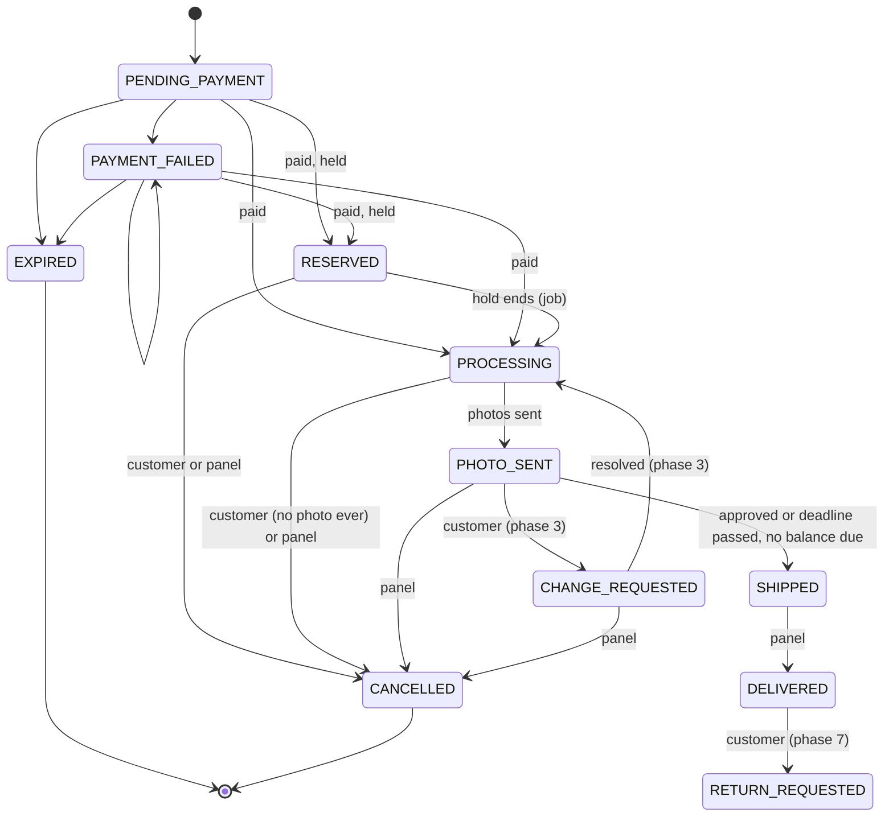
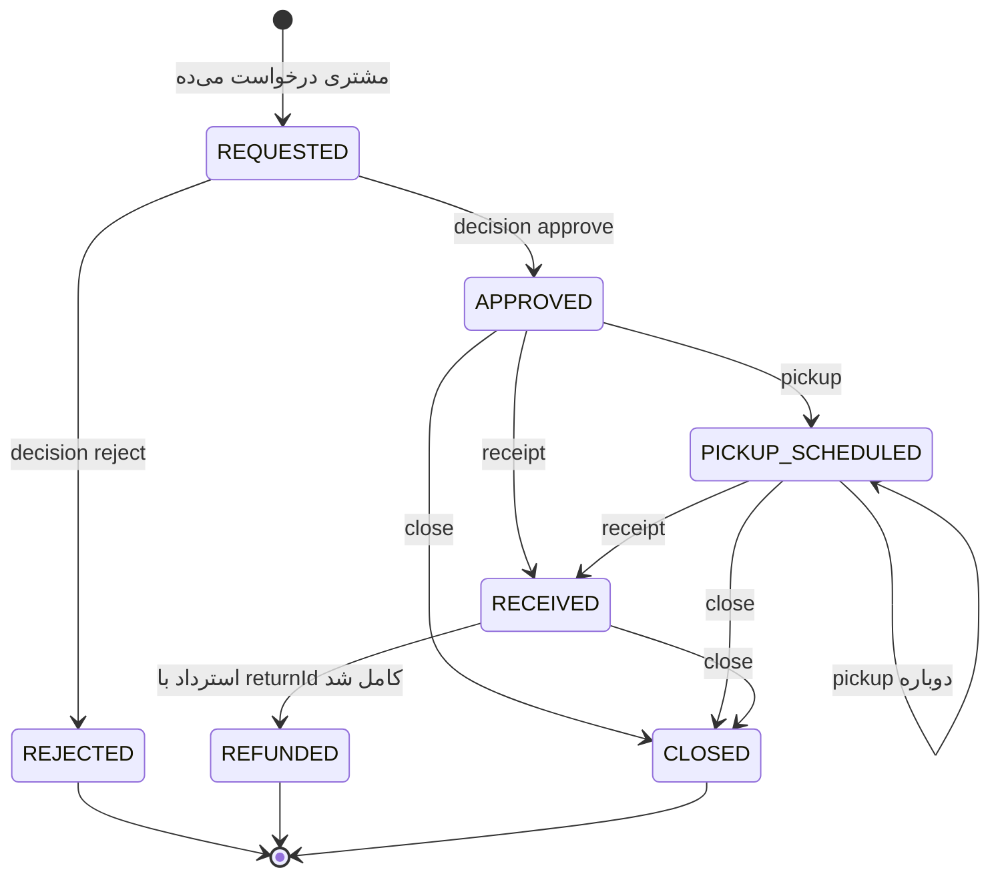

# نقشه‌ی راه تکمیل کیوا: پنل ادمین و باقی فروشگاه

> **kiva-be · completion · v1** · ۲۵ مهر ۱۴۰۵
>
> پایه: کانترکت API نسخه‌ی **1.7.0** (هر فاز با گام ۰ نسخه رو یه پله بالا می‌بره)، کد `main` در کامیت `1f93595`، اسکیل‌های بک‌اند شرکت (نسخه‌ی خودت در `Music\skills`)، و قراردادهای `COMMON_ROADMAP.md`، سند معماری کاتالوگ، سند معماری ورود و `PURCHASE_ROADMAP.md`.
>
> این سند نقشه‌ی ساختن **همه‌ی** endpointهاییه که از کانترکت مونده: ۱۳۱ تا از ۱۷۸ تا. وقتی فاز ۱۵ تموم بشه، هیچ endpoint ِ ساخته‌نشده‌ای نه تو فروشگاه می‌مونه، نه تو پنل ادمین. سند برای تیمی نوشته شده که باید بدون حدس زدن پیاده‌سازی کنه: هر قانون بیزنسی، هر جدول، هر UseCase، ترتیب هر خطا و تست‌هایی که ثابت می‌کنن کار درسته، همین‌جا نوشته شده. هر جا کانترکت مبهم یا متناقض بوده، تصمیمش اینجا گرفته شده و اصلاح کانترکتش تو گام ۰ ِ همون فاز اومده.
>
> روش کار مثل قبل: هر فاز برنچ خودش رو داره، هر گام یه کامیت. تو می‌گی کدوم گام، و هیچ گامی خودبه‌خود شروع نمی‌شه. وقتی گامی تموم شد، تیکش زده می‌شه و یه خط به «گزارش کار» آخر فایل اضافه می‌شه.

---

## فهرست

0. [در یک نگاه](#0)
1. [تصمیم‌های اصلی (همه‌ی فازها)](#1)
2. [مرز: همه‌ی ۱۳۱ endpoint و فازشون](#2)
3. [از چی محافظت می‌کنیم](#3)
4. [قانون‌های کد که همه‌ی فازها رعایت می‌کنن](#4)
5. [زیرساخت مشترک پنل: لاگ تغییرات، مدیا، نسخه و If-Match، نقش‌ها](#5)
6. [فاز ۱: پنل کاتالوگ و مدیا](#p1)
7. [فاز ۲: کار روی سفارش](#p2)
8. [فاز ۳: درخواست تغییر بعد از عکس](#p3)
9. [فاز ۴: تنظیمات، کد تخفیف، مشتری و گزارش](#p4)
10. [فاز ۵: حداقل محتوا](#p5)
11. [فاز ۶: انتشار](#p6)
12. [فاز ۷: مرجوعی](#p7)
13. [فاز ۸: نظرها](#p8)
14. [فاز ۹: علاقه‌مندی‌ها و داشبورد حساب](#p9)
15. [فاز ۱۰: «موجود شد خبرم کن» و «سؤال داری؟»](#p10)
16. [فاز ۱۱: بازاریابی و صفحه‌ی خانه](#p11)
17. [فاز ۱۲: جستجوی زنده](#p12)
18. [فاز ۱۳: تماس و خبرنامه](#p13)
19. [فاز ۱۴: حذف حساب و فاکتور](#p14)
20. [فاز ۱۵: بلاگ](#p15)
21. [همه‌ی migrationها](#21)
22. [ساختار پوشه‌ها](#22)
23. [پیکربندی، رازها و لاگ](#23)
24. [همه‌ی پیامک‌ها](#24)
25. [همه‌ی کارهای زمان‌بندی‌شده](#25)
26. [عمداً نه در این سند](#26)
27. [فرق با اسکیل شرکت](#27)
28. [سؤال‌های باز](#28)
29. [گزارش کار](#29)

---

<a id="0"></a>
## ۰. در یک نگاه

**الان چی داریم:** کاتالوگ فروشگاه، ورود و حساب، و کل خرید (سبد، تسویه، سفارش، پرداخت، سفارش‌های من، رزرو ۴ روزه، کد تخفیف). یعنی ۴۷ endpoint از ۱۷۸ تا. مشتری می‌تونه بخره و پول بده، ولی:

- هیچ راهی برای گذاشتن محصول واقعی نیست. محصول‌ها فقط از seed میان و `image` همه‌جا `null` ـه.
- سفارش پرداخت‌شده برای همیشه `PROCESSING` می‌مونه: کسی نمی‌تونه عکس قبل از ارسال بفرسته، ارسال و کد رهگیری ثبت کنه یا سفارش رو لغو کنه.
- از پنل ادمین فقط «لیست مشتری‌ها» و «تعیین نقش» ساخته شده.

**۱۵ فاز، در سه بخش:**

| # | فاز | endpoint | برنچ | کانترکت | کِی |
|---|---|---|---|---|---|
| ۱ | پنل کاتالوگ و مدیا (و پایه‌ی لاگ تغییرات) | ۲۴ | `panel-catalog` | 1.8.0 | قبل از انتشار |
| ۲ | کار روی سفارش: عکس، ارسال، رهگیری، لغو، استرداد | ۱۶ | `panel-orders` | 1.9.0 | قبل از انتشار |
| ۳ | درخواست تغییر بعد از عکس و پرداخت مانده | ۱ (و دو endpoint ِ موجود کامل می‌شن) | `change-requests` | 1.10.0 | قبل از انتشار |
| ۴ | تنظیمات، کد تخفیف، جزئیات مشتری، گزارش | ۸ | `panel-settings` | 1.11.0 | قبل از انتشار |
| ۵ | حداقل محتوا: `/config`، صفحه‌های ثابت، سؤالات متداول، نوار اطلاعیه | ۹ | `content-basics` | 1.12.0 | قبل از انتشار |
| ۶ | انتشار: سرور، بکاپ، اسکریپت deploy، حساب‌ها، دور واقعی | — | `launch` | — | انتشار |
| ۷ | مرجوعی و آپلود مشتری | ۸ | `returns` | 1.13.0 | بعد از انتشار |
| ۸ | نظرها | ۱۲ | `reviews` | 1.14.0 | بعد از انتشار |
| ۹ | علاقه‌مندی‌ها و داشبورد حساب | ۱۱ | `wishlist` | 1.15.0 | بعد از انتشار |
| ۱۰ | «موجود شد خبرم کن» و «سؤال داری؟» | ۵ | `stock-alerts` | 1.16.0 | بعد از انتشار |
| ۱۱ | بازاریابی و صفحه‌ی خانه | ۱۷ | `marketing` | 1.17.0 | بعد از انتشار |
| ۱۲ | جستجوی زنده | ۲ | `search` | 1.18.0 | بعد از انتشار |
| ۱۳ | تماس و خبرنامه | ۷ | `contact` | 1.19.0 | بعد از انتشار |
| ۱۴ | حذف حساب و فاکتور PDF | ۳ | `account-closure` | 1.20.0 | بعد از انتشار |
| ۱۵ | بلاگ | ۸ (و ۲ endpoint ِ خوندنی ِ تازه‌ی پنل) | `blog` | 1.21.0 | بعد از انتشار |
| | **جمع** | **۱۳۱** | | | |

**چرا این ترتیب:**

- **۱ قبل از ۲:** بدون محصول واقعی، خرید واقعی هم نیست. آپلود مدیایی که فاز ۱ می‌سازه، عکس قبل از ارسال ِ فاز ۲ رو هم نگه می‌داره. لاگ تغییرات هم اینجا ساخته می‌شه، چون از اولین نوشتن پنل لازمه.
- **پنل بعد از فاز ۱ روی سرور می‌ره** (فاز ۶ یه گام زودهنگام داره)، تا وارد کردن محصول‌های واقعی، که با عکاسی وقت‌گیره، همزمان با ساخت فاز ۲ جلو بره.
- **۳ قبل از انتشار:** طبق تصمیم لغو (بخش ۱، ردیف ۷)، بعد از فرستادن عکس وضعیت عوض شده و مشتری خودش لغو نمی‌کنه. پس درخواست تغییر تنها راهشه، و سؤالات متداول هم قولش رو داده: «تا قبل از ارسال می‌تونی رنگ یا مدل رو عوض کنی».
- **۴ و ۵ قبل از انتشار:** تنظیمات و کد تخفیف تا الان با SQL عوض می‌شن، و صفحه‌ی قوانین برای اینماد لازمه.
- **مرجوعی بعد از انتشار:** تا اون موقع با تماس تلفنی و استرداد دستی (فاز ۲) جلو می‌ره.
- **نظرها بعد از مرجوعی:** نظر به سفارش تحویل‌شده وصله، و اولین سفارش‌ها بعد از انتشار تحویل می‌شن.
- **۹ بعد از ۸:** داشبورد حساب شمارنده‌ی نظرها رو هم نشون می‌ده.
- **بلاگ آخر:** فروش رو جلو نمی‌بره، ولی کانترکت داره و پنل براش فرم ساخته، پس ساخته می‌شه تا هیچ endpoint ِ پنلی نمونه.

### وضعیت فازها

| فاز | گام‌ها | وضعیت |
|---|---|---|
| ۱ | ۱.۰ تا ۱.۱۰ | ⬜ |
| ۲ | ۲.۰ تا ۲.۱۱ | ⬜ |
| ۳ | ۳.۰ تا ۳.۵ | ⬜ |
| ۴ | ۴.۰ تا ۴.۵ | ⬜ |
| ۵ | ۵.۰ تا ۵.۵ | ⬜ |
| ۶ | ۶.۱ تا ۶.۹ | ⬜ |
| ۷ | ۷.۰ تا ۷.۶ | ⬜ |
| ۸ | ۸.۰ تا ۸.۶ | ⬜ |
| ۹ | ۹.۰ تا ۹.۵ | ⬜ |
| ۱۰ | ۱۰.۰ تا ۱۰.۴ | ⬜ |
| ۱۱ | ۱۱.۰ تا ۱۱.۷ | ⬜ |
| ۱۲ | ۱۲.۰ تا ۱۲.۳ | ⬜ |
| ۱۳ | ۱۳.۰ تا ۱۳.۵ | ⬜ |
| ۱۴ | ۱۴.۰ تا ۱۴.۴ | ⬜ |
| ۱۵ | ۱۵.۰ تا ۱۵.۵ | ⬜ |

جدول گام‌های هر فاز اول بخش همون فازه.

---

<a id="1"></a>
## ۱. تصمیم‌های اصلی (همه‌ی فازها)

قانون‌های عمومی سندهای قبلی اینجا هم برقرارن: یک تراکنش برای هر UseCase، `Cmd` و `Qry` با مقدار خام، منطق فقط تو دامنه، Flyway، لاگ ورودی هر UseCase، تست اجباری برای هر Aggregate و Domain Service، وضعیت HTTP از `FailureKind`، و «کانترکت اول». بخش ۴ همه‌شون رو برای تیم یه جا جمع کرده. این جدول تصمیم‌های این سنده. ردیف‌های ۱ تا ۱۰ رو خودت گرفتی (۲۱ و ۲۵ مهر ۱۴۰۵).

| # | موضوع | تصمیم | چرا |
|---|---|---|---|
| 1 | مرز | همه‌ی ۱۳۱ endpoint ِ مونده‌ی کانترکت 1.7.0. هیچ endpoint ِ پنلی نمی‌مونه، بلاگ هم | پنل برای همه‌شون فرم ساخته، و فروشگاه بدون هیچ‌کدومشون کامل نیست |
| 2 | مدیا | فایل‌ها روی دیسک همین سرور، زیر یه پوشه‌ی پیکربندی‌شده. nginx مستقیم سروشون می‌کنه و CDN آروان کششون می‌کنه | سرور فعلی تستیه و بعداً بزرگ‌تر می‌شه؛ حجم دغدغه نیست. بعداً جابه‌جایی به object storage فقط یه آداپتر تازه‌ست (پورت `MediaStorage`) |
| 3 | استرداد وجه | **دستی.** سرور فقط ثبتش می‌کنه: `PENDING` ← `PROCESSING` ← `COMPLETED` (با شماره‌ی پیگیری بانک) یا `FAILED`. هیچ تماس بانکی یا درگاهی برای برگردوندن پول نیست | فرایند بانکی خودکار نداریم. `reverse` ِ زرین‌پال فقط تا ۳۰ دقیقه کار می‌کنه |
| 4 | شماره شبا | **تلفنی** از مشتری گرفته می‌شه و تو سیستم ذخیره نمی‌شه. نه در لغو، نه در مرجوعی | داده‌ی مالی‌ای که نگه نمی‌داریم، لو هم نمی‌ره. ادمین شبا رو تو اپ بانک می‌زنه و فقط شماره‌ی پیگیری رو ثبت می‌کنه |
| 5 | لغو مشتری | مشتری فقط وقتی خودش لغو می‌کنه که **وضعیت سفارش هنوز عوض نشده**: `PROCESSING` یا `RESERVED`، و هیچ عکسی براش فرستاده نشده. بعد از عکس، لغو از راه درخواست تغییر (فاز ۳) یا اپراتور انجام می‌شه | تصمیم بیزنس. از لحظه‌ی عکاسی، کار اپراتور شروع شده |
| 6 | اعتبار کیف پول | `STORE_CREDIT` نداریم و از کانترکت حذف می‌شه | کیف پولی پشتش نیست |
| 7 | لاگ تغییرات | هر نوشتن موفق پنل یه ردیف، **۹۰ روز** نگه داشته می‌شه. هر شب ردیف‌های قدیمی‌تر پاک می‌شن (پنجره‌ی غلتان) | کمتر جا بگیره. تاریخچه‌ی دائمی محصول، موجودی و سفارش از قبل تو event store هست (با `occurredByUserId`)، و تغییر نقش‌ها تو `securityevent_tbl` |
| 8 | عکس قبل از ارسال | **فقط دستی.** اپراتور عکس رو تو پنل آپلود می‌کنه، خودش با گوشی تو پیام‌رسان مشتری می‌فرسته، و `send` با `manual = true` ثبتش می‌کنه. بات پیام‌رسان نداریم | سه بات (روبیکا، تلگرام، بله) کار جداییه، و بات تلگرام نمی‌تونه اولین پیام رو به کسی بده |
| 9 | avif | ساخته نمی‌شه. فقط webp در چند اندازه، thumbnail، `blurhash` و فریم کاور ویدیو | انکود avif روی سرور ۲ هسته‌ای کنده |
| 10 | درخواست تغییر و مرجوعی | درخواست تغییر فاز خودش رو داره و قبل از انتشاره (فاز ۳). مرجوعی بعد از انتشاره (فاز ۷) | ردیف ۵ |
| 11 | ذخیره‌سازی | برای هر Aggregate جدا: رویدادهای تازه‌ی سفارش و محصول همون ES ِ قبلی. استرداد، مرجوعی، یادداشت، مدیا، لاگ تغییرات، نظر، علاقه‌مندی، هشدار موجودی، محتوا و بلاگ جدول معمولی | سفارش و محصول تاریخچه‌شون مهمه و از قبل ES ان. بقیه یا رکورد ساده‌ان یا محتوایی که تاریخچه‌ش ارزش نداره |
| 12 | لاگ تغییرات کجا نوشته می‌شه | **داخل UseCase و در همون تراکنش**، با پورت `AuditTrail`. نه با middleware ِ HTTP | باید با کار rollback بشه، و «از چی به چی» رو فقط UseCase می‌دونه |
| 13 | همزمانی در پنل | فقط `PUT /admin/products/{productId}` هدر `If-Match` می‌گیره (کانترکت): نسخه‌ی قدیمی ← `412`. بقیه‌ی نوشتن‌ها مثل الان: دو ذخیره‌ی همزمان ← `409 CHANGED_BY_SOMEONE_ELSE` | کانترکت؛ و فرم محصول بلندترین فرمه و بیشترین خطر رو داره |
| 14 | پیامک | همه با الگوی تأییدشده‌ی فراز. **متن آزاد پیامک نداریم.** هر پیامک تازه یه الگو و یه متد تو `SmsSender` داره، و تا الگو تأیید نشده فرستاده نمی‌شه (WARN) | فراز فقط الگو می‌فرسته. متن آزاد یعنی ریسک اسپم و مسدود شدن خط |
| 15 | ایمیل | پورت `EmailSender` با پیاده‌سازی `log` (پیش‌فرض) و SMTP (فاز ۱۳). تا SMTP پیکربندی نشده، جواب ایمیلی پیام تماس فقط لاگ می‌شه | کانترکت جواب تماس رو با ایمیل هم می‌خواد، و ارائه‌دهنده‌ی ایمیل هنوز انتخاب نشده |
| 16 | متن فارسی | فقط لایه‌ی HTTP می‌سازدش (`*Texts`). دامنه و application فقط کد و عدد تولید می‌کنن. جمله‌ی لاگ تغییرات (`summary`) هم موقع خوندن ساخته می‌شه | قانون پروژه |
| 17 | کار خودکار سیستم | با `UserId.SYSTEM` انجام می‌شه و تو لاگ تغییرات ثبت نمی‌شه | کانترکت بخش ۲ |
| 18 | ستون تازه‌ی read model | با یه migration که خودش از روی داده‌ی موجود پرش می‌کنه (مثل V6 و V7). ابزار بازسازی read model از رویدادها ساخته نمی‌شه (بخش ۲۶) | هر ستونی که این سند لازم داره از جدول‌ها یا `eventstore_tbl` با SQL درمیاد |
| 19 | کانترکت اول | هر فاز با گام ۰ شروع می‌شه: همه‌ی تغییرات کانترکتِ همون فاز، و یه پله نسخه. هر چیزی که وسط پیاده‌سازی لازم شد، یه ردیف تازه به جدول تغییرات کانترکت همون فاز | سؤال «طبق کانترکته؟» همیشه یه جواب داره |
| 20 | فرانت | کد kiva-fe و پنل هیچ‌وقت دلیل طراحی نیست. فرانت خودش رو با کانترکت هماهنگ می‌کنه. هر فاز یه سند `docs/FRONTEND_*.md` برای فرانت داره | قانون پروژه |

---

<a id="2"></a>
## ۲. مرز: همه‌ی ۱۳۱ endpoint و فازشون

مسیرها زیر `/api/v1` ان. ستون «گام» به گام‌های بخش همون فاز اشاره می‌کنه.

### فاز ۱: پنل کاتالوگ و مدیا (۲۴)

| endpoint | گام |
|---|---|
| `GET /admin/audit-log` | ۱.۱ |
| `POST /admin/media` | ۱.۲ |
| `GET`، `POST /admin/categories` · `PUT`، `DELETE /admin/categories/{categoryId}` | ۱.۳ |
| `POST /admin/colors` · `PUT`، `DELETE /admin/colors/{colorKey}` | ۱.۳ |
| `GET`، `POST /admin/materials` · `PUT`، `DELETE /admin/materials/{materialId}` | ۱.۳ |
| `GET /admin/products` · `GET /admin/products/{productId}` | ۱.۴ |
| `POST /admin/products` · `PUT /admin/products/{productId}` | ۱.۵ |
| `PATCH /admin/products/{productId}/status` · `DELETE /admin/products/{productId}` | ۱.۶ |
| `POST /admin/products/{productId}/variants` · `PUT`، `DELETE /admin/products/{productId}/variants/{variantId}` | ۱.۷ |
| `POST`، `GET /admin/inventory/adjustments` | ۱.۸ |

و تغییر endpointهای موجود: `image`، `hoverImage`، گالری رنگ‌ها، تصویر سبد و تصویر ردیف سفارش از گام ۱.۹ واقعی می‌شن.

### فاز ۲: کار روی سفارش (۱۶)

| endpoint | گام |
|---|---|
| `GET /admin/orders` · `GET /admin/orders/{orderCode}` | ۲.۳ |
| `POST /admin/orders/{orderCode}/notes` | ۲.۴ |
| `PUT /admin/orders/{orderCode}/pre-shipment-media` · `POST /admin/orders/{orderCode}/pre-shipment-media/send` | ۲.۵ |
| `GET /me/orders/{orderCode}/media` · `POST /me/orders/{orderCode}/media-feedback` (فقط `APPROVE`؛ `REQUEST_CHANGE` با فاز ۳) | ۲.۵ |
| `POST /admin/orders/{orderCode}/refunds` · `PATCH /admin/refunds/{refundId}` | ۲.۶ |
| `POST /admin/orders/{orderCode}/status` (لغو) · `POST /me/orders/{orderCode}/cancel` | ۲.۷ |
| `PUT /admin/orders/{orderCode}/shipment` · `POST /admin/orders/{orderCode}/status` («تحویل شد») | ۲.۸ |
| `GET /me/tracking` · `POST /tracking/lookup` · `GET /tracking/daily/days` · `GET /tracking/daily` | ۲.۹ |

و تغییر endpointهای موجود: `actions`، `preShipmentMedia`، `shipment`، `refunds` و `totals.refunded` ِ `GET /me/orders/{orderCode}` واقعی می‌شن؛ `totalSpent` ِ `/admin/customers` مبلغ برگشتی رو کم می‌کنه.

### فاز ۳: درخواست تغییر (۱)

`POST /admin/orders/{orderCode}/change-request/resolution`، به‌علاوه‌ی `REQUEST_CHANGE` ِ `POST /me/orders/{orderCode}/media-feedback` و پرداخت مانده (`balanceDue`) با `POST /me/orders/{orderCode}/payments` ِ موجود.

### فاز ۴: تنظیمات، کد تخفیف، مشتری، گزارش (۸)

`GET`، `PUT /admin/settings` · `GET`، `POST /admin/discount-codes` · `PUT`، `DELETE /admin/discount-codes/{discountId}` · `GET /admin/customers/{customerId}` · `GET /admin/reports/overview`

### فاز ۵: حداقل محتوا (۹)

`GET /config` · `GET /pages/{slug}` · `GET /admin/pages` · `PUT /admin/pages/{slug}` · `GET /faq` · `GET`، `PUT /admin/faq/groups` · `GET`، `PUT /admin/announcements`

نوار اطلاعیه از فاز ۱۱ به اینجا اومده، چون `/config` اطلاعیه‌های فعال رو برمی‌گردونه.

### فاز ۷: مرجوعی (۸)

`POST /me/uploads` · `POST /me/orders/{orderCode}/returns` · `GET /me/returns` · `GET /admin/returns` · `POST /admin/returns/{returnId}/decision` · `PUT /admin/returns/{returnId}/pickup` · `POST /admin/returns/{returnId}/receipt` · `POST /admin/returns/{returnId}/close`

### فاز ۸: نظرها (۱۲)

`GET`، `POST /products/{productId}/reviews` · `GET /products/{productId}/reviews/summary` · `PUT /reviews/{reviewId}/helpful` · `GET /me/reviews` · `PATCH`، `DELETE /me/reviews/{reviewId}` · `GET /me/reviews/pending-products` · `GET /admin/reviews` · `POST /admin/reviews/{reviewId}/moderation` · `PUT`، `DELETE /admin/reviews/{reviewId}/reply`

### فاز ۹: علاقه‌مندی‌ها و داشبورد (۱۱)

`GET`، `DELETE /me/wishlist` · `GET /me/wishlist/ids` · `PUT`، `DELETE /me/wishlist/items/{productId}` · `POST /me/wishlist/add-to-cart` · `POST`، `DELETE /me/wishlist/share` · `GET /wishlists/shared/{token}` · `POST /cart/items/{itemId}/move-to-wishlist` · `GET /me/dashboard`

### فاز ۱۰: «موجود شد خبرم کن» و «سؤال داری؟» (۵)

`POST /products/{productId}/stock-alerts` · `GET /me/stock-alerts` · `DELETE /me/stock-alerts/{alertId}` · `GET /admin/stock-alerts` · `GET /products/{productId}/inquiry`

### فاز ۱۱: بازاریابی و خانه (۱۷)

`GET /home` · `GET /banners` · `GET /campaigns/active` · `GET /testimonials` · `GET /site/stats` · `GET`، `POST /admin/campaigns` · `PUT`، `DELETE /admin/campaigns/{campaignId}` · `GET`، `POST /admin/banners` · `PUT`، `DELETE /admin/banners/{bannerId}` · `GET`، `POST /admin/testimonials` · `PUT`، `DELETE /admin/testimonials/{testimonialId}`

### فاز ۱۲: جستجو (۲)

`GET /search/suggest` · `GET /search/hints`

### فاز ۱۳: تماس و خبرنامه (۷)

`GET /contact/topics` · `POST /contact/messages` · `POST /newsletter/subscriptions` · `POST /newsletter/subscriptions/unsubscribe` · `GET /admin/contact-messages` · `PATCH /admin/contact-messages/{ticketCode}` · `GET /admin/newsletter/subscriptions`

### فاز ۱۴: حذف حساب و فاکتور (۳)

`POST /me/deletion/request` · `DELETE /me` · `GET /me/orders/{orderCode}/invoice`

### فاز ۱۵: بلاگ (۸)

`GET /blog/categories` · `GET /blog/posts` · `GET /blog/posts/{idOrSlug}` · `GET /blog/posts/{postId}/related` · `POST /blog/posts/{postId}/feedback` · `POST /admin/blog/posts` · `PUT`، `DELETE /admin/blog/posts/{postId}`

به‌علاوه‌ی دو endpoint ِ **تازه** که کانترکت 1.7.0 نداشت و پنل بدونشون پیش‌نویس‌ها رو نمی‌بینه: `GET /admin/blog/posts` و `GET /admin/blog/posts/{postId}` (فاز ۱۵، تصمیم ۲). جزو شمارش ۱۳۱ تا نیستن.

### شمارش

| | فروشگاه | پنل | جمع |
|---|---|---|---|
| قبل از انتشار (فاز ۱ تا ۵) | ۱۰ | ۴۸ | ۵۸ |
| بعد از انتشار (فاز ۷ تا ۱۵) | ۴۱ | ۳۲ | ۷۳ |
| **جمع** | ۵۱ | ۸۰ | **۱۳۱** |

`GET /admin/customers` و `PUT /admin/customers/{customerId}/roles` از قبل ساخته شدن و جزو این ۱۳۱ تا نیستن (فاز ۴ فقط یه فیلتر به اولی اضافه می‌کنه).

---

<a id="3"></a>
## ۳. از چی محافظت می‌کنیم

هر ردیف یه خطر واقعی برای پول، داده یا سایته. ستون آخر می‌گه دفاعش تو کدوم گام ساخته و تست می‌شه. گام آخر هر فاز («ریویو») جلوی ردیف‌های همون فاز اسم تستی رو می‌نویسه که ازش محافظت می‌کنه، و نگهبانش رو یه بار عمداً خراب می‌کنه تا ببینه تست قرمز می‌شه.

| # | خطر | چطور پیش میاد | دفاع | گام |
|---|---|---|---|---|
| 1 | بالا رفتن دسترسی | کاربر `CUSTOMER` یا `OPERATOR` endpoint ِ تنظیمات یا استرداد رو صدا می‌زنه | هر route ِ `/admin` با `requireRoles` و دقیقاً نقش‌های `x-roles` ِ کانترکت. `RouteGuardsTest` هر route ِ پنل رو بدون توکن و با هر نقش ناکافی صدا می‌زنه و با کانترکت مقایسه می‌کنه | ۱.۰ و همه |
| 2 | آخرین ADMIN حذف بشه | دو ادمین همزمان نقش هم رو برمی‌دارن | قانون «آخرین ADMIN نقشش رو از دست نمی‌ده» با قفل advisory ِ نقش‌ها | ۴.۳ |
| 3 | فایل مخرب | فایل اجرایی با پسوند `.jpg`، SVG با اسکریپت، «بمب فشرده‌سازی» (عکس ۱ مگی که ۲۰۰ مگاپیکسله)، مسیر `../` در اسم فایل | نوع فایل از روی محتوا (libvips/ffprobe)، نه پسوند و نه هدر. فقط jpeg/png/webp و mp4. سقف حجم موقع خوندن جریان، سقف ابعاد قبل از decode. اسم فایل روی دیسک همیشه تصادفیه و اسم کلاینت هیچ‌جا استفاده نمی‌شه. خروجی همیشه دوباره انکود می‌شه (EXIF و GPS پاک) | ۱.۲، ۷.۱ |
| 4 | XSS ِ ذخیره‌شده | ادمین یا ادیتور تو توضیح محصول، صفحه‌ی ثابت، پاسخ سؤال یا بلاگ `<script>` یا `onerror` می‌ذاره | هر HTML از `HtmlSanitizer` (jsoup، فقط تگ‌های کانترکت) **قبل** از ذخیره رد می‌شه. لینک نسبی (`/faq#reserve`) مجاز، `javascript:` نه | ۱.۵، ۵.۱، ۵.۲، ۱۵.۲ |
| 5 | بازنویسی همزمان | دو ادمین یه محصول رو باز کردن و هر دو ذخیره می‌کنن | `If-Match` با نسخه‌ی محصول ← `412`. دو ذخیره در یک لحظه ← قید یکتای event store ← `409 CHANGED_BY_SOMEONE_ELSE` | ۱.۵ |
| 6 | استرداد بیشتر از پرداخت | دو ادمین همزمان استرداد ثبت می‌کنن، یا جمع استردادها از مبلغ پرداخت‌شده بیشتر می‌شه | قفل ردیف سفارش در read model (`FOR UPDATE`) موقع ثبت استرداد، و قانون «جمع استردادهای غیر `FAILED` ≤ مبلغ پرداخت‌شده» در دامنه. `CHECK` ِ دیتابیس دیوار دومه | ۲.۶ |
| 7 | ارسال سفارش بدهکار یا لغوشده | اپراتور کد رهگیری سفارشی رو می‌زنه که مانده‌ی پرداخت داره یا همین الان لغو شده | `ship` در Aggregate فقط از `PHOTO_SENT` (یا `PROCESSING` با اجازه‌ی صریح) و با `balanceDue = 0`. لغو و ارسال همزمان: قید یکتای stream ِ سفارش | ۲.۸، ۳.۴ |
| 8 | فروش بیشتر از موجودی در درخواست تغییر | رنگ تازه رزرو می‌شه در حالی که همزمان آخرینش فروخته می‌شه | رزرو رنگ تازه با همون `InventoryDomainService` و ترتیب قفل بخش ۱۱ ِ خرید | ۳.۳ |
| 9 | دو بار برگردوندن موجودی | لغو دوباره یا همزمان | `releaseForOrder` بی‌اثر بار دوم (از قبل). لغو در Aggregate فقط یک بار | ۲.۷ |
| 10 | پیدا کردن سفارش دیگران با رهگیری مهمان | کسی کدهای `KV-` رو با موبایل‌های حدسی امتحان می‌کنه | هر دو لازمن و باید با هم جور باشن. جواب «پیدا نشد» برای هر دو حالت یکیه. سقف ۱۰ بار در ۱۰ دقیقه برای هر IP (کانترکت) | ۲.۹ |
| 11 | لو رفتن داده در رهگیری روزانه | لیست عمومی کدهای رهگیری اسم و شهر گیرنده رو نشون می‌ده | فقط نسخه‌ی ماسک‌شده (طبق کانترکت) و فقط ۳۰ روز اخیر، یه ردیف برای هر کد رهگیری | ۲.۹ |
| 12 | اسپم پیامک | کسی با فرم «موجود شد خبرم کن» یا تماس، هزار پیامک به یه شماره می‌فرسته | هشدار موجودی فقط برای کاربر واردشده و یکی برای هر رنگ؛ سقف درخواست برای هر IP و هر کاربر | ۱۰.۱، ۱۳.۲ |
| 13 | نظر جعلی | ربات نظر پنج ستاره می‌ذاره | نظر فقط با ورود، با تأیید ادمین قبل از نمایش، و برچسب «خریدار» فقط وقتی سفارش تحویل‌شده‌ی همون محصول مال همون کاربره | ۸.۲ |
| 14 | حدس لینک لیست اشتراکی | کسی توکن لیست علاقه‌مندی رو حدس می‌زنه | توکن `wl_` + ۳۲ نویسه‌ی تصادفی base62 (حدود ۱۹۰ بیت، با `SecureRandom`)، با غیرفعال کردن باطل، سقف درخواست برای هر IP روی endpoint ِ عمومی، و `Cache-Control: no-store` تا CDN لینک باطل‌شده رو سرو نکنه. خود توکن ذخیره می‌شه (نه hash) چون کانترکت اون رو در `GET /me/wishlist` برمی‌گردونه و فقط یه لیست عمومی‌شده رو باز می‌کنه، نه حساب رو | ۹.۳ |
| 15 | لو رفتن داده‌ی شخصی تو لاگ | IP، موبایل یا متن پیام تو لاگ برنامه یا لاگ تغییرات | لاگ برنامه: همون قانون بخش ۱۹ ِ خرید. لاگ تغییرات: موبایل کاربر تو ردیف ذخیره نمی‌شه (موقع خوندن از `user_tbl`)، و بعد از ۹۰ روز پاک می‌شه | ۱.۱ و همه |
| 16 | دستکاری لاگ تغییرات | کسی ردیف لاگ رو عوض یا پاک می‌کنه | trigger ِ دیتابیس: `UPDATE` هیچ‌وقت، `DELETE` فقط برای ردیف‌های قدیمی‌تر از ۹۰ روز | ۱.۱ |
| 17 | حذف حساب با سفارش باز | کاربری که سفارش در راه داره حسابش رو پاک می‌کنه و سفارش بی‌صاحب می‌شه | `422 ACCOUNT_HAS_ACTIVE_ORDERS`. سفارش‌های تموم‌شده بی‌نام می‌شن، نه پاک (سند مالی‌ان) | ۱۴.۲ |
| 18 | پر شدن دیسک با فایل یتیم | آپلودهایی که هیچ‌وقت به چیزی وصل نشدن | job روزانه: مدیای وصل‌نشده‌ی قدیمی‌تر از ۴۸ ساعت پاک می‌شه. مدیای وصل‌شده هیچ‌وقت (snapshot سفارش‌ها بهش اشاره می‌کنه) | ۱.۲ |
| 19 | خطای منطقه‌ی زمانی | «امروز» ِ رهگیری روزانه، بازه‌ی گزارش یا فیلتر تاریخ لاگ به وقت UTC حساب بشه | همه‌ی «روز»ها با `ShopCalendar.ZONE` (تهران)، و تست مرز ساعت ۲۰:۳۰ ِ UTC | ۱.۱، ۲.۹، ۴.۴ |
| 20 | فرم پنل کار مشتری رو خراب کنه | تغییر قیمت یا غیرفعال کردن رنگ در لحظه‌ی خرید | ترتیب قفل بخش ۱۱ ِ خرید (ردیف محصول، بعد رنگ‌ها) برای هر نویسنده‌ی تازه‌ی read model. ثبت سفارش read model رو داخل تراکنش دوباره می‌خونه (از قبل) | ۱.۵ و ۱.۷ |
| 21 | پرداخت مانده دو بار | مشتری مانده رو دو بار می‌پردازه | همون نگهبان‌های پرداخت (`IdempotencyGuard`، قفل همه‌ی تلاش‌ها، «یک موفق برای هر بدهی») | ۳.۲ |

CSRF اینجا هم خطر نیست: همه‌ی نوشتن‌های پنل و فروشگاه با هدر `Authorization` میان که مرورگر خودش نمی‌فرسته. تنها کوکی (`kiva_rt`) فقط برای `/api/v1/auth` و `DELETE /me` فرستاده می‌شه و `SameSite=Strict` ـه.

---

<a id="4"></a>
## ۴. قانون‌های کد که همه‌ی فازها رعایت می‌کنن

این بخش برای کسیه که اولین بار تو این پروژه کد می‌زنه. هر چیزی که اینجا اومده همین الان تو کد هست و باید **عین همون** تکرار بشه. اگه جایی شک داشتی، نزدیک‌ترین نمونه‌ی موجود رو باز کن (دفترچه‌ی آدرس برای جدول ساده، کد تخفیف برای جدول با سرویس مشترک، محصول برای ES) و از روش بنویس، نه از روی حافظه‌ی پروژه‌ی دیگه.

### ۴.۱ ماژول‌ها و جای هر چیز

| ماژول | پوشه | پکیج | چی توش می‌ره | چی هرگز |
|---|---|---|---|---|
| common | `common/` | `com.kiva.common` | `Result` و عملگرهاش، `ResultFailure` و `FailureKind`، `CommandUseCase`/`QueryUseCase`، `TransactionManager`، `Pageable`/`Page`، `Patch`، `Money`، `Quantity`، `Slug`، `IranianMobileNumber`، `UserId`، پایه‌ی ES، `normalizePersian` | هر چیزی که مال یه فیچره |
| domain | `domain/` | `com.kiva.domain.aggregate.<name>` | Aggregate، VO، policy، Domain Service، **interface** ِ Repository و IdGenerator | Ktor، Exposed، Koin، serialization، coroutines، ساعت، متن فارسی |
| application | `application/` | `com.kiva.application` | UseCaseها (`usecase/<feature>/usecase/command|query/<VerbNoun>Uc.kt`)، سرویس‌های مشترک (`usecase/<feature>/<Name>.kt`)، پورت‌ها (`port/`)، پورت‌های read model (`repository/<X>QmRepository.kt`)، DTOها (`dto/<X>Dto.kt`) | فریمورک، SQL |
| ریشه | `src/` | `com.kiva.infrastructure` | جدول‌های Exposed و `*RepositoryImpl`، Projectorها، routeها، DI، پیکربندی، jobها، آداپترهای پیامک و درگاه و مدیا، migrationهای Flyway (`src/main/resources/db/migration`) | منطق بیزنس |

**دو `usecase`:** مسیر درست `application/.../usecase/address/usecase/command/AddAddressUc.kt` ـه. **املای `persistence`** درسته (اسکیل شرکت `persistance` نوشته).

**ترتیب ساختن یه فیچر تازه** (همیشه همین):

1. کانترکت: operation با `x-roles` در **یک خط**، `security`، کدهای خطای تازه در `ErrorCode`، شِماها.
2. migration تازه: `V<بعدی>__<اسم_با_زیرخط>.sql`. migration ِ اعمال‌شده هیچ‌وقت ویرایش نمی‌شه.
3. دامنه: `aggregate/<name>/{entity, model/valueobject, model/policy, repository}` و `<Name>DomainService.kt` (در ریشه‌ی پکیج aggregate، نه در زیرپوشه) و تست‌های دامنه.
4. application: DTO، UseCaseها، پورت‌ها.
5. infrastructure: `tbl/<Name>Tbl.kt`، `<Name>RepositoryImpl.kt`، DI (`DaoModule` ← `DomainServiceModule` ← `UseCaseModule`)، `HttpServer.configureRouting` (`by inject<>()` و mount) و `web/webV1<Area>.kt` با مدل‌های request/response.
6. تست هر لایه (۴.۹).

### ۴.۲ Value Object

```kotlin
@JvmInline
value class PageSlug private constructor(val value: String) {
    // Second wall: makeNew already refuses bad input with a Failure, so this only fails on broken stored data. A bug: stop loudly.
    init { require(isValid(value)) { "Invalid PageSlug '$value'" } }

    companion object {
        fun makeNew(raw: String?): Result<PageSlug, Failure> = ...
        /** For values read back from storage. Still checked by `init`. */
        fun constructFromPersisted(value: String): PageSlug = PageSlug(value)
    }

    sealed class Failure(code: String) : ResultFailure(code, FailureKind.INVALID, field = "slug") {
        data object Invalid : Failure("PAGE_SLUG_INVALID")
    }
}
```

- سازنده `private`. ورودی کاربر با `makeNew(raw)` که `Result<VO, VO.Failure>` می‌ده؛ داده‌ی ذخیره‌شده با `constructFromPersisted`. اسم `of` دیگه استفاده نمی‌شه.
- تک‌مقداری‌ها `@JvmInline value class`؛ چندمقداری‌ها `class`/`data class` با سازنده‌ی `private`.
- متن trim می‌شه. کد و عدد `normalizeDigits()`. متنی که همون‌طور نمایش داده می‌شه `normalizePersianLetters()`. متن جستجو و اسم یکتا `normalizePersian()`.
- VO ِ داده‌ی شخصی `toString()` ِ ستاره‌دار داره: `PostalCode.toString() = "PostalCode(***)"`.
- هر قانون VO یه `CHECK` ِ هم‌معنی تو migration داره.
- در تست هیچ‌وقت `any()` ِ MockK برای VO ای که `init { require }` داره.

### ۴.۳ Failure و `FailureKind`

| `FailureKind` | HTTP | کِی |
|---|---|---|
| `INVALID` | 400 | ورودی بدشکل. با `field` همیشه `400 VALIDATION_ERROR` با `errors[]` جواب داده می‌شه و کد خودش فقط تو `errors[].code` می‌مونه |
| `UNAUTHORIZED` | 401 | |
| `FORBIDDEN` | 403 | |
| `NOT_FOUND` | 404 | خود منبع آدرس نیست، یا مال کس دیگه‌ست |
| `CONFLICT` | 409 | تکراری، رقابت، قیمت عوض‌شده |
| `BUSINESS_RULE` | 422 | ورودی درسته، قانون اجازه نمی‌ده |
| `RATE_LIMITED` | 429 | `meta.retryAfterSeconds` هدر `Retry-After` رو هم می‌سازه |
| **`PRECONDITION_FAILED`** (تازه، گام ۱.۰) | 412 | نسخه‌ی `If-Match` با نسخه‌ی فعلی جور نیست |
| **`PAYLOAD_TOO_LARGE`** (تازه، گام ۱.۰) | 413 | `UPLOAD_TOO_LARGE` |
| **`UNSUPPORTED_MEDIA_TYPE`** (تازه، گام ۱.۰) | 415 | `UPLOAD_TYPE_NOT_ALLOWED` |

- اعلام: `data object Name : Parent("UPPER_SNAKE_CODE", FailureKind.X[, field])`؛ با داده برای کلاینت: `data class Name(val x: T) : Parent("CODE", FailureKind.X, meta = mapOf("x" to x.value))`. `meta` فقط مقدار ساده (عدد، رشته، بولی، لیست).
- هر لایه Failure ِ خودش رو داره و Failure ِ لایه‌ی پایین رو با `mapOnFailure(::failureOf)` و یه `when` ِ کامل ترجمه می‌کنه. شاخه‌ی ناممکن `error("...")`.
- **سیاست نوع:** ارجاع به چیزی که **داخل بدنه** نیست (`categoryId` ِ ناموجود) = `INVALID` با `field` (400). منبعِ خودِ آدرس ناموجود یا مال دیگری = `NOT_FOUND` (404)، و شناسه‌ی بدشکل در مسیر هم همون 404 (نه 400، تا معلوم نشه فرمت درست چیه).
- هر کد تازه‌ای که ممکنه به کلاینت برسه، متن فارسی تو `ErrorMessages.kt` می‌گیره (چه تو enum ِ کانترکت باشه چه نه). اگه کلاینت باید روش تصمیم بگیره، تو `ErrorCode` ِ کانترکت هم می‌ره. متن‌ها محاوره‌ای («نمی‌تونی»)، و `{placeholder}` از `meta` پر می‌شه.

### ۴.۴ Aggregate

- سازنده‌ی `private`، ساختن با factory ِ اسم‌دار در `companion object` (`create`، `empty`، `register`، `start`، `place`)، و خوندن با `constructFromPersisted(...)` (جدول ساده) یا سازنده‌ی عمومی `constructor(events: List<...>)` (ES).
- متد تغییر **اول قانون رو چک می‌کنه**، بعد وضعیت رو عوض می‌کنه یا رویداد می‌سازه، و `Result<Self, <Verb>Failure>` برمی‌گردونه. تکرار کاری که انجام شده موفقیته و هیچی ثبت نمی‌کنه.
- **ساعت و کاربر پارامترن:** `now: Instant` و `by: UserId`. دامنه هیچ‌وقت ساعت نمی‌خونه؛ فقط `ShopCalendar` تهران رو می‌شناسه (`ShopCalendar.ZONE`).
- `toString` فقط شناسه نشون می‌ده. KDoc هر Aggregate «قانون‌هایی که خودش نگه می‌داره» و «چیزی که نمی‌تونه بدونه» رو می‌نویسه.
- **ES:** از `EventSourceEntity<XDomainEvent>` ارث می‌بره. فیلدهای value class با `by Delegates.notNull()` و `private set`. `apply(event)` فقط فیلد ست می‌کنه (هیچ قانونی، هیچ ساعتی)؛ یه `check(...)` تو `apply` دیوار دوم در برابر stream ِ خراب. رویداد: `raiseEvent(X(id, nextSequence(), now, by, ...))`. ترتیب فیلدهای رویداد: `<شناسه‌ی aggregate>, sequence, occurredOn, occurredByUserId, <داده‌ی تغییرکرده>, id` (و `id` همیشه آخر با پیش‌فرض `EventId.generate()`). اسم رویداد گذشته و یکتاست و هیچ‌وقت عوض نمی‌شه.
- **Domain Service:** `class <Aggregate>DomainService(...)` فقط با پورت‌های دامنه. **هیچ‌وقت ذخیره نمی‌کنه و تراکنش باز نمی‌کنه.** چیزی رو نگه می‌داره که یه Aggregate تنها نمی‌دونه (جستجوی Aggregate ِ دیگه، شناسه‌ی تازه، قانون بین چند Aggregate). عملیات تک‌Aggregate رو UseCase مستقیم روی Aggregate صدا می‌زنه (Rule 1).
- **Repository:** interface در `domain/.../repository/`، همگام (بدون `suspend`)، `null` برای «نیست». قفل تو اسمش معلومه: `find` (بی‌قفل) در برابر `lockAndFind` / `lockFor…` / `lockByCode`. ES فقط `get(id)` و `save(aggregate)`.

### ۴.۵ UseCase

```kotlin
class AddAddressUc(
    private val transactionManager: TransactionManager,        // first when the Uc opens a transaction
    private val addressBookDomainService: AddressBookDomainService,
    private val addressBookRepository: AddressBookRepository,
    private val clock: Clock,                                   // last
) : CommandUseCase<AddAddressUc.Cmd, AddressId, AddAddressUc.Failure> {

    private val logger = getLogger()

    data class Cmd(val userId: UserId, val address: AddressFields, val setAsDefault: Boolean?)

    override suspend fun execute(command: Cmd): Result<AddressId, Failure> {
        logger.info("AddAddressUc.execute userId=${command.userId.value} setAsDefault=${command.setAsDefault}")
        val input = command.address.toInput().unwrapOr { return Result.failure(Failure.InvalidInput(it.problems)) }
        return transactionManager.inTransaction {
            ...
                .unwrapOr { return@inTransaction Result.failure(it) }
            Result.success(address.id)
        }
    }

    sealed class Failure(code: String, kind: FailureKind, field: String? = null,
                         causes: List<ResultFailure> = emptyList(), meta: Map<String, Any> = emptyMap()) :
        ResultFailure(code, kind, field, causes, meta) {
        data class InvalidInput(val problems: List<ResultFailure>) : Failure("VALIDATION_ERROR", FailureKind.INVALID, causes = problems)
        ...
    }
}
```

۱. اسم `<VerbNoun>Uc`؛ `Cmd`/`Qry`/`Failure` داخل کلاس. فعل‌ها: Query با `Get`/`List`/`Find`، Command با `Add`/`Create`/`Change`/`Update`/`Remove`/`Delete`/`Set`/`Place`/`Start`/`Handle`/`Expire`/`Release`/`Record`/`Resolve`/`Ship`/`Cancel`.

۲. `Cmd`/`Qry` مقدار **خام** می‌گیرن: شناسه‌های مسیر `String`، فیلدهای بدنه nullable. چیزهای از قبل تایپ‌شده: `userId`/`by: UserId`، `pageable: Pageable`، و در پنل **`actor: PanelActor`** (بخش ۵.۱). داده‌ی شخصی در `Cmd` ← `toString` ِ بدون اون.

۳. **ترتیب چک‌ها:** (الف) شکل ورودی با `Result.zip(...)` و `forField(...)` **قبل از تراکنش**، همه‌ی خطاها با هم ← `Failure.InvalidInput` (فرم بزرگ: zipهای تودرتو با `::InputProblems` و `flattenGroups()`)؛ (ب) شناسه‌ی بدشکل مسیر ← همون Failure ِ «پیدا نشد»؛ (ج) داخل تراکنش: مالکیت، وجود، یکتایی، قانون بیزنس.

۴. **یک تراکنش:** `transactionManager.inTransaction { ... }`، و داخلش `return@inTransaction Result.failure(...)` (همه‌چیز rollback). Queryها هم داخل `inTransaction`. استثناهای مستند: تماس درگاه و پردازش مدیا **بین** دو تراکنش (بخش ۲۷).

۵. وقتی جواب شکسته ولی یه نوشتن باید بمونه (رویداد امنیتی، شمارنده): تراکنش `Result.success(Outcome.Refused(...))` برمی‌گردونه و Failure **بعد از commit** ساخته می‌شه (`SendLoginCodeUc`، `CheckPanelAccessUc`).

۶. Command فقط شناسه یا `Unit` برمی‌گردونه، و route برای بدنه یه Query صدا می‌زنه. استثناهای مستند: `CartChange`، `IssuedSession`، `PlacedOrder`، `CreatedProductDto`، `InventoryAdjustmentDto`، و تو این سند `UploadedMediaDto` (۱.۲).

۷. خط اول لاگ: `logger.info("<Class>.execute <key>=<value> ...")`، فقط شناسه‌ها. موبایل با `.masked()`.

۸. ساعت یک بار: `val now = clock.instant()` و پایین فرستاده می‌شه.

۹. **تلاش دوباره با `ConcurrentChangeException`** فقط جایی که درسته (موجودی، سفارش، job): حداکثر ۳ بار، هر بار یه `inTransaction` ِ کامل و تازه (الگوی `AdjustInventoryUc`، `MAX_ATTEMPTS = 3`). **فرم‌های پنل دوباره تلاش نمی‌کنن:** exception بالا می‌ره و کلاینت `409 CHANGED_BY_SOMEONE_ELSE` می‌گیره و صفحه رو تازه می‌کنه.

۱۰. **رقابت یکتایی** (`ProductCodeTakenException`، `PhoneTakenException`، و تو این سند `UniqueTakenException`) داخل تراکنش گرفته می‌شه و به همون Failure ِ چک قبلی تبدیل می‌شه.

۱۱. **پیامک فقط بعد از commit**، داخل `try`، با `catch (e: CancellationException) { throw e }` و بقیه فقط WARN (الگوی `PaymentConfirmation.sendPaid`). کار بیزنس با شکست پیامک برنمی‌گرده.

۱۲. سرویس مشترک (Rule 15): وقتی دو UseCase یه ارکستراسیون رو تکرار می‌کنن، یه کلاس ساده در `usecase/<feature>/<Name>.kt` (مثل `CartCommands`، `Discounts`، `PaymentConfirmation`)، ثبت‌شده در `UseCaseModule`، که داخل تراکنش UseCase اجرا می‌شه.

۱۳. **job:** جفت «یابنده + تصمیم‌گیرنده»: `Find<Things>Uc` (Query، فقط شناسه‌ها، حداکثر ۱۰۰ تا) و `<Verb><Thing>Uc` (Command، یه کاندیدا در هر تراکنش، با تصمیم Aggregate زیر قفل خودش). با `UserId.SYSTEM`. `Cmd` ِ بی‌داده `data object Cmd`.

### ۴.۶ Query، DTO و read model

- DTO در `application/dto/<X>Dto.kt`: `data class` ِ تغییرناپذیر، `companion object { fun from(...) }`، `Money` و `Instant` با همون نوع. DTO ِ شخصی `toString` ِ شناسه‌دار.
- لیست صفحه‌بندی‌شده: `Qry(val pageable: Pageable, ...)` ← `QueryUseCase<Qry, Page<XDto>, Failure>`. متن جستجو `normalizePersian()` و سقف ۱۰۰ (`SEARCH_QUERY_TOO_LONG` روی `q`). **کل صفحه با یه کوئری اضافه غنی می‌شه، هیچ‌وقت N+1.**
- پورت read model در `application/repository/<X>QmRepository.kt` با ردیف‌های `*Qm`، پیاده‌سازی در `persistence/exposed/<X>QmRepositoryImpl.kt`.
- فیلتر خام + parser (`ProductFilterQuery` ← `ProductFilters.parse`)، و اسم sortها ثابت‌های یه `object <X>Sorts { const val ...; val names; DEFAULT }` که route به‌عنوان `allowedSorts` می‌ده. پیاده‌سازی با `Query.paginate(pageable, sortOrders, tiebreaker, mapper)` و tiebreaker ِ یکتا همیشه.
- **read model ِ Aggregateهای ES** (`productqm_tbl`، `productvariantqm_tbl`، `orderqm_tbl` و جدول‌های QM ِ تازه‌ی این سند) فقط با Projector نوشته می‌شن، در همون تراکنش، رویداد به رویداد: `EventStore.append(event, DomainEventSerializer.serialize(event))` و بعد `XQmProjector.project(event)`.

### ۴.۷ Infrastructure

- جدول: `object <Thing>Tbl : LongIdTable(name = "<thing>_tbl", columnName = "pId")`. اسم SQL حروف کوچیک چسبیده + `_tbl`. ستون‌ها camelCase و در SQL داخل `"…"`. شناسه‌ی بیزنس ستون جدا (`"addressId"`)؛ `"pId"` فقط کلید داخلیه. اسم قیدها و sequenceها ثابت‌های همون object (`ProductQmTbl.SLUG_KEY`).
- migration: کامنت انگلیسی بالای فایل که سبک جدول و دلیلش رو می‌گه؛ `CHECK` برای هر قانون VO؛ ایندکس یکتای جزئی به‌عنوان دیوار آخر؛ `ON DELETE CASCADE` فقط برای داده‌ی شخصی ِ مال کاربر؛ **هیچ FK ای از جدول مالی یا read model** (پرداخت، استرداد، سفارش؛ اونا از حساب و read model بیشتر عمر می‌کنن)؛ `CREATE SEQUENCE xxxid_seq` برای شناسه‌ای که قبل از ذخیره داده می‌شه.
- RepositoryImpl: بدون وابستگی سازنده، KDoc «داخل تراکنش UseCase اجرا می‌شه و هیچ‌وقت خودش باز نمی‌کنه»، نگاشت ردیف با `ResultRow.toX()` و `constructFromPersisted`.
  - قفل ردیف: `.forUpdate()`. قفل advisory: `TransactionManager.current().exec("SELECT pg_advisory_xact_lock(hashtextextended(?, 0))", listOf(TextColumnType() to "<key>")) { }` با کلید به‌صورت پارامتر (نه چسبیده به متن، تا تو لاگ SQL نیاد).
  - نسخه‌ی خوش‌بینانه: `update({ (id eq x) and (version eq read.version) })` و `updated != 1` ← `ConcurrentChangeException`.
  - رقابت یکتایی: `ExposedSQLException` ← `(e.cause as? PSQLException)?.serverErrorMessage?.constraint` با ثابت مقایسه می‌شه؛ هر نقض دیگه باگه و دوباره پرتاب می‌شه.
  - شناسه: `nextval('<seq>')` در `XIdGeneratorImpl`، یا `Random<X>Ids` با `SecureRandom` برای شناسه‌ی عمومی تصادفی.
- payload ِ رویداد: `@Serializable data class <Event>Payload(...) : EventPayload<<Event>>` در `persistence/event/serializer/payload/<aggregate>/`، فقط نوع‌های ساده‌ی JSON، سازنده‌ی دوم از رویداد، `toDomainEvent()` با `constructFromPersisted`. **فیلد payload هیچ‌وقت عوض یا حذف نمی‌شه؛ فیلد تازه پیش‌فرض داره** (رویدادهای قدیمی بخونن). ثبت در `DomainEventSerializer` (`when` ِ کامل) و نمونه‌ی هر رویداد در `<X>EventSamples` و JSON ِ طلایی در تست `StoredShape`.
- **DI:** repository و id generator در `DaoModule` (`single<Port> { Impl() }`)، Domain Service در `DomainServiceModule`، سرویس‌های مشترک و هر `*Uc` در `UseCaseModule` زیر کامنت `// --- feature ---`، پورت‌های زیرساخت در `InfrastructureModule`. همیشه آرگومان اسم‌دار: `single { AddAddressUc(transactionManager = get(), ..., clock = get()) }`. همه‌ی ماژول‌ها `createdAtStart = true` ان، پس `AppModulesTest` هر binding ِ جاافتاده رو می‌گیره.
- **پیکربندی:** `application.conf` با پیش‌فرض توسعه و `${?KIVA_...}`، رازها بدون پیش‌فرض. data class با `init { require }` و پیامی که اسم متغیر محیطی رو می‌گه، `toBooleanStrict()`، `toString` ِ ستاره‌دار برای راز. هر کلید تازه: `application.conf` + data class + `AppConfig.from` + `AppConfigTest` + یه ردیف جدول README. **تنظیمات بیزنس** (هزینه‌ها، آستانه‌ها، مهلت‌ها) در دیتابیسن، نه config.

### ۴.۸ HTTP

- یه فایل برای هر بخش کانترکت: `httpserver/controller/httprest/web/webV1<Area>.kt` با یه کلاس نگه‌دارنده‌ی UseCaseها (`class AdminProductUseCases(val ...)`)، یه `private const val` برای هر پارامتر مسیر، و `fun Route.webV1<Area>(useCases: ...)` با KDoc ِ tag ِ کانترکت و قانون ورود. ثبت در `HttpServer.configureRouting()`.
- **route هیچ منطق بیزنسی و هیچ نگاشت خطایی نداره** (Rule 9). شکل همیشگی بعد از Command: `execute(...)` ← `unwrapOr { return@post call.respondFailure(it) }` ← Query با شناسه‌ی برگشتی ← `call.respondResult(query, HttpStatusCode.Created) { XHttpResponse.from(it) }`. Command ِ `Unit` ← `respondResult(result)` = 204.
- **ورود:** `authenticate(ACCESS) { }` (اجباری)، `authenticate(ACCESS, optional = true) { }` (اختیاری؛ توکن خراب همیشه 401، هیچ‌وقت مهمانِ بی‌صدا)، و برای پنل **`requireRoles(useCases.checkPanelAccess, Role.ADMIN, Role.X) { ... }`** که خودش `authenticate` رو داره و در **هر** درخواست نشست و نقش‌های **فعلی** رو از دیتابیس می‌خونه (`CheckPanelAccessUc`). نقش‌ها **دقیقاً** همون `x-roles` ِ کانترکت؛ `ADMIN` همیشه صریح.
- request: `@Serializable data class <Name>HttpRequest(...)` با **همه‌ی فیلدها nullable و `= null`**، تا فیلدِ نیومده رو UseCase با بقیه گزارش کنه (`KivaJson` با `explicitNulls = true`: فیلد بدون پیش‌فرض یعنی بدنه‌ی نخوندنی). بدنه‌ی `PATCH` با `Patch<T>` و `PatchSerializer` (نیومده = بی‌تغییر، `null` = پاک).
- response: `@Serializable data class <Name>HttpResponse(...)` با `companion object { fun from(dto) }`، **همه‌ی فیلدهای کانترکت همیشه**، nullableها `T?` بدون حذف. پول `Long` ِ تومان (`.toman`)، زمان `Instant.toString()`. لیست صفحه‌بندی‌شده: `page.toHttpResponse(XHttpResponse::from)` ← `{items, meta}`.
- متن فارسی فقط در `*Texts` ِ لایه‌ی HTTP (`OrderTexts`، `ProductTexts`، و تو این سند `AuditTexts`، `PanelOrderTexts`، `RefundTexts`، `ReturnTexts`، `ReviewTexts`، …). عدد نمایشی با ارقام فارسی، تاریخ با `JalaliDates` (تهران). فیلدهای داده ارقام لاتین.
- صفحه‌بندی در route: `call.pageable(allowedSorts = XSorts.names, defaultSort = XSorts.DEFAULT, defaultSize = 20, maxSize = 100)`. sort ِ ناشناخته `400` روی `sort` (`SORT_NOT_ALLOWED`)، `size` بزرگ‌تر از سقف `400` (`PAGE_SIZE_INVALID`)، صفحه‌ی بعد از آخر یه صفحه‌ی خالیه.
- IP ِ کلاینت: `call.request.origin.remoteAddress`، که با `KIVA_TRUSTED_PROXY_HOPS = 1` همون آدرسیه که nginx گذاشته.
- هدر تازه‌ی سفارشی (درخواست یا پاسخ) باید به CORS ِ `configureHttp` اضافه بشه، وگرنه مرورگر پنهانش می‌کنه.
- endpointهای کش‌شونده (`/config`، `/faq`، `/categories`، `/colors`، بلاگ) با `respondResultCacheable` ِ `Caching.kt` (ETag ِ ضعیف، `max-age=300`، `304`).

### ۴.۹ تست

| سطح | اسم کلاس | دیتابیس | ابزار |
|---|---|---|---|
| VO، policy، Aggregate، Domain Service | `<X>Test`، `<Name>DomainServiceTest` | نه | `<Name>Fixtures`؛ دامنه هیچ mock ای لازم نداره |
| UseCase | `<Name>UcTest` یا `<Feature>UseCasesTest` | نه | repository ِ حافظه‌ای یا MockK، `MockTransactionManager` («ورودی غلط هیچ تراکنشی باز نمی‌کنه»)، `Clock.fixed`، `runTest` |
| Repository، Projector، migration | `<X>RepositoryImplTest`، `projector/<X>ProjectorTest`، `<X>MigrationTest` | `kiva_test` | `StoredCatalog`، `StoredOrders`، `SeededCatalog` |
| route و کل پشته | `WebV1<Area>OnDatabaseTest` | `kiva_test` | `AuthTestStack`، `PurchaseTestStack`، و تو این سند **`PanelTestStack`** (گام ۱.۰)، `MutableClock`، `RecordingSmsSender` |
| نگهبان | `RouteGuardsTest`، `ErrorMessagesTest`، `AppModulesTest`، `NoFloatingPointMoneyTest`، `*LogScanOnDatabaseTest` | بعضی | |

- **اسم تست** جمله‌ی انگلیسی که قانون و نتیجه رو می‌گه، با کد برای مسیر شکست: `` fun `a category that still has a draft product is 409 IN_USE with its count`() ``. «-» علت و نتیجه رو جدا می‌کنه.
- **برای هر قانون یه تست موفق و یه تست شکست.**
- تستی که می‌نویسه، `@AfterEach fun deleteWhatWasStored()` داره. دیتابیس تست هر بار اجرا پاک و از migrationها ساخته می‌شه (`TestDatabase`)، پس migration ِ خراب تست‌ها رو می‌شکنه.
- **همزمانی** با executor و `CountDownLatch`، N بار (مثلاً «دو استرداد همزمان، ۲۰ بار»). هر قفل باید یه تست همزمانی داشته باشه.
- `= runBlocking { ...; assertIs<T>(x) }` بی‌صدا رد می‌شه؛ همیشه `runBlocking<Unit> { }` یا `runTest`. بعد از هر گام تعداد `@Test` هر کلاس با XML ِ `build/test-results` مقایسه می‌شه.
- route تست‌ها UseCaseها رو **دستی** می‌سازن (`AuthTestStack`/`PurchaseTestStack`/`PanelTestStack`)، پس هر route ِ تازه باید به `app { routing { ... } }` ِ پشته‌ی خودش هم اضافه بشه.
- **خرابکاری عمدی:** برای هر نگهبان (قفل، ترتیب، شرط، مالکیت، ایندکس یکتا، trigger)، یه بار حذفش کن، `./gradlew test --continue` بزن، اسم تستی که قرمز شد رو تو پیام کامیت و سند ریویو بنویس، و برش گردون. اگه هیچ تستی قرمز نشد، اول تستش رو بنویس. برای ایندکس و trigger خود migration رو موقتاً عوض کن.

### ۴.۱۰ لاگ و حریم خصوصی

| | چی |
|---|---|
| **هرگز** | متن آدرس، کد پستی، اسم گیرنده، موبایل کامل، آیدی و یادداشت پیام‌رسان، یادداشت سفارش و پیام هدیه، توکن‌ها، merchant id، کلید پیامک، متن پیام تماس، متن نظر، ایمیل خبرنامه، شماره‌ی پیگیری بانکی ِ استرداد، IP در لاگ برنامه |
| **ماسک‌شده** | موبایل با `masked()` |
| **آزاد** | شناسه‌ها، کد سفارش، `refundId`، `returnId`، `mediaId`، مبلغ‌ها، وضعیت‌ها، `traceId` |

- لاگ SQL بدون مقدار (`SqlWithoutValuesLogger`). کلید قفل advisory همیشه پارامتر.
- `StatusPages` فقط مسیر رو لاگ می‌کنه، نه query string (`/admin/orders?q=0912…` شخصیه).
- هر فاز که داده‌ی شخصی تازه داره (جزئیات مشتری، نظر، پیام تماس، ایمیل خبرنامه) تست اسکن لاگ خودش رو داره یا `PurchaseLogScanOnDatabaseTest` رو گسترش می‌ده، با یه تست همراه که نشون می‌ده اسکن نشت عمدی رو پیدا می‌کنه.
- **حذف حساب (فاز ۱۴):** هر جدول تازه‌ای که داده‌ی یه کاربر رو نگه می‌داره، یه خط در `AccountEraser` می‌گیره (پاک یا بی‌نام) و یه ردیف در `AccountErasureOnDatabaseTest`. جدولی که بعد از فاز ۱۴ ساخته بشه و این رو نداشته باشه، ریویوی همون فاز رد می‌شه.

### ۴.۱۱ ترتیب قفل‌ها (از خرید، گسترش‌یافته)

هر UseCase قفل‌ها رو **فقط** به این ترتیب می‌گیره. ردیف‌های ۱ تا ۸ همون بخش ۱۱ ِ خریدن؛ ۰ و ۹ تا ۱۳ تازه‌ان و جاشون حساب‌شده‌ست:

| # | قفل | کی |
|---|---|---|
| 0 | advisory ِ نقش‌ها `roles` (تازه) | تغییر نقش‌ها (۴.۳) |
| 1 | advisory ِ idempotency `(userId, scope, key)` | ثبت سفارش، پرداخت دوباره، پرداخت مانده |
| 2 | ردیف سبد (`FOR UPDATE`): اول سبد کاربر، بعد سبد مهمان | Commandهای سبد، ثبت سفارش، ادغام، «انتقال به علاقه‌مندی‌ها»، «همه به سبد» |
| **13** | **advisory ِ علاقه‌مندی‌ها `(userId)` (تازه)** | افزودن، حذف و پاک کردن علاقه‌مندی، «انتقال از سبد»، ساخت لینک اشتراک (فاز ۹)، حذف حساب |
| 3 | advisory ِ دفترچه‌ی آدرس `(userId)` | Commandهای آدرس، ثبت سفارش با آدرس جدید، حذف حساب |
| 4 | advisory ِ گروه رزرو `(userId)` | پرداخت موفق با رزرو، پایان مهلت، لغو و ارسال سفارش ِ گروه |
| 5 | ردیف کد تخفیف (`FOR UPDATE`) | ثبت سفارش، پرداخت موفق، انقضا، لغو |
| 6 | ردیف‌های پرداخت ِ سفارش (`lockAttemptsOf`) | callback، تطبیق، انقضا، پرداخت دوباره و مانده، لغو |
| **9** | **ردیف سفارش در read model (`orderqm_tbl` با `FOR UPDATE`، `OrderQmProjector.lockOrder`)** | ثبت و تغییر استرداد، لغو، ارسال، تغییر وضعیت از پنل، حل درخواست تغییر، هر کار مرجوعی |
| **10** | **ردیف مرجوعی (`returnrequest_tbl` با `FOR UPDATE`)** | Commandهای مرجوعی، و ثبت و تغییر استردادِ مرجوعی |
| **11** | **ردیف نظر (`review_tbl` با `FOR UPDATE`)، و بلافاصله بعدش ردیف امتیاز همون محصول (`productrating_tbl`)** | تأیید، رد، ویرایش، حذف و رأی «مفید بود» ِ نظر |
| 7 | ردیف محصول‌ها و رنگ‌ها در read model، صعودی `(productId, variantId)` | رزرو، آزادسازی، ارسال، `soldCount`، برگشت به موجودی از مرجوعی، هر تغییر پنل روی محصول و رنگ، تغییر اسم دسته/رنگ/متریال (`refreshSearchText`) |
| 8 | stream ِ سفارش (قید یکتای event store) | همه‌ی رویدادهای سفارش |
| 12 | ردیف‌های لاگ تغییرات (فقط insert، بدون قفل) | همه‌ی نوشتن‌های پنل، آخر تراکنش |

**ترتیب واقعی، از بالا به پایین:** ۰، ۱، ۲، ۱۳، ۳، ۴، ۵، ۶، ۹، ۱۰، ۱۱، ۷، ۸، ۱۲. شماره‌ها اسم قفل‌ان، نه ترتیبشون (۱ تا ۸ از خرید اومدن و عوض نمی‌شن).

**قفل ۹ چرا بین ۶ و ۷:** هر کاری که سفارش پرداخت‌شده رو عوض می‌کنه (لغو، ارسال، استرداد) اول ممکنه پرداخت‌ها رو بخونه (۶)، بعد سفارش رو یکی‌یکی می‌کنه (۹)، بعد موجودی رو آزاد یا کسر می‌کنه (۷)، بعد رویداد سفارش رو می‌نویسه (۸). قفل ۹ جلوی دو کار همزمانِ پنل روی یه سفارش (دو اپراتور، یا اپراتور و مشتری) رو قبل از هر محاسبه‌ای می‌گیره، تا مثلاً جمع استردادها با یه عدد کهنه حساب نشه. چون همه‌ی رویدادهای سفارش در نهایت قید یکتای stream (۸) رو هم دارن، قفل ۹ ثبات رو قوی‌تر می‌کنه، نه اینکه جای ۸ رو بگیره.

**قفل ۱۰ چرا قبل از ۷:** ثبت رسیدن مرجوعی باید اول ردیف مرجوعی رو داشته باشه تا بدونه کدوم رنگ‌ها به موجودی برمی‌گردن (۷). هیچ کاری ۷ رو قبل از ۱۰ نمی‌گیره. **قفل ۱۱** به read model ِ محصول دست نمی‌زنه: امتیاز محصول جدول خودش رو داره (فاز ۸)، و تأیید نظر اول ردیف نظر رو می‌گیره تا بدونه امتیاز کدوم محصول عوض می‌شه.

---

<a id="5"></a>
## ۵. زیرساخت مشترک پنل

این‌ها در فاز ۱ ساخته می‌شن و همه‌ی فازهای بعد ازشون استفاده می‌کنن. هر کدوم گام خودش رو داره (فاز ۱)، ولی قانون‌هاش اینجا یه جا نوشته شده تا فازهای بعد لازم نباشه دوباره بنویسن.

### ۵.۱ لاگ تغییرات (Audit log)

**کانترکت:** هر درخواست **موفقِ** نوشتنی زیر `/admin/*` (`POST`، `PUT`، `PATCH`، `DELETE`) یه ردیف می‌ذاره، **به‌جز آپلود مدیا**. خوندن‌ها و کارهای خودکار سیستم ثبت نمی‌شن. خوندن با `GET /admin/audit-log` (فقط `ADMIN`).

**شکل ردیف** (جدول `auditlog_tbl`، گام ۱.۱):

| ستون | نوع | توضیح |
|---|---|---|
| `"pId"` | BIGINT identity | همون `id` ِ کانترکت |
| `"at"` | TIMESTAMPTZ | لحظه‌ی کار (`now` ِ UseCase) |
| `"actorId"` | BIGINT | کاربر پنل. **FK نداره** (لاگ باید بعد از حذف کاربر هم بمونه) |
| `action` | VARCHAR(60) | کد کار، `CHECK` با الگوی UPPER_SNAKE |
| `"entityType"` | VARCHAR(30) | یکی از `AuditEntityType` ِ کانترکت (`CHECK ... IN (...)`؛ هر مقدار تازه‌ی کانترکت یه migration) |
| `"entityId"` | VARCHAR(64) | شناسه یا کد (`12`، `KV-218340`، `lilac`، `terms`، `shop`) |
| `"entityLabel"` | VARCHAR(200) NULL | اسم نمایشی در لحظه‌ی تغییر |
| `changes` | JSONB NULL | آرایه‌ی `{field, from, to}`، یا `null` برای کاری که «از چی به چی» نداره |
| `ip` | VARCHAR(45) NULL | IP ِ درخواست |
| `"traceId"` | VARCHAR(64) NULL | برای پیدا کردن لاگ برنامه‌ی همون درخواست |

ایندکس‌ها: `("at" DESC, "pId" DESC)`، `("entityType", "entityId", "at" DESC)`، `("actorId", "at" DESC)`.

**trigger ِ فقط‌اضافه، با یه استثنا:**

```sql
CREATE FUNCTION auditlog_guard() RETURNS trigger AS
$$
BEGIN
    IF TG_OP = 'UPDATE' THEN
        RAISE EXCEPTION 'auditlog_tbl rows are never changed';
    END IF;
    -- DELETE: only the nightly retention job, and only rows past the 90 days
    IF OLD."at" >= now() - INTERVAL '90 days' THEN
        RAISE EXCEPTION 'auditlog_tbl rows younger than 90 days are never removed';
    END IF;
    RETURN OLD;
END
$$ LANGUAGE plpgsql;

CREATE TRIGGER auditlog_guard BEFORE UPDATE OR DELETE ON auditlog_tbl FOR EACH ROW EXECUTE FUNCTION auditlog_guard();
```

**کجا نوشته می‌شه:** پورت `application/port/AuditTrail.kt`:

```kotlin
/** Writes one row of the panel's change log, in the CALLER's transaction: it is rolled back with the work it records. */
interface AuditTrail {
    fun record(entry: AuditEntry)
}

data class AuditEntry(
    val at: Instant,
    val actor: PanelActor,
    val action: AuditAction,
    val entityType: AuditEntityType,
    val entityId: String,
    val entityLabel: String?,
    val changes: List<AuditChange>?,      // null = an action with no "from what to what" (a delete, an SMS)
)
data class AuditChange(val field: String, val from: String?, val to: String?)

/** Who did it, from where. Built by the route from the access token and the request; never from the body. */
data class PanelActor(val userId: UserId, val ip: String?)
```

- `AuditAction` یه `enum class` در `application/usecase/audit/AuditAction.kt` ـه (کانترکت لیست رو باز گذاشته، ولی کد ما بسته‌ست تا `AuditTexts` برای هر کد یه جمله داشته باشه و `when` کامل بمونه). `AuditEntityType` هم enum ِ همون پکیج، با همون مقدارهای کانترکت.
- پیاده‌سازی `AuditTrailImpl` در `persistence/exposed/` یه `insert` ـه. `traceId` رو از `MDC.get("traceId")` می‌خونه (کار زیرساخته، UseCase ازش خبر نداره).
- route `PanelActor` رو با یه تابع کمکی می‌سازه: `fun ApplicationCall.panelActor(): PanelActor = PanelActor(accessPrincipal().userId, request.origin.remoteAddress)` در `httpserver/auth/PanelActor.kt`.
- **هر UseCase ِ نوشتنی پنل** `actor: PanelActor` در `Cmd` داره و **آخر تراکنش، فقط اگه کار انجام شد**، `auditTrail.record(...)` رو صدا می‌زنه. کاری که چیزی رو عوض نکرد (ذخیره‌ی فرم بی‌تغییر، آرشیو ِ محصولِ از قبل آرشیو) ردیف نمی‌ذاره.
- **یه ردیف برای هر درخواست.** درخواستی که چند چیز رو عوض می‌کنه (ساخت محصول با رنگ‌هاش، ذخیره‌ی کل تنظیمات، کل سؤالات متداول) یه ردیف با همه‌ی `changes` می‌ذاره.
- **`changes` با `AuditDiff`** ساخته می‌شه (`application/usecase/audit/AuditDiff.kt`)، که فقط فیلدهای عوض‌شده رو نگه می‌داره:

```kotlin
val changes = AuditDiff.build {
    field("name", before.name.value, after.name.value)
    field("price", before.priceTag.price.toman, after.priceTag.price.toman)
    field("returnable", before.returnable, after.returnable)
    longText("description", before.description?.value, after.description?.value)   // only "changed", never the text
}
```

| نوع مقدار | `from`/`to` |
|---|---|
| عدد و پول | رقم لاتین بدون جداکننده (`"1890000"`) |
| بولی | `"true"` / `"false"` |
| enum | اسمش (`"ACTIVE"`) |
| زمان | ISO-8601 ِ UTC |
| لیست یا شیء کوچیک | JSON ِ فشرده با کلیدهای مرتب |
| متن کوتاه (≤ ۲۰۰ نویسه) | خودش |
| متن بلند و HTML (توضیحات، محتوای صفحه، بلوک‌های بلاگ، پاسخ سؤال) | `from = null`، `to = null`: فقط معلومه که عوض شده. متن تو لاگ تغییرات تکرار نمی‌شه |
| شماره‌ی پیگیری بانکی، موبایل، ایمیل | هرگز. فقط اسم فیلد با `null`ها |

- **جمله‌ی فارسی (`summary`) موقع خوندن ساخته می‌شه**، در `AuditTexts` ِ لایه‌ی HTTP، از `action`، `entityLabel` و `changes`. مثلاً `PRODUCT_PRICE_CHANGED` با `price` ← «قیمت از ۱٬۸۹۰٬۰۰۰ به ۱٬۷۹۰٬۰۰۰ تومان تغییر کرد». هر `AuditAction` باید یه جمله داشته باشه (`AuditTextsTest` همه‌ی مقدارهای enum رو چک می‌کنه).
- **`actor.fullName` و `actor.phone` موقع خوندن** از `user_tbl` میان (join)، نه از ردیف لاگ. کاربر حذف‌شده ← `fullName = null` و `phone` همون شماره‌ی بی‌نام‌شده (فاز ۱۴).
- **نگه‌داری ۹۰ روز:** job ِ `delete-old-audit-entries`، هر روز ساعت ۳:۳۰ ِ تهران: `DeleteOldAuditEntriesUc` ردیف‌های `"at" < now − 90 روز` رو دسته‌های ۵۰۰۰ تایی پاک می‌کنه تا تموم بشن. trigger اجازه‌ی پاک کردن جوون‌ترها رو نمی‌ده، پس باگ هم نمی‌تونه لاگ تازه رو پاک کنه.

**فهرست کارها** (`AuditAction`) و چیزی که ثبت می‌کنن. هر فاز ردیف‌های خودش رو اضافه می‌کنه:

| کار | endpoint | `entityType` / `entityId` | `entityLabel` | `changes` | فاز |
|---|---|---|---|---|---|
| `USER_ROLES_CHANGED` | `PUT /admin/customers/{customerId}/roles` | `USER` / شناسه‌ی کاربر | اسم کاربر | `roles` (لیست) | ۱ (برای endpoint ِ موجود) |
| `CATEGORY_CREATED` / `CATEGORY_UPDATED` / `CATEGORY_DELETED` | `/admin/categories*` | `CATEGORY` / `categoryId` | اسم دسته | فیلدهای عوض‌شده / — / `null` | ۱ |
| `COLOR_CREATED` / `COLOR_UPDATED` / `COLOR_DELETED` | `/admin/colors*` | `COLOR` / `colorKey` | اسم رنگ | همین‌طور | ۱ |
| `MATERIAL_CREATED` / `MATERIAL_UPDATED` / `MATERIAL_DELETED` | `/admin/materials*` | `MATERIAL` / `materialId` | اسم متریال | همین‌طور | ۱ |
| `PRODUCT_CREATED` | `POST /admin/products` | `PRODUCT` / `productId` | اسم محصول | `null` | ۱ |
| `PRODUCT_PRICE_CHANGED` | `PUT /admin/products/{id}` وقتی فقط قیمت عوض شده | `PRODUCT` / `productId` | اسم | `price`، `compareAtPrice` | ۱ |
| `PRODUCT_UPDATED` | `PUT /admin/products/{id}` | `PRODUCT` / `productId` | اسم | فیلدهای عوض‌شده (قیمت هم) | ۱ |
| `PRODUCT_PUBLISHED` / `PRODUCT_UNPUBLISHED` / `PRODUCT_ARCHIVED` | `PATCH …/status`، `DELETE /admin/products/{id}` | `PRODUCT` / `productId` | اسم | `status` | ۱ |
| `PRODUCT_PUBLISH_SCHEDULED` / `PRODUCT_PUBLISH_UNSCHEDULED` | `PATCH …/status` با `publishAt` / لغو برنامه | `PRODUCT` / `productId` | اسم | `publishAt` | ۱ |
| `VARIANT_ADDED` / `VARIANT_UPDATED` / `VARIANT_DEACTIVATED` | `/admin/products/{id}/variants*` | `VARIANT` / `variantId` | «اسم محصول — اسم رنگ» | فیلدهای عوض‌شده (`media` به‌صورت لیست شناسه‌ها) | ۱ |
| `INVENTORY_ADJUSTED` | `POST /admin/inventory/adjustments` | `INVENTORY` / `variantId` | SKU ِ رنگ | `stockOnHand` (از چند به چند)، `reason` | ۱ |
| `ORDER_STATUS_CHANGED` | `POST /admin/orders/{code}/status` | `ORDER` / کد سفارش | کد سفارش | `status` | ۲ |
| `ORDER_MEDIA_SET` | `PUT …/pre-shipment-media` | `ORDER` / کد | کد | `media` (تعداد به ازای هر ردیف) | ۲ |
| `ORDER_PHOTO_SENT` | `POST …/pre-shipment-media/send` | `ORDER` / کد | کد | `null` | ۲ |
| `ORDER_SHIPPED` | `PUT …/shipment` (یه ردیف برای هر سفارشِ گروه) | `ORDER` / کد | کد | `trackingCode`، `carrier` | ۲ |
| `ORDER_NOTE_ADDED` | `POST …/notes` | `ORDER` / کد | کد | `null` (متن یادداشت نه) | ۲ |
| `REFUND_CREATED` / `REFUND_UPDATED` | `POST …/refunds`، `PATCH /admin/refunds/{id}` | `REFUND` / `refundId` | کد سفارش | `amount`، `method` / `status` (شماره‌ی پیگیری فقط اسمش) | ۲ |
| `ORDER_CHANGE_RESOLVED` | `POST …/change-request/resolution` | `ORDER` / کد | کد | `decision`، `variantId` | ۳ |
| `SETTINGS_UPDATED` | `PUT /admin/settings` | `SETTINGS` / `shop` | `null` | هر فیلد عوض‌شده | ۴ |
| `DISCOUNT_CODE_CREATED` / `DISCOUNT_CODE_UPDATED` / `DISCOUNT_CODE_DEACTIVATED` | `/admin/discount-codes*` | `DISCOUNT_CODE` / شناسه | متن کد | فیلدهای عوض‌شده | ۴ |
| `PAGE_SAVED` | `PUT /admin/pages/{slug}` | `PAGE` / slug | عنوان صفحه | `title`، `content` (فقط «عوض شد») | ۵ |
| `FAQ_SAVED` | `PUT /admin/faq/groups` | `FAQ` / `faq` | `null` | تعداد گروه‌ها و سؤال‌ها، قبل و بعد | ۵ |
| `ANNOUNCEMENTS_SAVED` | `PUT /admin/announcements` | `ANNOUNCEMENT` / `announcements` | `null` | تعداد، قبل و بعد | ۵ |
| `RETURN_DECIDED` / `RETURN_PICKUP_SCHEDULED` / `RETURN_RECEIVED` / `RETURN_CLOSED` | `/admin/returns/{id}/*` | `RETURN` / `returnId` | کد سفارش | `status` و فیلدهای همون کار | ۷ |
| `REVIEW_MODERATED` / `REVIEW_REPLIED` / `REVIEW_REPLY_DELETED` | `/admin/reviews/{id}/*` | `REVIEW` / `reviewId` | اسم محصول | `status` / `null` | ۸ |
| `CAMPAIGN_*`، `BANNER_*`، `TESTIMONIAL_*` (`CREATED`/`UPDATED`/`DELETED`) | `/admin/campaigns*`، `/admin/banners*`، `/admin/testimonials*` | `CAMPAIGN`/`BANNER`/`TESTIMONIAL` / شناسه | عنوان | فیلدهای عوض‌شده | ۱۱ |
| `CONTACT_MESSAGE_UPDATED` | `PATCH /admin/contact-messages/{ticketCode}` | `CONTACT_MESSAGE` / کد تیکت | کد تیکت | `status`، `replied` | ۱۳ |
| `BLOG_POST_CREATED` / `BLOG_POST_UPDATED` / `BLOG_POST_DELETED` | `/admin/blog/posts*` | `BLOG_POST` (مقدار تازه‌ی کانترکت در گام ۱۵.۰) / `postId` | عنوان | فیلدهای عوض‌شده | ۱۵ |

`MEDIA` در enum ِ کانترکت می‌مونه ولی استفاده نمی‌شه (آپلود ثبت نمی‌شه)؛ گام ۱.۰ این رو تو توضیح کانترکت می‌نویسه.

### ۵.۲ مدیا

**یه جدول برای همه‌ی فایل‌ها:** عکس محصول، عکس دسته، عکس قبل از ارسال، بنر، اسکرین‌شات پیام رضایت، عکس بلاگ، و آپلودهای مشتری (مرجوعی و نظر، فاز ۷). هر فایل یه `MediaAsset` با شناسه‌ی عمومی `med_` و ۲۲ نویسه‌ی تصادفی (base62، ۱۳۰ بیت) ـه.

**دامنه:** `domain/.../aggregate/media/`:

| چیز | توضیح |
|---|---|
| `entity/MediaAsset.kt` | تغییرناپذیر. `id: MediaId`، `purpose: MediaPurpose`، `type: MediaType`، `mimeType`، `width`، `height`، `durationSec?`، `bytes`، `blurhash?`، `variants: List<MediaVariant>`، `posterPath?`، `alt?`، `uploadedBy: UserId`، `uploadedOn`، `attachedOn?` |
| `model/valueobject/MediaId.kt` | `med_` + `[0-9A-Za-z]{22}`. `MEDIA_ID_INVALID` |
| `model/valueobject/MediaPurpose.kt` | `PRODUCT`، `PRE_SHIPMENT`، `BLOG`، `BANNER`، `CATEGORY`، `TESTIMONIAL` (پنل) و `RETURN_EVIDENCE`، `REVIEW_PHOTO` (مشتری، فاز ۷). `isStaffPurpose` |
| `model/valueobject/MediaType.kt` | **از `product/model/valueobject` به اینجا منتقل می‌شه** (`IMAGE`، `VIDEO`)؛ importهای محصول عوض می‌شن |
| `model/valueobject/MediaVariant.kt` | `width` و مسیر نسبی فایل |
| `model/valueobject/MediaAlt.kt` | trim، خالی = null، حداکثر ۲۰۰. `MEDIA_ALT_TOO_LONG` |
| `model/policy/MediaLimitsPolicy.kt` | سقف‌های جدول پایین |
| `repository/MediaRepository.kt` | `find(id)`، `findAll(ids)`، `insert(asset)`، `markAttached(ids, now)`، `findUnattachedBefore(instant, limit)`، `delete(id)` |
| `repository/MediaIdGenerator.kt` | پیاده‌سازی `RandomMediaIds` با `SecureRandom` |

**سقف‌ها و نوع‌ها** (`MediaLimitsPolicy`):

| | پنل (`PRODUCT`، `CATEGORY`، `BANNER`، `TESTIMONIAL`، `BLOG`) | پنل (`PRE_SHIPMENT`) | مشتری (`RETURN_EVIDENCE`، `REVIEW_PHOTO`) |
|---|---|---|---|
| عکس | jpeg، png، webp؛ حداکثر ۱۵ مگابایت؛ حداکثر ۴۰ مگاپیکسل؛ کوتاه‌ترین ضلع حداقل ۳۲۰ | همون | jpeg، png، webp؛ **۸ مگابایت** (کانترکت) |
| ویدیو | ممنوع (فقط `PRODUCT` و `BLOG`: mp4/H.264، حداکثر ۲۰۰ مگابایت و ۱۸۰ ثانیه) | mp4 یا mov با H.264، حداکثر ۲۰۰ مگابایت و ۱۸۰ ثانیه | mp4/H.264، **۵۰ مگابایت** (کانترکت)، حداکثر ۶۰ ثانیه |

`CATEGORY`، `BANNER` و `TESTIMONIAL` فقط عکس می‌گیرن.

**نوع از روی محتوا، نه پسوند و نه هدر:** پردازنده اول فایل رو با `vipsheader` (عکس) یا `ffprobe` (ویدیو) باز می‌کنه. هر چیزی جز این نوع‌ها ← `415 UPLOAD_TYPE_NOT_ALLOWED`. **SVG، GIF، HEIC و هر نوع دیگه پذیرفته نمی‌شه.** ویدیوی HEVC (پیش‌فرض آیفون) هم ← `415`، با `meta.hint = "H264"` تا پنل بگه «دوربین رو روی Most Compatible بذار». دلیل: تبدیل ویدیو روی سرور ۲ هسته‌ای چند دقیقه طول می‌کشه و درخواست HTTP رو نگه می‌داره.

**پردازش (همگام، قبل از هر تراکنش):**

| نوع | خروجی |
|---|---|
| عکس | `vips thumbnail` با چرخش از روی EXIF و **حذف همه‌ی metadata** (EXIF و GPS)، در عرض‌های ۱۶۰، ۴۸۰، ۸۰۰، ۱۲۰۰ و ۱۶۰۰ (فقط عرض‌های کوچک‌تر از عکس اصلی، و همیشه حداقل یکی)، webp با کیفیت ۸۰. اصل فایل نگه داشته نمی‌شه. `blurhash` از نسخه‌ی ۳۲ پیکسلی (کتابخونه‌ی کوچیک یا پیاده‌سازی ۱۰۰ خطی ِ خودمون، با تست طلایی) |
| ویدیو | `ffmpeg -c copy -movflags +faststart` به mp4 (بدون انکود دوباره، چند ثانیه)، `-map_metadata -1` برای پاک کردن metadata، و فریم کاور از ثانیه‌ی ۱ (یا ۰) به webp در عرض‌های ۴۸۰ و ۸۰۰ |

- `url` = بزرگ‌ترین نسخه‌ی webp (یا `video.mp4`)، `thumbnailUrl` = نسخه‌ی ۱۶۰ (برای ویدیو، کاور ۴۸۰)، `srcSet` = همه‌ی نسخه‌ها، `width`/`height` = ابعاد بزرگ‌ترین نسخه، `mimeType` = `image/webp` یا `video/mp4`، `posterUrl` فقط ویدیو، `durationSec` فقط ویدیو.
- **ابزارها:** `libvips-tools` و `ffmpeg` با apt روی سرور (فاز ۶). روی ویندوز ِ توسعه: zip ِ رسمی هر دو، و مسیرشون در `kiva.media.vipsBin` و `kiva.media.ffmpegBin`. تست‌هایی که ابزار واقعی لازم دارن با `assumeTrue(MediaTools.available())` رد می‌شن (با پیام روشن)، و بقیه با پردازنده‌ی آزمایشی (`FakeMediaProcessor`) کار می‌کنن.

**ذخیره روی دیسک:** پورت `application/port/MediaStorage.kt` و پیاده‌سازی `DiskMediaStorage`:

```
{kiva.media.root}/{yyyy}/{mm}/{mediaId}/w160.webp, w480.webp, …, video.mp4, poster-w480.webp, poster-w800.webp
URL = {kiva.media.publicBaseUrl}/{yyyy}/{mm}/{mediaId}/w800.webp
```

- اسم‌ها همیشه از سرور. اسم فایل کلاینت هیچ‌جا استفاده یا ذخیره نمی‌شه (نه مسیر، نه دیتابیس، نه لاگ).
- نوشتن اتمی: همه در `{root}/.tmp/{random}/` و بعد یه `Files.move(ATOMIC_MOVE)` ِ پوشه.
- **فایل‌ها هیچ‌وقت عوض نمی‌شن** (اسمشون یکتاست)، پس nginx می‌تونه `Cache-Control: public, max-age=31536000, immutable` بده.
- توسعه: `kiva.media.serveLocally = true` یه route ِ `staticFiles("/media", root)` می‌سازه (فقط وقتی true؛ روی سرور false و nginx سرو می‌کنه).

**ترتیب `UploadMediaUc`:**

```
route: multipart ← فایل جریانی به یه فایل موقت با سقف حجم (بیشتر شد ← 413 همون لحظه)، purpose، alt
UseCase:
  1  شکل: purpose معتبر و مال نقش/نوع کاربر (کارمند فقط purposeهای پنل، مشتری فقط دو تای خودش) ← 400 روی purpose
  2  alt ← 400
  3  پردازش (بیرون تراکنش؛ ابزار جدا اجرا می‌شه با timeout ِ ۹۰ ثانیه) ← نوع یا ابعاد غلط: 415 یا 400
  4  ذخیره‌ی فایل‌ها روی دیسک (اتمی)
  5  تراکنش: insert ِ ردیف media_tbl
       شکست ← پوشه‌ی فایل‌ها پاک می‌شه (try/finally)
  6  فایل موقت در هر حالت پاک می‌شه
Route: 201 با MediaAsset
```

**وصل شدن:** هر UseCase ای که مدیا رو به چیزی وصل می‌کنه (رنگ محصول، عکس دسته، عکس قبل از ارسال، بنر، پیام رضایت، بلاگ، مرجوعی، نظر):

1. مدیا باید وجود داشته باشه ← وگرنه `400` روی همون فیلد با `MEDIA_NOT_FOUND`.
2. `purpose` ِ مدیا باید با جای استفاده جور باشه (عکس `PRE_SHIPMENT` رو کسی نمی‌تونه به محصول وصل کنه) ← `400 MEDIA_PURPOSE_MISMATCH`.
3. نوعش مجاز باشه (ویدیو برای دسته نه) ← `400 MEDIA_TYPE_NOT_ALLOWED`.
4. برای آپلود مشتری: فقط آپلودکننده‌ی خودش.
5. در همون تراکنش `mediaRepository.markAttached(ids, now)`.

**پاک‌سازی:** job ِ `delete-unattached-media` (روزانه ۴:۳۰ تهران): مدیایی که `attachedOn` نداره و بیشتر از ۴۸ ساعت پیش آپلود شده، اول ردیفش در یه تراکنش و بعد پوشه‌ش پاک می‌شه. **مدیای وصل‌شده هیچ‌وقت پاک نمی‌شه**، حتی اگه بعداً از محصول برداشته بشه، چون snapshot ِ سفارش‌ها و نظرها بهش اشاره می‌کنن.

**شکل در read model:** رویدادهای محصول فقط `mediaId` و `view`/`alt` رو نگه می‌دارن. Projector موقع projection، `MediaAsset` رو از `media_tbl` می‌خونه و **شکل کامل** (url‌ها، `srcSet`، `blurhash`، …) رو در JSONB ِ read model می‌نویسه. چون مدیا تغییرناپذیره و مدیای وصل‌شده هیچ‌وقت پاک نمی‌شه، این کار قطعیه. اگه `publicBaseUrl` روزی عوض بشه، فقط مسیرهای نسبی ذخیره شدن، پس فقط پیکربندی عوض می‌شه (read model مسیر نسبی نگه می‌داره و HTTP آدرس کامل می‌سازه).

### ۵.۳ نسخه و `If-Match`

فقط `PUT /admin/products/{productId}` (کانترکت).

- **نسخه‌ی محصول** = شماره‌ی آخرین رویداد stream ِ `PRODUCT/{id}`. هر تغییر محصول یا رنگ‌هاش (که رویداد Product ان) یه پله بالاش می‌بره. تغییر موجودی نه (Aggregate ِ دیگه‌ست).
- `EventSourceEntity` یه getter ِ عمومی `version: Long` می‌گیره (همون sequence ِ آخر؛ برای Aggregate ِ تازه‌ی ذخیره‌نشده، تعداد رویدادهای ثبت‌شده). `productqm_tbl.version` با هر رویداد محصول ست می‌شه (Projector، همون `sequence` ِ رویداد).
- **ETag** = `W/"{version}"`. `GET`، `POST`، `PUT` و `PATCH …/status` محصول و `POST`/`PUT` ِ رنگ، هدر `ETag` و فیلد `etag` ِ بدنه رو با همین مقدار برمی‌گردونن.
- `PUT` با `If-Match`: UseCase قبل از هر تغییری نسخه‌ی Aggregate رو با مقدار هدر مقایسه می‌کنه. جور نیست ← `412` با کد `CHANGED_BY_SOMEONE_ELSE` و `meta.currentEtag`. **`If-Match` ِ نیومده یعنی چک نکن** (کانترکت اختیاریش کرده؛ پنل همیشه می‌فرسته).
- دو `PUT` در یک لحظه با یه نسخه: هر دو از چک رد می‌شن، یکی رویدادش رو با شماره‌ی بعدی می‌نویسه و دومی به قید یکتای event store می‌خوره ← `409 CHANGED_BY_SOMEONE_ELSE` (`StatusPages`، از قبل). **هیچ‌چیز از دومی ذخیره نمی‌شه.**
- مقدار هدر: `W/"12"`، `"12"` یا `12` همه پذیرفته می‌شن (پنل ممکنه بدون `W/` بفرسته). هر چیز دیگه ← `400` روی `If-Match` با `IF_MATCH_INVALID`.

### ۵.۴ نقش‌ها و نگهبان‌ها

- هر route ِ پنل داخل `requireRoles(useCases.checkPanelAccess, ...)` با **دقیقاً** نقش‌های `x-roles` ِ کانترکت. `RouteGuardsTest` هر route ِ `/admin` رو با کانترکت مقایسه می‌کنه و route ِ پنلی که کانترکت نداره بیلد رو می‌شکنه. پس **اول کانترکت**، بعد کد.
- `x-roles` در کانترکت همیشه در **یک خط** با ۶ فاصله: `      x-roles: [ADMIN, OPERATOR]` (تست با regex می‌خونه).
- گام ۱.۰ به `RouteGuardsTest` یه تست چهارم اضافه می‌کنه: **هر route ِ پنل با یه نشست پنل بدون نقش مجاز ← 403.** (الان فقط «بدون توکن ← 401» و «نقش‌ها با کانترکت یکی‌ان» چک می‌شه.)
- `PanelTestStack` (گام ۱.۰) یه پشته‌ی تست برای routeهای پنله: کاربرهای آزمایشی با هر نقش (`0990000000x`)، توکن نشست پنل، و `deleteWhatWasStored()`.

### ۵.۵ پیامک، ایمیل و job

- **پیامک:** هر پیامک تازه مسیر ۹ مرحله‌ای بخش ۲۴ رو می‌ره (متد `SmsSender`، `LogSmsSender`، `FarazSmsConfig` با الگوی اختیاری، `application.conf`، `FarazSmsSender` با WARN وقتی الگو نیست، `RecordingSmsSender`، تست‌ها، README، چک‌لیست انتشار). **الگو باید قبل از انتشار در پنل فراز ساخته و تأیید بشه**؛ تا اون موقع پیامک فرستاده نمی‌شه و یه WARN می‌گه. فهرست کامل الگوها در بخش ۲۴.
- **job:** گام ۱.۱ کلاس `PanelJobs` رو می‌سازه و `InfrastructureModule` به‌جای `JobScheduler(get<PurchaseJobs>().all(), clock = get())` می‌نویسه `JobScheduler(get<PurchaseJobs>().all() + get<PanelJobs>().all(), clock = get())`. هر فاز کارهاش رو به `PanelJobs` (پنل) یا یه کلاس `<Area>Jobs` ِ تازه اضافه می‌کنه و همین خط رو گسترش می‌ده. فهرست کامل در بخش ۲۵.
- **ایمیل:** فاز ۱۳ (بخش همون فاز).

---

<a id="p1"></a>
## ۶. فاز ۱: پنل کاتالوگ و مدیا

**برنچ:** `panel-catalog` · **کانترکت:** 1.8.0 · **endpoint:** ۲۴ · **پیش‌نیاز:** هیچی

**هدف:** مدیر کاتالوگ بتونه از پنل محصول بسازه، عکس و ویدیو بذاره، رنگ اضافه و کم کنه، موجودی ثبت کنه، منتشر و آرشیو کنه، و دسته و رنگ و متریال رو مدیریت کنه. هر تغییر پنل تو لاگ تغییرات ثبت بشه. و عکس‌ها بالاخره تو فروشگاه، سبد و سفارش دیده بشن.

**وضعیت فعلی (چیزی که لازم نیست ساخته بشه):** Aggregate ِ `Product` همه‌ی تغییرهای پنل رو داره (`changeDetails`، `changePrice`، `addVariant`، `changeVariant`، `deactivateVariant`، `reactivateVariant`، `replaceVariantMedia`، `publish`، `unpublish`، `archive`) با کدهای خطایی که با کانترکت می‌خونن، و هر ۱۱ رویدادش Projector دارن. `Inventory` هم `adjust`، `reserve`، `releaseReservation` و `ship` رو داره. از UseCaseها فقط `CreateProductUc` و `AdjustInventoryUc` هستن (و فقط seeder صداشون می‌زنه). `ProductQmRepository.refreshSearchText` برای تغییر اسم دسته/رنگ/متریال آماده‌ست و هیچ‌کس صداش نمی‌زنه. **هیچ route ِ پنل کاتالوگ، هیچ زیرساخت مدیا و هیچ لاگ تغییراتی نیست.**

### ۶.۱ گام‌ها در یک نگاه

| گام | عنوان | اندازه | وضعیت |
|---|---|---|---|
| ۱.۰ | کانترکت 1.8.0 و آماده‌سازی | M | ✅ |
| ۱.۱ | لاگ تغییرات | M | ✅ |
| ۱.۲ | آپلود مدیا | L | ✅ |
| ۱.۳ | دسته، رنگ و متریال | M | ✅ |
| ۱.۴ | read model ِ پنل و دو Query ِ محصول | M | ✅ |
| ۱.۵ | ساخت و ویرایش محصول، `If-Match` | L | ✅ |
| ۱.۶ | وضعیت، آرشیو و انتشار زمان‌بندی‌شده | M | ✅ |
| ۱.۷ | رنگ‌ها (ورینت‌ها) | M | ⬜ |
| ۱.۸ | تغییر موجودی و تاریخچه‌اش | M | ⬜ |
| ۱.۹ | عکس‌ها در فروشگاه، سبد و سفارش | M | ⬜ |
| ۱.۱۰ | ریویو، حمله‌ی آزمایشی و دور با پنل | M | ⬜ |

### ۶.۲ تصمیم‌های این فاز

| # | موضوع | تصمیم | چرا |
|---|---|---|---|
| 1 | `slug` و `sku` ِ محصول | **بعد از ساخت عوض نمی‌شن.** `PUT` با مقدار دیگه ← `400` روی همون فیلد (`SLUG_IMMUTABLE`، `SKU_IMMUTABLE`). `sku` ِ نیومده یا خالی یعنی «همون». برای اصلاح، محصول پیش‌نویس آرشیو و دوباره ساخته می‌شه | `slug` آدرس صفحه‌ی محصوله (SEO، لینک‌های پخش‌شده) و `sku` روی سفارش‌ها و برچسب انبار چاپ شده. هیچ رویدادی تو Aggregate عوضشون نمی‌کنه و ساختنش ریسک بیشتری از فایده داره |
| 2 | `colorKey` و `sku` ِ رنگ | همین‌طور: `PUT` ِ رنگ با رنگ دیگه ← `400 COLOR_KEY_IMMUTABLE` | رنگ هویت ورینته؛ برای رنگ دیگه، ورینت تازه |
| 3 | `status` در `PUT` ِ محصول | نادیده گرفته می‌شه. وضعیت فقط با `PATCH …/status` و `DELETE` عوض می‌شه. در `POST` (ساخت) پذیرفته می‌شه، پیش‌فرض `DRAFT` | دو راه برای یه کار، با توانایی‌های متفاوت (`publishAt` فقط تو `PATCH`)، گیج‌کننده‌ست |
| 4 | `variants` در `PUT` | نادیده گرفته می‌شه (کانترکت: «فقط در ساخت») | رنگ‌ها endpoint ِ خودشون رو دارن |
| 5 | انتشار زمان‌بندی‌شده | `PATCH` با `ACTIVE` و `publishAt` ِ آینده ← محصول `DRAFT` می‌مونه و برنامه‌ریزی می‌شه (رویداد تازه‌ی `ProductPublishScheduled`). job ِ هر دقیقه منتشرش می‌کنه. `publishAt` ِ گذشته یا الان ← همون لحظه منتشر می‌شه. `PATCH` با `DRAFT` روی محصولِ برنامه‌ریزی‌شده ← برنامه لغو می‌شه | کانترکت `publishAt` داره و پنل فرمش رو ساخته |
| 6 | ویرایش همزمان | نسخه‌ی محصول = شماره‌ی آخرین رویداد. `If-Match` فقط روی `PUT` ِ محصول (بخش ۵.۳) | کانترکت |
| 7 | `stockQuantity` ِ رنگ | فقط در ساخت (محصول یا رنگ): یه `StockAdjusted` با `RESTOCK` و بدون یادداشت، **در همون تراکنش**. در `PUT` ِ رنگ نادیده گرفته می‌شه | کانترکت: «موجودی اولیه؛ برای تغییرات بعدی از adjustments استفاده کنید». هر تغییر موجودی باید تو تاریخچه‌ی موجودی باشه |
| 8 | `isActive: false` در ساخت رنگ | رنگ اضافه و همون لحظه غیرفعال می‌شه (دو رویداد در یه Command) | Aggregate رنگ ِ تازه رو همیشه فعال می‌سازه |
| 9 | مدیای محصول | رویدادها فقط `mediaId`، `view` و `alt` رو نگه می‌دارن. Projector شکل کامل `MediaAsset` رو از `media_tbl` در read model می‌نویسه (بخش ۵.۲). ترتیب گالری: `isPrimary` اول (حداکثر یکی)، بعد `sortOrder`، بعد ترتیب ورودی. حداکثر ۲۰ مدیا برای هر رنگ | مدیا تغییرناپذیره، پس resolve کردن موقع projection قطعیه. اولین مدیای گالری همون عکس کارته |
| 10 | فیلدهای تازه‌ی محصول | `tags` (حداکثر ۲۰، هر کدوم ۱ تا ۳۰ نویسه)، `seo` (`title` حداکثر ۷۰، `description` حداکثر ۱۷۰، `noIndex`)، `barcode` ِ رنگ، و **کل `ProductSpecs` ِ کانترکت** به `ProductDetails` و رویدادها اضافه می‌شن (فیلدهای payload با پیش‌فرض) | پنل همه‌ی فیلدهای `ProductUpsertRequest` رو فرم کرده. `canonicalUrl`، `ogImageUrl` و `jsonLd` ِ ورودی نادیده گرفته می‌شن: سرور می‌سازدشون |
| 11 | `maxPerOrder` | حداکثر ۲۰ | ردیف سبد بیشتر از ۲۰ نمی‌گیره؛ بی‌سقف بودنش یادداشت ۱۰ ِ ریویوی کاتالوگ بود |
| 12 | `viewsCount` و `conversionRate` | `null` (کانترکت nullable می‌شه) | هیچ آمار بازدیدی جمع نمی‌شه؛ صفر دروغه |
| 13 | `createdBy` و `InventoryAdjustment.createdBy` | اسم نمایشی کاربر پنل: `fullName`، وگرنه موبایل ماسک‌شده؛ برای `UserId.SYSTEM` «سیستم». از `user_tbl` موقع خوندن | ورود با موبایله و ایمیل ممکنه خالی باشه |
| 14 | شمارش «در استفاده» | محصول در **هر** وضعیت (پیش‌نویس و آرشیو هم). برای رنگ: هر ورینت (فعال یا نه) + دسته‌هایی که آیکنشون این رنگه + (فاز ۱۱) پیام‌های رضایت. `productCount` ِ لیست‌های **پنل** هم همین شمارش همه‌ی وضعیت‌هاست، تا ادمین ببینه چرا حذف نمی‌شه. لیست‌های فروشگاه همون «فقط منتشرشده» می‌مونن | کانترکت؛ و FK ِ دیتابیس هم همین رو می‌گه |
| 15 | `slug` ِ دسته و متریال | **عوض می‌شه** (`ON UPDATE CASCADE` ِ read model از قبل هست)؛ تکراری ← `409 DUPLICATE_SLUG` | کانترکت `DUPLICATE_SLUG` رو برای `PUT` ِ متریال داره؛ دسته هم همون قانون. بهای عوض کردنش (لینک‌های قدیمی) تو فرم پنل گفته می‌شه |
| 16 | `key` ِ رنگ | عوض نمی‌شه. بدنه‌ی `PUT` باید همون کلید مسیر رو داشته باشه | تو رویدادهای ذخیره‌شده و `category_tbl."iconColorKey"` بدون cascade هست |
| 17 | متن جستجوی محصول | اسم محصول + اسم دسته + اسم رنگ‌های فعال + اسم متریال + **SKU** (تازه). توضیح متریال نه | جستجوی پنل با SKU لازمه. توضیح متریال متن بلنده و نتیجه رو شلوغ می‌کنه؛ کانترکت اصلاح می‌شه |
| 18 | آستانه‌ی «موجودی کم» | در این فاز همون ثابت `StockPolicy.LOW_STOCK_THRESHOLD = 5`. فاز ۴ می‌بردش به تنظیمات | تنظیمات مال فاز ۴ ـه |

### ۶.۳ تغییرات دامنه

**`common`:**
- `FailureKind` سه مقدار تازه: `PRECONDITION_FAILED` (412)، `PAYLOAD_TOO_LARGE` (413)، `UNSUPPORTED_MEDIA_TYPE` (415). نگاشتشون در `Problem.kt` ← `toHttpStatus`.
- `EventSourceEntity` getter ِ عمومی `version: Long`.

**`media` (تازه):** بخش ۵.۲.

**`product`:**

| تغییر | جزئیات |
|---|---|
| `ProductMedia` | شکل تازه: `mediaId: MediaId`، `type: MediaType`، `view: MediaView`، `alt: MediaAlt?`. فیلد `url` حذف می‌شه. `ProductMediaPayload` فیلد `mediaId: String? = null` می‌گیره و `url` با پیش‌فرض `null` می‌مونه (فیلد payload حذف نمی‌شه). خوندن ردیفی بدون `mediaId` ← `error(...)`؛ گام ۱.۵ با یه کوئری ثابت می‌کنه هیچ رویداد ذخیره‌شده‌ای مدیا نداره (seed هیچ‌وقت مدیا نذاشته) |
| `MediaView` | `makeNew(raw)` با `MEDIA_VIEW_INVALID` |
| `ProductDetails` | فیلدهای تازه: `tags: ProductTags`، `seo: ProductSeo` (هر دو با `NONE`) |
| `ProductSpecs` | شکل کامل کانترکت: `dimensions`، `weightGrams`، `closure`، `straps: List<StrapInfo>` (حداکثر ۴)، `pockets: PocketInfo?`، `laptopMaxInch` (۰ تا ۲۰)، `capacityLiters` (۰ تا ۱۰۰)، `waterproof`، `occasions`، `fits: Set<FitItem>`، `lining` (`material` ≤ ۶۰، `color` ≤ ۴۰)، `hardware` (`material` ≤ ۶۰، `finish` ≤ ۴۰)، `stitching` ≤ ۱۰۰، `handmade`، `madeIn` ≤ ۴۰، `careInstructions` (حداکثر ۱۰ تا، هر کدوم ≤ ۲۰۰)، `warranty` (`months` ۱ تا ۶۰، `description` ≤ ۲۰۰). فیلدهای قدیمی `strap` و `pockets` (متن) در payload می‌مونن: موقع خوندن `strap` ← `straps = [StrapInfo(type = null, label = strap)]` و `pockets` ← `PocketInfo(summary = pockets)`. هر مشکل یه خطای فیلد با مسیر (`specs.straps.1.lengthCm`) |
| `MaxPerOrder` | سقف ۲۰ (`MAX = 20`، `meta.max`) |
| `Variant` | فیلد تازه‌ی `barcode: Barcode?` (`[0-9A-Za-z-]{4,32}`، `BARCODE_INVALID`) |
| رویدادهای تازه | `ProductPublishScheduled(publishAt)` و `ProductPublishUnscheduled`؛ فیلد تازه‌ی `barcode` (پیش‌فرض null) در `VariantAdded` و `VariantChanged` (یعنی «بارکد ِ رنگ بعد از این تغییر») |
| `Product` | فیلد `publishAt: Instant?`؛ متدهای `schedulePublish(at, by, now)` و `unschedulePublish(by, now)`؛ `publish`، `unpublish` و `archive` برنامه رو هم پاک می‌کنن (در `apply`). `changeVariant` پارامتر `barcode` هم می‌گیره |

**قانون‌های `schedulePublish`:** فقط از `DRAFT` (`ACTIVE` ← `PublishAtNotAllowed`، `ARCHIVED` ← `ProductIsArchived`)؛ حداقل یه رنگ فعال (`NoActiveVariant`)؛ `at > now` (اینو UseCase تصمیم می‌گیره: گذشته = انتشار فوری)؛ `at ≤ now + 365 روز` (`PublishAtTooFar`)؛ همون زمان دوباره ← بی‌اثر.

**`category`، `color`، `material`:** از «فقط خوندنی» درمیان:

| Aggregate | تازه |
|---|---|
| `Category` | `create(slug, name, description, icon, imageMediaId, sortOrder, showInMenu, seo)`، `change(...)` که کپی تازه برمی‌گردونه؛ VOها: `CategoryDescription` (≤ ۵۰۰)، `CategorySeo` (همون قانون‌های `ProductSeo`)؛ `imageMediaId: MediaId?` |
| `Color` | `create(key, name, hex, isLight, sortOrder)`، `change(name, hex, isLight, sortOrder)` |
| `Material` | `create(...)`، `change(...)`؛ `MaterialFamily.makeNew` (`MATERIAL_FAMILY_INVALID`)؛ VOها: `MaterialDescription` ِ متریال (≤ ۱۰۰۰؛ اسم کلاس `MaterialNote` تا با `MaterialDescription` ِ محصول قاطی نشه)، `CareInstructions` (حداکثر ۱۰، هر کدوم ≤ ۲۰۰) |
| Repositoryها | `insert`، `update`، `delete`، و برای دسته و متریال `findBySlug`؛ رقابت یکتایی ← `UniqueTakenException(constraint)` ِ تازه کنار repository |

### ۶.۴ جدول‌ها

**`V21__audit_log.sql` (گام ۱.۱):** `auditlog_tbl` و trigger ِ `auditlog_guard` (بخش ۵.۱).

**`V22__media.sql` (گام ۱.۲):**

```sql
CREATE TABLE media_tbl (
    "pId"          BIGINT GENERATED BY DEFAULT AS IDENTITY PRIMARY KEY,
    "mediaId"      VARCHAR(26)  NOT NULL UNIQUE CHECK ("mediaId" ~ '^med_[0-9A-Za-z]{22}$'),
    purpose        VARCHAR(20)  NOT NULL CHECK (purpose IN ('PRODUCT','PRE_SHIPMENT','BLOG','BANNER','CATEGORY','TESTIMONIAL','RETURN_EVIDENCE','REVIEW_PHOTO')),
    type           VARCHAR(5)   NOT NULL CHECK (type IN ('IMAGE','VIDEO')),
    "mimeType"     VARCHAR(20)  NOT NULL CHECK ("mimeType" IN ('image/webp','video/mp4')),
    width          INTEGER      NOT NULL CHECK (width > 0),
    height         INTEGER      NOT NULL CHECK (height > 0),
    "durationSec"  INTEGER      CHECK ("durationSec" > 0),
    bytes          BIGINT       NOT NULL CHECK (bytes > 0),
    blurhash       VARCHAR(100),
    variants       JSONB        NOT NULL CHECK (jsonb_typeof(variants) = 'array' AND jsonb_array_length(variants) > 0),  -- [{width, path}]
    "posterPath"   VARCHAR(200),
    alt            VARCHAR(200),
    "storageDir"   VARCHAR(100) NOT NULL,                     -- "2026/10/med_…" (relative to kiva.media.root)
    "uploadedBy"   BIGINT       NOT NULL CHECK ("uploadedBy" >= 0),   -- no FK: the file outlives the account
    "uploadedOn"   TIMESTAMPTZ  NOT NULL,
    "attachedOn"   TIMESTAMPTZ,
    CHECK ((type = 'VIDEO') = ("durationSec" IS NOT NULL)),
    CHECK ((type = 'VIDEO') = ("posterPath" IS NOT NULL)),
    CHECK ((type = 'VIDEO') = ("mimeType" = 'video/mp4'))
);
CREATE INDEX media_unattached_idx ON media_tbl ("uploadedOn") WHERE "attachedOn" IS NULL;
```

**`V23__catalog_admin.sql` (گام ۱.۳):**

```sql
ALTER TABLE category_tbl
    ADD COLUMN "imageMediaId"   VARCHAR(26) CHECK ("imageMediaId" ~ '^med_[0-9A-Za-z]{22}$'),   -- no FK (media rows are never deleted once attached)
    ADD COLUMN "seoTitle"       VARCHAR(70),
    ADD COLUMN "seoDescription" VARCHAR(170),
    ADD COLUMN "seoNoIndex"     BOOLEAN NOT NULL DEFAULT FALSE,
    ADD CONSTRAINT category_description_length CHECK (char_length(description) <= 500);
ALTER TABLE material_tbl
    ADD CONSTRAINT material_description_length CHECK (char_length(description) <= 1000),
    ADD CONSTRAINT material_care_count CHECK (cardinality("careInstructions") <= 10);
```

**`V24__product_admin_read_model.sql` (گام ۱.۴):**

```sql
ALTER TABLE productqm_tbl
    ADD COLUMN version            BIGINT      NOT NULL DEFAULT 1 CHECK (version >= 1),
    ADD COLUMN "createdByUserId"  BIGINT      NOT NULL DEFAULT 0 CHECK ("createdByUserId" >= 0),
    ADD COLUMN "publishAt"        TIMESTAMPTZ,
    ADD COLUMN tags               TEXT[]      NOT NULL DEFAULT '{}',
    ADD COLUMN seo                JSONB       NOT NULL DEFAULT '{}' CHECK (jsonb_typeof(seo) = 'object'),
    ADD COLUMN "availableTotal"   INTEGER     NOT NULL DEFAULT 0 CHECK ("availableTotal" >= 0),
    ADD CONSTRAINT productqm_publish_at_only_draft CHECK ("publishAt" IS NULL OR status = 'DRAFT');
ALTER TABLE productvariantqm_tbl
    ADD COLUMN barcode     VARCHAR(32),
    ADD COLUMN "soldCount" INTEGER NOT NULL DEFAULT 0 CHECK ("soldCount" >= 0);

-- Backfills from what is already stored (no rebuild tool: section 1, row 18)
UPDATE productqm_tbl p SET version = e.v
  FROM (SELECT "aggregateId", max(sequence) AS v FROM eventstore_tbl WHERE "aggregateName" = 'PRODUCT' GROUP BY "aggregateId") e
 WHERE e."aggregateId" = p."productId"::text;
UPDATE productqm_tbl p SET "createdByUserId" = e."occurredByUserId"
  FROM eventstore_tbl e
 WHERE e."aggregateName" = 'PRODUCT' AND e."eventType" = 'ProductCreated' AND e."aggregateId" = p."productId"::text;
UPDATE productqm_tbl p SET "availableTotal" = coalesce(v.total, 0)
  FROM (SELECT "productId", sum("onHand" - reserved) AS total FROM productvariantqm_tbl WHERE "isActive" GROUP BY "productId") v
 WHERE v."productId" = p."productId";
UPDATE productvariantqm_tbl v SET "soldCount" = s.sold
  FROM (SELECT (l->>'variantId')::bigint AS "variantId", sum((l->>'quantity')::int) AS sold
          FROM orderqm_tbl o, jsonb_array_elements(o.lines) l
         WHERE o."paidOn" IS NOT NULL GROUP BY 1) s
 WHERE s."variantId" = v."variantId";

CREATE INDEX productqm_status_updated_idx ON productqm_tbl (status, "updatedOn" DESC);
CREATE INDEX productqm_publish_due_idx ON productqm_tbl ("publishAt") WHERE "publishAt" IS NOT NULL;
```

اسم دقیق کلیدهای JSON ِ `lines` (`variantId`، `quantity`) رو قبل از نوشتن از `OrderLinePayload` چک کن.

**`V25__inventory_adjustments.sql` (گام ۱.۸):**

```sql
CREATE TABLE inventoryadjustmentqm_tbl (
    "pId"              BIGINT GENERATED BY DEFAULT AS IDENTITY PRIMARY KEY,   -- the contract's InventoryAdjustment.id
    "eventId"          UUID         NOT NULL UNIQUE,
    "variantId"        BIGINT       NOT NULL,
    "productId"        BIGINT       NOT NULL,
    sku                VARCHAR(80)  NOT NULL,
    delta              INTEGER      NOT NULL CHECK (delta <> 0 AND delta BETWEEN -10000 AND 10000),
    reason             VARCHAR(20)  NOT NULL CHECK (reason IN ('RESTOCK','STOCKTAKE','DAMAGED','RETURNED','MANUAL_CORRECTION')),
    note               VARCHAR(300),
    "stockAfter"       INTEGER      NOT NULL CHECK ("stockAfter" >= 0),       -- on hand after this adjustment
    "occurredOn"       TIMESTAMPTZ  NOT NULL,
    "occurredByUserId" BIGINT       NOT NULL CHECK ("occurredByUserId" >= 0)
);
CREATE INDEX inventoryadjustmentqm_variant_idx ON inventoryadjustmentqm_tbl ("variantId", "occurredOn" DESC);
CREATE INDEX inventoryadjustmentqm_occurred_idx ON inventoryadjustmentqm_tbl ("occurredOn" DESC, "pId" DESC);
```

backfill: برای هر stream ِ `INVENTORY`، جمع غلتان `onHand` از `StockAdjusted` (`+delta`) و `StockShipped` (`−quantity`) به ترتیب `sequence` (با `sum(...) OVER (PARTITION BY "aggregateId" ORDER BY sequence)`)، و بعد فقط ردیف‌های `StockAdjusted` با `productId` و `sku` از `productvariantqm_tbl`.

### ۶.۵ UseCaseها و endpointها

| UseCase | نوع | endpoint | نقش‌ها | خطاها | گام |
|---|---|---|---|---|---|
| `ListAuditLogUc` | Query | `GET /admin/audit-log` | ADMIN | 400 | ۱.۱ |
| `DeleteOldAuditEntriesUc` | Command | job | — | — | ۱.۱ |
| `UploadMediaUc` | Command | `POST /admin/media` | ADMIN، CATALOG_MANAGER، CONTENT_EDITOR، OPERATOR | 400 · 413 · 415 | ۱.۲ |
| `FindUnattachedMediaUc` + `DeleteUnattachedMediaUc` | Query + Command | job | — | — | ۱.۲ |
| `ListAdminCategoriesUc`، `CreateCategoryUc`، `UpdateCategoryUc`، `DeleteCategoryUc` | | `/admin/categories*` | ADMIN، CATALOG_MANAGER | 400 · 404 · 409 `DUPLICATE_SLUG` · `IN_USE` | ۱.۳ |
| `CreateColorUc`، `UpdateColorUc`، `DeleteColorUc` | | `/admin/colors*` | ADMIN، CATALOG_MANAGER | 400 · 404 · 409 `DUPLICATE_CODE` · `IN_USE` | ۱.۳ |
| `ListAdminMaterialsUc`، `CreateMaterialUc`، `UpdateMaterialUc`، `DeleteMaterialUc` | | `/admin/materials*` | ADMIN، CATALOG_MANAGER | 400 · 404 · 409 `DUPLICATE_SLUG` · `IN_USE` | ۱.۳ |
| `FindAdminProductsUc` | Query | `GET /admin/products` | ADMIN، CATALOG_MANAGER | 400 | ۱.۴ |
| `GetAdminProductUc` | Query | `GET /admin/products/{productId}`، و بدنه‌ی همه‌ی نوشتن‌های محصول | ADMIN، CATALOG_MANAGER | 404 `PRODUCT_NOT_FOUND` | ۱.۴ |
| `CreateProductUc` (گسترش) | Command | `POST /admin/products` | ADMIN، CATALOG_MANAGER | 400 · 409 · 422 | ۱.۵ |
| `UpdateProductUc` | Command | `PUT /admin/products/{productId}` | ADMIN، CATALOG_MANAGER | 400 · 404 · 409 · 412 · 422 | ۱.۵ |
| `ChangeProductStatusUc` | Command | `PATCH /admin/products/{productId}/status` | ADMIN، CATALOG_MANAGER | 400 · 404 · 422 | ۱.۶ |
| `ArchiveProductUc` | Command | `DELETE /admin/products/{productId}` | ADMIN، CATALOG_MANAGER | 404 | ۱.۶ |
| `FindDueScheduledProductsUc` + `PublishScheduledProductUc` | Query + Command | job | — | — | ۱.۶ |
| `AddVariantUc` | Command | `POST /admin/products/{productId}/variants` | ADMIN، CATALOG_MANAGER | 400 · 404 · 409 · 422 | ۱.۷ |
| `UpdateVariantUc` | Command | `PUT …/variants/{variantId}` | ADMIN، CATALOG_MANAGER | 400 · 404 · 422 | ۱.۷ |
| `DeactivateVariantUc` | Command | `DELETE …/variants/{variantId}` | ADMIN، CATALOG_MANAGER | 404 · 422 | ۱.۷ |
| `AdjustInventoryUc` (گسترش) | Command | `POST /admin/inventory/adjustments` | ADMIN، CATALOG_MANAGER | 400 · 422 | ۱.۸ |
| `ListInventoryAdjustmentsUc` | Query | `GET /admin/inventory/adjustments` | ADMIN، CATALOG_MANAGER | 400 | ۱.۸ |

**فایل‌های route:** `webV1AdminAudit.kt`، `webV1AdminMedia.kt`، `webV1AdminCatalog.kt` (دسته، رنگ، متریال)، `webV1AdminProducts.kt` (محصول و رنگ‌ها)، `webV1AdminInventory.kt`. پاسخ‌ها: `AdminProductHttpResponse` (به‌علاوه‌ی `AdminVariantHttpResponse`)، `AdminProductListItemHttpResponse`، `AdminCategoryHttpResponse`، `InventoryAdjustmentHttpResponse`، `AuditLogEntryHttpResponse`، و `MediaAssetHttpResponse` ِ کامل (با `srcSet`، `posterUrl`، `width`، `height`، `durationSec`، `mimeType`، `blurhash`).

### ۶.۶ قانون‌های هر endpoint

#### `GET /admin/audit-log`

- پارامترها: `entityType` (مقدار enum، وگرنه ۴۰۰)، `entityId` (≤ ۶۴)، `actorId` (عدد مثبت)، `from` و `to` (`YYYY-MM-DD`، روز تهران، **شامل** هر دو)، `page`، `size`. `from > to` ← `400` روی `to` با `DATE_RANGE_INVALID`. `entityId` بدون `entityType` مجازه.
- `from` = ساعت ۰۰:۰۰ ِ اون روز در تهران، `to` = ۰۰:۰۰ ِ روز بعدش (نابسته)، هر دو با `ShopCalendar.ZONE` به `Instant` تبدیل می‌شن.
- ترتیب: `"at" DESC, "pId" DESC`. بازه‌ی بیشتر از ۹۰ روز پیش فقط خالی برمی‌گرده (نگه‌داری).
- `actor`: `id`، `fullName`، `phone` (کامل، چون فقط ADMIN می‌بینه) از `user_tbl`. `summary` از `AuditTexts`.

#### `POST /admin/media`

ترتیب بخش ۵.۲. `alt` ≤ ۲۰۰. پاسخ `201` با `MediaAsset`. **لاگ تغییرات نمی‌نویسه.** درخواست بدون `file` یا `purpose` ← `400` روی همون فیلد. multipart با بیشتر از یه فایل ← `400` روی `file` (`FILE_COUNT_INVALID`).

#### `GET /admin/categories`، `POST`، `PUT`، `DELETE /admin/categories/{categoryId}`

- لیست: همه‌ی دسته‌ها به ترتیب `sortOrder`، بعد شناسه. `productCount` = محصول در هر وضعیت. `imageMediaId` و `imageUrl` (نسخه‌ی ۸۰۰). `icon.imageUrl` همیشه `null` (فیلد آپلودی براش نیست؛ کانترکت اصلاح می‌شه).
- ساخت و ویرایش، ترتیب: شکل (`name` ۱ تا ۱۰۰، `slug` با الگو و ≤ ۱۰۰، `description` ≤ ۵۰۰، `iconBagType` و `iconColorKey` **اجباری**، `sortOrder` پیش‌فرض ۰، `showInMenu` پیش‌فرض `true`، `seo`) ← ۴۰۰ همه با هم؛ تراکنش: (`PUT`) دسته هست، وگرنه `404 NOT_FOUND` ← `iconColorKey` در پالت، وگرنه `400 COLOR_NOT_FOUND` روی `iconColorKey` ← `imageMediaId` (قانون‌های وصل شدن، `purpose = CATEGORY`) ← `slug` ِ تکراری (به‌جز خودش) ← `409 DUPLICATE_SLUG` ← ذخیره (رقابت با `UniqueTakenException` ← همون ۴۰۹) ← اگه `name` یا `slug` عوض شده: `productQmRepository.refreshSearchText(NamedInSearch.Category(slugِ تازه))` ← `markAttached` ← لاگ تغییرات.
- حذف: دسته هست ← شمارش محصول در هر وضعیت > ۰ ← `409 IN_USE` با `meta.productCount` ← حذف ← لاگ. کدهای تخفیفی که `categoryIds` ـشون این دسته رو دارن مانعی نیستن (شناسه‌ی کهنه بی‌خطره).
- `categoryId` ِ بدشکل ← `404 NOT_FOUND`.

#### `POST /admin/colors`، `PUT`، `DELETE /admin/colors/{colorKey}`

- ساخت: شکل (`key` با الگوی `ColorKey`، `name` ۱ تا ۵۰، `hex` به حروف بزرگ، `isLight` پیش‌فرض `false`، `sortOrder` پیش‌فرض بزرگ‌ترین + ۱) ← کلید تکراری ← `409 DUPLICATE_CODE` روی `key` ← ذخیره ← لاگ.
- ویرایش: رنگ هست (`404 NOT_FOUND`) ← `key` ِ بدنه = کلید مسیر، وگرنه `400 COLOR_KEY_IMMUTABLE` ← ذخیره ← اگه اسم عوض شده `refreshSearchText(NamedInSearch.Color(key))` ← لاگ.
- حذف: ورینت با این رنگ (هر وضعیت) یا دسته‌ای با این آیکن یا (فاز ۱۱) پیام رضایت ← `409 IN_USE` با `meta.productCount`، `meta.categoryCount`، `meta.testimonialCount` ← حذف ← لاگ.

#### `GET /admin/materials`، `POST`، `PUT`، `DELETE /admin/materials/{materialId}`

مثل دسته‌ها. `family` با `MaterialFamily.makeNew`؛ `slug` با همون الگو و یکتا (`409 DUPLICATE_SLUG` روی `POST` و `PUT`)؛ `description` ≤ ۱۰۰۰؛ `careInstructions` حداکثر ۱۰ تا، هر کدوم trim و ۱ تا ۲۰۰. تغییر `name` یا `slug` ← `refreshSearchText(NamedInSearch.Material(slugِ تازه))`.

#### `GET /admin/products`

- پارامترها: `q` (≤ ۱۰۰، `normalizePersian`)، `status` (یکی از سه)، `category` (slugها با کاما)، `stockStatus`، `sort` (پیش‌فرض `updated`)، `page`، `size`.
- **`q`:** `searchText` شامل متنه، یا `sku` ِ محصول یا یکی از رنگ‌هاش با `q` شروع می‌شه (حروف بزرگ)، یا `barcode` ِ یکی از رنگ‌ها دقیقاً `q` ـه.
- **`totalStock`** = جمع موجودی قابل فروش (`onHand − reserved`) رنگ‌های **فعال** (ستون `availableTotal`، که `ProductQmSummary.refresh` نگهش می‌داره). **`variantsCount`** = همه‌ی رنگ‌ها (فعال و غیرفعال). **`lowStockVariants`** = رنگ‌های فعالی که ۰ < موجودی < آستانه (در خود کوئری، با آستانه به‌عنوان پارامتر).
- **`stockStatus`:** `OUT_OF_STOCK` = `totalStock = 0`؛ `LOW_STOCK` = `totalStock > 0` و `lowStockVariants > 0`؛ `IN_STOCK` = بقیه.
- **sortها:** `updated` (`updatedOn` نزولی)، `newest` (`createdOn` نزولی)، `name` (اسم صعودی)، `price_asc`/`price_desc` (قیمت کارت = قیمت رنگ پیش‌فرض)، `bestselling` (`soldCount` نزولی)، `stock_asc` (`availableTotal` صعودی). tiebreaker همیشه `productId` نزولی. ناموجودها اینجا ته لیست **نمی‌رن** (این قانون فروشگاهه).
- `imageUrl` = `thumbnailUrl` ِ اولین مدیای رنگ پیش‌فرض، یا `null`. `rating` = `{average: 0, count: 0}` تا فاز ۸ (ستون `ratingAvg` رو کسی نمی‌نویسه و فاز ۸ حذفش می‌کنه).
- همه‌ی صفحه با **دو** کوئری: یکی ردیف‌ها، یکی مدیای اول رنگ پیش‌فرض ِ همه‌ی محصول‌های صفحه.

#### `GET /admin/products/{productId}`

- محصول در **هر** وضعیت. نبود یا شناسه‌ی بدشکل ← `404 PRODUCT_NOT_FOUND`.
- `AdminProduct` = همه‌ی فیلدهای `ProductDetail` (با همون سازنده‌ی پاسخ فروشگاه، `ProductDetailHttpResponse`) + `status`، `adminVariants` (**همه‌ی** رنگ‌ها به ترتیب `sortOrder` و شناسه، با `barcode`، `isActive`، `stockOnHand`، `stockReserved`، `stockAvailable`، `soldCount`، `stockAlertSubscribers = 0` تا فاز ۱۰)، `newUntil`، `sortPriority`، `publishAt`، `viewsCount = null`، `conversionRate = null`، `createdAt`، `createdBy`، `etag`.
- `variants` (بخش فروشگاهی) فقط رنگ‌های فعال، و `stock.availableQuantity` با همون قانون فروشگاه. موجودی دقیق فقط در `adminVariants` ـه.
- محصول بدون رنگ فعال: `defaultColorKey = null`، `displayColorKey = null`، `colors = []`، `variants = []`، `stock = {status: OUT_OF_STOCK, availableQuantity: null, maxOrderQuantity: 0}`.
- فیلدهای فقط‌مشتری: `isWishlisted = null`، `stockAlert = null`، `campaign = null`، `perks = []`، `selectedColorKey` = رنگ پیش‌فرض.
- هدر `ETag` و فیلد `etag`: `W/"{version}"`.

#### `POST /admin/products`

```
بیرون از تراکنش (۴۰۰ها، همه با هم، با مسیر فیلد):
  name، slug، sku، categoryId، materialId، bagType، materialDescription، price، compareAtPrice،
  shortDescription، description (sanitize و بعد ≤ ۱۰٬۰۰۰)، highlights، specs.*، tags، seo، newUntil، maxPerOrder،
  returnable، reservable، sortPriority، status،
  variants.i.colorKey/sku/barcode/priceOverride/compareAtPriceOverride (بدون priceOverride ← PRICE_OVERRIDE_REQUIRED)/
  stockQuantity (۰ تا ۱۰٬۰۰۰)/isDefault/isActive/sortOrder/media.j.*
  رنگ تکراری در خود ورودی ← 409 COLOR_ALREADY_ON_PRODUCT روی variants.i.colorKey
تراکنش:
  1  slug گرفته‌شده؟ ← 409 DUPLICATE_SLUG
  2  دسته، متریال، رنگ‌ها هستن؟ (ProductDomainService.createProduct) ← 400 روی همون فیلد
  3  مدیاها: هستن، purpose = PRODUCT، مال هیچ چیز ممنوعی نیستن ← 400 روی variants.i.media.j.mediaId
  4  SKUها (تایپ‌شده یا ساخته‌شده) گرفته‌شده؟ ← 409 DUPLICATE_SKU
  5  رنگ‌های isActive = false ← deactivateVariant
  6  status: ACTIVE ← publish (NO_ACTIVE_VARIANT 422 روی status)، ARCHIVED ← archive
  7  ذخیره‌ی محصول (رقابت ProductCodeTakenException ← همون ۴۰۹)
  8  موجودی اولیه: برای هر رنگ با stockQuantity > 0، به ترتیب variantId، Inventory.adjust(RESTOCK) و ذخیره
  9  markAttached(همه‌ی mediaIdها)
  10 لاگ تغییرات: PRODUCT_CREATED
Route: GetAdminProductUc ← 201، هدر ETag
```

#### `PUT /admin/products/{productId}`

```
بیرون از تراکنش: همون شکل POST برای فیلدهای محصول (variants و status خونده نمی‌شن)، و If-Match (بدشکل ← 400 IF_MATCH_INVALID)
تراکنش:
  1  محصول هست؟ ← 404 PRODUCT_NOT_FOUND
  2  If-Match اومده و ≠ نسخه‌ی فعلی؟ ← 412 CHANGED_BY_SOMEONE_ELSE (meta.currentEtag)
  3  slug ≠ فعلی ← 400 SLUG_IMMUTABLE؛ sku اومده و ≠ فعلی ← 400 SKU_IMMUTABLE
  4  آرشیو؟ ← 422 PRODUCT_ARCHIVED
  5  دسته و متریال هستن؟ ← 400 روی همون فیلد (ProductDomainService.changeDetails)
  6  changeDetails، بعد changePrice (هر کدوم بی‌تغییر ← هیچ رویدادی)
  7  ذخیره (دو ذخیره‌ی همزمان ← ConcurrentChangeException ← 409 CHANGED_BY_SOMEONE_ELSE)
  8  اگه رویدادی ثبت شد: لاگ تغییرات (PRODUCT_PRICE_CHANGED اگه فقط قیمت، وگرنه PRODUCT_UPDATED، با AuditDiff ِ قبل و بعد)
Route: GetAdminProductUc ← 200، هدر ETag ِ تازه
```

`If-Match` قبل از قانون‌های بیزنس چک می‌شه: کسی که فرم کهنه داره، اول باید صفحه رو تازه کنه.

#### `PATCH /admin/products/{productId}/status`

| وضعیت فعلی | `status` ِ درخواست | `publishAt` | نتیجه |
|---|---|---|---|
| `DRAFT` | `ACTIVE` | نیومده یا ≤ الان | `publish` (برنامه هم پاک). بدون رنگ فعال ← `422 NO_ACTIVE_VARIANT` |
| `DRAFT` | `ACTIVE` | > الان | `schedulePublish`. بدون رنگ فعال ← `422 NO_ACTIVE_VARIANT`. بیشتر از ۳۶۵ روز ← `400 PUBLISH_AT_TOO_FAR` |
| `DRAFT` | `DRAFT` | نیومده | برنامه داره ← `unschedulePublish`؛ نداره ← `422 PRODUCT_ALREADY_DRAFT` |
| `ACTIVE` | `ACTIVE` | نیومده | `422 PRODUCT_ALREADY_ACTIVE` |
| `ACTIVE` | `DRAFT` | نیومده | `unpublish` |
| `DRAFT` یا `ACTIVE` | `ARCHIVED` | نیومده | `archive` |
| `ARCHIVED` | `DRAFT` یا `ACTIVE` | — | `422 INVALID_STATUS_TRANSITION` (`meta.from`، `meta.to`) |
| `ARCHIVED` | `ARCHIVED` | — | `422 PRODUCT_ALREADY_ARCHIVED` |
| هر | `DRAFT` یا `ARCHIVED`، یا محصولِ `ACTIVE` | اومده | `400 PUBLISH_AT_NOT_ALLOWED` روی `publishAt` |

ترتیب: شکل (`status`، `publishAt`) ← محصول هست (۴۰۴) ← جدول بالا ← ذخیره ← لاگ ← بدنه با `GetAdminProductUc`.

**job ِ `publish-scheduled-products` (هر دقیقه):** `FindDueScheduledProductsUc` (محصول‌های `DRAFT` با `publishAt ≤ now`، حداکثر ۱۰۰) و برای هر کدوم `PublishScheduledProductUc(productId)` با `UserId.SYSTEM`: بارگذاری؛ اگه دیگه `DRAFT` نیست یا برنامه نداره یا برنامه‌ش هنوز نرسیده ← هیچی؛ وگرنه `publish`. اگه دیگه رنگ فعالی نداره ← `unschedulePublish` و یه WARN (`product {id} was due to be published at {publishAt} but has no active color; its schedule was dropped`). سیستم لاگ تغییرات نمی‌نویسه.

#### `DELETE /admin/products/{productId}`

`archive`. از قبل آرشیو ← `204`، بدون رویداد و بدون لاگ. سفارش‌های قبلی و رزروهای باز دست نمی‌خورن؛ سبدهایی که این محصول رو دارن ردیفشون `purchasable = false` می‌شه (قانون موجود سبد).

#### `POST /admin/products/{productId}/variants`

```
شکل: colorKey، sku، barcode، priceOverride/compareAtPriceOverride، stockQuantity (۰ تا ۱۰٬۰۰۰)، isDefault، isActive، sortOrder، media
تراکنش:
  1  محصول هست؟ ← 404 PRODUCT_NOT_FOUND
  2  آرشیو؟ ← 422 PRODUCT_ARCHIVED
  3  رنگ در پالت؟ ← 400 COLOR_NOT_FOUND روی colorKey
  4  رنگ از قبل روی محصول (حتی غیرفعال)؟ ← 409 COLOR_ALREADY_ON_PRODUCT
  5  SKU گرفته‌شده؟ ← 409 DUPLICATE_SKU
  6  مدیاها (قانون‌های وصل شدن)
  7  addVariant؛ اگه isActive = false ← deactivateVariant
  8  ذخیره (رقابت SKU ← 409)
  9  stockQuantity > 0 ← Inventory.adjust(RESTOCK)
  10 markAttached، لاگ تغییرات (VARIANT_ADDED)
Route: 201 با AdminVariant ِ همین رنگ (از GetAdminProductUc)، و هدر ETag ِ محصول
```

#### `PUT /admin/products/{productId}/variants/{variantId}`

- رنگ مال همین محصول نیست، یا نیست، یا شناسه بدشکله ← `404 VARIANT_NOT_FOUND`.
- `colorKey` ≠ فعلی ← `400 COLOR_KEY_IMMUTABLE`؛ `sku` اومده و ≠ فعلی ← `400 SKU_IMMUTABLE`؛ `stockQuantity` نادیده.
- ترتیب اعمال در Aggregate، تا هیچ حالت میانی ناممکن نشه: (۱) اگه `isActive: true` و غیرفعاله ← `reactivateVariant`؛ (۲) `changeVariant(ownPriceTag, sortOrder ?: فعلی, makeDefault = isDefault, barcode)`؛ (۳) `replaceVariantMedia` اگه لیست فرق داره؛ (۴) اگه `isActive: false` و فعاله ← `deactivateVariant`. `isDefault: true` و `isActive: false` با هم ← `422 INACTIVE_VARIANT_CANNOT_BE_DEFAULT`. غیرفعال کردن آخرین رنگ فعال محصول منتشرشده ← `422 LAST_ACTIVE_VARIANT`.
- `priceOverride: null` یعنی «قیمت خود محصول».
- `isDefault: false` پیش‌فرض بودن رو برنمی‌داره (برای عوض کردنش، یه رنگ دیگه رو پیش‌فرض کن؛ قانون موجود Aggregate).
- هیچ تغییری ← `200` بدون رویداد و بدون لاگ.

#### `DELETE /admin/products/{productId}/variants/{variantId}`

`deactivateVariant`. از قبل غیرفعال ← `204` بدون رویداد. آخرین رنگ فعال محصول منتشرشده ← `422 LAST_ACTIVE_VARIANT` (پیام: «اول محصول رو از انتشار دربیار»). اگه پیش‌فرض بود، رنگ بعدی (`sortOrder`، بعد شناسه) خودکار پیش‌فرض می‌شه (قانون موجود).

#### `POST /admin/inventory/adjustments`، `GET /admin/inventory/adjustments`

- ثبت: همون `AdjustInventoryUc` (تا ۳ بار با `ConcurrentChangeException`)، به‌علاوه‌ی لاگ تغییرات (`INVENTORY_ADJUSTED`، `changes`: `stockOnHand` از چند به چند، `reason`). قانون‌ها: `delta` ≠ ۰ و حداکثر ±۱۰٬۰۰۰ (`STOCK_DELTA_INVALID`)؛ `RESTOCK` و `RETURNED` فقط مثبت، `DAMAGED` فقط منفی، `STOCKTAKE` و `MANUAL_CORRECTION` هر دو (`ADJUSTMENT_DIRECTION_INVALID`)؛ موجودی بعد از تغییر نباید از رزروشده کمتر بشه ← `422 QUANTITY_EXCEEDS_STOCK` با `meta.availableQuantity`؛ رنگِ ناموجود ← `400 VARIANT_NOT_FOUND` روی `variantId`. `STOCKTAKE` هم یه **تفاوت** ـه، نه عدد شمارش: پنل خودش تفاوت رو حساب می‌کنه.
- پاسخ `201` با `InventoryAdjustment`: `id` = ردیف `inventoryadjustmentqm_tbl` همین رویداد (UseCase بعد از ذخیره با `eventId` می‌خونَدش)، `stockAfter` = موجودی فیزیکی (`onHand`) بعدش، `createdBy` اسم نمایشی.
- لیست: `variantId` (اختیاری؛ بدشکل ← ۴۰۰)، `page`، `size`، **تازه‌ترین اول**. فقط تغییرهای دستی؛ رزرو، آزادسازی و ارسال تو این لیست نیستن.
- «موجود شد»: این UseCase کاری نمی‌کنه؛ job ِ `notify-back-in-stock` ِ فاز ۱۰ هر رنگی رو که موجود شده (از هر راهی) پیدا می‌کنه و پیامک می‌فرسته.

### ۶.۷ عکس‌ها در فروشگاه (گام ۱.۹)

| جا | الان | بعد |
|---|---|---|
| `ProductSummary.image` | همیشه `null` | اولین مدیای **عکس** ِ رنگ نمایش (`displayColorKey`)، وگرنه `null` |
| `ProductSummary.hoverImage` | فرستاده نمی‌شه | دومین عکس همون رنگ، وگرنه `null` |
| `ProductColorOption.imageUrl` / `thumbnailUrl` | نیست | نسخه‌ی ۴۸۰ و ۱۶۰ ِ اولین عکس هر رنگ |
| `ProductVariant.media` | `{type, url, alt, view, …}` بدون `id` | `ProductMedia` ِ کامل (`id`، `srcSet`، `posterUrl`، `blurhash`، `isUnedited = true`، …) |
| `ProductDetail.image` | `null` | مثل کارت |
| `CartItem.image` | `null` | اولین عکس رنگ همون ردیف (`OfferQm` یه فیلد تازه می‌گیره) |
| `OrderItemSnapshot.imageUrl` (ثبت سفارش) | `null` | نسخه‌ی ۴۸۰ ِ اولین عکس رنگ، لحظه‌ی ثبت. **سفارش‌های قبلی `null` می‌مونن** (snapshot) |
| `AdminProductListItem.imageUrl`، `ProductRef.imageUrl`، `Category.imageUrl` | `null` | از مدیا |

لیست محصول‌ها برای هر صفحه یه کوئری اضافه برای مدیای اول و دوم ِ رنگ‌های فعال محصول‌های همون صفحه می‌زنه (نه N+1). `hasVideo` مثل قبل از مدیای رنگ‌های فعال حساب می‌شه.

### ۶.۸ تغییرات کانترکت 1.8.0

همه در گام ۱.۰. هر چیزی که وسط کار لازم شد، یه ردیف تازه.

| # | کجا | تغییر | چرا |
|---|---|---|---|
| 1 | بخش ۲، «لاگ تغییرات» | «۹۰ روز نگه داشته می‌شود و هر شب قدیمی‌ترها پاک می‌شوند». «یک ردیف برای هر درخواست؛ درخواستی که چیزی را عوض نکرد ردیف ندارد». «`actor` از حساب فعلی کاربر خوانده می‌شود». «`MEDIA` استفاده نمی‌شود چون آپلود ثبت نمی‌شود» | تصمیم ۷ ِ بخش ۱؛ ابهام‌های «یک ردیف یا چند» و «بی‌تغییر» |
| 2 | `GET /admin/audit-log` | «حذف ندارد» ← «ویرایش ندارد؛ بعد از ۹۰ روز خودکار پاک می‌شود». `from > to` ← ۴۰۰ | همون |
| 3 | `POST /admin/media` | جدول سقف‌ها و نوع‌ها (۵.۲)، «پردازش همگام است؛ پاسخ کامل است»، «avif ساخته نمی‌شود»، `413 UPLOAD_TOO_LARGE` (`meta.maxBytes`)، `415 UPLOAD_TYPE_NOT_ALLOWED` (`meta.allowed`، `meta.hint`)، `400` برای `purpose`/`alt`/ابعاد (`IMAGE_TOO_SMALL`، `IMAGE_TOO_LARGE`، `VIDEO_TOO_LONG`) | کانترکت هیچ سقفی نداشت |
| 4 | همه‌ی نوشتن‌های پنل کاتالوگ | پاسخ‌های `422` با کدهاشون: `PRODUCT_ARCHIVED`، `PRODUCT_ALREADY_ACTIVE`، `PRODUCT_ALREADY_DRAFT`، `PRODUCT_ALREADY_ARCHIVED`، `NO_ACTIVE_VARIANT`، `INVALID_STATUS_TRANSITION`، `LAST_ACTIVE_VARIANT`، `INACTIVE_VARIANT_CANNOT_BE_DEFAULT`، `QUANTITY_EXCEEDS_STOCK`. `409` ِ ساخت رنگ با کد `COLOR_ALREADY_ON_PRODUCT` و `DUPLICATE_SKU` | کدها تو enum بودن ولی هیچ پاسخی اسمشون رو نمی‌برد |
| 5 | `PUT /admin/products/{productId}` | قانون `If-Match` (بخش ۵.۳)؛ `412` با بدنه‌ی `Problem` و کد `CHANGED_BY_SOMEONE_ELSE` (`meta.currentEtag`)؛ `If-Match` ِ نیومده = بدون چک. `slug` و `sku` عوض نمی‌شن (`400`)؛ `status` و `variants` نادیده. `DUPLICATE_SLUG`/`DUPLICATE_SKU` از `409` این endpoint برداشته می‌شن | تصمیم‌های ۱، ۳، ۴، ۶ |
| 6 | همه‌ی پاسخ‌های محصول پنل | هدر `ETag` (= `etag` ِ بدنه) | کلاینت نسخه رو بدونه |
| 7 | `PATCH /admin/products/{productId}/status` | جدول بالا؛ `AdminProduct.publishAt` (تازه، nullable)؛ `DELETE` ِ محصول آرشیو‌شده ← `204` | انتشار زمان‌بندی‌شده تعریف نشده بود |
| 8 | `VariantUpsertRequest` | `colorKey` و `sku` در `PUT` عوض نمی‌شن؛ `stockQuantity` در `PUT` نادیده و ≤ ۱۰٬۰۰۰؛ `media`: حداکثر ۲۰، حداکثر یه `isPrimary`، `view` اجباری، فقط مدیای `PRODUCT`، ترتیب نهایی | تصمیم‌های ۲، ۷، ۹ |
| 9 | `ProductSummary.defaultColorKey`، `displayColorKey` | `nullable`: «فقط برای محصول بدون رنگ فعال (پیش‌نویس در پنل)؛ در فروشگاه هیچ‌وقت null نیست» | محصول پیش‌نویس بدون رنگ نمی‌تونست شِما رو پر کنه |
| 10 | `AdminProduct` | `viewsCount` و `conversionRate` nullable («تا آمار بازدید ساخته نشده null»)؛ `createdBy` = اسم نمایشی (مثال درست)؛ «`variants` فقط رنگ‌های فعال، `adminVariants` همه» | تصمیم‌های ۱۲، ۱۳ |
| 11 | `GET /admin/products` و `AdminProductListItem` | تعریف `q` (با SKU و بارکد)، `totalStock`، `lowStockVariants`، `stockStatus` و هر `sort`؛ `imageUrl` nullable | همه تعریف‌نشده بودن |
| 12 | `ProductUpsertRequest` | `name` ۱ تا ۱۲۰، `slug` ≤ ۱۰۰، الگوی `sku`، `tags` حداکثر ۲۰ × ۱ تا ۳۰، `maxPerOrder` ۱ تا ۲۰، `compareAtPrice > price`، `description` ≤ ۱۰٬۰۰۰ بعد از پاک‌سازی، `seo.title` ≤ ۷۰ («`canonicalUrl`، `ogImageUrl` و `jsonLd` ِ ورودی نادیده گرفته می‌شوند»)، سقف‌های `specs` | سقف‌های کد تو کانترکت نبودن |
| 13 | `InventoryAdjustmentRequest`، `InventoryAdjustment`، لیستش | `delta` ≠ ۰ و حداکثر ±۱۰٬۰۰۰، قانون جهت هر `reason`، «`STOCKTAKE` تفاوت است، نه عدد شمارش»، `422 QUANTITY_EXCEEDS_STOCK`، رنگ ناموجود ← `400 VARIANT_NOT_FOUND`، `reason` ِ پاسخ enum، `stockAfter` = موجودی فیزیکی، `createdBy` اسم نمایشی، «تازه‌ترین اول» | همون |
| 14 | `CategoryUpsertRequest`، دسته‌ها | `iconBagType` و `iconColorKey` در `required`؛ `name` ≤ ۱۰۰، `description` ≤ ۵۰۰؛ `409 DUPLICATE_SLUG` روی `POST` و `PUT`؛ «`productCount` ِ پنل همه‌ی وضعیت‌هاست»؛ «`icon.imageUrl` فعلاً همیشه null»؛ `imageMediaId` فقط مدیای `CATEGORY` | ستون‌های دیتابیس NOT NULL ان؛ یکتایی slug |
| 15 | رنگ‌ها | `PUT`: کلید بدنه = کلید مسیر (`400 COLOR_KEY_IMMUTABLE`)؛ `POST`: `409 DUPLICATE_CODE`؛ `name` ≤ ۵۰؛ `DELETE`: `meta.productCount`، `meta.categoryCount`، `meta.testimonialCount`؛ «`GET /colors` کل پالت رو برمی‌گردونه» | تصمیم ۱۶؛ کدی برای کلید تکراری نبود |
| 16 | متریال‌ها | الگوی `slug` و ≤ ۱۰۰؛ `409 DUPLICATE_SLUG` روی `POST`؛ `description` ≤ ۱۰۰۰؛ `careInstructions` حداکثر ۱۰ × ≤ ۲۰۰؛ توضیح `PUT`: «اسم تازه در متن جستجو می‌نشیند» (بدون «توضیح») | تصمیم ۱۷ |
| 17 | `ErrorCode` | `DUPLICATE_CODE` (تازه؛ متن: «این کد قبلاً استفاده شده») | ردیف ۱۵ |
| 18 | مثال‌های SKU | `KV-1001-LIL` ← `KV-1001-LILAC` | قانون واقعی `Sku.forVariant` |
| 19 | `ProductUpsertRequest.specs` | شِمای تازه‌ی `ProductSpecsInput`: همون `ProductSpecs` با سقف هر فیلد (ردیف `ProductSpecs` ِ ۶.۳)، و `seo` ِ ورودی محصول و دسته فقط با `title`، `description`، `noIndex` | `ProductSpecs` ِ پاسخ هیچ سقفی نداشت و `label`ها رو سرور می‌سازه (گام ۱.۰) |
| 20 | پارامتر `SearchQuery` | «جستجو روی نام، دسته، رنگ‌های فعال، متریال و کد محصول (SKU)» | تصمیم ۱۷: کد محصول در متن جستجو (گام ۱.۴) |

**کدهای فیلدی تازه** (در enum ِ کانترکت نیستن، ولی متن فارسی تو `ErrorMessages.kt` می‌گیرن؛ گام ۱.۰ این‌ها رو هم اضافه کرد: `FIELD_REQUIRED` برای فیلد اجباری ِ نیومده، `STOCK_QUANTITY_INVALID`، `DATE_INVALID`، `AUDIT_ENTITY_TYPE_INVALID`، `ENTITY_ID_TOO_LONG`، و کدهای `specs`: `STRAPS_TOO_MANY`، `STRAP_TYPE_INVALID`، `STRAP_LENGTH_INVALID`، `STRAP_LENGTH_RANGE_INVALID`، `STRAP_MATERIAL_TOO_LONG`، `POCKET_COUNT_INVALID`، `LAPTOP_MAX_INCH_INVALID`، `CAPACITY_LITERS_INVALID`، `FIT_ITEM_INVALID`، `LINING_MATERIAL_TOO_LONG`، `LINING_COLOR_TOO_LONG`، `HARDWARE_MATERIAL_TOO_LONG`، `HARDWARE_FINISH_TOO_LONG`، `STITCHING_TOO_LONG`، `MADE_IN_TOO_LONG`، `WARRANTY_MONTHS_INVALID`، `WARRANTY_DESCRIPTION_TOO_LONG`): `SLUG_IMMUTABLE`، `SKU_IMMUTABLE`، `COLOR_KEY_IMMUTABLE`، `IF_MATCH_INVALID`، `PUBLISH_AT_NOT_ALLOWED`، `PUBLISH_AT_TOO_FAR`، `MEDIA_ID_INVALID`، `MEDIA_NOT_FOUND`، `MEDIA_PURPOSE_MISMATCH`، `MEDIA_TYPE_NOT_ALLOWED`، `MEDIA_VIEW_INVALID`، `MEDIA_PRIMARY_DUPLICATE`، `MEDIA_DUPLICATE`، `MEDIA_TOO_MANY`، `MEDIA_ALT_TOO_LONG` (هست)، `IMAGE_TOO_SMALL`، `IMAGE_TOO_LARGE`، `VIDEO_TOO_LONG`، `FILE_COUNT_INVALID`، `MEDIA_PURPOSE_INVALID`، `BARCODE_INVALID`، `TAG_INVALID`، `TAGS_TOO_MANY`، `SEO_TITLE_TOO_LONG`، `SEO_DESCRIPTION_TOO_LONG`، `MATERIAL_FAMILY_INVALID`، `CATEGORY_DESCRIPTION_TOO_LONG`، `MATERIAL_NOTE_TOO_LONG`، `CARE_INSTRUCTIONS_INVALID`، `DATE_RANGE_INVALID`، و کدهای هر فیلد تازه‌ی `specs`. `MEDIA_INVALID` و `SPECS_INVALID` هم که الان متن ندارن، متن می‌گیرن.

**پیام برای فرانت:** همه‌ی ردیف‌ها رفتار پنل رو تعریف می‌کنن؛ ردیف‌های ۹ و جدول ۶.۷ رفتار فروشگاه رو هم عوض می‌کنن. `docs/FRONTEND_PANEL_CATALOG.md` (گام ۱.۱۰).

### ۶.۹ گام‌ها

#### برای همه‌ی گام‌های همه‌ی فازها

- **برنچ فاز** از `main`؛ هر گام یه کامیت (یا چند کامیت کوچیک با یه موضوع) با اسم «Phase N step M: …». فاز که تموم شد، merge به `main`.
- `./gradlew test --rerun-tasks` سبز (نه از cache) و **بدون هشدار کامپایلر**.
- **تست:** برای هر قانون یه تست موفق و یه تست شکست. Aggregate، policy و VO بدون دیتابیس؛ Repository، Projector، migration و endpoint روی `kiva_test`. برای VO ای که `require` داره، هیچ‌وقت `any()` ِ MockK.
- **هر endpoint ِ پنل:** یه تست «نقش مجاز ← کار انجام می‌شه»، یه تست «هر نقش دیگه ← 403» (`RouteGuardsTest` عمومیش رو داره، ولی هر endpoint ِ حساس یه تست صریح هم داره)، و برای هر نوشتن «یه ردیف لاگ تغییرات با این `action` و این `changes`».
- **لاگ:** هر UseCase و Domain Service ورودش رو با شناسه‌ها لاگ می‌کنه. هیچ داده‌ی شخصی‌ای (۴.۱۰).
- **کانترکت:** هر کد خطای تازه متن فارسی تو `ErrorMessages.kt` می‌گیره. پاسخ‌ها همه‌ی فیلدهای کانترکت رو دارن و فیلد بی‌مقدار `null` ـه، نه حذف‌شده.
- **خرابکاری عمدی** برای هر نگهبان (قفل، ترتیب، شرط، مالکیت، ایندکس، trigger): یه بار حذف، اسم تستی که قرمز شد تو پیام کامیت.
- **سؤال‌های طراحی** هر گام جوابشون همین‌جاست؛ اگه سؤال تازه‌ای پیش اومد، اول جواب داده می‌شه (و یه خط تو همون گام اضافه می‌شه)، بعد کد.
- هر گام یه خط به گزارش کار (بخش ۲۹).

---

#### گام ۱.۰: کانترکت 1.8.0 و آماده‌سازی · M ✅

**می‌سازی:**
- برنچ `panel-catalog`.
- همه‌ی ردیف‌های ۶.۸ در `api/kiva-openapi.yml` و `info.version: 1.8.0`. اعتبار YAML با snakeyaml ِ cache ِ Gradle.
- `common`: سه `FailureKind` ِ تازه و نگاشتشون در `Problem.kt`؛ `EventSourceEntity.version`.
- `ErrorMessages.kt`: متن همه‌ی کدهای تازه‌ی ۶.۸ (همین‌جا، تا گام‌های بعد فقط استفاده کنن).
- `RouteGuardsTest`: تست چهارم «هر route ِ پنل با نشست پنل بدون نقش مجاز ← 403».
- `PanelTestStack` در `src/test/.../web/`: کاربر آزمایشی برای هر نقش، توکن نشست پنل، `app { }` با `configureHttp`، `configureAuthentication` و routeهای پنل، `RecordingSmsSender`، `deleteWhatWasStored()`.

وابسته به: هیچی

**چرا این‌طوری:**
- چرا `412` یه `FailureKind` ِ تازه‌ست و نه یه استثنا در route؟ چون route نگاشت خطا نمی‌کنه (Rule 9)؛ وضعیت HTTP همیشه از `kind` میاد، پس هر وضعیت تازه یه `kind` ِ تازه‌ست.
- چرا همه‌ی متن‌ها اول کار؟ تا `ErrorMessagesTest` از اول سبز باشه و هیچ گامی با متن نصفه تموم نشه.

**تموم شده یعنی:**
- [x] کانترکت 1.8.0 با هر ۱۸ ردیف؛ YAML معتبره؛ `ErrorMessagesTest` سبزه (`DUPLICATE_CODE` متن داره).
- [x] `FailureKind.PRECONDITION_FAILED` ← 412، `PAYLOAD_TOO_LARGE` ← 413، `UNSUPPORTED_MEDIA_TYPE` ← 415، با تست `Problem`.
- [x] `version` ِ Aggregate ِ تازه بعد از `create` با دو رنگ ۳ ـه، و بعد از بارگذاری از ۵ رویداد ۵.
- [x] `RouteGuardsTest` تست ۴۰۳ رو داره و روی `/admin/customers` سبزه (یه کاربر `SUPPORT` به `PUT …/roles` ← 403).
- [x] `PanelTestStack` با یه تست نمونه کار می‌کنه.

---

#### گام ۱.۱: لاگ تغییرات · M ✅

**می‌سازی:** `V21__audit_log.sql`؛ `AuditTrail`، `AuditEntry`، `AuditChange`، `PanelActor` (application)؛ `AuditAction` و `AuditEntityType` (enum، با ردیف‌های فاز ۱ ِ جدول ۵.۱)؛ `AuditDiff`؛ `AuditTrailImpl`؛ `AuditLogQmRepository` و پیاده‌سازیش (با join ِ `user_tbl`)؛ `ListAuditLogUc`؛ `AuditTexts` (جمله‌ی هر `AuditAction`)؛ `webV1AdminAudit.kt`؛ `ApplicationCall.panelActor()`؛ `DeleteOldAuditEntriesUc` و `PanelJobs` با job ِ `delete-old-audit-entries`؛ و **لاگ تغییرات برای endpoint ِ موجود `PUT /admin/customers/{customerId}/roles`** (`SetUserRolesUc.Cmd` یه `actor: PanelActor` می‌گیره).

وابسته به: ۱.۰

**چرا این‌طوری:**
- چرا داخل UseCase و نه یه middleware که بعد از هر ۲xx بنویسه؟ چون باید با خود کار rollback بشه (کار شکست بخوره و ردیف بمونه، دروغه)، و «از چی به چی» و «اسم نمایشی» رو فقط UseCase می‌دونه.
- چرا جمله‌ی فارسی موقع خوندن ساخته می‌شه؟ قانون «فارسی فقط HTTP»؛ و اگه جمله‌ای غلط بود، اصلاحش همه‌ی ردیف‌های قبلی رو هم درست می‌کنه.
- چرا موبایل کاربر تو ردیف نیست؟ داده‌ی شخصی کمتر، و حذف حساب (فاز ۱۴) لازم نیست لاگ رو دست بزنه.

**تموم شده یعنی:**
- [x] `AuditDiff` فقط فیلدهای عوض‌شده رو می‌ده؛ متن بلند `from = to = null`؛ پول بدون جداکننده؛ لیست JSON ِ مرتب.
- [x] تغییر نقش یه ردیف `USER_ROLES_CHANGED` با `roles` ِ قبل و بعد، `ip` و `traceId` می‌ذاره؛ تغییر نقش ِ ردشده (`ROLE_CHANGE_NOT_ALLOWED`) هیچ ردیفی نمی‌ذاره.
- [x] `GET /admin/audit-log`: تازه‌ترین اول؛ فیلتر `entityType` + `entityId`، `actorId`، و `from`/`to` به وقت تهران (ردیف ساعت ۲۱:۰۰ ِ UTC ِ پنجشنبه تو روز جمعه ـه)؛ `from > to` ← ۴۰۰؛ `summary` فارسی و `actor` با اسم و موبایل.
- [x] `SUPPORT` ← 403؛ بدون توکن ← 401.
- [x] دیتابیس رد می‌کنه: `UPDATE` ِ هر ردیف؛ `DELETE` ِ ردیف ۸۹ روزه. `DELETE` ِ ردیف ۹۱ روزه مجازه.
- [x] `DeleteOldAuditEntriesUc` با `MutableClock`: ردیف‌های ۹۱ روزه می‌رن، ۸۹ روزه می‌مونن؛ ۱۲٬۰۰۰ ردیف در سه دسته؛ اجرای دوباره بی‌اثر.
- [x] `AuditTextsTest`: هر مقدار `AuditAction` یه جمله داره.
- [x] خرابکاری: trigger بدون شرط ۹۰ روز ← تست «ردیف ۸۹ روزه پاک نمی‌شه» قرمز.

**یادداشت پیاده‌سازی (تصمیم‌های وسط کار):**
- `AuditTrailImpl` و `AuditLogQmRepositoryImpl` کنار بقیه در `persistence/exposed/` ان (نه `infrastructure/audit/` ِ بخش ۲۲)، مثل `SecurityEventLogImpl`. `AuditDiff` در application ـه چون UseCaseها می‌سازنش.
- پاک کردن قدیمی‌ها متد خود پورت `AuditTrail` ـه (`deleteRecordedBefore(before, limit)`)، مثل `IdempotencyStore`. هر دسته‌ی ۵۰۰۰تایی تراکنش خودش رو داره.
- مرز پاک کردن یه ساعت زودتر از ۹۰ روزه (`SAFETY_MARGIN`): trigger با ساعت دیتابیس چک می‌کنه، و چند ثانیه اختلاف دو ساعت نباید یه دسته رو بشکنه.
- `actor.phone` فقط وقتی `null` می‌شه که حساب دیگه نباشه (left join)، که تو فروشگاه پیش نمیاد (حساب بی‌نام می‌شه، پاک نه).
- `entityLabel` ِ تغییر نقش اسم کاربره، یا `null`؛ `roles` به ترتیب الفبا تا یه مجموعه همیشه یه متن باشه.

---

#### گام ۱.۲: آپلود مدیا · L ✅

**می‌سازی:** `V22__media.sql`؛ aggregate ِ `media` (بخش ۵.۲، و انتقال `MediaType`)؛ پورت‌های `MediaProcessor` و `MediaStorage`؛ `VipsFfmpegMediaProcessor` (اجرای `vips`، `vipsheader`، `ffprobe`، `ffmpeg` با `ProcessBuilder`، timeout ِ ۹۰ ثانیه، خطای استاندارد فقط در لاگ)، `DiskMediaStorage`، `RandomMediaIds`، `MediaRepositoryImpl`؛ `Blurhash` (پیاده‌سازی کوچیک با تست طلایی)؛ `UploadMediaUc` و `UploadedMediaDto`؛ `webV1AdminMedia.kt` با خوندن multipart جریانی و سقف حجم؛ پیکربندی `kiva.media` (بخش ۲۳)؛ route ِ `staticFiles` ِ توسعه؛ `FindUnattachedMediaUc` + `DeleteUnattachedMediaUc` و job ِ `delete-unattached-media`؛ `FakeMediaProcessor` برای تست‌ها؛ سه فایل نمونه‌ی کوچیک تست (jpeg، png، mp4 ِ H.264) و یه SVG و یه HEVC برای تست ِ رد.

وابسته به: ۱.۰

**چرا این‌طوری:**
- چرا پردازش بیرون تراکنش؟ مثل تماس درگاه: کار طولانی (تا چند ثانیه) با connection ِ باز، pool رو پر می‌کنه. ردیف فقط وقتی نوشته می‌شه که فایل‌ها سالم روی دیسکن.
- چرا عکس اصلی نگه داشته نمی‌شه؟ ممکنه GPS و اطلاعات دوربین داشته باشه، و حجمش چند برابر نسخه‌هاست. نسخه‌ی ۱۶۰۰ برای هر صفحه‌ای کافیه.
- چرا HEVC رد می‌شه به‌جای تبدیل؟ تبدیل روی ۲ هسته چند دقیقه طول می‌کشه و درخواست HTTP (و timeout ِ nginx) رو نگه می‌داره. تنظیم دوربین یه بار انجام می‌شه.

**تموم شده یعنی:**
- [x] jpeg ِ ۴۰۰۰×۳۰۰۰ با GPS ← `201`، پنج نسخه‌ی webp، `blurhash`، `width = 1600`؛ هیچ نسخه‌ای EXIF یا GPS نداره (با `vipsheader -a` چک می‌شه).
- [x] عکس ۴۰۰×۳۲۰ فقط نسخه‌های ۱۶۰ و ۴۰۰ (اندازه‌ی خودش) رو می‌سازه؛ عکس ۲۰۰×۲۰۰ ← `400 IMAGE_TOO_SMALL`؛ ۵۰ مگاپیکسل ← `400 IMAGE_TOO_LARGE`.
- [x] mp4 ِ H.264 ← `201` با `posterUrl` و `durationSec`؛ HEVC ← `415` با `meta.hint = "H264"`؛ SVG، GIF و فایل اجرایی با پسوند `.jpg` ← `415`.
- [x] ۱۶ مگابایت ← `413` قبل از اینکه کل فایل خونده بشه (تست با جریانی که بیشتر از سقف می‌فرسته و چک می‌کنه سرور زودتر قطع کرده).
- [x] `purpose` ِ `RETURN_EVIDENCE` از پنل ← `400 MEDIA_PURPOSE_INVALID`؛ ویدیو با `purpose = CATEGORY` ← `415`.
- [x] اسم فایل کلاینت (`../../etc/passwd.jpg`) هیچ‌جا نیست: نه روی دیسک، نه در دیتابیس، نه در لاگ.
- [x] خطای دیتابیس بعد از ذخیره‌ی فایل‌ها ← پوشه پاک می‌شه (با `MediaRepository` ِ خراب‌شده در تست).
- [x] هیچ ردیف لاگ تغییراتی برای آپلود.
- [x] job: مدیای وصل‌نشده‌ی ۴۹ ساعته پاک می‌شه (ردیف و پوشه)، ۴۷ ساعته و وصل‌شده می‌مونن.
- [x] `OPERATOR` و `CONTENT_EDITOR` می‌تونن آپلود کنن؛ `SUPPORT` ← 403.
- [x] تست‌های ابزار واقعی بدون `vips` روی PATH با پیام روشن رد می‌شن، نه شکست.

**یادداشت پیاده‌سازی (تصمیم‌های وسط کار):**
- مثال «عکس ۴۰۰×۳۰۰» با قانون «کوتاه‌ترین ضلع حداقل ۳۲۰» ِ همین سند و کانترکت نمی‌خوند (۳۰۰ < ۳۲۰ یعنی `IMAGE_TOO_SMALL`)؛ قانون کانترکت موند و مثال شد ۴۰۰×۳۲۰.
- روی این کامپیوتر `vips` و `ffmpeg` نصب نیستن، پس چهار تست `VipsFfmpegMediaProcessorTest` با پیام روشن skip شدن (نه شکست). بقیه‌ی آپلود با `FakeMediaProcessor` تست شده (نوع عکس از محتوا با خواننده‌های خود JDK، GIF و SVG و فایل اجرایی ← `Unsupported`). روی سرور (گام ۶) و هر جا ابزارها باشن، این چهار تست باید سبز بشن.
- فایل‌های نمونه‌ی تست در repo نیستن: عکس‌ها با JDK و ویدیوها با خود ffmpeg (`testsrc` با libx264 و libx265) همون لحظه ساخته می‌شن؛ عکس GPS‌دار با یه بلوک EXIF ِ دست‌ساز.
- سقف موقع خوندن: اگه `purpose` قبل از فایل اومده باشه سقف همون purpose (۱۵ مگ برای دسته)، وگرنه بزرگ‌ترین سقف (۲۰۰ مگ)؛ بعد از تشخیص نوع، سقف دقیق همون نوع (۴۱۳). قطع زودهنگام با `copyToFileWithin` تست شده (از ۱۰۰ مگ، کمتر از ۴ مگ خونده می‌شه).
- هر part ِ فایلی، با هر اسمی، یه فایل حساب می‌شه (دو تا ← `FILE_COUNT_INVALID`). فایل موقت مال route ـه و همیشه پاک می‌شه.
- کاور ویدیو برای ویدیوی باریک‌تر از ۸۰۰ بزرگ نمی‌شه (مثل عکس‌ها: ۴۸۰ و عرض خود ویدیو). صدای ویدیو (اگه باشه) AAC می‌شه تا mov ِ گوشی هم mp4 ِ درست بده؛ تصویر دوباره انکود نمی‌شه.
- `MediaRepository.deleteIfUnattached` خودش در `DELETE` شرط «وصل‌نشده و قدیمی‌تر از ۴۸ ساعت» رو چک می‌کنه، پس مدیایی که بین پیدا شدن و پاک شدن وصل بشه می‌مونه (تست داره). job حداکثر ۵۰ دسته‌ی ۱۰۰تایی در هر اجرا.
- `MediaAssetHttpResponse` ِ ناقص قبلی (فقط برای `image` ِ کارت) با نسخه‌ی کامل کانترکت جایگزین شد؛ تا گام ۱.۹ همه‌جا `null` می‌مونه.

---

#### گام ۱.۳: دسته، رنگ و متریال · M ✅

**می‌سازی:** `V23__catalog_admin.sql`؛ متدهای `create`/`change` و VOهای تازه‌ی ۶.۳؛ نوشتن در سه Repository و `UniqueTakenException`؛ شمارش «در استفاده» در `ProductQmRepository` (`countAllByCategory`، `countAllByMaterial`، `countAllByColor`، به‌علاوه‌ی `countCategoriesWithIcon(colorKey)` در `CategoryRepository`)؛ ۱۱ UseCase ِ جدول ۶.۵؛ `webV1AdminCatalog.kt`؛ `imageUrl` و `seo` در پاسخ دسته (پنل و فروشگاه).

وابسته به: ۱.۱ و ۱.۲

**چرا این‌طوری:**
- چرا شمارش «در استفاده» از read model و نه از FK ِ دیتابیس؟ FK فقط می‌گه «نمی‌شه»، ولی کانترکت `meta.productCount` می‌خواد. FK دیوار دومه برای وقتی چک و حذف همزمان پیش بیاد.
- چرا `refreshSearchText` در همون تراکنش؟ وگرنه بین commit ِ اسم تازه و به‌روزرسانی جستجو، محصول با اسم تازه پیدا نمی‌شه، و اگه دومی شکست بخوره هیچ‌وقت پیدا نمی‌شه.

**تموم شده یعنی:**
- [x] ساخت دسته با همه‌ی فیلدها ← `201`؛ بدون `iconBagType` ← ۴۰۰؛ `iconColorKey` ِ ناموجود ← `400 COLOR_NOT_FOUND`؛ slug ِ تکراری ← `409 DUPLICATE_SLUG`؛ دو ساخت همزمان با یه slug، ۱۰ بار ← یکی ۲۰۱ و یکی ۴۰۹، هیچ‌وقت ۵۰۰.
- [x] تغییر اسم دسته ← جستجوی `/products?q=<اسم تازه>` محصولاتش رو پیدا می‌کنه، اسم قدیمی نه.
- [x] تغییر slug ِ دسته ← `/products?category=<slug تازه>` کار می‌کنه.
- [x] حذف دسته‌ای که فقط یه محصول **آرشیو** داره ← `409 IN_USE` با `productCount = 1`؛ دسته‌ی خالی ← `204` و لاگ `CATEGORY_DELETED`.
- [x] رنگ: کلید تکراری ← `409 DUPLICATE_CODE`؛ `PUT` با کلید دیگه ← `400 COLOR_KEY_IMMUTABLE`؛ حذف رنگی که فقط روی یه ورینت **غیرفعال** هست ← `409 IN_USE` (`productCount = 1`)؛ حذف رنگ آیکن یه دسته ← `409 IN_USE` (`categoryCount = 1`).
- [x] متریال: `family` ِ غلط ← `400 MATERIAL_FAMILY_INVALID`؛ ۱۱ دستور نگه‌داری ← ۴۰۰؛ تغییر اسم ← جستجو.
- [x] `GET /admin/categories` و `/admin/materials`: `productCount` پیش‌نویس و آرشیو رو هم می‌شمره؛ `GET /categories` و `/materials` همون «فقط منتشرشده».
- [x] هر نوشتن یه ردیف لاگ با `changes` ِ درست؛ `PUT` ِ بی‌تغییر هیچی.
- [x] `OPERATOR` ← 403.
- [x] خرابکاری: حذف `refreshSearchText` از `UpdateCategoryUc` ← تست جستجو قرمز.

**یادداشت پیاده‌سازی (تصمیم‌های وسط کار):**
- سئو یه VO ِ مشترک داره: `SeoMeta` در `common` (`title` ≤ ۷۰، `description` ≤ ۱۷۰، `noIndex`؛ خالی = null)، به‌جای `CategorySeo` و `ProductSeo` ِ جدا. محصول (۱.۵)، صفحه و بلاگ هم همین رو می‌گیرن.
- دسته و متریال شناسه‌شون رو قبل از insert از sequence ِ identity ِ جدول می‌گیرن (`CategoryIdGenerator`، `MaterialIdGenerator`، مثل `user_tbl`)، تا `create` ِ Aggregate شناسه داشته باشه.
- `UniqueTakenException` و `StillReferencedException` در `common.repository` ان. FK ِ read model (دیوار دوم «در استفاده») ← همون `409 IN_USE`، با `productCount` حداقل ۱ (بعد از خطای دیتابیس تراکنش دیگه کوئری نمی‌گیره).
- قانون‌های وصل شدن مدیا (۵.۲) یه سرویس مشترکه: `MediaAttachments` (`check` همه‌ی فیلدها با هم، `attach`). عکس ۸۰۰ ِ دسته = بزرگ‌ترین نسخه‌ای که از ۸۰۰ پهن‌تر نیست (`MediaAsset.pathFor`).
- بدنه‌ی پاسخ نوشتن‌ها با سه Query ِ کوچیک خونده می‌شه: `GetAdminCategoryUc`، `GetAdminMaterialUc`، `GetAdminColorUc` (رنگ بدون `productCount`، چون کانترکت فقط در `/colors` می‌فرستدش).
- ردیف لاگ ِ `*_CREATED` و `*_DELETED` بدون `changes`ـه؛ `*_UPDATED` فیلدهای عوض‌شده. توضیح متریال `longText` (فقط «عوض شد»).
- پاسخ فروشگاه هم کامل شد: `Category.imageUrl`، `icon.imageUrl` (همیشه null) و `seo` (برگشت به اسم و توضیح دسته، `canonicalUrl` = `{siteUrl}/categories/{slug}`).
- fakeهای تست application یه پایه‌ی مشترک دارن (`UnusedRepositories.kt`) تا متد تازه‌ی پورت فقط یه فایل رو عوض کنه.
- خرابکاری: حذف `refreshSearchText` از `UpdateCategoryUc` ← `renaming a category puts its new name in its products' search text - the old name finds nothing` قرمز شد.

---

#### گام ۱.۴: read model ِ پنل و دو Query ِ محصول · M ✅

**می‌سازی:** `V24__product_admin_read_model.sql` (با backfillها)؛ Projector: `version` = `sequence` ِ هر رویداد محصول، `createdByUserId` از `ProductCreated`، `publishAt`، `tags`، `seo`، `barcode`؛ `ProductQmSummary.refresh` ← `availableTotal`؛ `OrderQmProjector` با `OrderPaid` ← `soldCount` ِ هر رنگ هم (مثل محصول، زیر همون قفل ۷)؛ پورت‌های تازه‌ی `ProductQmRepository` (`findForAdmin(filter, pageable)`، `findAdminDetail(productId)`)؛ `AdminProductSorts`؛ `FindAdminProductsUc`، `GetAdminProductUc`، DTOها؛ `webV1AdminProducts.kt` (دو GET)؛ `AdminProductHttpResponse`، `AdminVariantHttpResponse`، `AdminProductListItemHttpResponse`.

وابسته به: ۱.۰

**چرا این‌طوری:**
- چرا `availableTotal` ستونه ولی `lowStockVariants` نه؟ اولی برای مرتب‌سازی لازمه و به آستانه بستگی نداره؛ دومی به آستانه بستگی داره که فاز ۴ قابل تغییرش می‌کنه، و اگه ذخیره می‌شد با تغییر آستانه کهنه می‌شد.
- چرا `AdminProduct` از همون سازنده‌ی پاسخ فروشگاه استفاده می‌کنه؟ تا پنل دقیقاً همون چیزی رو ببینه که مشتری می‌بینه («پیش‌نمایش»)، و دو کد برای یه شِما نباشه.

**تموم شده یعنی:**
- [x] backfillها روی دیتابیس با داده‌ی seed: `version` ِ هر محصول = تعداد رویدادهاش، `createdByUserId = 0`، `availableTotal` = جمع موجودی رنگ‌های فعال، `soldCount` ِ رنگ‌ها از سفارش‌های پرداخت‌شده.
- [x] لیست همه‌ی وضعیت‌ها رو داره؛ هر فیلتر و هر sort ِ جدول با یه تست؛ `q = KV-1001` محصول و `q = KV-1001-LILAC` همون محصول رو پیدا می‌کنه.
- [x] `stockStatus = LOW_STOCK` محصولی رو می‌ده که یه رنگش ۳ تا و بقیه ۱۲ تا دارن.
- [x] جزئیات محصول پیش‌نویس بدون رنگ ← `200` با `defaultColorKey = null` و `adminVariants = []`؛ محصول آرشیو هم `200`؛ ناموجود و `abc` ← `404 PRODUCT_NOT_FOUND`.
- [x] `adminVariants` رنگ غیرفعال رو داره با `isActive = false`؛ `variants` نه.
- [x] هدر `ETag` = فیلد `etag` = `W/"{تعداد رویدادها}"`.
- [x] صفحه‌ی ۲۰ تایی دقیقاً دو کوئری می‌زنه (با شمارنده‌ی کوئری در تست).

**یادداشت پیاده‌سازی (تصمیم‌های وسط کار):**
- backfillها با یه تست اثبات می‌شن که SQL ِ خود `V24` روی ردیف‌هایی که به حالت قبل از V24 برگردونده شدن همون عددهای Projector رو می‌ده (`V24's backfills give exactly what the projectors wrote`). دیتابیس تست محصول seed نداره، پس محصول‌ها با Repository ِ واقعی ساخته می‌شن.
- صفحه‌ی لیست سه statement می‌زنه، مستقل از اندازه‌ی صفحه: ردیف‌ها (با `variantsCount` و `lowStockVariants` در خود SQL، با subquery)، شمارش کل (`paginate`) و مدیای اول رنگ‌های پیش‌فرض. تست با `statementCount` ِ تراکنش برای صفحه‌ی ۱ و ۲۰ تایی ۳ می‌بینه. اسم دسته‌ها یه کوئری جدا در UseCase ـه (همه‌ی دسته‌ها، نه یکی برای هر محصول).
- متن جستجو حالا با کد محصول تموم می‌شه (تصمیم ۱۷)؛ `V24` کد رو به ردیف‌های قبلی هم اضافه کرد و توضیح `SearchQuery` ِ کانترکت عوض شد (ردیف ۲۰ ِ ۶.۸).
- `tags`، `seo`، `barcode` و `publishAt` ستون‌هاشون الان ساخته شدن ولی تا رویدادهاشون (۱.۵ و ۱.۶) مقدار پیش‌فرض دارن.
- `createdBy` یه `ActorNameDto` ـه (سیستم، شخص با اسم یا موبایل ماسک‌شده، یا حسابی که دیگه نیست ← «حساب حذف‌شده») و متنش در `PanelTexts` ِ لایه‌ی HTTP؛ همین برای `createdBy` ِ تاریخچه‌ی موجودی (۱.۸) هم استفاده می‌شه.
- `defaultColorKey`، `displayColorKey` و `selectedColorKey` در DTO و پاسخ `String?` شدن (فروشگاه هیچ‌وقت null نمی‌ده). سازنده‌ی رنگ صفحه‌ی محصول (`ProductCards.variantOf`) بین فروشگاه و پنل مشترکه.
- `AdminProductHttpResponse` از خروجی خود `ProductDetailHttpResponse.from` ساخته می‌شه و فیلدهای پنل بهش اضافه می‌شن؛ `respondResultWithETag` هدر `ETag` رو با `VersionETag.of(version)` می‌ذاره.
- کد فیلدی تازه: `STOCK_STATUS_INVALID` (پارامتر `stockStatus`) با متن فارسی.

---

#### گام ۱.۵: ساخت و ویرایش محصول، `If-Match` · L ✅

**می‌سازی:** تغییرات دامنه‌ی ۶.۳ برای محصول (`ProductMedia` ِ تازه، `ProductTags`، `ProductSeo`، `ProductSpecs` ِ کامل، `Barcode`، `MaxPerOrder` ِ سقف‌دار) با payloadها و JSON ِ طلایی؛ Projector: مدیای رنگ‌ها به شکل کامل از `media_tbl`؛ یه سرویس مشترک `ProductInput` (application، Rule 15) که شکل ورودی محصول رو برای ساخت و ویرایش یه جا می‌خونه؛ گسترش `CreateProductUc.Cmd` (tags، seo، barcode و media و isActive و stockQuantity ِ هر رنگ، `actor`)؛ `UpdateProductUc`؛ خوندن `If-Match` در route؛ به‌روزرسانی `DevCatalogSeeder` و سه تستی که `CreateProductUc` رو می‌سازن.

وابسته به: ۱.۲، ۱.۳، ۱.۴

**چرا این‌طوری:**
- چرا `If-Match` اول، قبل از همه‌ی قانون‌ها؟ کسی که فرم کهنه داره نباید پیام «قیمت قبل از تخفیف باید بیشتر باشه» رو روی داده‌ای بگیره که دیگه وجود نداره.
- چرا ذخیره‌ی بی‌تغییر هیچ رویدادی نمی‌سازه و لاگ نمی‌نویسه؟ قانون موجود Aggregate؛ و لاگ پر از «هیچی عوض نشد» به درد کسی نمی‌خوره.
- چرا موجودی اولیه در همون تراکنش؟ تا محصول بدون موجودی ِ نصفه‌کاره نمونه (مشکل فعلی seeder).

**تموم شده یعنی:**
- [x] قبل از هر چیز، یه کوئری روی `eventstore_tbl` ثابت می‌کنه هیچ رویداد ذخیره‌شده‌ای مدیا نداره (و نتیجه‌ش تو یادداشت گام میاد).
- [x] ساخت کامل با سه رنگ، مدیا، موجودی اولیه و `status = ACTIVE` ← `201`، محصول تو فروشگاه با عکس، `availableTotal` درست، یه ردیف لاگ `PRODUCT_CREATED`، و هر سه رنگ با `StockAdjusted` ِ `RESTOCK` تو تاریخچه‌ی موجودی.
- [x] ۱۰ خطای شکل با هم ← یه ۴۰۰ با ۱۰ ردیف `errors[]` و مسیرهای درست (`variants.1.media.0.mediaId`، `specs.straps.0.lengthCm`).
- [x] مدیای `PRE_SHIPMENT` در گالری محصول ← `400 MEDIA_PURPOSE_MISMATCH`؛ دو `isPrimary` ← `400 MEDIA_PRIMARY_DUPLICATE`؛ ۲۱ مدیا ← `400 MEDIA_TOO_MANY`.
- [x] `description` با `<script>` و `onerror` ذخیره می‌شه بدون اون‌ها؛ لینک `javascript:` حذف می‌شه.
- [x] `PUT` با `If-Match` ِ درست ← `200` و `ETag` یه پله بالاتر؛ با `If-Match` ِ کهنه ← `412` و هیچ رویدادی؛ بدون `If-Match` ← `200`.
- [x] دو `PUT` همزمان با یه `If-Match`، ۱۰ بار ← یکی `200` و یکی `409 CHANGED_BY_SOMEONE_ELSE`، و فقط تغییر برنده ذخیره شده.
- [x] `PUT` با `slug` ِ دیگه ← `400 SLUG_IMMUTABLE`؛ با `status = ARCHIVED` ← محصول آرشیو **نمی‌شه**.
- [x] تغییر فقط قیمت ← لاگ `PRODUCT_PRICE_CHANGED` با `price` ِ قبل و بعد؛ قیمت و اسم ← `PRODUCT_UPDATED` با هر دو.
- [x] `PUT` روی محصول آرشیو ← `422 PRODUCT_ARCHIVED`.
- [x] رویدادهای ذخیره‌شده‌ی قبلی (`ProductDetailsChanged` بدون `tags`/`seo`، `VariantAdded` بدون `barcode`) هنوز خونده می‌شن (تست با JSON ِ قدیمی).
- [x] خرابکاری: حذف چک `If-Match` ← تست ۴۱۲ قرمز؛ حذف sanitize ← تست `<script>` قرمز.

**یادداشت پیاده‌سازی (تصمیم‌های وسط کار):**
- کوئری روی دیتابیس توسعه، قبل از هر چیز: ۹۷ رویداد محصول، ۶۵ تاشون فیلد `media` دارن و **هیچ‌کدوم** خالی نیست جز `[]` (۰ از ۶۵). پس رویداد ذخیره‌شده‌ای با `url` نیست و `ProductMediaPayload` ِ بدون `mediaId` با `error(...)` می‌ایسته (تست با JSON).
- سئوی محصول همون `SeoMeta` ِ مشترک ۱.۳ ـه (نه `ProductSeo`). در payload `seo` با پیش‌فرض `null` و `tags` با پیش‌فرض `[]`؛ `barcode` ِ `VariantAdded`/`VariantChanged` با پیش‌فرض `null`. نسخه‌ی payload همون ۱ موند.
- `strap` و `pockets` ِ متنی ِ قبلی در `ProductSpecsPayload` موندن (فیلد حذف نمی‌شه) و از این به بعد `null` نوشته می‌شن؛ شکل تازه `straps` و `pocketInfo` ـه. payload ِ قدیمی یه بند با همون `label` (`StrapInfo.legacy`) و جیب‌هایی با همون `summary` (`PocketInfo.legacy`) خونده می‌شه، و دوباره نوشتنش شکل تازه رو می‌ده. `ProductSpecs` حالا `warranty` هم داره (کانترکت داشت).
- read model ِ مدیا: `GalleryItemPayload` در `productvariantqm_tbl.media` (شناسه، نوع، `view`، `alt`، اندازه‌ها، `blurhash`، همه‌ی مسیرهای نسبی). Projector موقع `VariantAdded`/`VariantMediaReplaced` ردیف‌های `media_tbl` رو می‌خونه؛ فایلِ نبود = باگ (`error`). لایه‌ی application `GalleryItemDto` (`UploadedMediaDto` + `view`) می‌بینه و پاسخ `ProductMedia` ِ کانترکت همه‌ی فیلدهای `MediaAsset` رو با `MediaUrls` می‌سازه (`webV1Products` و `webV1AdminProducts` حالا `mediaUrls` می‌گیرن). `alt` ِ آیتم گالری، یا اگه پنل نداد `alt` ِ خود فایل.
- `ProductInput` فرم رو با یه جمع‌کننده‌ی ساده (`Problems`) به‌جای zipهای تودرتو می‌خونه؛ مسیرها کامل‌ان (`specs.closure.type`، `specs.straps.0.lengthCm`، `variants.1.media.0.mediaId`). سقف‌های کل specs (وزن، تعداد بند، …) با `ProductSpecs.problemsOfWhole` همراه خطاهای اجزا میان. ترتیب نهایی گالری مال `ProductGalleryPolicy` ِ دامنه‌ست و جای هر فایل در فرم (`mediaPlaces`) نگه داشته می‌شه تا `MEDIA_NOT_FOUND` روی همون اندیس بیاد.
- ترتیب `CreateProductUc` در تراکنش: slug ← فایل‌ها (`PRODUCT`، عکس یا ویدیو) ← دامنه ← کدها ← رنگ‌های `isActive: false` غیرفعال ← `status` ← ذخیره ← موجودی اولیه (یه `RESTOCK` برای هر رنگ با موجودی، به ترتیب id ِ رنگ) ← `markAttached` ← لاگ. `actor` ِ null یعنی seeder: با `UserId.SYSTEM` و بدون لاگ. seeder حالا موجودی رو در همون درخواست می‌ده و `AdjustInventoryUc` رو صدا نمی‌زنه (محصول نصفه‌کاره نمی‌مونه).
- `UpdateProductUc`: شکل `If-Match` قبل از هر چیز؛ فرم قبل از تراکنش، ولی **اگه فرم غلط بود و `If-Match` اومده بود**، اول یه خوندن کوتاه نسخه رو چک می‌کنه تا فرم کهنه ۴۱۲ بگیره نه خطاهای فرم (قانون «`If-Match` قبل از همه»). ذخیره‌ی همزمان: `ConcurrentChangeException` تا `StatusPages` بالا می‌ره ← `409 CHANGED_BY_SOMEONE_ELSE`. لاگ: فقط قیمت ← `PRODUCT_PRICE_CHANGED`، بقیه ← `PRODUCT_UPDATED` با همه‌ی فیلدها؛ `description` و `specs` فقط «عوض شد».
- تست همزمانی در سطح UseCase روی دیتابیس با یه `CyclicBarrier` بعد از خوندن (`UpdateProductUcOnDatabaseTest`)، تا هر ۱۰ دور واقعاً هر دو یه نسخه رو ببینن و جواب همیشه «یکی ذخیره، یکی ۴۰۹» باشه، نه گاهی ۴۱۲.
- `MaxPerOrder` حالا ۱ تا ۲۰ ـه؛ سقف ۲۰ ِ ردیف سبد با همین یکی شد (دو تست سبد که `maxPerOrder = 30` داشتن، ۲۰ شدن). متن `MAX_PER_ORDER_INVALID` با `{max}`.
- لینک نسبی (`/faq#reserve`) هنوز `href` ِ خودش رو از دست می‌ده: این تصمیم ۶ ِ گام ۵.۱ ـه. تست sanitize ِ این گام `<script>`، `onclick` و `javascript:` رو چک می‌کنه و لینک `https` ِ کامل باید بمونه.
- تست‌های دیتابیس که رویداد با گالری می‌سازن، فایل‌های نمونه رو یه بار در `media_tbl` می‌ذارن (`SampleMedia`) چون Projector اندازه‌ها رو از اونجا می‌خونه.
- خرابکاری: حذف چک `If-Match` در تراکنش ← `a stale version is 412 …` (application) و `PUT with the current If-Match is 200 … a stale one is 412 …` (HTTP) قرمز؛ `HtmlSanitizer { it }` به‌جای sanitizer در `ProductInput` ← `the description is kept as the sanitizer made it …` و `a description is kept without script …` قرمز.

---

#### گام ۱.۶: وضعیت، آرشیو و انتشار زمان‌بندی‌شده · M ✅

**می‌سازی:** `schedulePublish`، `unschedulePublish`، دو رویداد تازه و payloadهاشون؛ Projector (`publishAt`)؛ `ChangeProductStatusUc` (جدول ۶.۶)، `ArchiveProductUc`؛ `FindDueScheduledProductsUc` + `PublishScheduledProductUc` و job ِ `publish-scheduled-products` در `PanelJobs`؛ routeهای `PATCH …/status` و `DELETE /admin/products/{productId}`.

وابسته به: ۱.۵

**چرا این‌طوری:**
- چرا محصولِ برنامه‌ریزی‌شده `DRAFT` می‌مونه و یه وضعیت تازه نمی‌گیره؟ کانترکت وضعیت دیگه‌ای نداره و فروشگاه فقط `ACTIVE` نشون می‌ده؛ `publishAt` فقط یه برنامه‌ست.
- چرا job دوباره رنگ فعال رو چک می‌کنه؟ بین برنامه‌ریزی و موعد ممکنه آخرین رنگ غیرفعال شده باشه؛ قانون انتشار باید لحظه‌ی انتشار برقرار باشه.

**تموم شده یعنی:**
- [x] هر ردیف جدول ۶.۶ یه تست.
- [x] برنامه برای ۱۰ دقیقه‌ی بعد ← `DRAFT` با `publishAt`؛ `MutableClock` ۱۱ دقیقه جلو و اجرای job ← `ACTIVE` و `publishedOn` = زمان اجرا.
- [x] محصولی که بعد از برنامه رنگ فعالش رو از دست داده ← job منتشرش نمی‌کنه، برنامه پاک می‌شه و یه WARN.
- [x] دو اجرای همزمان job ← یه `ProductPublished`.
- [x] `DELETE` ← `204` و آرشیو؛ دوباره ← `204` بدون رویداد و بدون لاگ.
- [x] محصول آرشیو‌شده در سبد ← ردیف `purchasable = false`.
- [x] دیتابیس رد می‌کنه: `publishAt` روی محصول `ACTIVE`.

**یادداشت پیاده‌سازی (تصمیم‌های وسط کار):**
- «گذشته = انتشار فوری» تصمیم UseCase ـه؛ `schedulePublish` با `at ≤ now` یه `require` ِ دامنه‌ست (باگ، نه خطای کاربر). خطاهای `schedulePublish` یه خانواده‌ی جدا دارن (`SchedulePublishFailure`)؛ `unschedulePublish` بدون برنامه ← `PRODUCT_ALREADY_DRAFT` (همون ردیف جدول).
- `publish`، `unpublish` و `archive` در `apply` و در Projector برنامه رو پاک می‌کنن؛ قید `productqm_publish_at_only_draft` ِ `V24` دیوار دومه (تست: `UPDATE` ِ مستقیم روی محصول `ACTIVE` رد می‌شه).
- `publishAt` (و `newUntil` ِ فرم محصول) با `MomentField` خونده می‌شه: ISO-8601 با offset، وگرنه `400 DATE_TIME_INVALID` روی همون فیلد (کد و متن تازه). این یه باگ ِ ۱.۵ رو هم درست کرد: `newUntil` ِ بدشکل بی‌صدا null می‌شد.
- دو اجرای همزمان job: هر دو پیش‌نویس رو می‌خونن؛ event store اولی رو نگه می‌داره و `ConcurrentChangeException` ِ دومی در `PublishScheduledProductUc` یعنی «اجرای دیگه انجامش داد» (`Outcome.NOTHING`). تست با `CyclicBarrier` بعد از خوندن.
- لاگ تغییرات: `PRODUCT_PUBLISHED`، `PRODUCT_UNPUBLISHED`، `PRODUCT_ARCHIVED`، `PRODUCT_PUBLISH_SCHEDULED`، `PRODUCT_PUBLISH_UNSCHEDULED` با `status` و `publishAt` ِ قبل و بعد. job لاگ نمی‌نویسه.
- `DELETE` ِ دوباره ← `204` بدون رویداد و لاگ؛ «در سبد خریدنی نیست» با `OfferQmRepository` (منبع سبد) تست شد.
- فایل‌های نمونه‌ی تست (`SampleMedia`) حالا «وصل‌شده» ذخیره می‌شن تا job ِ پاک‌سازی مدیا در تست خودش اون‌ها رو برنداره. `MutableClock` یه کپی هم در تست‌های application گرفت.
- خرابکاری: حذف `catch (ConcurrentChangeException)` از `PublishScheduledProductUc` ← `two runs of the job on one product at the same moment publish it once` قرمز.

---

#### گام ۱.۷: رنگ‌ها (ورینت‌ها) · M ⬜

**می‌سازی:** `AddVariantUc`، `UpdateVariantUc`، `DeactivateVariantUc`؛ `changeVariant` با `barcode`؛ سه route؛ `AdminVariantHttpResponse` از `GetAdminProductUc`.

وابسته به: ۱.۵

**چرا این‌طوری:**
- چرا ترتیب اعمال در `PUT` (فعال کردن، تغییر، مدیا، غیرفعال کردن)؟ تا «رنگ غیرفعال رو فعال و پیش‌فرض کن» در یه درخواست کار کنه (اول فعال، بعد پیش‌فرض)، و «غیرفعال کن» آخر بیاد که قانون آخرین رنگ فعال روی وضعیت نهایی چک بشه.
- چرا `isDefault: false` پیش‌فرض بودن رو برنمی‌داره؟ همیشه باید دقیقاً یه رنگ پیش‌فرض باشه؛ «برداشتن» بدون «گذاشتن» این قانون رو می‌شکنه.

**تموم شده یعنی:**
- [ ] افزودن رنگ با موجودی ۸ و دو مدیا ← `201`، تو فروشگاه با عکس و موجودی ۸.
- [ ] رنگ تکراری (حتی غیرفعال) ← `409 COLOR_ALREADY_ON_PRODUCT`؛ SKU ِ رنگ محصول دیگه ← `409 DUPLICATE_SKU`.
- [ ] رنگ با `isActive: false` ← اضافه و غیرفعال؛ تو فروشگاه نیست.
- [ ] `PUT` رنگ غیرفعال با `isActive: true` و `isDefault: true` ← فعال و پیش‌فرض، رنگ قبلی پیش‌فرض نیست.
- [ ] `PUT` با `colorKey` ِ دیگه ← `400 COLOR_KEY_IMMUTABLE`؛ با `stockQuantity: 99` ← موجودی عوض نمی‌شه.
- [ ] غیرفعال کردن آخرین رنگ محصول منتشرشده ← `422 LAST_ACTIVE_VARIANT`؛ محصول پیش‌نویس ← مجاز.
- [ ] رنگ محصول دیگه در مسیر ← `404 VARIANT_NOT_FOUND`.
- [ ] تغییر قیمت رنگ همزمان با خرید همون رنگ، ۲۰ بار ← هیچ بن‌بستی (قفل ۷: ردیف محصول، بعد رنگ).
- [ ] هر نوشتن لاگ `VARIANT_*` با `changes`؛ `DELETE` ِ رنگِ از قبل غیرفعال هیچی.

---

#### گام ۱.۸: تغییر موجودی و تاریخچه‌اش · M ⬜

**می‌سازی:** `V25__inventory_adjustments.sql` (با backfill)؛ `InventoryQmProjector` با `StockAdjusted` یه ردیف `inventoryadjustmentqm_tbl` می‌نویسه؛ `InventoryAdjustmentQmRepository`؛ گسترش `AdjustInventoryUc` (`actor`، لاگ تغییرات، `id` از read model)؛ `ListInventoryAdjustmentsUc`؛ `webV1AdminInventory.kt`؛ `InventoryAdjustmentHttpResponse`.

وابسته به: ۱.۴

**چرا این‌طوری:**
- چرا یه جدول QM و نه کوئری روی `eventstore_tbl`؟ لیست صفحه‌بندی‌شده با فیلتر رنگ و «موجودی بعدش» روی جدول رویدادها یه جمع غلتان روی همه‌ی رویدادها می‌خواد؛ QM یه بار حساب می‌کنه.
- چرا رزرو و ارسال تو تاریخچه نیستن؟ اونا تغییر دستی نیستن و هر سفارش ده‌ها ردیف می‌ساخت؛ تاریخچه‌ی رزرو مال سفارشه.

**تموم شده یعنی:**
- [ ] backfill روی داده‌ی seed: هر رنگ یه ردیف `RESTOCK` با `stockAfter` = موجودی اولیه.
- [ ] `RESTOCK` با ۵ ← `201` با `id`، `stockAfter`، `createdBy` = اسم کاربر؛ تو لیست اول.
- [ ] `DAMAGED` با +۲ ← `400 ADJUSTMENT_DIRECTION_INVALID`؛ ۰ ← `400 STOCK_DELTA_INVALID`؛ کم کردن بیشتر از آزاد (۳ تا رزرو شده) ← `422 QUANTITY_EXCEEDS_STOCK` با `availableQuantity`.
- [ ] لیست با `variantId` فقط همون رنگ؛ تازه‌ترین اول؛ رزرو یه سفارش تو لیست نیست.
- [ ] ۲۰ تغییر همزمان روی یه رنگ ← موجودی نهایی = جمعشون، ۲۰ ردیف تاریخچه با `stockAfter` ِ پشت‌سرهم.
- [ ] لاگ تغییرات `INVENTORY_ADJUSTED` با `stockOnHand` ِ قبل و بعد.

---

#### گام ۱.۹: عکس‌ها در فروشگاه، سبد و سفارش · M ⬜

**می‌سازی:** جدول ۶.۷: `ProductCardQm` و `ProductDetailQm` با مدیا، کوئری مدیای یه صفحه، `ProductSummaryHttpResponse.image`/`hoverImage`، `ProductColorOptionHttpResponse.imageUrl`/`thumbnailUrl`، `ProductMediaHttpResponse` ِ کامل، `OfferQm.imageUrl` و `CartItemHttpResponse.image`، `PlaceOrderUc` ← `OrderItemSnapshot.imageUrl`، و `MediaAssetHttpResponse.from` (آدرس کامل از `publicBaseUrl` و مسیر نسبی).

وابسته به: ۱.۵ و ۱.۷

**تموم شده یعنی:**
- [ ] کارت محصول با عکس رنگ پیش‌فرض؛ با فیلتر `color=lilac`، عکس رنگ یاسی؛ `hoverImage` دومین عکس.
- [ ] محصول بدون مدیا ← `image = null` مثل قبل (فرانت ایلاستریشن نشون می‌ده).
- [ ] رنگ بدون مدیا ← `imageUrl = null` برای همون رنگ.
- [ ] سبد با عکس هر ردیف؛ سفارش تازه با `imageUrl` در ردیف‌ها؛ سفارش قبلی `null` می‌مونه.
- [ ] ویدیو تو گالری `type = VIDEO` با `posterUrl` و `durationSec`؛ `image` ِ کارت هیچ‌وقت ویدیو نیست.
- [ ] لیست ۲۴ تایی فروشگاه یه کوئری بیشتر از قبل می‌زنه، نه ۲۴ تا.

---

#### گام ۱.۱۰: ریویو، حمله‌ی آزمایشی و دور با پنل · M ⬜

**می‌سازی:**
- `PANEL_CATALOG_REVIEW.md`: ردیف‌های ۱، ۳، ۴، ۵، ۱۵، ۱۶، ۱۸ و ۲۰ ِ بخش ۳ با اسم تست‌هاشون، جدول خرابکاری (چک نقش در هر route، trigger ِ لاگ، چک `If-Match`، sanitize، تشخیص نوع فایل از محتوا، سقف حجم، `refreshSearchText`، قفل ۷ در تغییر رنگ، چک «در استفاده»)، و اسکن لاگ.
- `PanelCatalogLogScanOnDatabaseTest`: ساخت و ویرایش محصول، آپلود، تغییر موجودی و خوندن لاگ تغییرات؛ هیچ IP، موبایل کامل یا اسم فایل کلاینتی تو لاگ برنامه نیست.
- `docs/FRONTEND_PANEL_CATALOG.md`: کل رفتار برای پنل (آپلود و سقف‌ها، `ETag`/`If-Match`، جدول وضعیت، ترتیب گالری، «در استفاده»، لاگ تغییرات).
- README: پیکربندی مدیا، نصب `vips` و `ffmpeg` روی ویندوز و سرور.
- دور واقعی با پنل (`kiva-backoffice-fe` روی `localhost:3200`، `NEXT_PUBLIC_API_URL` به بک‌اند محلی، origin ِ `http://localhost:3200` در `KIVA_ALLOWED_ORIGINS`): ورود با `CATALOG_MANAGER`، دسته‌ی تازه با عکس، محصول با سه رنگ و گالری و ویدیو، ذخیره در دو تب (۴۱۲)، برنامه‌ی انتشار، تغییر موجودی، آرشیو؛ و دیدن نتیجه در kiva-fe.

وابسته به: ۱.۰ تا ۱.۹

**تموم شده یعنی:**
- [ ] هر ردیف بخش ۳ ِ این فاز حداقل یه تست داره و هر خرابکاری حداقل یه تست رو قرمز می‌کنه.
- [ ] اسکن لاگ سبز، با تست همراهِ نشت عمدی.
- [ ] دور با پنل انجام شده، یا اگه این محیط پنل رو نداره، با Chromium و اسکریپت، و دور با پنل برای تو مونده (مثل گام ۲۱ ِ خرید).
- [ ] merge به `main`.

---

<a id="p2"></a>
## ۷. فاز ۲: کار روی سفارش

**برنچ:** `panel-orders` · **کانترکت:** 1.9.0 · **endpoint:** ۱۶ · **پیش‌نیاز:** فاز ۱ (لاگ تغییرات، مدیا)

**هدف:** سفارش پرداخت‌شده تا دست مشتری برسه: اپراتور صف سفارش‌ها رو می‌بینه، عکس قبل از ارسال می‌ذاره و (دستی) می‌فرسته، مشتری تأیید می‌کنه، سفارش با کد رهگیری ارسال و بعد «تحویل شد» می‌شه. سفارش قبل از تغییر وضعیت توسط مشتری، و تا قبل از ارسال توسط اپراتور، لغو می‌شه و استردادش دستی ثبت و پیگیری می‌شه. مهمان با کد سفارش و موبایل پیگیری می‌کنه و لیست کدهای رهگیری روزانه عمومیه.

**وضعیت فعلی:** `Order` فقط تا `PROCESSING` جلو می‌ره و هیچ رویدادی بعدش نداره. `Inventory.ship` هست ولی هیچ‌کس صداش نمی‌زنه. هیچ مدل استردادی نیست (`Payment.refund` فقط برگردوندن خودکار درگاهه). `OrderActionsPolicy` همه‌ی گزینه‌ها جز `canPay` و `canAddToReservation` رو `false` می‌ده. تایم‌لاین یه ردیف برای هر **تغییر وضعیت** ـه و برچسبش فقط از وضعیت میاد. `OrderStatus.isPaid` منفی تعریف شده (هر چیزی جز سه وضعیت پرداخت‌نشده). `orderqm_tbl_paid_check` وضعیت پرداخت‌شده بدون `paidOn` رو رد می‌کنه.

### ۷.۱ گام‌ها در یک نگاه

| گام | عنوان | اندازه | وضعیت |
|---|---|---|---|
| ۲.۰ | کانترکت 1.9.0 | M | ⬜ |
| ۲.۱ | دامنه‌ی سفارش بعد از پرداخت، و Aggregate ِ استرداد | L | ⬜ |
| ۲.۲ | read model ِ سفارش برای پنل و تایم‌لاین تازه | L | ⬜ |
| ۲.۳ | صف و جزئیات سفارش در پنل | M | ⬜ |
| ۲.۴ | یادداشت داخلی | S | ⬜ |
| ۲.۵ | عکس قبل از ارسال، تأیید مشتری و تأیید خودکار | L | ⬜ |
| ۲.۶ | استرداد دستی | M | ⬜ |
| ۲.۷ | تغییر وضعیت از پنل و لغو (پنل و مشتری) | L | ⬜ |
| ۲.۸ | ارسال (تکی و گروهی) و «تحویل شد» | L | ⬜ |
| ۲.۹ | رهگیری: مهمان، روزانه و «رهگیری‌های من» | M | ⬜ |
| ۲.۱۰ | «سفارش‌های من» کامل و آمار مشتری | M | ⬜ |
| ۲.۱۱ | ریویو، حمله‌ی آزمایشی و دور با پنل | M | ⬜ |

### ۷.۲ تصمیم‌های این فاز

| # | موضوع | تصمیم | چرا |
|---|---|---|---|
| 1 | لغو توسط مشتری | فقط وقتی `status` ∈ {`RESERVED`، `PROCESSING`} **و** هیچ عکسی برای سفارش فرستاده نشده (`photoEverSent = false`). وگرنه `422 ORDER_NOT_CANCELLABLE`. سفارش پرداخت‌نشده لغو نمی‌شه (خودش منقضی می‌شه) | تصمیم ۵ ِ بخش ۱. «وضعیت عوض نشده» یعنی کار اپراتور شروع نشده؛ سفارشی که بعد از درخواست تغییر دوباره `PROCESSING` شده، عکسش قبلاً فرستاده شده |
| 2 | لغو توسط پنل | با `POST …/status` و `CANCELLED`، از `RESERVED`، `PROCESSING`، `PHOTO_SENT` و `CHANGE_REQUESTED`. بعد از `SHIPPED` هیچ‌وقت (اون مرجوعیه، فاز ۷) | کانترکت: «از `CHANGE_REQUESTED` فقط همین endpoint یا لغو» و «تا قبل از `SHIPPED`» |
| 3 | نتیجه‌ی هر لغو | یکی و یکسان، در سرویس مشترک `OrderCancellation` (Rule 15): رویداد `OrderCancelled`، آزاد شدن رزرو موجودی، کم شدن `soldCount`، برگشتن استفاده‌ی کد تخفیف (`CONFIRMED` ← `RELEASED`)، **یه استرداد `PENDING` به اندازه‌ی کل پرداخت‌شده منهای استردادهای قبلی** (اگه بیشتر از صفر باشه)، و پیامک «لغو شد» | دو مسیر لغو نباید دو نتیجه‌ی متفاوت داشته باشن |
| 4 | روش استرداد | `ORIGINAL_PAYMENT` (برگشت به همون کارت، با کارت به کارت ِ دستی) یا `BANK_TRANSFER` (به شبایی که تلفنی گرفته شده). استردادهای خودکار (لغو، و فاز ۳) `BANK_TRANSFER`. `STORE_CREDIT` حذف | تصمیم‌های ۳، ۴ و ۶ ِ بخش ۱ |
| 5 | کجا ثبت می‌شه استرداد | **جدول** `refund_tbl` با Aggregate ِ ساده‌ی `Refund` (state machine ِ کانترکت). وقتی `COMPLETED` شد، رویداد `OrderRefunded(refundId, amount)` روی سفارش، تا `refunded` و تایم‌لاین سفارش از رویدادها بیاد | استرداد یه رکورد کاری با چند مرحله‌ست؛ ولی «پول برگشت» یه واقعه‌ی مالی سفارشه و باید تو تاریخچه‌ی سفارش باشه |
| 6 | ارسال فقط بعد از عکس | `PUT …/shipment` فقط از `PHOTO_SENT`، و فقط وقتی مشتری تأیید کرده یا مهلت پاسخش (`feedbackDeadline` = زمان ارسال عکس + ۲۴ ساعت) گذشته. وگرنه `422 AWAITING_CUSTOMER_FEEDBACK` با `meta.feedbackDeadline` | «هرچی ببینی همون می‌رسه» امضای کیواست؛ ارسال بدون عکس یا قبل از اینکه مشتری فرصت جواب داشته باشه این قول رو می‌شکنه |
| 7 | تأیید خودکار | job ِ `approve-silent-photos` (هر ۱۰ دقیقه): عکسِ فرستاده‌شده‌ای که مهلتش گذشته و جوابی نگرفته ← `APPROVED` (سیستم). ۲۴ ساعت تا فاز ۴ ثابت ِ `PreShipmentPolicy.FEEDBACK_HOURS` ـه و بعد از تنظیمات (`preShipmentFeedbackHours`) | کانترکت پیشنهادش داده؛ بدون اون مشتریِ ساکت سفارش رو برای همیشه نگه می‌داره |
| 8 | ارسال گروهی | سفارشی که تو گروه رزرو ِ آزادشده‌ست: یه `PUT …/shipment` **همه‌ی** سفارش‌های لغونشده‌ی گروه رو با یه کد ارسال می‌کنه. اگه حتی یکی آماده نیست (عکس تأییدنشده، مانده‌ی پرداخت، درخواست تغییر باز) ← `422 GROUP_NOT_READY` با `meta.orderCodes` و هیچ‌کدوم ارسال نمی‌شن | کانترکت «یک کد رهگیری» برای گروه می‌خواد؛ نیمه ارسال کردن یعنی یه بسته‌ی دوم با هزینه‌ی ارسالی که مشتری نداده |
| 9 | حامل | `carrier` باید همون روش ارسال سفارش باشه، وگرنه `400 CARRIER_MISMATCH` روی `carrier` | مشتری برای همون روش پول داده |
| 10 | اصلاح کد رهگیری | `PUT …/shipment` روی سفارش `SHIPPED` فقط کد، `shippedAt` و `showInDailyList` رو اصلاح می‌کنه (رویداد `OrderShipmentCorrected`)، بدون موجودی و بدون پیامک. روی `DELIVERED` ← `422 INVALID_STATUS_TRANSITION` | اشتباه تایپی تو کد رهگیری رایجه و بدون این راه درست نمی‌شه |
| 11 | «تحویل شد» | دستی، با `POST …/status` و `DELIVERED` از `SHIPPED`. لحظه‌ی تحویل = لحظه‌ی درخواست. **مهلت مرجوعی همون لحظه ثابت می‌شه:** `returnableUntil = deliveredOn + returnWindowDays` (از تنظیمات همون لحظه) در رویداد `OrderDelivered` | اتصالی به سامانه‌ی تیپاکس و پست نداریم. snapshot ِ مهلت یعنی تغییر تنظیمات بعداً مهلت سفارش‌های قبلی رو جابه‌جا نمی‌کنه |
| 12 | ارسال عکس | همیشه دستی: `manual` پیش‌فرض `true` و `false` ← `400 MANUAL_ONLY`. `channelOverride` کانالی که واقعاً استفاده شده رو ثبت می‌کنه. `message` فقط ثبت می‌شه (کسی تحویلش نمی‌ده). `username` ِ پیام‌رسان مشتری به `PreShipmentMedia` اضافه می‌شه تا اپراتور بدونه به کجا بفرسته | تصمیم ۸ ِ بخش ۱ |
| 13 | دسته‌ی عکس | `PUT …/pre-shipment-media` دسته‌ی **پیش‌نویس** رو کامل جایگزین می‌کنه (فقط در `PROCESSING`)؛ مشتری پیش‌نویس رو نمی‌بینه. `send` پیش‌نویس رو «فرستاده» می‌کنه. اگه سفارش بیشتر از یه ردیف داره، هر ردیف حداقل یه عکس با `orderItemId` ِ خودش لازم داره، وگرنه `422 PHOTOS_INCOMPLETE` با `meta.missingItemIds`. حداکثر ۲۰ مدیا | کانترکت: «به ازای هر قلم کالا»؛ و مشتری نباید عکس نیمه‌کاره ببینه |
| 14 | صف پیش‌فرض پنل | بدون فیلتر `status`، سفارش‌های پرداخت‌نشده و منقضی (`PENDING_PAYMENT`، `PAYMENT_FAILED`، `EXPIRED`) نمیان. پارامتر تازه‌ی `sort`: `newest` (پیش‌فرض) و `oldest` (برای کار کردن صف به ترتیب). `statusCounts` همه‌ی ۱۳ وضعیت رو داره (صفر هم)، با همه‌ی فیلترها **جز** `status` | صف اپراتور سفارش پرداخت‌شده‌ست؛ شمارنده‌ی تب‌ها نباید با انتخاب یه تب عوض بشه |
| 15 | «منتظر عکس» | `awaitingPhotos = true` یعنی `PROCESSING` و عکس در وضعیت `WAITING` (پیش‌نویس داشته باشه یا نه)، پس سفارشی که بعد از درخواست تغییر دوباره عکس لازم داره هم میاد | تعریف کانترکت («بدون مدیا») این سفارش‌ها رو جا می‌انداخت |
| 16 | صف استرداد | پارامتر تازه‌ی `refundStatus` (`PENDING`، `PROCESSING`) روی `GET /admin/orders`: سفارش‌هایی که استردادی در اون وضعیت دارن | برای استرداد دستی صف لازمه؛ با یه فیلتر، بدون endpoint ِ تازه |
| 17 | مشتری استردادش رو می‌بینه | `OrderDetail.refunds` (تازه): همه‌ی استردادهای سفارش با وضعیت و `statusNote` | کانترکت `statusNote` رو «برای مشتری» تعریف کرده ولی جایی برای دیدنش نداشت |
| 18 | `isPaid` | معنیش «یه بار پرداخت شده» می‌مونه (لغوشده هم). تازه: `countsAsPurchase` = `isPaid` و نه `CANCELLED`. «خرید اول» ِ کد تخفیف و `groupOrderCodes` از `countsAsPurchase` استفاده می‌کنن؛ آمار پنل (`ordersCount`) همون `isPaid` (کانترکت: «از جمله لغو») | سفارش لغوشده نباید مشتری رو از کد «خرید اول» محروم کنه یا تو گروه رزرو دیده بشه |
| 19 | `totalSpent` | جمع (پرداخت‌شده − برگشت‌داده‌شده) ِ سفارش‌های پرداخت‌شده | کانترکت: «در فاز استرداد، مبلغ برگشتی از آن کم می‌شود» |
| 20 | رهگیری مهمان | فقط سفارش پرداخت‌شده (هر وضعیت جز سه وضعیت پرداخت‌نشده)؛ موبایل = موبایل حساب خریدار **یا** موبایل گیرنده. هر عدم تطابق یا نبودن ← همون `404 TRACKING_NOT_FOUND`. سقف ۱۰ درخواست در ۱۰ دقیقه برای هر IP | کانترکت؛ هیچ پاسخی نباید نگه سفارش وجود داره |
| 21 | رهگیری روزانه | یه ردیف برای هر **کد رهگیری** (سفارش‌های یه گروه یه ردیف)، فقط `showInDailyList = true`، فقط ۳۰ روز اخیر | کد رهگیری همون چیزیه که مشتری دنبالشه؛ داده‌ی کمتر عمومی |
| 22 | تایم‌لاین | هر ردیف یه `kind` (نوع واقعه) و یه `note` ِ اختیاری داره؛ برچسب از `kind` ساخته می‌شه نه از وضعیت. ردیف‌های موجود با migration `kind` می‌گیرن | «مهلت رزرو تموم شد» دیگه «پرداخت شد» ِ دوم نمی‌شه، و واقعه‌هایی که وضعیت رو عوض نمی‌کنن (اصلاح کد، استرداد) دیده می‌شن |
| 23 | یادداشت داخلی | جدول `ordernote_tbl`، فقط اضافه (ویرایش و حذف نداره)، فقط پنل می‌بینه | یادداشت روی وضعیت سفارش اثر نداره، پس رویداد سفارش نیست |

### ۷.۳ ماشین وضعیت



**`OrderTransitionPolicy`** (دامنه، `object`): یه جا برای «از این وضعیت به کجا». هم `ChangeOrderStatusUc` ازش می‌پرسه، هم `allowedTransitions` ِ پاسخ پنل، هم تست‌ها:

| وضعیت فعلی | `allowedTransitions` (فقط چیزی که `POST …/status` می‌پذیره) |
|---|---|
| `RESERVED`، `PROCESSING`، `PHOTO_SENT`، `CHANGE_REQUESTED` | `[CANCELLED]` |
| `SHIPPED` | `[DELIVERED]` |
| بقیه | `[]` |

`PHOTO_SENT` (با `send`)، `SHIPPED` (با `shipment`)، خروج از `CHANGE_REQUESTED` به‌جز لغو (فاز ۳) و وضعیت‌های مرجوعی (فاز ۷) هیچ‌وقت از `POST …/status` نمیان (کانترکت).

**زیرماشین عکس (`PreShipmentMedia.status`):** `WAITING` (پیش‌نویس داره یا نه) ← `send` ← `SENT` ← تأیید مشتری یا job ← `APPROVED`؛ `SENT` یا `APPROVED` ← درخواست تغییر (فاز ۳) ← `CHANGE_REQUESTED` ← رسیدگی ← `WAITING` (عکس تازه).

### ۷.۴ تغییرات دامنه

**رویدادهای تازه‌ی سفارش** (هر کدوم: کلاس، payload، دو شاخه در `DomainEventSerializer`، نمونه در `OrderEventSamples.onePerKind`، JSON ِ طلایی در `StoredShape`):

| رویداد | داده | وضعیت بعدش | کی |
|---|---|---|---|
| `OrderPhotosAttached` | `items: List<OrderPhoto(mediaId, lineId?, view?, sortOrder)>` | بی‌تغییر؛ پیش‌نویس جایگزین می‌شه | `PUT …/pre-shipment-media` |
| `OrderPhotosSent` | `batchNo`، `channel`، `manual = true`، `message?`، `feedbackDeadline` | `PHOTO_SENT`؛ عکس `SENT` | `send` |
| `OrderPhotosApproved` | `automatic: Boolean` | بی‌تغییر؛ عکس `APPROVED` | مشتری یا job |
| `OrderShipped` | `carrier`، `trackingCode`، `shippedOn`، `showInDailyList`، `reservationGroupId?` | `SHIPPED` | `shipment` |
| `OrderShipmentCorrected` | `trackingCode`، `shippedOn`، `showInDailyList` | بی‌تغییر | `shipment` روی `SHIPPED` |
| `OrderDelivered` | `deliveredOn`، `returnableUntil?` (فقط اگه ردیف قابل مرجوعی داره) | `DELIVERED` | `status` |
| `OrderCancelled` | `by: CancelledBy {CUSTOMER, STAFF}`، `reason: CancelReason?` (فقط مشتری)، `note?` (≤ ۵۰۰) | `CANCELLED` | لغو |
| `OrderRefunded` | `refundId`، `amount` | بی‌تغییر؛ `refunded += amount` | استرداد `COMPLETED` |

**وضعیت تازه‌ی `Order`:** `photoDraft: List<OrderPhoto>`، `photosSent: List<OrderPhoto>` (آخرین دسته‌ی فرستاده‌شده)، `photoBatch: Int`، `photoStatus: PhotoStatus`، `photoEverSent: Boolean`، `photosSentOn`، `feedbackDeadline`، `shipment: OrderShipment?` (`carrier`، `trackingCode`، `shippedOn`، `showInDailyList`)، `deliveredOn`، `returnableUntil`، `cancellation: OrderCancellationInfo?`، `refunded: Money`.

**متدهای تازه** (همه با `by` و `now`، و Failure ِ خودشون):

| متد | قانون‌ها | Failure |
|---|---|---|
| `attachPhotos(items, by, now)` | فقط `PROCESSING` و عکس `WAITING`؛ ۱ تا ۲۰ مورد؛ هر `lineId` مال همین سفارش؛ `mediaId` تکراری نه | `NotInPhotoStep` ← `INVALID_STATUS_TRANSITION`؛ `UnknownLine(lineId)` ← `400 ORDER_ITEM_NOT_FOUND` روی `items.i.orderItemId` |
| `sendPhotos(channel, message, feedbackHours, by, now)` | فقط `PROCESSING` و عکس `WAITING` و پیش‌نویس ناخالی؛ سفارش چندردیفه: هر ردیف حداقل یه عکس | `INVALID_STATUS_TRANSITION`؛ `PhotosIncomplete(lineIds)` ← `422 PHOTOS_INCOMPLETE` |
| `approvePhotos(automatic, by, now)` | فقط `PHOTO_SENT` و عکس `SENT`؛ `APPROVED` ِ دوباره بی‌اثر؛ خودکار فقط وقتی `now ≥ feedbackDeadline` | `NotAwaitingApproval` ← `422 INVALID_STATUS_TRANSITION` |
| `ship(carrier, trackingCode, shippedOn, showInDailyList, by, now)` | فقط `PHOTO_SENT` و (عکس `APPROVED` یا `now ≥ feedbackDeadline`)؛ `carrier == shippingMethod`؛ `shippedOn ≤ now` و حداکثر ۷ روز قبل و نه قبل از `photosSentOn` | `INVALID_STATUS_TRANSITION`؛ `AwaitingFeedback(deadline)` ← `422 AWAITING_CUSTOMER_FEEDBACK`؛ `CarrierMismatch` ← `400 CARRIER_MISMATCH`؛ `ShippedOnInvalid` ← `400 SHIPPED_AT_INVALID`؛ (فاز ۳) `BalanceDue(amount)` ← `422 BALANCE_DUE` |
| `correctShipment(...)` | فقط `SHIPPED` | `INVALID_STATUS_TRANSITION` |
| `markDelivered(returnWindowDays, by, now)` | فقط `SHIPPED` | `INVALID_STATUS_TRANSITION` |
| `cancel(by: CancelledBy, reason, note, actor, now)` | مشتری: `RESERVED`/`PROCESSING` و `!photoEverSent`؛ پنل: `RESERVED`/`PROCESSING`/`PHOTO_SENT`/`CHANGE_REQUESTED` | مشتری ← `422 ORDER_NOT_CANCELLABLE`؛ پنل ← `422 INVALID_STATUS_TRANSITION` |
| `recordRefund(refundId, amount, by, now)` | `refunded + amount ≤ paidTotal` (دیوار دوم؛ قانون اصلی در `RefundDomainService`)؛ همون `refundId` دوباره بی‌اثر | `error(...)` (باگه) |

**`OrderStatus`:** `isPaid` می‌مونه (KDoc: «یه بار پرداخت شده، حتی اگه بعداً لغو شده»). تازه: `countsAsPurchase = isPaid && this != CANCELLED`.

**`OrderActionsPolicy`:** امضای تازه با `OrderActionFacts` (`status`، `holdUntil`، `photoEverSent`، `photoStatus`، `balanceDue`، `deliveredOn`، `returnableUntil`، `hasReturnableLine`، `hasOpenReturn`، `reviewedAll`، `now`). در این فاز: `canCancel` (تصمیم ۱)، `canApproveMedia` (`PHOTO_SENT` و عکس `SENT`). `canRequestChange` تا فاز ۳ `false`، `canReturn` تا فاز ۷، `canReview` تا فاز ۸. `canPay` و `canAddToReservation` مثل قبل. سازنده‌های `OrderActionFacts` از `OrderQm` (لیست‌ها) و از Aggregate (تست‌ها) هر دو یه نتیجه می‌دن.

**`InventoryDomainService.shipForOrder(orderCode, lines, by, now)`:** مثل `releaseForOrder`: به ترتیب قفل `(productId, variantId)`، فقط موجودی‌هایی که رویداد گرفتن، بار دوم بی‌اثر. شکست `RESERVATION_NOT_FOUND` یعنی باگ (سفارش پرداخت‌شده‌ی ارسال‌نشده همیشه رزرو داره) ← `error(...)`.

**`DiscountRedemption.giveBack(now)`:** از `CONFIRMED` به `RELEASED` (تازه؛ `HELD` ← `RELEASED` همون `release` ِ موجود). `DiscountRedemptionRepositoryImpl.save` شرط `WHERE status = 'HELD'` رو به «وضعیتی که خونده شد» تغییر می‌ده (همون قفل خوش‌بینانه).

**Aggregate ِ تازه‌ی `refund`** (`domain/.../aggregate/refund/`):

| | |
|---|---|
| `entity/Refund.kt` | `id: RefundId`، `orderId`، `amount: Money` (> ۰)، `method: RefundMethod {ORIGINAL_PAYMENT, BANK_TRANSFER}`، `status: RefundStatus {PENDING, PROCESSING, COMPLETED, FAILED}`، `source: RefundSource {MANUAL, CANCELLATION, CHANGE_REQUEST, RETURN}`، `reason: RefundReason?` (≤ ۳۰۰)، `returnId?`، `expectedBy`، `referenceId: BankReference?` (≤ ۶۴، `[0-9A-Za-z-]`)، `statusNote: RefundNote?` (≤ ۳۰۰)، `createdOn`، `createdBy`، `processingOn`، `completedOn`، `failedOn`، `version` |
| رفتار | `start(...)` (همیشه `PENDING`، `expectedBy = createdOn + ۷۲ ساعت`)، `markProcessing(note, now)`، `complete(referenceId, note, now)` (برای هر دو روش `referenceId` اجباری)، `fail(note, now)`. هر انتقال دیگه ← `InvalidTransition(from, to)` ← `422 INVALID_STATUS_TRANSITION`. `COMPLETED` و `FAILED` پایانی |
| `RefundDomainService` | `refundable(paidTotal, existing)` = پرداخت‌شده − جمع استردادهای غیر `FAILED`. `open(order, payments, existing, amount, method, reason, source, by, now)` ← بیشتر از قابل استرداد ← `ExceedsPaid(refundable)` ← `400 REFUND_EXCEEDS_PAID` روی `amount` با `meta.refundable` |
| «پرداخت‌شده» | جمع `amount` ِ تلاش‌های `SUCCEEDED` ِ سفارش (تلاشی که درگاه خودش برگردونده، `REFUNDED`، حساب نمی‌شه). فاز ۳ پرداخت مانده رو هم می‌شمره |
| `repository/RefundRepository.kt` | `add`، `lock(id)`، `lockAllOf(orderId)`، `findAllOf(orderId)`، `save` (نسخه)؛ `RefundIdGenerator` (`refundid_seq`) |

### ۷.۵ جدول‌ها

**`V26__order_admin_read_model.sql` (گام ۲.۲):**

```sql
ALTER TABLE orderqm_tbl
    ADD COLUMN "searchText"       TEXT        NOT NULL DEFAULT '',           -- code, recipient name and phone, city; normalizePersian
    ADD COLUMN "photoStatus"      VARCHAR(16) NOT NULL DEFAULT 'WAITING' CHECK ("photoStatus" IN ('WAITING','SENT','APPROVED','CHANGE_REQUESTED')),
    ADD COLUMN "photoEverSent"    BOOLEAN     NOT NULL DEFAULT FALSE,
    ADD COLUMN photos             JSONB       NOT NULL DEFAULT '{"draft":[],"sent":[],"batch":0}' CHECK (jsonb_typeof(photos) = 'object'),
    ADD COLUMN "photosSentOn"     TIMESTAMPTZ,
    ADD COLUMN "feedbackDeadline" TIMESTAMPTZ,
    ADD COLUMN feedback           JSONB,                                      -- the customer's last answer (+ resolution, phase 3)
    ADD COLUMN "trackingCode"     VARCHAR(40),
    ADD COLUMN "shippedOn"        TIMESTAMPTZ,
    ADD COLUMN "showInDailyList"  BOOLEAN     NOT NULL DEFAULT TRUE,
    ADD COLUMN "deliveredOn"      TIMESTAMPTZ,
    ADD COLUMN "returnableUntil"  TIMESTAMPTZ,
    ADD COLUMN "cancelledOn"      TIMESTAMPTZ,
    ADD COLUMN cancellation       JSONB,                                      -- {by, reason, note}
    ADD COLUMN refunded           BIGINT      NOT NULL DEFAULT 0 CHECK (refunded >= 0),
    ADD CONSTRAINT orderqm_shipped_check CHECK ((status IN ('SHIPPED','DELIVERED','RETURN_REQUESTED','RETURNED','REFUNDED') AND "shippedOn" IS NOT NULL AND "trackingCode" IS NOT NULL)
                                                 OR status NOT IN ('SHIPPED','DELIVERED','RETURN_REQUESTED','RETURNED','REFUNDED')),
    ADD CONSTRAINT orderqm_cancelled_check CHECK ((status = 'CANCELLED') = ("cancelledOn" IS NOT NULL));

-- searchText for existing rows, from the address JSON, with the same rules as normalizePersian:
-- Arabic/Persian digits to Latin, ي/ى to ی, ك to ک, ZWNJ to a space, runs of spaces to one
UPDATE orderqm_tbl SET "searchText" = btrim(regexp_replace(replace(translate(
        code || ' ' || (address->>'recipientName') || ' ' || (address->>'recipientPhone') || ' ' || (address->>'cityName'),
        'يىك۰۱۲۳۴۵۶۷۸۹٠١٢٣٤٥٦٧٨٩', 'ییک01234567890123456789'),
        U&'\200C', ' '), '\s+', ' ', 'g'));
-- step 2.2 has a test that the projector's normalizePersian and this SQL give the same text for the same address

-- every timeline entry gets its kind (derived from status and position: PLACED, PAYMENT_FAILED, PAID, RELEASED_FROM_RESERVATION, EXPIRED)
-- (the exact UPDATE with jsonb_agg over jsonb_array_elements WITH ORDINALITY lives in the migration; a PROCESSING entry that follows a RESERVED entry becomes RELEASED_FROM_RESERVATION)

CREATE INDEX orderqm_status_placed_idx ON orderqm_tbl (status, "placedOn" DESC);
CREATE INDEX orderqm_daily_idx ON orderqm_tbl ("shippedOn") WHERE "shippedOn" IS NOT NULL AND "showInDailyList";
CREATE INDEX orderqm_tracking_idx ON orderqm_tbl ("trackingCode") WHERE "trackingCode" IS NOT NULL;
CREATE INDEX orderqm_photo_deadline_idx ON orderqm_tbl ("feedbackDeadline") WHERE "photoStatus" = 'SENT';

ALTER TABLE shippingmethod_tbl ADD COLUMN "trackingUrlTemplate" VARCHAR(300) CHECK ("trackingUrlTemplate" LIKE 'https://%{code}%');
UPDATE shippingmethod_tbl SET "trackingUrlTemplate" = 'https://tipaxco.com/tracking?code={code}' WHERE code = 'TIPAX';
UPDATE shippingmethod_tbl SET "trackingUrlTemplate" = 'https://tracking.post.ir/?id={code}' WHERE code = 'POST';
```

آدرس‌های رهگیری تیپاکس و پست **باید قبل از انتشار با سایت خودشون چک بشن** (چک‌لیست فاز ۶). تا فاز ۴ فقط با SQL عوض می‌شن.

**`V27__order_notes.sql` (گام ۲.۴):**

```sql
CREATE TABLE ordernote_tbl (
    "pId"       BIGINT GENERATED BY DEFAULT AS IDENTITY PRIMARY KEY,   -- AdminNote.id
    "orderId"   BIGINT        NOT NULL,                                 -- no FK (orders are not rows of a write table)
    text        VARCHAR(1000) NOT NULL CHECK (btrim(text) <> ''),
    "authorId"  BIGINT        NOT NULL CHECK ("authorId" > 0),
    "createdOn" TIMESTAMPTZ   NOT NULL
);
CREATE INDEX ordernote_order_idx ON ordernote_tbl ("orderId", "createdOn");
-- trigger: UPDATE and DELETE always refused (the same function shape as paymentlog_append_only)
```

**`V28__refunds.sql` (گام ۲.۶):**

```sql
CREATE SEQUENCE refundid_seq AS BIGINT START WITH 1;
CREATE TABLE refund_tbl (
    "pId"          BIGINT GENERATED BY DEFAULT AS IDENTITY PRIMARY KEY,
    "refundId"     BIGINT       NOT NULL UNIQUE CHECK ("refundId" > 0),
    "orderId"      BIGINT       NOT NULL,                       -- no FK: a financial record
    amount         BIGINT       NOT NULL CHECK (amount > 0),
    method         VARCHAR(16)  NOT NULL CHECK (method IN ('ORIGINAL_PAYMENT','BANK_TRANSFER')),
    status         VARCHAR(10)  NOT NULL CHECK (status IN ('PENDING','PROCESSING','COMPLETED','FAILED')),
    source         VARCHAR(16)  NOT NULL CHECK (source IN ('MANUAL','CANCELLATION','CHANGE_REQUEST','RETURN')),
    reason         VARCHAR(300),
    "returnId"     BIGINT,
    "expectedBy"   TIMESTAMPTZ  NOT NULL,
    "referenceId"  VARCHAR(64),
    "statusNote"   VARCHAR(300),
    "createdOn"    TIMESTAMPTZ  NOT NULL,
    "createdBy"    BIGINT       NOT NULL CHECK ("createdBy" >= 0),
    "processingOn" TIMESTAMPTZ,
    "completedOn"  TIMESTAMPTZ,
    "failedOn"     TIMESTAMPTZ,
    version        BIGINT       NOT NULL DEFAULT 0,
    CHECK ((status = 'COMPLETED') = ("completedOn" IS NOT NULL)),
    CHECK ((status = 'FAILED') = ("failedOn" IS NOT NULL)),
    CHECK (status <> 'COMPLETED' OR "referenceId" IS NOT NULL)
);
CREATE INDEX refund_order_idx ON refund_tbl ("orderId");
CREATE INDEX refund_open_idx ON refund_tbl (status) WHERE status IN ('PENDING','PROCESSING');
```

### ۷.۶ UseCaseها و endpointها

| UseCase | نوع | endpoint | نقش‌ها | خطاها | گام |
|---|---|---|---|---|---|
| `FindAdminOrdersUc` | Query | `GET /admin/orders` | ADMIN، OPERATOR | 400 | ۲.۳ |
| `GetAdminOrderUc` | Query | `GET /admin/orders/{orderCode}` و بدنه‌ی همه‌ی نوشتن‌های سفارش | ADMIN، OPERATOR | 404 `ORDER_NOT_FOUND` | ۲.۳ |
| `AddOrderNoteUc` | Command | `POST /admin/orders/{orderCode}/notes` | ADMIN، OPERATOR | 400 · 404 | ۲.۴ |
| `SetPreShipmentMediaUc` | Command | `PUT …/pre-shipment-media` | ADMIN، OPERATOR | 400 · 404 · 422 | ۲.۵ |
| `SendPreShipmentMediaUc` | Command | `POST …/pre-shipment-media/send` | ADMIN، OPERATOR | 400 · 404 · 422 | ۲.۵ |
| `GetMyOrderMediaUc` | Query | `GET /me/orders/{orderCode}/media` | مشتری | 404 | ۲.۵ |
| `SubmitMediaFeedbackUc` | Command | `POST /me/orders/{orderCode}/media-feedback` | مشتری | 400 · 404 · 422 | ۲.۵ (و ۳.۳) |
| `FindSilentPhotoOrdersUc` + `ApproveSilentPhotosUc` | Query + Command | job | — | — | ۲.۵ |
| `CreateRefundUc` | Command | `POST /admin/orders/{orderCode}/refunds` | ADMIN | 400 · 404 · 422 | ۲.۶ |
| `UpdateRefundUc` | Command | `PATCH /admin/refunds/{refundId}` | ADMIN | 400 · 404 · 422 | ۲.۶ |
| `ChangeOrderStatusUc` | Command | `POST /admin/orders/{orderCode}/status` | ADMIN، OPERATOR | 400 · 404 · 422 | ۲.۷ و ۲.۸ |
| `CancelMyOrderUc` | Command | `POST /me/orders/{orderCode}/cancel` | مشتری | 400 · 404 · 422 | ۲.۷ |
| `ShipOrderUc` | Command | `PUT …/shipment` | ADMIN، OPERATOR | 400 · 404 · 422 | ۲.۸ |
| `LookupGuestTrackingUc` | Query | `POST /tracking/lookup` | عمومی | 400 · 404 · 429 | ۲.۹ |
| `ListDailyShipmentDaysUc`، `ListDailyShipmentsUc` | Query | `GET /tracking/daily/days`، `GET /tracking/daily` | عمومی | 400 | ۲.۹ |
| `ListMyTrackingUc` | Query | `GET /me/tracking` | مشتری | 401 | ۲.۹ |

**سرویس‌های مشترک** (Rule 15، `application/usecase/order/`): `OrderCancellation` (لغو با همه‌ی نتیجه‌هاش، داخل تراکنش صدازننده؛ `ChangeOrderStatusUc`، `CancelMyOrderUc` و فاز ۳ ازش استفاده می‌کنن) و `OrderByCode` (کد ← `OrderId` از read model ← `orderRepository.get`؛ برای پنل بدون مالک، برای مشتری با مالک).

**فایل‌های route:** `webV1AdminOrders.kt` (صف، جزئیات، وضعیت، عکس، ارسال، یادداشت، ایجاد استرداد)، `webV1AdminRefunds.kt`، `webV1MyOrders.kt` (سه route ِ تازه)، `webV1Tracking.kt`. متن‌ها: `PanelOrderTexts` (برچسب‌های پنل)، `RefundTexts`، و گسترش `OrderTexts` (برچسب هر `kind` ِ تایم‌لاین، پیام‌های انتظار).

### ۷.۷ قانون‌های هر endpoint

#### `GET /admin/orders`

- پارامترها: `status` (لیست با کاما؛ مقدار ناشناخته ← ۴۰۰)، `q` (≤ ۱۰۰)، `shippingMethod`، `reserved`، `awaitingPhotos`، `refundStatus` (تازه)، `from`/`to` (روز تهران، شامل، روی `placedOn`)، `sort` (تازه: `newest`، `oldest`)، `page`، `size`.
- **`q`** بعد از `normalizePersian` و نرمال کردن ارقام: اگه شکل کد سفارشه (`KV-…` یا فقط رقم ۴ تا ۸ تایی) ← کد دقیق؛ اگه شکل موبایله ← موبایل حساب یا گیرنده (دقیق)؛ وگرنه `searchText` یا اسم حساب شامل متنه.
- بدون `status` ← همه جز `PENDING_PAYMENT`، `PAYMENT_FAILED`، `EXPIRED`.
- `reserved = true` یعنی سفارش عضو یه گروه رزروه (`reservationGroupId` داره)، چه هنوز `RESERVED` باشه چه آزاد شده باشه.
- **ردیف** (`AdminOrderListItem`): `customerName` = اسم حساب، وگرنه اسم گیرنده (کانترکت non-null)؛ `customerPhone` = موبایل حساب؛ `city`؛ `itemsCount`؛ `payable`؛ `shippingMethod`؛ `messenger`؛ `reserved`؛ `reservationExpiresAt` (گروه `HOLDING`)؛ `shipmentGroupCode` (`SG-…`)؛ `mediaCount` (دسته‌ی آخر فرستاده‌شده، وگرنه پیش‌نویس)؛ `trackingCode`.
- **`statusCounts`:** هر ۱۳ وضعیت، با همه‌ی فیلترها جز `status`.
- صفحه با سه کوئری: ردیف‌ها، شمارنده‌ها، و اسم/موبایل حساب‌ها برای کل صفحه.

#### `GET /admin/orders/{orderCode}`

همه‌ی `OrderDetail` (همون سازنده‌ی پاسخ مشتری) + `customer` (`id`، `fullName`، `phone`، `ordersCount`)، `shipmentGroup` (`code`، `orderCodes` ِ لغونشده‌ها به ترتیب پرداخت، `releaseAt` = `expiresOn` ِ گروه)، `payments` (**همه‌ی** تلاش‌ها، قدیمی‌ترین اول)، `refunds`، `notes` (با `author` = اسم نمایشی)، `allowedTransitions`. `preShipmentMediaDetail` برای پنل **پیش‌نویس** رو هم نشون می‌ده (کانترکت: فیلد تازه‌ی `draftItems` در `AdminOrder`)، و `username` ِ پیام‌رسان. کد ناموجود یا بدشکل ← `404 ORDER_NOT_FOUND`.

#### `POST /admin/orders/{orderCode}/notes`

`text` بعد از trim ۱ تا ۱۰۰۰ (`NOTE_REQUIRED`، `NOTE_TOO_LONG`) ← سفارش هست ← insert ← لاگ تغییرات `ORDER_NOTE_ADDED` (بدون متن) ← `201 AdminNote`.

#### `PUT /admin/orders/{orderCode}/pre-shipment-media`

```
شکل: items ۱ تا ۲۰؛ هر کدوم mediaId (MediaId.makeNew)، orderItemId (اختیاری)، view (اختیاری)، sortOrder (پیش‌فرض ترتیب)؛ mediaId تکراری ← 400 MEDIA_DUPLICATE
تراکنش:
  1  سفارش (OrderByCode) ← 404 ORDER_NOT_FOUND
  2  مدیاها: هستن، purpose = PRE_SHIPMENT ← 400 روی items.i.mediaId (MEDIA_NOT_FOUND / MEDIA_PURPOSE_MISMATCH)
  3  order.attachPhotos ← 422 INVALID_STATUS_TRANSITION (نه PROCESSING یا عکس WAITING نیست)، 400 ORDER_ITEM_NOT_FOUND
  4  ذخیره، markAttached، لاگ ORDER_MEDIA_SET
Route: 200 با PreShipmentMedia ِ نمای پنل (پیش‌نویس در items)
```

#### `POST /admin/orders/{orderCode}/pre-shipment-media/send`

```
شکل: بدنه اختیاری؛ manual (پیش‌فرض true؛ false ← 400 MANUAL_ONLY)، channelOverride، message (≤ ۵۰۰)
تراکنش (با تا ۳ تلاش برای ConcurrentChangeException):
  1  سفارش ← 404
  2  order.sendPhotos(channel = channelOverride ?: کانال سفارش، message, FEEDBACK_HOURS) ← 422 INVALID_STATUS_TRANSITION یا PHOTOS_INCOMPLETE
  3  ذخیره، لاگ ORDER_PHOTO_SENT
بعد از commit: پیامک «عکس کیفت فرستاده شد» (sendPhotosSent(order)) به موبایل حساب
Route: 200 با AdminOrder
```

#### `GET /me/orders/{orderCode}/media`

فقط سفارش خود کاربر (وگرنه `404 ORDER_NOT_FOUND`). `items` = آخرین دسته‌ی **فرستاده‌شده** (قبل از اولین ارسال خالی، با `waitingMessage`)؛ هر مورد `MediaAsset` ِ کامل + `orderItemId`، `view`، `capturedAt` (= زمان آپلود مدیا). `feedback` آخرین جواب مشتری، `feedbackDeadline`.

#### `POST /me/orders/{orderCode}/media-feedback`

- `decision = APPROVE`: سفارش خود کاربر ← `order.approvePhotos(automatic = false)` ← شکست (عکس `SENT` نیست) ← `422 INVALID_STATUS_TRANSITION`؛ از قبل `APPROVED` ← `200` بی‌اثر ← ذخیره ← بدنه `OrderDetail`. **لاگ تغییرات نمی‌نویسه** (مشتریه، نه پنل).
- `decision = REQUEST_CHANGE`: تا فاز ۳ ← `422 CHANGE_REQUEST_NOT_ALLOWED`.
- `feedback` در read model: `{decision, changeType: null, orderItemId: null, desiredVariantId: null, note, at, resolution: null}`.

#### job ِ `approve-silent-photos` (هر ۱۰ دقیقه)

`FindSilentPhotoOrdersUc` (عکس `SENT` و `feedbackDeadline ≤ now`، حداکثر ۱۰۰) و برای هر کدوم `ApproveSilentPhotosUc(orderId)` با `UserId.SYSTEM`: بارگذاری، `approvePhotos(automatic = true)`؛ اگه دیگه `SENT` نیست ← هیچی.

#### `POST /admin/orders/{orderCode}/refunds`

```
شکل: amount (> ۰، Money)، reason (۱ تا ۳۰۰، اجباری ← REFUND_REASON_REQUIRED)، method (پیش‌فرض ORIGINAL_PAYMENT؛ STORE_CREDIT دیگه تو enum نیست ← 400)، returnId (تا فاز ۷ هر مقداری ← 400 RETURN_NOT_FOUND روی returnId؛ فاز ۷ قانون واقعیش رو می‌ذاره)
تراکنش:
  1  قفل ردیف سفارش در read model (قفل ۹) ← 404 ORDER_NOT_FOUND
  2  تلاش‌های پرداخت سفارش (بی‌قفل؛ استرداد پرداختی رو عوض نمی‌کنه)، استردادهای سفارش (lockAllOf)
  3  RefundDomainService.open ← 400 REFUND_EXCEEDS_PAID (meta.refundable)
  4  insert، لاگ REFUND_CREATED
Route: 201 با Refund
```

#### `PATCH /admin/refunds/{refundId}`

```
شکل: status (PROCESSING | COMPLETED | FAILED)، referenceId (≤ ۶۴)، note (≤ ۳۰۰)
تراکنش:
  1  استرداد (lock) ← 404 REFUND_NOT_FOUND
  2  قفل ردیف سفارش (قفل ۹)
  3  انتقال ← 422 INVALID_STATUS_TRANSITION؛ COMPLETED بدون referenceId ← 400 REFERENCE_ID_REQUIRED
  4  COMPLETED ← order.recordRefund(refundId, amount) و ذخیره‌ی سفارش (OrderRefunded)
  5  ذخیره‌ی استرداد، لاگ REFUND_UPDATED (referenceId فقط اسمش)
بعد از commit، اگه COMPLETED: پیامک «پولت برگشت» (sendRefundCompleted(order, amount))
Route: 200 با Refund
```

`statusNote` به مشتری نشون داده می‌شه (در `OrderDetail.refunds`)؛ متن نمونه‌ی کانترکت به «شماره شبا تأیید نشد؛ دوباره باهات تماس می‌گیریم» عوض می‌شه.

#### `POST /admin/orders/{orderCode}/status`

```
شکل: status (enum)، note (≤ ۵۰۰)، notifyCustomer (پیش‌فرض true)
تراکنش (تا ۳ بار با ConcurrentChangeException):
  1  سفارش ← 404
  2  status ∉ OrderTransitionPolicy.allowedFrom(فعلی) ← 422 INVALID_STATUS_TRANSITION (meta.from، meta.to، meta.allowed)
  3  CANCELLED ← OrderCancellation.run(order, CancelledBy.STAFF, reason = null, note, actor)
     DELIVERED ← order.markDelivered(settings.returnWindowDays)
  4  لاگ ORDER_STATUS_CHANGED (status ِ قبل و بعد)
بعد از commit، اگه notifyCustomer: CANCELLED ← پیامک «لغو شد»، DELIVERED ← پیامک «تحویل شد»
Route: 200 با AdminOrder
```

`note` در تایم‌لاین مشتری به‌عنوان `note` ِ همون ردیف نشون داده می‌شه (پس اپراتور می‌دونه مشتری می‌بینه؛ متن پنل اینو می‌گه).

#### `OrderCancellation.run(order, by, reason, note, actor)` (داخل تراکنش صدازننده، به ترتیب قفل)

```
5  ردیف redemption ِ کد تخفیف سفارش (اگه داره)
6  تلاش‌های پرداخت سفارش (lockAttemptsOf)؛ اگه تلاشی در حال VERIFYING ـه ← هیچ‌چیز (پرداخت مانده در جریانه، فاز ۳) ← 422 PAYMENT_IN_PROGRESS
9  قفل ردیف سفارش در read model
   order.cancel(by, reason, note) ← 422 ORDER_NOT_CANCELLABLE (مشتری) یا INVALID_STATUS_TRANSITION (پنل)
7  InventoryDomainService.releaseForOrder(order.code, order.lines) ← ذخیره‌ی موجودی‌ها (به ترتیب)
8  ذخیره‌ی سفارش (OrderCancelled؛ Projector: soldCount ِ محصول‌ها و رنگ‌ها کم می‌شه، زیر قفل ۷ ِ OrderQmProjector.lockFor)
   discounts.giveBackFor(order.id, now)
   paid = جمع تلاش‌های SUCCEEDED؛ refundable = paid − استردادهای غیر FAILED
   refundable > 0 ← Refund.start(source = CANCELLATION, method = BANK_TRANSFER, amount = refundable) و insert
نتیجه: refundId? (برای پاسخ مشتری)
```

#### `POST /me/orders/{orderCode}/cancel`

```
شکل: reason (enum ِ کانترکت)، note (≤ ۵۰۰؛ برای OTHER اجباری ← 400 NOTE_REQUIRED)
تراکنش: سفارش خود کاربر ← 404 ORDER_NOT_FOUND؛ OrderCancellation.run(..., CancelledBy.CUSTOMER, reason, note)
بعد از commit: پیامک «لغو شد»
Route: 200 با CancelOrderResponse { order (OrderSummary), refund (یا null اگه چیزی پرداخت نشده بود)، message (CancelTexts) }
```

پیام جدید: «سفارش لغو شد. برای برگردوندن پولت، همکارهامون تا {N} ساعت کاری باهات تماس می‌گیرن.» (`N` = ۷۲ تا سیاستش عوض بشه). **لاگ تغییرات نه** (مشتریه). تکرار لغو ← `422 ORDER_NOT_CANCELLABLE` (وضعیت دیگه `CANCELLED` ـه).

#### `PUT /admin/orders/{orderCode}/shipment`

```
شکل: carrier، trackingCode (۶ تا ۴۰، [0-9A-Za-z-]، حروف بزرگ)، shippedAt (اختیاری، پیش‌فرض الان)، showInDailyList (پیش‌فرض true)
تراکنش (تا ۳ بار با ConcurrentChangeException):
  1  سفارش ← 404
  2  وضعیت SHIPPED ← اصلاح: correctShipment (برای گروه، روی همه‌ی سفارش‌های ارسال‌شده‌ی گروه با همون کد قبلی) ← ذخیره ← لاگ ← تموم (بدون موجودی و پیامک)
  3  گروه:
       سفارش عضو گروه ← قفل گروه (قفل ۴)؛ گروه هنوز HOLDING ← 422 INVALID_STATUS_TRANSITION
       اعضا = همه‌ی سفارش‌های گروه که countsAsPurchase و ارسال‌نشده‌ان، به ترتیب orderId
       هر کدوم: (فاز ۳) balanceDue > 0، یا ship() شکست بخوره ← جمع کن ← GROUP_NOT_READY با meta.orderCodes (اگه بیشتر از یکی عضو داره)، یا همون خطای خودش (سفارش تک)
  4  برای هر عضو، به ترتیب orderId: قفل ردیف read model (قفل ۹)
  5  همه‌ی ردیف‌های همه‌ی اعضا با هم، مرتب (productId, variantId) ← shipForOrder هر سفارش با ترتیب کلی (قفل ۷) ← ذخیره‌ی موجودی‌ها
  6  order.ship(...) هر عضو و ذخیره (قفل ۸، به ترتیب orderId)
  7  لاگ ORDER_SHIPPED برای هر عضو
بعد از commit: یه پیامک «ارسال شد» با کد رهگیری و اسم حامل (برای سفارشی که آدرسش زده شده؛ اعضای گروه یه مشتری‌ان)
Route: 200 با AdminOrder ِ همون سفارش
```

`trackingUrl` موقع خوندن از `trackingUrlTemplate` ِ روش ارسال ساخته می‌شه (`{code}` ← کد).

#### `POST /tracking/lookup`

- route داخل `rateLimit(TRACKING_LOOKUP_RATE_LIMIT)` (تازه در `configureHttp`: ۱۰ در ۱۰ دقیقه برای هر IP، با `Retry-After` و `meta.retryAfterSeconds`).
- `orderCode`: trim، ارقام لاتین، فقط رقم ← `KV-` اضافه می‌شه؛ بعد `OrderCode.makeNew`. بدشکل ← `404 TRACKING_NOT_FOUND` (نه ۴۰۰). `phone` بدشکل ← `400` روی `phone`.
- سفارش با این کد و `isPaid`، و `phone` = موبایل حساب یا `address.recipientPhone`. هر چیز دیگه ← `404 TRACKING_NOT_FOUND`.
- `GuestTrackingResult`: `code`، `placedAt`، `shippingMethod`، `status`، `statusLabel`، `statusTone`، `progress`، `shipment`، `preShipmentMedia` (`channelName`، `preview` = حداکثر ۴ مدیای دسته‌ی فرستاده‌شده، `totalCount`)، `loginHint`. **بدون آدرس، قیمت و اسم.**

#### `GET /tracking/daily/days` و `GET /tracking/daily`

- `days` ۱ تا ۳۰ (پیش‌فرض ۱۰). روزها از امروز ِ تهران به عقب. `shipmentCount` = تعداد کدهای رهگیری یکتای اون روز. `isNonShippingDay` از `nonShippingWeekdays` ِ تنظیمات. `label`: «امروز»، «دیروز»، وگرنه اسم روز هفته (`TrackingTexts`).
- لیست یه روز: `date` اجباری (۳۰ روز اخیر، وگرنه یه لیست خالی؛ بدشکل ← ۴۰۰)، `q` (≤ ۲۰): چهار رقم ← چهار رقم آخر موبایل گیرنده؛ یه حرف فارسی ← حرف اول اسم گیرنده؛ وگرنه شهر شامل متن. `size` ۱ تا ۲۰۰ (پیش‌فرض ۱۰۰). ترتیب `shippedOn` نزولی.
- هر ردیف (یکی برای هر کد): `recipientMasked` = حرف اول هر کلمه‌ی اسم + `***` (`س*** م***`)، `recipientInitial`، `city`، `carrier`، `carrierName`، `phoneLast4`، `phoneMasked` (`09** *** 4821`)، `trackingCode`، `trackingUrl`، `shippedAt`. **ماسک کردن در application** (`DailyShipmentMask`، با تست)، تا هیچ مسیری اسم کامل رو به HTTP نرسونه.
- جمعه: `emptyMessage` «جمعه‌ها ارسال نداریم».

#### `GET /me/tracking`

سفارش‌های خود کاربر که `shippedOn` دارن و لغو نشدن، گروه‌بندی بر اساس روز ارسال (تهران)، تازه‌ترین روز اول، حداکثر ۵۰ کد. هر مورد: `orderCode`، `carrier`، `carrierName`، `trackingCode`، `trackingUrl`.

### ۷.۸ «سفارش‌های من» بعد از این فاز (گام ۲.۱۰)

| فیلد | الان | بعد |
|---|---|---|
| `actions.canCancel` | `false` | تصمیم ۱ |
| `actions.canApproveMedia` | `false` | `PHOTO_SENT` و عکس `SENT` |
| `shipment` | فقط `waitingMessage` | بعد از ارسال: `trackingCode`، `trackingUrl`، `shippedAt`، `deliveredAt`، و `waitingMessage = null` |
| `preShipmentMedia` | همیشه `WAITING` و `count = 0` | وضعیت واقعی، تعداد دسته‌ی فرستاده‌شده، `hasVideo`، `sentAt` |
| `preShipmentMediaDetail` | `items = []`، `feedback = null` | دسته‌ی فرستاده‌شده، `feedback`، `feedbackDeadline`، `username` |
| `progress.steps[].at` | فقط مرحله‌ی اول | `PLACED` = `paidOn`، `PHOTO_SENT` = `photosSentOn` (اولین بار)، `SHIPPED` = `shippedOn`، `DELIVERED` = `deliveredOn` |
| `timeline` | برچسب از وضعیت | برچسب از `kind`؛ ردیف‌های تازه: «عکس کیفت فرستاده شد»، «عکس رو تأیید کردی»، «خودکار تأیید شد»، «تحویل {حامل} شد»، «کد رهگیری اصلاح شد»، «تحویل شد»، «لغو شد»، «{مبلغ} تومان برگشت داده شد» |
| `totals.refunded` | `0` | از read model |
| `refunds` (تازه) | — | همه‌ی استردادها |
| `items[].returnableUntil` | `null` | بعد از تحویل، برای ردیف‌های قابل مرجوعی |
| پنل مشتری‌ها `totalSpent` | جمع `payable` | تصمیم ۱۹ |
| `groupOrderCodes` و «خرید اول» | `isPaid` | `countsAsPurchase` |

### ۷.۹ پیامک‌های این فاز

| متد `SmsSender` | الگو (`application.conf`) | متغیرها | کِی |
|---|---|---|---|
| `sendPhotosSent(to, orderCode)` | `photosSentPattern` (`KIVA_FARAZ_PHOTOS_SENT_PATTERN`) | `order` | بعد از `send` |
| `sendOrderShipped(to, orderCode, carrierName, trackingCode)` | `orderShippedPattern` | `order`، `carrier`، `tracking` | بعد از ارسال (نه اصلاح) |
| `sendOrderDelivered(to, orderCode)` | `orderDeliveredPattern` | `order` | `DELIVERED` با `notifyCustomer` |
| `sendOrderCancelled(to, orderCode)` | `orderCancelledPattern` | `order` | هر لغو (مشتری همیشه؛ پنل با `notifyCustomer`) |
| `sendRefundCompleted(to, orderCode)` | `refundCompletedPattern` | `order` | استرداد `COMPLETED` |

همه به موبایل حساب خریدار. همه اختیاری (WARN وقتی الگو نیست). شکستشون فقط WARN.

### ۷.۱۰ تغییرات کانترکت 1.9.0

| # | کجا | تغییر | چرا |
|---|---|---|---|
| 1 | بخش ۳ «رزرو ۴ روزه ← لغو» و «عکس قبل از ارسال» | «مشتری تا وقتی وضعیت سفارش عوض نشده (`RESERVED` یا `PROCESSING` و هیچ عکسی فرستاده نشده) لغو می‌کند؛ بعد از آن لغو با درخواست تغییر یا پشتیبانی است. پنل تا قبل از `SHIPPED` لغو می‌کند.» «بازگشت وجه دستی است: یک استرداد `PENDING` ثبت می‌شود و همکاران با مشتری تماس می‌گیرند» | تصمیم‌های ۳ تا ۵ ِ بخش ۱ |
| 2 | بخش ۴ | جدول `allowedTransitions` (۷.۳)؛ «ارسال فقط از `PHOTO_SENT`، بعد از تأیید مشتری یا پایان مهلت پاسخ (۲۴ ساعت بعد از ارسال عکس)»؛ زیرماشین عکس؛ «گروه رزرو با یک درخواست و یک کد ارسال می‌شود و همه‌ی اعضا باید آماده باشند» | ابهام‌های بزرگ کانترکت |
| 3 | `POST /me/orders/{orderCode}/cancel` | summary و قانون تازه؛ `422 ORDER_NOT_CANCELLABLE` («وضعیت عوض شده»)؛ `note` برای `OTHER` اجباری؛ `CancelOrderResponse.refund` ← nullable؛ مثال `message` ِ تازه | تصمیم ۱ |
| 4 | `POST /admin/orders/{orderCode}/status` | `422` با کد `INVALID_STATUS_TRANSITION` (`meta.allowed`)؛ «`note` در تایم‌لاین مشتری دیده می‌شود»؛ «لغو، استرداد `PENDING` ِ کل مبلغ پرداخت‌شده را می‌سازد» | کد نداشت؛ ابهام لغو پنل |
| 5 | `PUT …/pre-shipment-media` | «پیش‌نویس را کامل جایگزین می‌کند؛ فقط در `PROCESSING` با عکس `WAITING`؛ ۱ تا ۲۰ مورد؛ فقط مدیای `PRE_SHIPMENT`»؛ `422 INVALID_STATUS_TRANSITION` | — |
| 6 | `POST …/pre-shipment-media/send` | «ارسال همیشه دستی است»؛ `manual` پیش‌فرض `true`، `false` ← ۴۰۰؛ `message` فقط ثبت می‌شود؛ `422 INVALID_STATUS_TRANSITION`، `PHOTOS_INCOMPLETE` (`meta.missingItemIds`) | تصمیم ۸ ِ بخش ۱ |
| 7 | `PreShipmentMedia` | فیلد تازه‌ی `username` (nullable)؛ «`items` فقط دسته‌ی فرستاده‌شده؛ پیش‌نویس فقط در `AdminOrder.draftItems`»؛ `feedbackDeadline` از پیشنهادی به واقعی | اپراتور باید بدونه به کجا بفرسته |
| 8 | `PUT …/shipment` | قانون‌های بالا؛ `400 CARRIER_MISMATCH`، `SHIPPED_AT_INVALID`؛ `422 AWAITING_CUSTOMER_FEEDBACK` (`meta.feedbackDeadline`)، `GROUP_NOT_READY` (`meta.orderCodes`)؛ «روی `SHIPPED` = اصلاح کد» | — |
| 9 | `GET /admin/orders` | پارامترهای `sort` و `refundStatus`؛ پیش‌فرض بدون سفارش پرداخت‌نشده؛ تعریف `q`، `reserved`، `awaitingPhotos` و `statusCounts` | — |
| 10 | `AdminOrder` | `draftItems` (تازه)؛ `payments` = همه‌ی تلاش‌ها؛ `AdminNote.author` = اسم نمایشی | — |
| 11 | `OrderDetail` | `refunds: Refund[]` (تازه) | تصمیم ۱۷ |
| 12 | `Refund`، `AdminRefundRequest`، `CreateReturnRequest`، `ReturnRequest` | `STORE_CREDIT` حذف از هر چهار enum؛ `Refund.expectedBy` = «زمان ثبت + ۷۲ ساعت؛ تخمین تماس»؛ `referenceId` = «شماره‌ی پیگیری انتقال بانکی»؛ مثال `statusNote` ِ تازه | تصمیم‌های ۳، ۴، ۶ ِ بخش ۱ |
| 13 | `POST /admin/orders/{orderCode}/refunds`، `PATCH /admin/refunds/{refundId}` | `400 REFUND_EXCEEDS_PAID` (`meta.refundable`)؛ `400 REFERENCE_ID_REQUIRED`؛ `404 REFUND_NOT_FOUND`؛ «`referenceId` برای `COMPLETED` همیشه لازم است» | — |
| 14 | `POST /tracking/lookup`، `GET /tracking/daily*` | «فقط سفارش پرداخت‌شده»؛ «یک ردیف برای هر کد رهگیری»؛ «فقط ۳۰ روز اخیر» | — |
| 15 | `ErrorCode` | تازه: `AWAITING_CUSTOMER_FEEDBACK`، `GROUP_NOT_READY`، `PHOTOS_INCOMPLETE`، `REFUND_NOT_FOUND`، `PAYMENT_IN_PROGRESS` | کلاینت روی هر کدوم رفتار جدا داره |
| 16 | بخش ۵ (پیامک‌ها) | «لغو شد» و «پول برگشت» اضافه؛ «ارسال عکس: پیام‌رسان با اپراتور، پیامک با سرور» | — |

**کدهای فیلدی تازه** (فقط متن فارسی): `NOTE_REQUIRED`، `NOTE_TOO_LONG`، `ORDER_ITEM_NOT_FOUND`، `MANUAL_ONLY`، `CARRIER_MISMATCH`، `SHIPPED_AT_INVALID`، `TRACKING_CODE_INVALID`، `REFUND_EXCEEDS_PAID`، `REFERENCE_ID_REQUIRED`، `REFUND_REASON_REQUIRED`، `RETURN_NOT_FOUND`.

### ۷.۱۱ گام‌ها

#### گام ۲.۰: کانترکت 1.9.0 · M ⬜

**می‌سازی:** برنچ `panel-orders`؛ ردیف‌های ۷.۱۰ و `info.version: 1.9.0`؛ متن کدهای تازه در `ErrorMessages.kt`.

وابسته به: فاز ۱ (merge‌شده)

**تموم شده یعنی:**
- [ ] همه‌ی ردیف‌ها، YAML معتبر، `ErrorMessagesTest` سبز.
- [ ] `STORE_CREDIT` در هیچ‌جای کانترکت نیست (grep).

---

#### گام ۲.۱: دامنه‌ی سفارش بعد از پرداخت، و Aggregate ِ استرداد · L ⬜

**می‌سازی:** رویدادها، وضعیت و متدهای ۷.۴ با payload و JSON ِ طلایی؛ `OrderTransitionPolicy`؛ `PreShipmentPolicy` (`FEEDBACK_HOURS = 24`، `MAX_PHOTOS = 20`)؛ `OrderActionsPolicy` با `OrderActionFacts`؛ `OrderStatus.countsAsPurchase`؛ `InventoryDomainService.shipForOrder`؛ `DiscountRedemption.giveBack`؛ Aggregate و Domain Service ِ `refund`؛ `CancelReason` و `CancelledBy`.

وابسته به: ۲.۰

**چرا این‌طوری:**
- چرا `OrderPhotosApproved` وضعیت سفارش رو عوض نمی‌کنه؟ کانترکت وضعیت «تأییدشده» نداره و `PHOTO_SENT` تا ارسال می‌مونه؛ تأیید فقط شرط ارساله.
- چرا `returnableUntil` تو رویداد `OrderDelivered` و نه حساب‌شده موقع خوندن؟ چون از تنظیمات اون لحظه میاد؛ replay نباید با تنظیمات امروز دوباره حساب کنه (همون اصل `heldForReservation` ِ `OrderPaid`).

**تموم شده یعنی:**
- [ ] هر سطر جدول متدهای ۷.۴ یه تست موفق و یه تست شکست.
- [ ] replay: ثبت، پرداخت، عکس، تأیید، ارسال، تحویل ← دقیقاً همون وضعیت؛ و ثبت، پرداخت، لغو، استرداد ← `refunded` درست.
- [ ] مشتری: لغو `PROCESSING` ِ بدون عکس ← موفق؛ بعد از یه بار عکس (حتی اگه دوباره `PROCESSING` شده) ← `ORDER_NOT_CANCELLABLE`.
- [ ] ارسال قبل از تأیید و قبل از مهلت ← `AWAITING_CUSTOMER_FEEDBACK`؛ بعد از مهلت بدون تأیید ← موفق.
- [ ] `Refund`: هر انتقال مجاز موفق، هر انتقال دیگه `INVALID_STATUS_TRANSITION`؛ `COMPLETED` بدون شماره‌ی پیگیری رد.
- [ ] `RefundDomainService`: پرداخت ۲٬۰۰۰٬۰۰۰، استرداد قبلی ۵۰۰٬۰۰۰ (`PENDING`) و ۳۰۰٬۰۰۰ (`FAILED`) ← قابل استرداد ۱٬۵۰۰٬۰۰۰.
- [ ] `shipForOrder` ردیف‌ها رو به ترتیب قفل برمی‌گردونه و بار دوم هیچی.
- [ ] `giveBack` فقط از `CONFIRMED`.
- [ ] `NoFloatingPointMoneyTest` پکیج `refund` رو هم می‌گرده.

---

#### گام ۲.۲: read model ِ سفارش برای پنل و تایم‌لاین تازه · L ⬜

**می‌سازی:** `V26__order_admin_read_model.sql` (با backfill ِ `searchText` و `kind` ِ تایم‌لاین)؛ `OrderTimelineEntry` با `kind` و `note`؛ Projector برای همه‌ی رویدادهای تازه (ستون‌ها، تایم‌لاین، `soldCount` ِ محصول و رنگ منفی با `OrderCancelled` زیر قفل ۷ و قبل از stream ِ سفارش، مثل `OrderPaid`)؛ `OrderQm` با فیلدهای تازه؛ `OrderQmRepository`: `findByCode(code)` (بدون مالک)، `findForAdmin(filter, pageable)`، `statusCounts(filter)`، `findOfGroup(groupId)`، `findSilentPhotos(now, limit)`، `dailyShipments(day, q, pageable)`، `shippedOfCustomer(userId)`؛ `lockOrder(orderId)` (قفل ۹)؛ `purchasesOf` با `refunded`؛ `paidCodesIn` با `countsAsPurchase`.

وابسته به: ۲.۱

**تموم شده یعنی:**
- [ ] backfill: تایم‌لاین سفارش رزروی ِ آزادشده ← `PLACED`، `PAID`، `RELEASED_FROM_RESERVATION`؛ `searchText` ِ همه‌ی ردیف‌ها پر.
- [ ] هر رویداد تازه فقط همون ردیف رو عوض می‌کنه و یه ردیف تایم‌لاین با `kind` ِ درست می‌ذاره.
- [ ] لغو ← `soldCount` ِ محصول و رنگ همون اندازه‌ای کم می‌شه که با پرداخت زیاد شده بود، و هیچ‌وقت منفی نمی‌شه.
- [ ] پرداخت و لغو یه سفارش در یه لحظه، ۲۰ بار ← یکی‌شون، هیچ بن‌بست.
- [ ] دیتابیس رد می‌کنه: `SHIPPED` بدون کد، `CANCELLED` بدون `cancelledOn`.

---

#### گام ۲.۳: صف و جزئیات سفارش در پنل · M ⬜

**می‌سازی:** `FindAdminOrdersUc`، `GetAdminOrderUc`، `AdminOrderSorts`، `OrderByCode`؛ `webV1AdminOrders.kt` (دو GET)؛ `AdminOrderListItemHttpResponse`، `AdminOrderHttpResponse`؛ `PanelTestStack` با سفارش‌های پرداخت‌شده (از `PurchaseTestStack` یا `StoredOrders`).

وابسته به: ۲.۲

**تموم شده یعنی:**
- [ ] هر فیلتر یه تست؛ `q` با کد، با فقط رقم، با موبایل حساب، با موبایل گیرنده، با اسم.
- [ ] پیش‌فرض سفارش پرداخت‌نشده نداره؛ `status=PENDING_PAYMENT` داره.
- [ ] `statusCounts` با `status=PROCESSING` همون عددهای بدون اون فیلتره و هر ۱۳ کلید رو داره.
- [ ] `from`/`to` به وقت تهران (سفارش ساعت ۲۲:۰۰ ِ UTC ِ پنجشنبه تو جمعه‌ست).
- [ ] جزئیات: همه‌ی تلاش‌های پرداخت، گروه رزرو با کدهای اعضا، `allowedTransitions` ِ درست برای هر وضعیت.
- [ ] `OPERATOR` می‌بینه، `CATALOG_MANAGER` ← 403.
- [ ] صفحه‌ی ۲۰ تایی سه کوئری.

---

#### گام ۲.۴: یادداشت داخلی · S ⬜

**می‌سازی:** `V27__order_notes.sql`؛ `OrderNote` (domain، ساده)، `OrderNoteRepository`؛ `AddOrderNoteUc`؛ route؛ یادداشت‌ها در `GetAdminOrderUc`.

وابسته به: ۲.۳

**تموم شده یعنی:**
- [ ] یادداشت ← `201` با `author` = اسم اپراتور؛ تو جزئیات به ترتیب زمان.
- [ ] متن خالی یا ۱۰۰۱ نویسه ← ۴۰۰.
- [ ] دیتابیس `UPDATE` و `DELETE` رو رد می‌کنه.
- [ ] یادداشت تو پاسخ مشتری نیست.
- [ ] لاگ تغییرات بدون متن یادداشت.

---

#### گام ۲.۵: عکس قبل از ارسال، تأیید مشتری و تأیید خودکار · L ⬜

**می‌سازی:** `SetPreShipmentMediaUc`، `SendPreShipmentMediaUc`، `GetMyOrderMediaUc`، `SubmitMediaFeedbackUc` (فقط `APPROVE`)؛ job ِ `approve-silent-photos` در `PanelJobs`؛ `SmsSender.sendPhotosSent` (و مسیر ۹ مرحله‌ای پیامک)؛ routeها؛ `PreShipmentMediaHttpResponse` ِ واقعی؛ `OrderTexts` (پیام‌های انتظار و برچسب‌های تایم‌لاین عکس).

وابسته به: ۲.۳ و فاز ۱ (مدیا)

**چرا این‌طوری:**
- چرا مشتری پیش‌نویس رو نمی‌بینه؟ اپراتور ممکنه چند بار عکس عوض کنه؛ مشتری فقط چیزی رو ببینه که واقعاً براش فرستاده شده.
- چرا پیامک بعد از commit؟ قانون پروژه؛ و اگه پیامک نرسه، عکس‌ها هنوز فرستاده‌شده‌ان (اپراتور دستی فرستاده).

**تموم شده یعنی:**
- [ ] پیش‌نویس دو بار جایگزین می‌شه؛ مشتری چیزی نمی‌بینه؛ `send` ← `PHOTO_SENT`، مشتری دسته رو می‌بینه، پیامک ضبط می‌شه.
- [ ] سفارش دوردیفه با عکس فقط برای ردیف ۱ ← `422 PHOTOS_INCOMPLETE` با `missingItemIds = [2]`.
- [ ] مدیای `PRODUCT` در عکس سفارش ← `400 MEDIA_PURPOSE_MISMATCH`.
- [ ] `manual = false` ← `400 MANUAL_ONLY`.
- [ ] تأیید مشتری ← `APPROVED`، `canApproveMedia = false`؛ تأیید دوباره ← `200`؛ مشتری دیگه ← `404`.
- [ ] job: ۲۴ ساعت و یه دقیقه بعد ← `APPROVED` (خودکار) و ردیف تایم‌لاین «خودکار تأیید شد»؛ ۲۳ ساعت ← هیچی.
- [ ] `REQUEST_CHANGE` ← `422 CHANGE_REQUEST_NOT_ALLOWED` (تا فاز ۳).
- [ ] `PUT …/pre-shipment-media` روی `RESERVED` ← `422`.

---

#### گام ۲.۶: استرداد دستی · M ⬜

**می‌سازی:** `V28__refunds.sql`؛ `RefundRepositoryImpl`، `RefundIdGeneratorImpl`؛ `CreateRefundUc`، `UpdateRefundUc`؛ `webV1AdminRefunds.kt` و route ِ ایجاد در `webV1AdminOrders.kt`؛ `SmsSender.sendRefundCompleted`؛ `RefundHttpResponse`، `RefundTexts`.

وابسته به: ۲.۲

**چرا این‌طوری:**
- چرا قفل ردیف سفارش (۹) و نه فقط قفل استردادها؟ دو استرداد همزمان برای سفارشی که هنوز هیچ استردادی نداره، هیچ ردیفی برای قفل کردن ندارن؛ ردیف سفارش همیشه هست.

**تموم شده یعنی:**
- [ ] ثبت ← `201 PENDING` با `expectedBy`؛ بیشتر از قابل استرداد ← `400 REFUND_EXCEEDS_PAID` با `refundable`.
- [ ] دو استرداد همزمان که هر کدوم به‌تنهایی جا می‌شه ولی با هم نه، ۲۰ بار ← یکی `201` و یکی `400`، جمع هیچ‌وقت بیشتر از پرداخت نیست.
- [ ] `PATCH`: هر انتقال مجاز، و `COMPLETED` بدون `referenceId` ← ۴۰۰؛ `COMPLETED` ← `refunded` ِ سفارش بالا می‌ره، ردیف تایم‌لاین، پیامک؛ دوباره `COMPLETED` ← `422`.
- [ ] `OPERATOR` ← 403 روی هر دو.
- [ ] لاگ تغییرات بدون شماره‌ی پیگیری؛ اسکن لاگ برنامه هم شماره‌ی پیگیری رو پیدا نمی‌کنه.
- [ ] خرابکاری: حذف قفل ۹ ← تست همزمانی قرمز؛ حذف چک «غیر FAILED» ← تست جمع قرمز.

---

#### گام ۲.۷: تغییر وضعیت از پنل و لغو (پنل و مشتری) · L ⬜

**می‌سازی:** `OrderCancellation`، `ChangeOrderStatusUc` (فقط `CANCELLED` در این گام؛ `DELIVERED` با ۲.۸)، `CancelMyOrderUc`؛ `SmsSender.sendOrderCancelled`؛ routeها؛ `CancelOrderResponseHttpResponse`، `CancelTexts`.

وابسته به: ۲.۶

**چرا این‌طوری:**
- چرا لغو پنل و مشتری یه سرویس مشترک دارن؟ هر نتیجه‌ای که فقط تو یکی‌شون باشه (مثلاً برگشتن کد تخفیف) یه باگ پنهانه که فقط با یه مسیر دیده می‌شه.
- چرا لغو وقتی پرداخت مانده در جریانه رد می‌شه؟ وگرنه پول اون پرداخت بعد از لغو می‌رسه و هیچ استردادی براش ساخته نشده.

**تموم شده یعنی:**
- [ ] مشتری `PROCESSING` رو لغو می‌کنه ← `CANCELLED`، موجودی برگشت (`available` ِ read model)، `soldCount` کم، استفاده‌ی کد تخفیف برگشت (کد `usageLimit = 1` دوباره قابل استفاده‌ست)، استرداد `PENDING` ِ کل پرداخت با `BANK_TRANSFER`، پیامک، و `CancelOrderResponse` با `refund`.
- [ ] سفارش رایگان (`payable = 0`) لغو ← `refund = null`.
- [ ] مشتری بعد از عکس ← `422 ORDER_NOT_CANCELLABLE`؛ پنل همون سفارش رو لغو می‌کنه ← موفق.
- [ ] پنل `SHIPPED` رو لغو کنه ← `422 INVALID_STATUS_TRANSITION` با `allowed = [DELIVERED]`.
- [ ] لغو همزمان مشتری و اپراتور، ۲۰ بار ← یه `OrderCancelled`، یه استرداد، یه آزادسازی.
- [ ] لغو سفارش اصلی گروه رزرو ← گروه `HOLDING` می‌مونه؛ `groupOrderCodes` سفارش لغوشده رو نداره.
- [ ] مشتری با تنها سفارش لغوشده‌ش هنوز می‌تونه `WELCOME` (خرید اول) بگیره.
- [ ] لغو مشتری لاگ تغییرات نمی‌ذاره؛ لغو پنل `ORDER_STATUS_CHANGED`.

---

#### گام ۲.۸: ارسال (تکی و گروهی) و «تحویل شد» · L ⬜

**می‌سازی:** `ShipOrderUc` (تکی، گروهی، اصلاح)؛ `DELIVERED` در `ChangeOrderStatusUc`؛ `SmsSender.sendOrderShipped`، `sendOrderDelivered`؛ route؛ `trackingUrl` از تنظیمات؛ `ShipmentHttpResponse` ِ واقعی.

وابسته به: ۲.۵ و ۲.۷

**تموم شده یعنی:**
- [ ] ارسال سفارش تأییدشده ← `SHIPPED`، `onHand` و `reserved` با هم کم شدن، پیامک با کد، تو رهگیری روزانه.
- [ ] `carrier` ِ دیگه ← ۴۰۰؛ `shippedAt` فردا یا ۸ روز پیش ← ۴۰۰؛ کد ۵ نویسه ← ۴۰۰.
- [ ] گروه سه‌تایی که یکیش عکسش تأیید نشده ← `422 GROUP_NOT_READY` با همون یه کد، و هیچ‌کدوم ارسال نمی‌شن؛ بعد از تأیید ← هر سه با یه کد، یه پیامک.
- [ ] عضو لغوشده‌ی گروه ارسال نمی‌شه و مانع هم نیست.
- [ ] گروه هنوز `HOLDING` ← `422 INVALID_STATUS_TRANSITION`.
- [ ] اصلاح کد روی `SHIPPED` ← کد عوض می‌شه، موجودی دست نمی‌خوره، پیامک نه؛ روی `DELIVERED` ← `422`.
- [ ] `DELIVERED` ← `deliveredAt` و `returnableUntil` = تحویل + ۷ روز برای ردیف‌های `returnable`؛ تغییر بعدی `returnWindowDays` اون رو عوض نمی‌کنه.
- [ ] دو ارسال همزمان یه سفارش ← یکی موفق، یکی `409 CHANGED_BY_SOMEONE_ELSE` یا `422`؛ موجودی یه بار کسر.
- [ ] ارسال سفارش A (رنگ ۱، رنگ ۲) و B (رنگ ۲، رنگ ۱) همزمان، ۵۰ بار ← هیچ بن‌بست.

---

#### گام ۲.۹: رهگیری: مهمان، روزانه و «رهگیری‌های من» · M ⬜

**می‌سازی:** چهار UseCase ِ رهگیری، `DailyShipmentMask`، `TrackingTexts`، `webV1Tracking.kt`، rate limiter ِ `tracking-lookup` در `configureHttp`، route ِ `GET /me/tracking`.

وابسته به: ۲.۸

**تموم شده یعنی:**
- [ ] مهمان با کد و موبایل گیرنده ← `200` بدون آدرس و قیمت؛ با موبایل خریدار ← `200`؛ با موبایل دیگه، کد سفارش پرداخت‌نشده یا کد بدشکل ← همون `404 TRACKING_NOT_FOUND` (بدنه‌ها بایت‌به‌بایت یکی).
- [ ] یازدهمین درخواست در ۱۰ دقیقه از یه IP ← `429` با `Retry-After`.
- [ ] `21500` (فقط رقم) و `kv-۲۱۸۳۴۰` (ارقام فارسی) پیدا می‌شن.
- [ ] روزانه: هیچ اسم یا موبایل کاملی در پاسخ نیست (تست روی بدنه‌ی خام)؛ گروه سه‌تایی یه ردیف؛ `showInDailyList = false` نیست؛ جمعه `emptyMessage` داره.
- [ ] `q = 4821`، `q = س`، `q = تهران` هر کدوم فقط ردیف‌های درست.
- [ ] «رهگیری‌های من» فقط سفارش‌های خود کاربر، به روز.

---

#### گام ۲.۱۰: «سفارش‌های من» کامل و آمار مشتری · M ⬜

**می‌سازی:** جدول ۷.۸: `OrderSummaryDto`، `OrderDetailDto`، `OrderSummaryHttpResponse`، `OrderDetailHttpResponse` (حذف هر مقدار ثابت باقی‌مونده‌ی این فاز)، `refunds` ِ جزئیات، `purchasesOf` و `AdminCustomerDto`، `Discounts` («خرید اول» با `countsAsPurchase`)، `Reservations` (`groupOrderCodes`).

وابسته به: ۲.۵ تا ۲.۹

**تموم شده یعنی:**
- [ ] یه سفارش رو کل مسیر می‌بریم (پرداخت، عکس، تأیید، ارسال، تحویل) و بعد از هر قدم `GET /me/orders/{code}` با کانترکت مقایسه می‌شه (همه‌ی فیلدها، تایم‌لاین، `progress`، `actions`).
- [ ] تو کد پاسخ‌های سفارش هیچ `= 0` یا `= emptyList()` ِ ثابتی جز فیلدهای فاز ۳، ۷، ۸ و ۱۴ (`balanceDue`، `returns`، `reviewed`، `invoiceUrl`) نمونده (grep).
- [ ] `totalSpent` ِ مشتری با یه لغو و استرداد کامل ← بدون اون سفارش.

---

#### گام ۲.۱۱: ریویو، حمله‌ی آزمایشی و دور با پنل · M ⬜

**می‌سازی:** `PANEL_ORDERS_REVIEW.md` (ردیف‌های ۶، ۷، ۹، ۱۰، ۱۱، ۱۵، ۱۹ ِ بخش ۳ با تست‌هاشون؛ خرابکاری: قفل ۹ در استرداد، چک «غیر FAILED»، ترتیب قفل در ارسال گروهی، چک تأیید/مهلت قبل از ارسال، چک مالکیت در `media` و `cancel`، یکسانی ۴۰۴ ِ رهگیری مهمان، ماسک روزانه، سقف درخواست رهگیری)؛ `PanelOrdersLogScanOnDatabaseTest` (کل مسیر با لغو و استرداد و رهگیری؛ هیچ موبایل کامل، اسم گیرنده، شماره‌ی پیگیری بانکی یا متن یادداشتی تو لاگ برنامه)؛ `docs/FRONTEND_PANEL_ORDERS.md` و به‌روزرسانی `docs/FRONTEND_PURCHASE.md` (لغو، عکس، رهگیری)؛ README (الگوهای پیامک)؛ دور با پنل و kiva-fe: پرداخت، عکس (آپلود و ارسال)، تأیید در kiva-fe، ارسال، رهگیری مهمان، تحویل؛ و یه سفارش لغو و استرداد کامل.

وابسته به: ۲.۰ تا ۲.۱۰

**تموم شده یعنی:**
- [ ] هر ردیف بخش ۳ ِ این فاز تست داره و هر خرابکاری قرمز می‌کنه.
- [ ] اسکن لاگ سبز، با تست همراه.
- [ ] دور واقعی انجام شده (یا بدون پنل با اسکریپت، و دور با پنل برای تو مونده).
- [ ] merge به `main`.

---

<a id="p3"></a>
## ۸. فاز ۳: درخواست تغییر بعد از عکس

**برنچ:** `change-requests` · **کانترکت:** 1.10.0 · **endpoint:** ۱ تازه، و دو endpoint ِ موجود کامل می‌شن · **پیش‌نیاز:** فاز ۲

**هدف:** مشتری بعد از دیدن عکس بتونه رنگ یا مدل دیگه بخواد، یه قلم رو حذف کنه یا درخواست دیگه‌ای بده؛ اپراتور اجرا یا رد کنه؛ اگه گرون‌تر شد مشتری مانده رو آنلاین بپردازه و تا نپرداخته ارسال نشه؛ اگه ارزون‌تر شد یه استرداد دستی ساخته بشه.

**وضعیت فعلی (بعد از فاز ۲):** `REQUEST_CHANGE` ← `422`. پرداخت سفارش پرداخت‌شده به چهار دلیل جدا ممکن نیست: `PaymentDomainService.startAttempt` برای سفارش پرداخت‌شده `AlreadyPaid` می‌ده؛ مبلغ تلاش همیشه کل `payable` ـه؛ `Order.markPaid` هر مبلغی جز `payable` رو رد می‌کنه؛ و ایندکس یکتای `payment_one_success_per_order_idx` تلاش موفق دوم (حتی بعد از `REFUNDED`) رو رد می‌کنه. `OrderLine` هم «هیچ‌وقت عوض نمی‌شه».

### ۸.۱ گام‌ها در یک نگاه

| گام | عنوان | اندازه | وضعیت |
|---|---|---|---|
| ۳.۰ | کانترکت 1.10.0 | S | ⬜ |
| ۳.۱ | دامنه: درخواست تغییر، ردیف عوض‌شده، مانده و جمع‌های بعد از تغییر | L | ⬜ |
| ۳.۲ | پرداخت مانده | L | ⬜ |
| ۳.۳ | درخواست تغییر مشتری | M | ⬜ |
| ۳.۴ | رسیدگی اپراتور | L | ⬜ |
| ۳.۵ | ریویو و دور واقعی | M | ⬜ |

### ۸.۲ تصمیم‌های این فاز

| # | موضوع | تصمیم | چرا |
|---|---|---|---|
| 1 | کِی مشتری درخواست می‌ده | فقط وقتی `PHOTO_SENT` ـه (عکس `SENT` یا `APPROVED`؛ یعنی بعد از تأیید هم نظرش رو عوض می‌کنه). یه درخواست باز در هر لحظه. بعد از ارسال ← `422 CHANGE_REQUEST_NOT_ALLOWED` | کانترکت: «تا قبل از `SHIPPED`»؛ دو درخواست همزمان برای اپراتور گیج‌کننده‌ست |
| 2 | شکل درخواست | `COLOR`: `orderItemId` و `desiredVariantId` (رنگ دیگه‌ی **همون** محصول) اجباری. `MODEL`: `orderItemId` و `desiredVariantId` (رنگی از محصول **دیگه**) اجباری. `CANCEL_ITEM`: `orderItemId` اجباری. `OTHER`: `note` اجباری. بقیه‌ی ترکیب‌ها ← `400` روی فیلد | کانترکت شرط‌ها رو ننوشته بود |
| 3 | `CANCEL_ITEM` | می‌مونه، **به‌عنوان استثنای تأییدشده با اپراتور** (تصمیم لغو فقط «خود مشتری بدون واسطه» رو بسته). تنها قلم سفارش ← اجرای اون لغو کامل سفارشه (`OrderCancellation`، فاز ۲) | بعد از عکس تنها راه مشتری برای منصرف شدن همینه، و اپراتور تأییدش می‌کنه |
| 4 | قیمت قلم تازه | قیمت **امروز** ِ رنگ تازه (همون `PurchaseOffer` ِ سبد: قیمت خود رنگ یا محصول). اسم، SKU، رنگ و عکس هم snapshot ِ تازه. شماره‌ی ردیف (`orderItemId`) عوض نمی‌شه | کانترکت؛ شماره‌ی ثابت چون عکس‌ها، بازخورد و (فاز ۷) مرجوعی بهش اشاره می‌کنن |
| 5 | اختلاف قیمت | `(قیمت تازه − قیمت قبلی قلم) × تعداد`. مثبت ← `balanceDue` بالا می‌ره. منفی ← اول از `balanceDue` ِ موجود کم می‌شه، و باقیش یه استرداد `PENDING` (`source = CHANGE_REQUEST`، `BANK_TRANSFER`) | کانترکت؛ «اول بدهی، بعد استرداد» از استرداد و پرداخت همزمان جلوگیری می‌کنه |
| 6 | سهم پرداخت‌شده‌ی قلم حذف‌شده | `مبلغ ردیف − سهم کد تخفیف ِ ردیف`، که سهم کد = `floor(مبلغ ردیف × codeDiscount ِ سفارش ÷ subtotal ِ سفارش)`. هزینه‌ی ارسال برنمی‌گرده | کانترکت: «هزینه‌ی ارسال و کد تخفیف دوباره حساب نمی‌شوند»؛ گرد کردن رو به پایین یعنی هیچ‌وقت بیشتر از پرداخت‌شده برنمی‌گرده |
| 7 | جمع‌های سفارش بعد از تغییر | `OrderTotals` ِ موقع ثبت دست نمی‌خوره (سند مالیه). جمع‌های نمایشی با `OrderTotalsView` ساخته می‌شن: `itemsCompareAtTotal`، `productDiscount` و `subtotal` از ردیف‌های **فعلی**؛ `codeDiscount` و `shippingCost` ثابت؛ `payable` = کل پرداخت‌شده (ثبت + مانده‌های پرداخت‌شده)؛ `balanceDue`؛ `refunded`. هویت: `subtotal − codeDiscount + shippingCost = payable + balanceDue − مبلغ استردادهای «اختلاف قیمت»` | کانترکت `payable` رو «پرداخت شده» تعریف کرده؛ و این هویت با یه تست همیشه چک می‌شه |
| 8 | پرداخت مانده | ستون تازه‌ی `purpose` ِ پرداخت: `ORDER` (همه‌ی قبلی‌ها) یا `BALANCE`. ایندکس «یک موفق» فقط برای `ORDER`. تلاش `BALANCE` به اندازه‌ی `balanceDue` ِ همون لحظه. تأییدش فقط وقتی `balanceDue` هنوز دقیقاً همون مبلغه؛ وگرنه (مثلاً اپراتور وسط کار دوباره تغییر داده) مثل «پول گرفتیم، سفارش قابل پرداخت نبود» ← `reverse` در ۳۰ دقیقه، وگرنه ERROR و استرداد دستی | همون دیوارهای پرداخت سفارش، برای پول دوم |
| 9 | مهلت پرداخت مانده | ندارن (سفارش تا پرداخت `PROCESSING` می‌مونه و ارسال نمی‌شه). `PaymentInit.expiresAt` برای `BALANCE` = پایان پنجره‌ی ۲۰ دقیقه‌ای همون تلاش. سقف ۱۰ تلاش برای هر `(سفارش، purpose)` | مانده موجودی رو قفل نمی‌کنه؛ موجودی از ثبت سفارش رزرو شده |
| 10 | پیامک رسیدگی | `notifyCustomer` ← پیامک «درخواستت بررسی شد؛ جزئیات تو صفحه‌ی سفارش» بدون `note` (متن آزاد پیامک نداریم). `note` در `feedback.resolution.note` و تایم‌لاین دیده می‌شه | بخش ۱، ردیف ۱۴ |
| 11 | عکس‌ها بعد از رسیدگی | دسته‌ی قبلی تو تاریخچه می‌مونه (رویدادها) و تا دسته‌ی تازه فرستاده نشده در `items` دیده می‌شه؛ عکس `WAITING` و پیش‌نویس خالی | کانترکت: «پاسخ قبلی مشتری با نتیجه‌اش می‌ماند تا عکس تازه برسد» |

### ۸.۳ تغییرات دامنه

**رویدادهای تازه‌ی سفارش:**

| رویداد | داده | وضعیت بعدش |
|---|---|---|
| `OrderChangeRequested` | `changeType`، `lineId?`، `desiredVariantId?`، `note?` | `CHANGE_REQUESTED`؛ عکس `CHANGE_REQUESTED` |
| `OrderChangeRejected` | `note` | `PROCESSING`؛ عکس `WAITING` |
| `OrderLineReplaced` | `lineId`، ردیف تازه (`OrderLine` ِ کامل با snapshot)، `priceDifference: Long` (علامت‌دار، تومان) | — |
| `OrderLineRemoved` | `lineId`، `paidShare: Money` | — |
| `OrderChangeApplied` | `changeType`، `note?`، `balanceDueAfter: Money` | `PROCESSING`؛ عکس `WAITING` |
| `OrderBalancePaid` | `paymentId`، `amount` | بی‌تغییر؛ `balanceDue = 0`، `balancePaid += amount` |

یه رسیدگی `APPLY` با `COLOR`/`MODEL` ← `OrderLineReplaced` و `OrderChangeApplied`؛ با `CANCEL_ITEM` (چند ردیف) ← `OrderLineRemoved` و `OrderChangeApplied`؛ با `OTHER` ← فقط `OrderChangeApplied`.

**وضعیت تازه‌ی `Order`:** `openChange: ChangeRequest?`، `balanceDue: Money`، `balancePaid: Money`، `differenceRefunded: Money` (برای هویت تصمیم ۷).

**متدها:**

| متد | قانون‌ها | Failure |
|---|---|---|
| `requestChange(request, by, now)` | فقط `PHOTO_SENT` و عکس `SENT`/`APPROVED`؛ `lineId` مال همین سفارش و حذف‌نشده؛ `COLOR`: رنگ تازه مال همون محصول و غیر از فعلی؛ `MODEL`: محصول دیگه (اینا رو UseCase با read model می‌سنجه و نتیجه رو به‌صورت `ChangeTarget` می‌ده) | `CHANGE_REQUEST_NOT_ALLOWED`؛ `400 ORDER_ITEM_NOT_FOUND`؛ `400 DESIRED_VARIANT_INVALID` |
| `rejectChange(note, by, now)` | فقط `CHANGE_REQUESTED`؛ `note` اجباری | `INVALID_STATUS_TRANSITION`؛ `400 NOTE_REQUIRED` |
| `replaceLine(lineId, newLine, by, now)` | فقط `CHANGE_REQUESTED` با `COLOR`/`MODEL` روی همین `lineId`؛ `maxPerOrder` ِ محصول تازه روی کل سفارش | `INVALID_STATUS_TRANSITION`؛ `QUANTITY_EXCEEDS_LIMIT` |
| `removeLine(lineId, paidShare, by, now)` | فقط `CHANGE_REQUESTED` با `CANCEL_ITEM`؛ سفارش بیشتر از یه ردیف داره (تنها ردیف ← UseCase سراغ `OrderCancellation` می‌ره) | `INVALID_STATUS_TRANSITION` |
| `applyChange(note, by, now)` | بعد از `replaceLine`/`removeLine` یا برای `OTHER` (با `note`) | `INVALID_STATUS_TRANSITION`؛ `400 NOTE_REQUIRED` |
| `payBalance(paymentId, amount, by, now)` | `balanceDue > 0` و `amount == balanceDue`؛ همون `paymentId` دوباره بی‌اثر | `NoBalanceDue` ← `ORDER_ALREADY_PAID`؛ `AmountMismatch` |
| `ship(...)` (فاز ۲) | شرط تازه: `balanceDue == 0` | `BalanceDue(amount)` ← `422 BALANCE_DUE` |

**`ChangeRequestPolicy`:** `priceDifference(oldLine, newPriceTag)`، `paidShareOf(line, placedTotals)` (تصمیم ۶)، `settle(balanceDue, difference): Settlement(balanceDueAfter, refund)` (تصمیم ۵). هر سه تست طلایی دارن.

**`OrderTotalsView`** (policy): از `placedTotals`، ردیف‌های فعلی، `balancePaid`، `balanceDue`، `refunded` جمع‌های نمایشی رو می‌سازه.

**`Payment`:** فیلد `purpose: PaymentPurpose {ORDER, BALANCE}`. `PaymentDomainService.startAttempt` برای سفارش پرداخت‌شده با `balanceDue > 0` ← تلاش `BALANCE` به مبلغ `balanceDue`؛ برای سفارش پرداخت‌شده بدون مانده ← همون `AlreadyPaid`. `confirmed(...)` برای `BALANCE` ← `order.payBalance` (نه `markPaid`)؛ شکستش ← `OrderNotPaid` (همون مسیر `reverse`).

### ۸.۴ جدول‌ها

**`V29__balance_payments.sql` (گام ۳.۲):**

```sql
ALTER TABLE payment_tbl ADD COLUMN purpose VARCHAR(7) NOT NULL DEFAULT 'ORDER' CHECK (purpose IN ('ORDER','BALANCE'));
DROP INDEX payment_one_success_per_order_idx;
CREATE UNIQUE INDEX payment_one_order_success_idx ON payment_tbl ("orderId") WHERE purpose = 'ORDER' AND status IN ('SUCCEEDED','REFUNDED');
-- payment_one_verifying_per_order_idx stays: one confirmation at a time per order, whatever the purpose

ALTER TABLE orderqm_tbl
    ADD COLUMN "balanceDue"   BIGINT NOT NULL DEFAULT 0 CHECK ("balanceDue" >= 0),
    ADD COLUMN "balancePaid"  BIGINT NOT NULL DEFAULT 0 CHECK ("balancePaid" >= 0),
    ADD CONSTRAINT orderqm_no_ship_with_balance CHECK ("balanceDue" = 0 OR status NOT IN ('SHIPPED','DELIVERED','RETURN_REQUESTED','RETURNED','REFUNDED'));
```

### ۸.۵ قانون‌های endpointها

#### `POST /me/orders/{orderCode}/media-feedback` با `REQUEST_CHANGE`

```
شکل (۴۰۰، همه با هم): changeType اجباری و شرط‌های تصمیم ۲؛ note ≤ ۵۰۰
تراکنش:
  1  سفارش خود کاربر ← 404 ORDER_NOT_FOUND
  2  قفل ردیف سفارش (قفل ۹)
  3  رنگ تازه (COLOR/MODEL) از read model: هست و فعاله و محصولش منتشرشده‌ست، وگرنه ← 422 PRODUCT_UNAVAILABLE
     (موجودی اینجا چک نمی‌شه: اپراتور موقع اجرا چک می‌کنه، شاید تا اون موقع برگرده)
  4  order.requestChange ← 422 CHANGE_REQUEST_NOT_ALLOWED (وضعیت)، 400 (ردیف یا رنگ)
  5  ذخیره
Route: 200 با OrderDetail
```

`canRequestChange` = `PHOTO_SENT` و عکس `SENT`/`APPROVED` و هیچ درخواست بازی نیست. **لاگ تغییرات نه** (مشتری).

#### `POST /admin/orders/{orderCode}/change-request/resolution`

```
شکل: decision اجباری؛ variantId (فقط APPLY با COLOR/MODEL؛ نیومده = desiredVariantId ِ مشتری)؛ note ≤ ۵۰۰؛ notifyCustomer پیش‌فرض true
تراکنش (تا ۳ بار با ConcurrentChangeException):
  5  ردیف redemption (فقط اگه کار به لغو کامل برسه)
  6  تلاش‌های پرداخت سفارش (lockAttemptsOf)؛ پرداخت مانده‌ای در VERIFYING ← 422 PAYMENT_IN_PROGRESS
  9  قفل ردیف سفارش
     سفارش CHANGE_REQUESTED نیست ← 422 INVALID_STATUS_TRANSITION
     REJECT ← rejectChange(note)
     APPLY + OTHER ← applyChange(note)
     APPLY + CANCEL_ITEM:
        تنها ردیف ← OrderCancellation.run(order, STAFF, reason = null, note) (همه‌ی نتیجه‌های لغو فاز ۲)
        وگرنه ← paidShare (ChangeRequestPolicy)، removeLine، settle ← استرداد (اگه هست)، applyChange
     APPLY + COLOR/MODEL:
        پیشنهاد رنگ تازه از read model (OfferQmRepository.findOffers) ← نیست یا inShop نیست ← 422 PRODUCT_UNAVAILABLE
        ردیف تازه: snapshot ِ رنگ تازه، قیمت امروز، همون تعداد و همون lineId
  7     موجودی، به ترتیب (productId, variantId) ِ هر دو رنگ: آزاد کردن رزرو رنگ قبلی برای این سفارش،
        رزرو رنگ تازه برای همون تعداد ← کم بود ← 422 QUANTITY_EXCEEDS_STOCK (meta.availableQuantity)، و هیچ‌چیز ذخیره نمی‌شه
        replaceLine، settle ← balanceDue یا استرداد، applyChange
  8  ذخیره‌ی موجودی‌ها (به ترتیب)، ذخیره‌ی سفارش، insert ِ استرداد (اگه هست)
     لاگ ORDER_CHANGE_RESOLVED (decision، changeType، variantId)
بعد از commit، اگه notifyCustomer: پیامک «درخواستت بررسی شد»
Route: 200 با AdminOrder
```

**مشکل رزرو یه رنگ برای یه سفارش:** `Inventory.reserve` برای همون `orderCode` با تعداد دیگه `RESERVATION_QUANTITY_MISMATCH` می‌ده. اگه رنگ تازه از قبل یه ردیف دیگه‌ی همین سفارشه (مشتری دو رنگ گرفته بود و یکی رو به اون یکی عوض می‌کنه): رزرو اون رنگ آزاد و با **جمع** تعدادها دوباره گرفته می‌شه، و دو ردیف یکی نمی‌شن (شماره‌ها ثابت می‌مونن)؛ پس `InventoryDomainService` یه متد تازه‌ی `rebalanceForOrder(orderCode, before: List<OrderLine>, after: List<OrderLine>)` می‌گیره که برای هر رنگ تفاوت تعداد رو حساب می‌کنه و به ترتیب قفل آزاد/رزرو می‌کنه.

#### `POST /me/orders/{orderCode}/payments` (موجود) برای مانده

- `canPay` تازه: سفارش پرداخت‌نشده تا `holdUntil` (مثل قبل)، **یا** `balanceDue > 0` و وضعیت `PROCESSING`/`PHOTO_SENT`/`CHANGE_REQUESTED`.
- `StartPaymentAttemptUc` همون ترتیب قبلی رو می‌ره؛ `startAttempt` تشخیص می‌ده سفارش پرداخت‌شده با مانده‌ست و تلاش `BALANCE` می‌سازه. سقف ۱۰ تلاش از تلاش‌های `BALANCE` شمرده می‌شه.
- `PaymentInit.amount` = `balanceDue`، `expiresAt` = پایان پنجره‌ی تلاش.
- `HandleGatewayCallbackUc`/`PaymentConfirmation`: شرط «verify فقط برای سفارش در انتظار پرداخت» برای `BALANCE` می‌شه «فقط وقتی `balanceDue` هنوز همون مبلغ تلاشه». بعد از تأیید: `OrderBalancePaid`، پیامک «پرداخت موفق» ِ موجود، و صفحه‌ی نتیجه.
- job ِ انقضا به سفارش‌های پرداخت‌شده کاری نداره (از قبل)؛ تلاش رهاشده‌ی `BALANCE` با تطبیق ← `EXPIRED` (همون `abandon`).
- `POST /payments/{paymentId}/retry` برای تلاش `BALANCE` هم کار می‌کنه (همون مسیر).

### ۸.۶ تغییرات کانترکت 1.10.0

| # | کجا | تغییر |
|---|---|---|
| 1 | `PreShipmentFeedbackRequest` | شرط‌های تصمیم ۲ در توضیح؛ کدهای ۴۰۰ (`CHANGE_TYPE_REQUIRED`، `ORDER_ITEM_REQUIRED`، `DESIRED_VARIANT_REQUIRED`، `DESIRED_VARIANT_INVALID`، `NOTE_REQUIRED`)؛ `422 PRODUCT_UNAVAILABLE`؛ «بعد از تأیید هم مجاز است؛ یک درخواست باز در هر لحظه» |
| 2 | `POST …/change-request/resolution` | ترتیب و نتیجه‌ها (۸.۵)؛ `422 PAYMENT_IN_PROGRESS`، `QUANTITY_EXCEEDS_LIMIT`؛ «`CANCEL_ITEM` ِ تنها قلم = لغو کامل سفارش (مثل لغو پنل)»؛ فرمول سهم پرداخت‌شده (تصمیم ۶)؛ «اول از مانده کم می‌شود، بعد استرداد»؛ «پیامک بدون `note` است» |
| 3 | `OrderTotals` | تعریف هر فیلد بعد از تغییر (تصمیم ۷)، و هویت؛ `payable` = «کل پرداخت‌شده تا الان» |
| 4 | `POST /me/orders/{orderCode}/payments` | حذف «(فاز بعد …)»؛ قانون مانده؛ `PaymentInit.expiresAt` برای مانده |
| 5 | `/payment-callbacks/{gateway}` | «برای پرداخت مانده، verify فقط وقتی مانده هنوز همان مبلغ است» |
| 6 | `OrderPaymentInfo` | فیلدهای تازه‌ی `purpose` (`ORDER`، `BALANCE`) و `amount` (هر دو non-null)، تا پرداخت‌های مانده تو جزئیات جدا دیده بشن |
| 7 | `ErrorCode` | — (همه‌ی کدهای این فاز تو enum هستن) |

### ۸.۷ گام‌ها

#### گام ۳.۰: کانترکت 1.10.0 · S ⬜

برنچ `change-requests`؛ ردیف‌های ۸.۶؛ متن کدهای فیلدی.

**تموم شده یعنی:**
- [ ] کانترکت معتبر، `ErrorMessagesTest` سبز.

---

#### گام ۳.۱: دامنه · L ⬜

**می‌سازی:** رویدادها، وضعیت و متدهای ۸.۳ با payload و JSON ِ طلایی؛ `ChangeRequestPolicy`، `OrderTotalsView`؛ `OrderLine` یه factory ِ `replacedBy(...)` می‌گیره (سازنده هنوز `internal`)؛ `InventoryDomainService.rebalanceForOrder`؛ Projector برای رویدادهای تازه (`lines`، `totals` ِ نمایشی، `balanceDue`، `feedback.resolution`، تایم‌لاین: «درخواست تغییر ثبت شد»، «درخواستت رد شد: …»، «رنگ عوض شد»، «یه قلم حذف شد»، «مانده پرداخت شد»).

وابسته به: ۳.۰

**چرا این‌طوری:**
- چرا `OrderTotals` ِ موقع ثبت دست نمی‌خوره؟ سند مالیه و قانون‌های `init` ـش (جمع‌ها) برای ردیف‌های عوض‌شده برقرار نیستن؛ یه نمای جدا خطر شکستن اعداد قدیمی رو نداره.
- چرا تفاوت قیمت علامت‌دار تو رویداد ذخیره می‌شه؟ تا replay هیچ‌وقت دوباره با قیمت امروز حساب نکنه.

**تموم شده یعنی:**
- [ ] طلایی‌ها: آیدا کاراملی ۲٬۷۹۰٬۰۰۰ ← آیدا مشکی با قیمت ۲٬۹۹۰٬۰۰۰ ← `balanceDue = 200٬000`؛ همون با ۲٬۵۹۰٬۰۰۰ ← استرداد ۲۰۰٬۰۰۰؛ اول +۳۰۰٬۰۰۰ بعد −۵۰۰٬۰۰۰ ← مانده صفر و استرداد ۲۰۰٬۰۰۰.
- [ ] سهم پرداخت‌شده: سفارش ۳٬۴۸۰٬۰۰۰ با کد ۳۴۸٬۰۰۰، حذف ردیف ۶۹۰٬۰۰۰ ← `690000 − floor(690000 × 348000 / 3480000) = 621٬000`.
- [ ] هویت تصمیم ۷ بعد از هر ترکیب (تست جدولی).
- [ ] `requestChange` در `PROCESSING` یا `SHIPPED` ← `CHANGE_REQUEST_NOT_ALLOWED`؛ دومی ← همون.
- [ ] `ship` با مانده ← `BALANCE_DUE` با مبلغ.
- [ ] `rebalanceForOrder`: عوض کردن ردیف ۱ (رنگ A) به رنگ B که ردیف ۲ هم هست ← رزرو B با جمع تعدادها، رزرو A آزاد.
- [ ] رویدادهای سفارش‌های قبل از این فاز بدون تغییر خونده می‌شن.

---

#### گام ۳.۲: پرداخت مانده · L ⬜

**می‌سازی:** `V29__balance_payments.sql`؛ `PaymentPurpose`؛ `PaymentRepository` با `purpose`؛ `PaymentDomainService.startAttempt`/`confirmed`/`beginConfirming` برای `BALANCE`؛ `PaymentConfirmation`؛ `OrderActionsPolicy.canPay`؛ `GetPaymentResultUc` (صفحه‌ی نتیجه برای مانده)؛ `OrderPaymentInfo` با `purpose` و `amount`.

وابسته به: ۳.۱

**تموم شده یعنی:**
- [ ] سفارش با مانده ← `POST …/payments` ← `201` با `amount = balanceDue` ← درگاه آزمایشی ← `balanceDue = 0`، `payable` بالا رفته، سفارش هنوز `PROCESSING`.
- [ ] سفارش بدون مانده ← `422 ORDER_ALREADY_PAID` (مثل قبل).
- [ ] دو تلاش مانده که هر دو پرداخت شدن، در یک لحظه، ۱۰ بار ← فقط یکی تأیید می‌شه؛ دومی `reverse` یا ERROR، و `balancePaid` هیچ‌وقت دو برابر نمی‌شه.
- [ ] اپراتور بعد از شروع پرداخت مانده دوباره تغییر می‌ده (مانده عوض می‌شه) ← پرداخت قدیمی تأیید نمی‌شه.
- [ ] دیتابیس رد می‌کنه: دو پرداخت موفق `ORDER` برای یه سفارش؛ ارسال سفارش با مانده.
- [ ] همه‌ی تست‌های پرداخت فاز خرید بدون تغییر سبزن.
- [ ] خرابکاری: حذف چک «مانده هنوز همون مبلغه» ← تست قرمز.

---

#### گام ۳.۳: درخواست تغییر مشتری · M ⬜

**می‌سازی:** `REQUEST_CHANGE` در `SubmitMediaFeedbackUc`؛ `canRequestChange`؛ `feedback` ِ کامل در پاسخ.

وابسته به: ۳.۱

**تموم شده یعنی:**
- [ ] هر شرط تصمیم ۲ یه تست ۴۰۰؛ `COLOR` با رنگ محصول دیگه ← `400 DESIRED_VARIANT_INVALID`؛ رنگ غیرفعال ← `422 PRODUCT_UNAVAILABLE`.
- [ ] درخواست ← `CHANGE_REQUESTED`، عکس `CHANGE_REQUESTED`، `canCancel = false`، `canRequestChange = false`.
- [ ] بعد از تأیید هم درخواست پذیرفته می‌شه.
- [ ] مشتری دیگه ← `404`.

---

#### گام ۳.۴: رسیدگی اپراتور · L ⬜

**می‌سازی:** `ResolveChangeRequestUc`؛ route در `webV1AdminOrders.kt`؛ `SmsSender.sendChangeResolved` (الگوی `changeResolvedPattern`، متغیر `order`)؛ شرط `BALANCE_DUE` در `ShipOrderUc` (و گروه: عضو با مانده ← `GROUP_NOT_READY`).

وابسته به: ۳.۲ و ۳.۳

**تموم شده یعنی:**
- [ ] `REJECT` بدون `note` ← ۴۰۰؛ با `note` ← `PROCESSING`، عکس `WAITING`، `feedback.resolution = REJECT` و `note` تو جزئیات مشتری.
- [ ] `APPLY` ِ `COLOR` گرون‌تر ← ردیف عوض شده، موجودی رنگ قبلی برگشته و رنگ تازه رزرو شده، `balanceDue` درست، `canPay = true`؛ ارسال ← `422 BALANCE_DUE`؛ بعد از پرداخت ← ارسال موفق.
- [ ] `APPLY` ِ `COLOR` ارزون‌تر ← استرداد `PENDING` با `source = CHANGE_REQUEST`.
- [ ] `APPLY` ِ `COLOR` به رنگی که موجود نیست ← `422 QUANTITY_EXCEEDS_STOCK` و **هیچ** چیز عوض نشده (رزرو رنگ قبلی سر جاش).
- [ ] `APPLY` ِ `CANCEL_ITEM` روی تنها ردیف ← سفارش `CANCELLED` با همه‌ی نتیجه‌های لغو فاز ۲.
- [ ] `APPLY` ِ `CANCEL_ITEM` روی یکی از دو ردیف ← ردیف حذف، موجودیش برگشته، استرداد سهم پرداخت‌شده.
- [ ] رسیدگی روی سفارشی که `CHANGE_REQUESTED` نیست ← `422 INVALID_STATUS_TRANSITION`.
- [ ] رسیدگی همزمان با شروع پرداخت مانده ← یکی‌شون؛ هیچ پولی بی‌حساب نمی‌مونه.
- [ ] لاگ تغییرات `ORDER_CHANGE_RESOLVED`.

---

#### گام ۳.۵: ریویو و دور واقعی · M ⬜

**می‌سازی:** `CHANGE_REQUESTS_REVIEW.md` (ردیف‌های ۷، ۸، ۲۱ ِ بخش ۳؛ خرابکاری: چک مانده قبل از ارسال، شرط تأیید پرداخت مانده، ترتیب قفل در عوض کردن رنگ، چک موجودی رنگ تازه، گرد کردن رو به پایین سهم پرداخت‌شده)؛ `docs/FRONTEND_PANEL_ORDERS.md` و `docs/FRONTEND_PURCHASE.md` (درخواست تغییر و پرداخت مانده)؛ دور واقعی: مشتری بعد از عکس رنگ گرون‌تر می‌خواد، اپراتور اجرا می‌کنه، مشتری مانده رو تو درگاه آزمایشی می‌پردازه، عکس تازه، تأیید، ارسال.

وابسته به: ۳.۰ تا ۳.۴

**تموم شده یعنی:**
- [ ] همه‌ی خرابکاری‌ها قرمز می‌کنن؛ دور واقعی انجام شده؛ merge به `main`.

---

<a id="p4"></a>
## ۹. فاز ۴: تنظیمات، کد تخفیف، مشتری و گزارش

**برنچ:** `panel-settings` · **کانترکت:** 1.11.0 · **endpoint:** ۸ · **پیش‌نیاز:** فاز ۲ (و فاز ۳ برای عددهای «درخواست تغییر» ِ گزارش)

**هدف:** هر چیزی که تا الان با SQL عوض می‌شد (هزینه‌ی ارسال، آستانه‌ی ارسال رایگان، درگاه‌ها، مهلت‌ها، کد تخفیف) از پنل عوض بشه؛ مدیر پروفایل کامل یه مشتری رو ببینه؛ هیچ‌وقت آخرین ادمین حذف نشه؛ و داشبورد مدیریتی عددهای واقعی بده.

**وضعیت فعلی:** `ShopSettings` و `DiscountCode` فقط خوندنی‌ان (فقط `constructFromPersisted`، repository بدون `save`). `shopsettings_tbl` ستون نسخه داره ولی کسی ازش استفاده نمی‌کنه. `lowStockThreshold` یه ثابته (`StockPolicy.LOW_STOCK_THRESHOLD = 5`)، `returnWindowDays` از فاز ۲ استفاده می‌شه، `preShipmentFeedbackHours` ثابت فاز ۲ ـه. `GetCustomerUc` هست ولی route نداره. کانترکت برای درگاه فیلد «فعال» نداره.

### ۹.۱ گام‌ها در یک نگاه

| گام | عنوان | اندازه | وضعیت |
|---|---|---|---|
| ۴.۰ | کانترکت 1.11.0 | M | ⬜ |
| ۴.۱ | تنظیمات فروشگاه | L | ⬜ |
| ۴.۲ | کدهای تخفیف در پنل | M | ⬜ |
| ۴.۳ | جزئیات مشتری، فیلتر نقش و «آخرین ادمین» | M | ⬜ |
| ۴.۴ | گزارش مدیریتی | M | ⬜ |
| ۴.۵ | ریویو | S | ⬜ |

### ۹.۲ تصمیم‌های این فاز

| # | موضوع | تصمیم | چرا |
|---|---|---|---|
| 1 | `PUT /admin/settings` | **کل سند** فرستاده می‌شه؛ هر فیلد سطح اول اجباری (نیومده ← `400` روی همون فیلد). لیست‌ها کامل جایگزین می‌شن. فیلدهای فقط‌خوندنی (`ShippingMethod.description`، `PaymentGateway.name`، `available`) نادیده | «ویرایش کامل» بدون قانون «نیومده یعنی چی» یعنی پاک شدن بی‌صدای تنظیمات |
| 2 | روش‌های ارسال | لیست دقیقاً همون روش‌هایی که ردیف دارن (`TIPAX`، `POST`)، هر کدوم یه بار؛ ترتیب لیست = ترتیب نمایش. `COURIER` تا تصمیمش گرفته نشده ← `400 SHIPPING_METHOD_NOT_SUPPORTED`. حداقل یه روش فعال. فیلد تازه‌ی `defaultShippingMethod` (باید فعال باشه) | پیک هنوز پیشنهادیه؛ سبد روش پیش‌فرض لازم داره و کانترکت راهی برای انتخابش نداشت |
| 3 | درگاه‌ها | شِمای تازه‌ی `AdminPaymentGatewaySetting` (`code`، `name` فقط‌خوندنی، `isActive`، `isDefault`، `available` فقط‌خوندنی): لیست دقیقاً سه درگاه؛ حداقل یکی فعال؛ دقیقاً یه پیش‌فرض و فعال | کانترکت راهی برای روشن و خاموش کردن نداشت؛ `available` حساب‌شده‌ست (فعال **و** آداپتر دار) |
| 4 | سقف‌ها | `freeShippingThreshold` ۰ تا ۱۰۰٬۰۰۰٬۰۰۰؛ `baseCost` ۰ تا ۱۰٬۰۰۰٬۰۰۰؛ `minDays` ۰ تا ۳۰ و `maxDays` از `minDays` تا ۳۰؛ `reservationHoldDays` ۱ تا ۱۴؛ `returnWindowDays` ۰ تا ۶۰؛ `lowStockThreshold` ۱ تا ۲۰؛ `preShipmentFeedbackHours` ۱ تا ۱۶۸؛ `paymentPendingMinutes` ۵ تا ۶۰؛ `nonShippingWeekdays` کمتر از ۷ روز؛ `supportHours` حداکثر ۷؛ `social` حداکثر ۱۰ | همون `CHECK` های موجود دیتابیس، و برای تازه‌ها مقدار معقول |
| 5 | اثر تغییر | فقط برای آینده: `paymentPendingMinutes` سفارش‌های تازه؛ `reservationHoldDays` گروه‌های تازه؛ `returnWindowDays` سفارش‌هایی که از این به بعد تحویل می‌شن؛ `preShipmentFeedbackHours` عکس‌هایی که از این به بعد فرستاده می‌شن؛ هزینه‌ها و آستانه از سبد بعدی؛ **اسم روش ارسال روی سفارش‌های قبلی هم عوض می‌شه** (از تنظیمات خونده می‌شه). `lowStockThreshold` همون لحظه همه‌جا (`StockPolicy` آستانه رو پارامتر می‌گیره) | snapshot ِ هر مهلت تو خود سفارشه |
| 6 | `features` | فقط کلیدهای شناخته‌شده: `wishlistShare` (فاز ۹)، `reviewMedia` (فاز ۸)، `giftWrap` (فعلاً همیشه `false`؛ `true` ← `400 FEATURE_NOT_AVAILABLE`). کلید ناشناخته ← ۴۰۰ | پرچم بی‌اثر تو پنل گیج‌کننده‌ست |
| 7 | `siteStats` | دستی (عددهای بازاریابی)، تو تنظیمات ذخیره و در فاز ۱۱ با `GET /site/stats` منتشر می‌شه | کانترکت جایی برای حسابش نگفته؛ عددهای بازاریابی معمولاً دستی‌ان |
| 8 | همزمانی تنظیمات | نسخه‌ی خوش‌بینانه‌ی `shopsettings_tbl.version`: دو ذخیره‌ی همزمان ← دومی `409 CHANGED_BY_SOMEONE_ELSE` | فرم بزرگ، دو ادمین |
| 9 | کد تخفیف: متن | trim، حروف بزرگ، ارقام لاتین، بعد الگوی `^[A-Z0-9_-]{3,32}$` (کانترکت؛ کدهای دوحرفی قبلی دیتابیس معتبر می‌مونن ولی کد تازه حداقل ۳). تکراری ← `409 DUPLICATE_CODE` | همون نرمال‌سازی سمت مشتری |
| 10 | کد تخفیف: قانون‌ها | `PERCENT`: ۱ تا ۱۰۰. `FIXED`: ۱٬۰۰۰ تا ۱۰۰٬۰۰۰٬۰۰۰. `maxDiscount` فقط برای `PERCENT` (`FIXED` با سقف ← `400 MAX_DISCOUNT_NOT_ALLOWED`). `endsAt > startsAt`. `usageLimit` و `perUserLimit` ≥ ۱ یا `null` (= بی‌سقف؛ پیش‌فرض «۱» ِ کانترکت برداشته می‌شه). `categoryIds` و `productIds` باید وجود داشته باشن، و «اجتماع»‌ان (ردیف مشمول = محصولش تو لیست یا دسته‌اش تو لیست). `requiresLogin` ِ ذخیره‌شده = `requiresLogin` یا `firstOrderOnly` یا `perUserLimit ≠ null` | همون چیزی که `DiscountCode.needsCustomer` الان حساب می‌کنه؛ ذخیره‌اش پنل رو صادق نگه می‌داره |
| 11 | ویرایش کد استفاده‌شده | مجاز. سفارش‌های قبلی مبلغ ذخیره‌شده‌ی خودشون رو دارن؛ سبدها با همگام‌سازی بعدی دوباره چک می‌شن | |
| 12 | `DELETE` ِ کد | `isActive = false` و `204`، دوباره هم `204`. هیچ‌وقت حذف واقعی (ردیف‌های مصرف بهش FK دارن) | کانترکت |
| 13 | `usedCount` و `totalDiscountGiven` | از ردیف‌های `CONFIRMED` (پرداخت‌شده و برنگشته) | سند خرید، بخش ۱۴ |
| 14 | «آخرین ادمین» | تغییر نقش زیر قفل advisory ِ `roles` (قفل ۰)؛ داخل قفل، نقش‌های **فعلی** ِ انجام‌دهنده دوباره خونده می‌شه (دیگه ADMIN نیست ← `403 FORBIDDEN`)؛ و تغییری که تعداد ADMINها رو صفر کنه ← `422 ROLE_CHANGE_NOT_ALLOWED` با `meta.reason = LAST_ADMIN` | دو ادمین همزمان نقش هم رو برمی‌دارن و هر دو از چک اول (شروع درخواست) رد شدن |
| 15 | فیلتر نقش | پارامتر تازه‌ی `role` روی `GET /admin/customers` | صفحه‌ی نقش‌ها باید کارمندها رو پیدا کنه |
| 16 | جزئیات مشتری | `recentOrders` = ۵ سفارش آخر **در هر وضعیتی** (پرداخت‌نشده هم، تا پشتیبانی ببینه)، تازه‌ترین اول. خوندن ثبت نمی‌شه (کانترکت)، ولی شماره‌ی مشتری هیچ‌وقت تو لاگ برنامه نمیاد | |
| 17 | گزارش: کدوم سفارش | «سفارش دوره» = `paidOn` در بازه و لغو نشده. همه‌ی عددهای پولی از همین سفارش‌ها | تعریف یکسان برای همه‌ی کارت‌ها |

### ۹.۳ تعریف عددهای گزارش (`GET /admin/reports/overview`)

`from` و `to` روز تهران و **شامل**؛ `from ≤ to`، و حداکثر ۳۶۶ روز (`400 DATE_RANGE_TOO_LONG`). «سفارش دوره» در تصمیم ۱۷.

| فیلد | تعریف |
|---|---|
| `revenue` | جمع (پرداخت‌شده − برگشت‌داده‌شده) ِ سفارش‌های دوره. پرداخت‌شده = `payable` ِ ثبت + `balancePaid` |
| `ordersCount` | تعداد سفارش‌های دوره |
| `averageOrderValue` | `revenue ÷ ordersCount`، گرد به نزدیک‌ترین تومان (نیمه به بالا، ریاضی صحیح)؛ بدون سفارش ۰ |
| `newCustomers` | کاربرهایی که **اولین** سفارش پرداخت‌شده‌شون (`countsAsPurchase`) تو این بازه‌ست |
| `reservationShare` | درصد سفارش‌های دوره که عضو گروه رزروان (یک رقم اعشار، نیمه به بالا) |
| `mediaApprovalRate` | از سفارش‌هایی که **اولین** دسته‌ی عکسشون تو بازه فرستاده شد، درصد اونایی که هیچ‌وقت درخواست تغییر نداشتن |
| `changeRequestRate` | از همون سفارش‌ها، درصد اونایی که حداقل یه درخواست تغییر داشتن |
| `returnRate` | از سفارش‌هایی که تو بازه تحویل شدن، درصد اونایی که درخواست مرجوعی دارن (تا فاز ۷ صفر) |
| `discountTotal` | جمع `codeDiscount` ِ سفارش‌های دوره |
| `shippingMix` | تعداد سفارش‌های دوره برای **هر** روش ارسال (صفر هم) |
| `messengerMix` | تعداد برای **هر** پیام‌رسان (صفر هم) |
| `topProducts` | ۵ محصول با بیشترین تعداد فروخته‌شده در سفارش‌های دوره (ردیف‌های **فعلی** سفارش، یعنی بعد از درخواست تغییر)؛ `revenue` ِ هر کدوم جمع مبلغ ردیف‌هاش؛ مساوی ← شناسه‌ی کوچک‌تر |
| `dailySeries` | هر روز تهران ِ بازه، **صفر هم**: `revenue` و `orders` ِ سفارش‌هایی که `paidOn` ـشون اون روزه |

همه با ریاضی صحیح و بدون `Double` (`NoFloatingPointMoneyTest` پکیج گزارش رو هم می‌گرده). درصدها به صورت «هزارم» حساب و موقع پاسخ به یه رقم اعشار تبدیل می‌شن (مثل `PerMilleAsPercentSerializer` ِ سبد).

### ۹.۴ جدول‌ها

**`V30__admin_settings.sql` (گام‌های ۴.۱ تا ۴.۴):**

```sql
ALTER TABLE shopsettings_tbl
    ADD COLUMN "lowStockThreshold"        INTEGER     NOT NULL DEFAULT 5  CHECK ("lowStockThreshold" BETWEEN 1 AND 20),
    ADD COLUMN "preShipmentFeedbackHours" INTEGER     NOT NULL DEFAULT 24 CHECK ("preShipmentFeedbackHours" BETWEEN 1 AND 168),
    ADD COLUMN "supportPhone"             VARCHAR(20),
    ADD COLUMN "supportEmail"             VARCHAR(100),
    ADD COLUMN "supportHours"             JSONB       NOT NULL DEFAULT '[]' CHECK (jsonb_typeof("supportHours") = 'array'),
    ADD COLUMN social                     JSONB       NOT NULL DEFAULT '[]' CHECK (jsonb_typeof(social) = 'array'),
    ADD COLUMN "siteStats"                JSONB       NOT NULL DEFAULT '{}' CHECK (jsonb_typeof("siteStats") = 'object'),
    ADD COLUMN features                   JSONB       NOT NULL DEFAULT '{"wishlistShare":false,"reviewMedia":false,"giftWrap":false}' CHECK (jsonb_typeof(features) = 'object');

ALTER TABLE discountcode_tbl
    ADD COLUMN version     BIGINT      NOT NULL DEFAULT 0,
    ADD COLUMN "updatedOn" TIMESTAMPTZ NOT NULL DEFAULT now();

ALTER TABLE orderqm_tbl
    ADD COLUMN "firstPhotosSentOn"    TIMESTAMPTZ,
    ADD COLUMN "changeRequestedEver"  BOOLEAN NOT NULL DEFAULT FALSE;
-- backfill both from eventstore_tbl (first OrderPhotosSent, any OrderChangeRequested of each ORDER stream)
CREATE INDEX orderqm_paid_on_idx ON orderqm_tbl ("paidOn") WHERE "paidOn" IS NOT NULL;
```

### ۹.۵ UseCaseها و endpointها

| UseCase | نوع | endpoint | نقش‌ها | خطاها | گام |
|---|---|---|---|---|---|
| `GetAdminSettingsUc` | Query | `GET /admin/settings` | ADMIN | — | ۴.۱ |
| `UpdateSettingsUc` | Command | `PUT /admin/settings` | ADMIN | 400 · 409 | ۴.۱ |
| `ListDiscountCodesUc` | Query | `GET /admin/discount-codes` | ADMIN | 400 | ۴.۲ |
| `CreateDiscountCodeUc`، `UpdateDiscountCodeUc`، `DeactivateDiscountCodeUc` | Command | `POST`، `PUT`، `DELETE /admin/discount-codes*` | ADMIN | 400 · 404 · 409 | ۴.۲ |
| `GetCustomerDetailUc` | Query | `GET /admin/customers/{customerId}` | ADMIN، SUPPORT | 404 | ۴.۳ |
| `FindCustomersUc` (گسترش) | Query | `GET /admin/customers` | ADMIN، SUPPORT | 400 | ۴.۳ |
| `SetUserRolesUc` (گسترش) | Command | `PUT /admin/customers/{customerId}/roles` | ADMIN | 403 · 422 | ۴.۳ |
| `GetReportOverviewUc` | Query | `GET /admin/reports/overview` | ADMIN | 400 | ۴.۴ |

### ۹.۶ قانون‌های endpointها

#### `GET`/`PUT /admin/settings`

```
PUT، شکل (۴۰۰، همه با هم با مسیر فیلد: shippingMethods.1.maxDays، social.0.url، …):
  هر فیلد سطح اول اومده؛ سقف‌های تصمیم ۴؛ روش‌ها و درگاه‌ها طبق تصمیم‌های ۲ و ۳؛
  trackingUrlTemplate با https://، شامل {code} و ≤ ۳۰۰؛ supportPhone (موبایل یا ثابت ایران، ارقام لاتین شده)؛ supportEmail (شکل ایمیل)؛
  supportHours.i: label ۱ تا ۵۰، weekdays (enum)، from/to به شکل HH:mm و from < to (یا هر دو null برای «تعطیل»)؛
  social.i: channel، name ۱ تا ۴۰، url با https://، handle ≤ ۵۰؛ features تصمیم ۶؛ siteStats: عددهای ≥ ۰، درصدها ۰ تا ۱۰۰
تراکنش:
  1  تنظیمات فعلی (با نسخه)
  2  ShopSettings.change(...) ← قانون‌های بین فیلدها (روش پیش‌فرض فعال، درگاه پیش‌فرض فعال، freeShippingMethods زیرمجموعه‌ی روش‌ها)
  3  ذخیره با نسخه ← ConcurrentChangeException ← 409
  4  لاگ SETTINGS_UPDATED (هر فیلد عوض‌شده؛ لیست‌ها JSON)
Route: 200 با AdminSettings ِ تازه
```

`GET` همیشه کل سند رو با همه‌ی فیلدها برمی‌گردونه.

#### `GET`، `POST`، `PUT`، `DELETE /admin/discount-codes`

- لیست: `active` (اختیاری؛ یعنی پرچم `isActive`)، `page`، `size`؛ تازه‌ترین ساخته‌شده اول. `usedCount`/`totalDiscountGiven` با **یه** کوئری برای کل صفحه.
- ساخت و ویرایش: شکل (تصمیم‌های ۹ و ۱۰، همه با هم) ← تراکنش: (`PUT`) کد هست و قفل ← `categoryIds`/`productIds` هستن ← `400` روی `categoryIds.i`/`productIds.i` ← متن تکراری (به‌جز خودش) ← `409 DUPLICATE_CODE` ← ذخیره (رقابت یکتایی ← همون ۴۰۹؛ نسخه ← ۴۰۹ `CHANGED_BY_SOMEONE_ELSE`) ← لاگ.
- `DELETE`: کد هست (۴۰۴) ← از قبل غیرفعال ← `204` بی‌اثر ← `isActive = false` ← لاگ `DISCOUNT_CODE_DEACTIVATED`.
- شناسه‌ی بدشکل ← `404 NOT_FOUND`.

#### `GET /admin/customers/{customerId}`

کاربر (۴۰۴ برای ناموجود و بدشکل) ← دفترچه‌ی آدرس (`AddressBookRepository.find`) ← ۵ سفارش آخر (`OrderQmRepository.recentOfCustomer(userId, 5)`) ← `purchasesOf` ← `AdminCustomerDetail`. `fullText` ِ آدرس با همون `AddressTexts` ِ دفترچه.

#### `PUT /admin/customers/{customerId}/roles` (گسترش)

```
تراکنش:
  0  قفل advisory ِ roles
     نقش‌های فعلی انجام‌دهنده از user_tbl ← ADMIN نیست ← 403 FORBIDDEN
     (قانون‌های قبلی: خودش ← 422 ROLE_CHANGE_NOT_ALLOWED)
     هدف ADMIN ـه و نقش‌های تازه ADMIN ندارن و تعداد ADMINها ۱ ـه ← 422 ROLE_CHANGE_NOT_ALLOWED (meta.reason = LAST_ADMIN)
     بقیه مثل قبل (ذخیره، باطل کردن نشست‌ها، رویداد امنیتی، لاگ تغییرات)
```

#### `GET /admin/reports/overview`

بخش ۹.۳. همه‌ی عددها با چند کوئری جمعی روی `orderqm_tbl` (نه بارگذاری سفارش‌ها). `topProducts` با `ProductRef` (عکس از فاز ۱).

### ۹.۷ تغییرات کانترکت 1.11.0

| # | کجا | تغییر |
|---|---|---|
| 1 | `AdminSettings` | `required` = همه‌ی فیلدها؛ «PUT کل سند است و لیست‌ها کامل جایگزین می‌شوند»؛ سقف هر فیلد (تصمیم ۴)؛ `defaultShippingMethod` (تازه)؛ `paymentGateways: AdminPaymentGatewaySetting[]` (شِمای تازه)؛ `nonShippingWeekdays` با enum ِ روزها؛ `features` با کلیدهای شناخته‌شده؛ «`siteStats` دستی است و در `/site/stats` منتشر می‌شود»؛ توضیح «مقادیری که در `/config` منتشر می‌شوند» اصلاح؛ «تغییرها فقط از این لحظه به بعد اثر دارند» با فهرست تصمیم ۵؛ `409 CHANGED_BY_SOMEONE_ELSE` |
| 2 | `DiscountCodeUpsertRequest` و endpointها | تصمیم‌های ۹ تا ۱۳؛ `409 DUPLICATE_CODE`؛ `400 MAX_DISCOUNT_NOT_ALLOWED`؛ `perUserLimit` بدون پیش‌فرض و `null` = بی‌سقف؛ «`active` یعنی پرچم `isActive`»؛ تعریف `usedCount` و `totalDiscountGiven` |
| 3 | `GET /admin/customers` | پارامتر `role` |
| 4 | `PUT /admin/customers/{customerId}/roles` | «آخرین ADMIN نقشش را از دست نمی‌دهد» (`meta.reason = LAST_ADMIN`)؛ «تغییر در رویدادهای امنیتی و لاگ تغییرات ثبت می‌شود» |
| 5 | `AdminCustomerDetail` | «`recentOrders` پنج سفارش آخر در هر وضعیت» |
| 6 | `GET /admin/reports/overview` | جدول ۹.۳؛ `400 DATE_RANGE_INVALID` و `DATE_RANGE_TOO_LONG`؛ `required` روی همه‌ی فیلدهای `AdminReportOverview` |

### ۹.۸ گام‌ها

#### گام ۴.۰: کانترکت 1.11.0 · M ⬜

برنچ `panel-settings`؛ ردیف‌های ۹.۷؛ متن کدهای تازه (`SHIPPING_METHOD_NOT_SUPPORTED`، `NO_ACTIVE_SHIPPING_METHOD`، `NO_ACTIVE_GATEWAY`، `DEFAULT_GATEWAY_INVALID`، `DEFAULT_SHIPPING_METHOD_INVALID`، `FEATURE_NOT_AVAILABLE`، `FEATURE_UNKNOWN`، `TRACKING_URL_TEMPLATE_INVALID`، `SUPPORT_PHONE_INVALID`، `EMAIL_INVALID`، `SUPPORT_HOURS_INVALID`، `SOCIAL_LINK_INVALID`، `MAX_DISCOUNT_NOT_ALLOWED`، `DISCOUNT_VALUE_INVALID`، `DISCOUNT_CODE_TEXT_INVALID`، `DATE_RANGE_TOO_LONG`).

**تموم شده یعنی:**
- [ ] کانترکت معتبر، `ErrorMessagesTest` سبز.

---

#### گام ۴.۱: تنظیمات فروشگاه · L ⬜

**می‌سازی:** `V30` (بخش تنظیمات)؛ `ShopSettings` با فیلدهای تازه و `change(...)` و Failureهاش؛ `DeliveryDays.makeNew`، `ShippingCost.makeNew`، `TrackingUrlTemplate`، `SupportHours`، `SocialLink`، `SiteStats`، `ShopFeatures` (VOها)؛ `ShopSettingsRepository.save(settings)` با نسخه؛ `GetAdminSettingsUc`، `UpdateSettingsUc`؛ `webV1AdminSettings.kt`؛ `StockPolicy.stockOf(available, maxPerOrder, threshold)` و همه‌ی صدازننده‌هاش (کاتالوگ، سبد) آستانه رو از تنظیمات می‌خونن؛ `SendPreShipmentMediaUc` مهلت رو از تنظیمات می‌خونه؛ `trackingUrlTemplate` در `ShippingMethod`.

وابسته به: ۴.۰

**تموم شده یعنی:**
- [ ] `GET` همه‌ی فیلدها رو داره؛ همون رو `PUT` کن ← `200` بدون هیچ تغییری و بدون ردیف لاگ.
- [ ] هر سقف تصمیم ۴ یه تست ۴۰۰ با مسیر درست.
- [ ] غیرفعال کردن روش پیش‌فرض ← `400 DEFAULT_SHIPPING_METHOD_INVALID`؛ هیچ درگاه فعال ← `400 NO_ACTIVE_GATEWAY`؛ `COURIER` ← `400`.
- [ ] `lowStockThreshold = 3` ← کارت محصولی با ۴ عدد دیگه «موجودی کم» نیست؛ با ۲ عدد هست.
- [ ] `preShipmentFeedbackHours = 48` ← عکس بعدی مهلت ۴۸ ساعته؛ عکس‌های قبلی همون ۲۴.
- [ ] `freeShippingThreshold` عوض می‌شه ← سبد بعدی با آستانه‌ی تازه.
- [ ] دو `PUT` همزمان ← یکی ۲۰۰ و یکی ۴۰۹.
- [ ] `SUPPORT` و `OPERATOR` ← 403.
- [ ] لاگ `SETTINGS_UPDATED` فقط با فیلدهای عوض‌شده.

---

#### گام ۴.۲: کدهای تخفیف در پنل · M ⬜

**می‌سازی:** `V30` (بخش کد تخفیف)؛ `DiscountCode.makeNew`/`change` و Failureها؛ `DiscountCodeRepository`: `findById`، `list(active, pageable)`، `add`، `save` (نسخه)، `usageStatsOf(ids)`؛ چهار UseCase؛ `webV1AdminDiscountCodes.kt`؛ `DiscountCodeHttpResponse`.

وابسته به: ۴.۰

**تموم شده یعنی:**
- [ ] ساخت با ` paeez۱۵ ` ← ذخیره به‌صورت `PAEEZ15`؛ دوباره ← `409 DUPLICATE_CODE`.
- [ ] `PERCENT` با ۱۲۰، `FIXED` با ۵۰۰، `FIXED` با `maxDiscount` ← ۴۰۰ هر کدوم با کد خودش.
- [ ] `firstOrderOnly = true` و `requiresLogin = false` ← پاسخ `requiresLogin = true`.
- [ ] `categoryIds` با دسته‌ی ناموجود ← `400` روی `categoryIds.0`.
- [ ] کدی که در پنل ساخته شد، در سبد (`POST /cart/discount-code`) کار می‌کنه؛ بعد از غیرفعال کردن، سبد با همگام‌سازی بعدی `DISCOUNT_REMOVED` می‌گیره.
- [ ] `usedCount` و `totalDiscountGiven` فقط سفارش‌های پرداخت‌شده‌ی برنگشته رو می‌شمرن (سفارش لغوشده‌ی فاز ۲ از شمارش بیرون می‌ره).
- [ ] `OPERATOR` و `CONTENT_EDITOR` ← 403.

---

#### گام ۴.۳: جزئیات مشتری، فیلتر نقش و «آخرین ادمین» · M ⬜

**می‌سازی:** `GetCustomerDetailUc` (به‌جای استفاده‌ی فعلی از `GetCustomerUc` فقط برای پاسخ نقش‌ها)؛ `OrderQmRepository.recentOfCustomer`؛ فیلتر `role` در `AdminCustomerRepository.find`؛ قانون تصمیم ۱۴ در `SetUserRolesUc`؛ route ِ `GET /admin/customers/{customerId}`؛ `AdminCustomerDetailHttpResponse`؛ اصلاح KDoc ِ کهنه‌ی `AdminCustomerHttpResponse`.

وابسته به: ۴.۰

**تموم شده یعنی:**
- [ ] جزئیات با آدرس‌ها (پیش‌فرض اول) و ۵ سفارش آخر (پرداخت‌نشده هم)؛ مشتری ناموجود و `abc` ← ۴۰۴.
- [ ] `role=OPERATOR` فقط اپراتورها.
- [ ] دو ادمین (A و B) همزمان ADMIN ِ همدیگه رو برمی‌دارن، ۱۰ بار ← یکی موفق و دومی `403`؛ همیشه حداقل یه ADMIN می‌مونه.
- [ ] اسکن لاگ: خوندن جزئیات مشتری هیچ موبایل کامل یا آدرسی تو لاگ برنامه نمی‌ذاره.
- [ ] خرابکاری: حذف خوندن دوباره‌ی نقش انجام‌دهنده ← تست همزمانی قرمز.

---

#### گام ۴.۴: گزارش مدیریتی · M ⬜

**می‌سازی:** `V30` (بخش سفارش و backfill)؛ Projector: `firstPhotosSentOn`، `changeRequestedEver`؛ پورت `ReportQmRepository` و پیاده‌سازیش (کوئری‌های جمعی)؛ `GetReportOverviewUc` (ساختن روزهای خالی، درصدها)؛ `webV1AdminReports.kt`.

وابسته به: ۴.۰ (و فاز ۳ برای داده‌ی درخواست تغییر)

**تموم شده یعنی:**
- [ ] داده‌ی آزمایشی ثابت (۱۲ سفارش با پرداخت، لغو، استرداد، رزرو، عکس و درخواست تغییر در روزهای مختلف) ← هر فیلد جدول ۹.۳ دقیقاً عدد حساب‌شده‌ی دستی.
- [ ] روز بدون سفارش تو `dailySeries` با صفر هست؛ مرز روز تهران (سفارش ۲۱:۰۰ ِ UTC) درست.
- [ ] `from > to` و بازه‌ی ۴۰۰ روزه ← ۴۰۰.
- [ ] `SUPPORT` ← 403.

---

#### گام ۴.۵: ریویو · S ⬜

**می‌سازی:** `PANEL_SETTINGS_REVIEW.md` (ردیف ۲ ِ بخش ۳؛ خرابکاری: نسخه‌ی تنظیمات، قفل نقش‌ها، چک یکتایی کد)؛ `docs/FRONTEND_PANEL_SETTINGS.md`؛ دور با پنل (تنظیمات، ساخت کد و استفاده در kiva-fe، صفحه‌ی مشتری، داشبورد).

**تموم شده یعنی:**
- [ ] همه‌ی خرابکاری‌ها قرمز می‌کنن؛ merge به `main`.

---

<a id="p5"></a>
## ۱۰. فاز ۵: حداقل محتوا

**برنچ:** `content-basics` · **کانترکت:** 1.12.0 · **endpoint:** ۹ · **پیش‌نیاز:** فاز ۴ (تنظیمات)

**هدف:** همه‌ی عددها و متن‌هایی که الان تو `kiva.js` ِ فرانت ثابت نوشته شدن از `GET /config` بیان؛ صفحه‌های ثابت (قوانین برای اینماد، حریم خصوصی، شرایط بازگشت، درباره‌ی ما) و سؤالات متداول از پنل نوشته بشن؛ نوار اطلاعیه‌ی بالای سایت از پنل مدیریت بشه.

### ۱۰.۱ گام‌ها در یک نگاه

| گام | عنوان | اندازه | وضعیت |
|---|---|---|---|
| ۵.۰ | کانترکت 1.12.0 | S | ⬜ |
| ۵.۱ | صفحه‌های ثابت، و لینک نسبی در HTML | M | ⬜ |
| ۵.۲ | سؤالات متداول | M | ⬜ |
| ۵.۳ | نوار اطلاعیه | S | ⬜ |
| ۵.۴ | `GET /config` | M | ⬜ |
| ۵.۵ | ریویو | S | ⬜ |

### ۱۰.۲ تصمیم‌های این فاز

| # | موضوع | تصمیم | چرا |
|---|---|---|---|
| 1 | بخش‌های بی‌پنل ِ `/config` | `brand`، `currency.label`، `reservation.description`، `returns.policyUrl`، متن‌های `preShipmentPhoto`، `support.emailResponseHint`/`responseTimeHint`، `productPerks`، `trustBadges` و `footerLinks` در **یه ردیف JSONB** (`sitecontent_tbl`) که migration با مقدارهای نمونه‌ی فعلی فرانت (`kiva.js`) پرش می‌کنه. تا وقتی endpoint ِ پنل براش نیست، با SQL عوض می‌شه | کانترکت ویرایششون رو نداره. متن فارسی تو کد نمی‌ره، و عوض کردن لینک اینماد deploy نمی‌خواد |
| 2 | بخش‌های حساب‌شده | `shipping.*`، `reservation.enabled`/`holdDays`، `returns.windowDays`، `inventory.lowStockThreshold`، `paymentGateways`، `support.phone`/`email`/`hours`، `social`، `features` از تنظیمات فاز ۴ (همون ردیف‌هایی که سبد و تسویه می‌خونن). `support.phoneDisplay` از `supportPhone` با ارقام فارسی و خط تیره ساخته می‌شه. `support.isOpenNow` از ساعت‌های پشتیبانی و ساعت تهران ِ همون لحظه. `auth.*` از ثابت‌های `OtpPolicy`. `preShipmentPhoto.channels` همون پیام‌رسان‌های تسویه (`CheckoutTexts.messengers`) | یه منبع برای هر عدد |
| 3 | کش `/config` | `respondResultCacheable` (`ETag` ِ ضعیف، `public, max-age=300`، `304`). `isOpenNow` تا ۵ دقیقه ممکنه کهنه باشه | کانترکت کش رو خواسته؛ ۵ دقیقه برای «الان پاسخگوییم» قابل قبوله |
| 4 | روش‌های ارسال در `/config` | فقط روش‌های فعال، به ترتیب تنظیمات | همون چیزی که سبد پیشنهاد می‌ده |
| 5 | اطلاعیه‌های `/config` | فقط اطلاعیه‌هایی که الان در بازه‌شونن (`startsAt ≤ now < endsAt`، `null` = باز)، به ترتیب | کانترکت |
| 6 | لینک نسبی در HTML | `JsoupHtmlSanitizer` علاوه بر `http`/`https` ِ کامل، لینک‌هایی که با یه `/` (نه `//`) یا `#` شروع می‌شن رو نگه می‌داره. همه‌جا (توضیح محصول هم) | خود کانترکت تو مثال‌ها `/faq#reserve` داره؛ پاک شدن بی‌صدای لینک‌های داخلی بدتر از هر خطریه که لینک نسبی داره |
| 7 | صفحه‌ی ثابت | `PUT /admin/pages/{slug}` می‌سازه یا ویرایش می‌کنه و همیشه `200`. `slug` با الگوی `Slug`؛ `slug` ِ بدنه یا نیومده یا همون مسیر، وگرنه `400 SLUG_IMMUTABLE`. `title` ۱ تا ۱۲۰، `content` بعد از پاک‌سازی ۱ تا ۵۰٬۰۰۰ نویسه. `seo.title` ≤ ۷۰، `seo.description` ≤ ۱۷۰، `noIndex`؛ `canonicalUrl` = `{kiva.shop.siteUrl}/pages/{slug}` (ورودی نادیده). حذف نداره (کانترکت) | `404` ِ کانترکت برای upsert معنی نداشت |
| 8 | صفحه‌های لازم برای انتشار | `terms`، `privacy`، `returns`، `about`. **seed نمی‌شن**: تا نوشته نشدن `404` می‌دن، و چک‌لیست انتشار (۶.۷) نوشتنشون رو می‌خواد | صفحه‌ی قانونی ِ «در حال تکمیل» از نبودنش بدتره |
| 9 | سؤالات متداول | `PUT` کل درخت رو جایگزین می‌کنه. گروه: `id` = anchor با الگوی `^[a-z][a-z0-9-]{1,30}$` و یکتا، `name` ۱ تا ۶۰، `icon` ≤ ۳۰، `isSignature`. سؤال: `id` ِ موجود = همون سؤال، بی `id` = سؤال تازه، `id` ِ ناشناخته ← `400 FAQ_ITEM_NOT_FOUND`؛ `question` ۱ تا ۳۰۰؛ `answer` HTML ِ پاک‌شده ۱ تا ۵۰۰۰. حداکثر ۲۰ گروه و ۵۰ سؤال در هر گروه. **ترتیب = ترتیب آرایه** (`sortOrder` ِ ورودی نادیده، و پاسخ از آرایه می‌سازدش). گروه و سؤالی که تو بدنه نیست حذف می‌شه | همون قانون اطلاعیه‌ها؛ دو منبع برای ترتیب (آرایه و `sortOrder`) یعنی ابهام |
| 10 | جستجوی سؤالات | `q` (≤ ۱۰۰) بعد از `normalizePersian`، شامل‌بودن در متن سؤال یا متن ساده‌ی جواب (HTML بدون تگ، نرمال‌شده). با `q`: فقط گروه‌هایی که سؤال جور دارن، `totalMatches` = تعداد سؤال‌های جور، و `questionHighlighted`/`answerHighlighted` با `<mark>` دور هر تطابق (فقط در متن، نه داخل تگ). بدون `q`: همه، `totalMatches` = همه‌ی سؤال‌ها، هایلایت‌ها `null`. بدون نتیجه: `emptyMessage` | کانترکت این‌ها رو مبهم گذاشته بود |
| 11 | نوار اطلاعیه | `PUT` کل لیست، حداکثر ۱۰. `text` ۱ تا ۲۰۰، `url` `null` یا `https://` ِ کامل یا مسیر نسبی (`/…`)، `icon` ≤ ۳۰، `endsAt > startsAt` اگه هر دو هست. `id` مثل سؤالات (`400 ANNOUNCEMENT_NOT_FOUND` برای ناشناخته). ترتیب = ترتیب آرایه | کانترکت |
| 12 | محتوای سؤالات و قانون لغو | متن سؤالات متداول **داده‌ست** و چک‌لیست انتشار باید چک کنه با قانون‌های این سند جوره (مثلاً «لغو تا قبل از تغییر وضعیت»، «استرداد با تماس تلفنی») | کانترکت یه جمله از FAQ رو نقل کرده که دیگه درست نیست |

### ۱۰.۳ جدول‌ها

**`V31__content_basics.sql`:**

```sql
CREATE TABLE sitecontent_tbl (
    "pId"       BIGINT GENERATED BY DEFAULT AS IDENTITY PRIMARY KEY,
    singleton   BOOLEAN     NOT NULL DEFAULT TRUE UNIQUE CHECK (singleton),
    document    JSONB       NOT NULL CHECK (jsonb_typeof(document) = 'object'),
    "updatedOn" TIMESTAMPTZ NOT NULL
);
-- one INSERT with the prototype's brand, perks, trust badges, footer links and display hints (from kiva.js)

CREATE TABLE staticpage_tbl (
    "pId"            BIGINT GENERATED BY DEFAULT AS IDENTITY PRIMARY KEY,
    slug             VARCHAR(100) NOT NULL UNIQUE CHECK (slug ~ '^(?=.*[a-z])[a-z0-9]+(-[a-z0-9]+)*$'),
    title            VARCHAR(120) NOT NULL CHECK (btrim(title) <> ''),
    content          TEXT         NOT NULL CHECK (char_length(content) BETWEEN 1 AND 50000),
    "seoTitle"       VARCHAR(70),
    "seoDescription" VARCHAR(170),
    "seoNoIndex"     BOOLEAN      NOT NULL DEFAULT FALSE,
    "updatedOn"      TIMESTAMPTZ  NOT NULL,
    "updatedBy"      BIGINT       NOT NULL CHECK ("updatedBy" >= 0)
);

CREATE TABLE faqgroup_tbl (
    "pId"         BIGINT GENERATED BY DEFAULT AS IDENTITY PRIMARY KEY,
    anchor        VARCHAR(31) NOT NULL UNIQUE CHECK (anchor ~ '^[a-z][a-z0-9-]{1,30}$'),
    name          VARCHAR(60) NOT NULL CHECK (btrim(name) <> ''),
    icon          VARCHAR(30),
    "isSignature" BOOLEAN     NOT NULL DEFAULT FALSE,
    "sortOrder"   INTEGER     NOT NULL
);
CREATE SEQUENCE faqitemid_seq AS BIGINT START WITH 1;
CREATE TABLE faqitem_tbl (
    "pId"       BIGINT GENERATED BY DEFAULT AS IDENTITY PRIMARY KEY,
    "itemId"    BIGINT        NOT NULL UNIQUE CHECK ("itemId" > 0),
    "groupId"   BIGINT        NOT NULL REFERENCES faqgroup_tbl ("pId") ON DELETE CASCADE,
    question    VARCHAR(300)  NOT NULL CHECK (btrim(question) <> ''),
    answer      TEXT          NOT NULL CHECK (char_length(answer) BETWEEN 1 AND 5000),
    "sortOrder" INTEGER       NOT NULL
);

CREATE SEQUENCE announcementid_seq AS BIGINT START WITH 1;
CREATE TABLE announcement_tbl (
    "pId"            BIGINT GENERATED BY DEFAULT AS IDENTITY PRIMARY KEY,
    "announcementId" BIGINT       NOT NULL UNIQUE CHECK ("announcementId" > 0),
    icon             VARCHAR(30),
    text             VARCHAR(200) NOT NULL CHECK (btrim(text) <> ''),
    url              VARCHAR(300),
    "sortOrder"      INTEGER      NOT NULL,
    "startsAt"       TIMESTAMPTZ,
    "endsAt"         TIMESTAMPTZ,
    CHECK ("startsAt" IS NULL OR "endsAt" IS NULL OR "endsAt" > "startsAt")
);
```

**دامنه:** Aggregateهای ساده‌ی `StaticPage` (`PageSlug`، `PageTitle`، `PageContent` با `HtmlSanitizer`، `PageSeo`)، `FaqBook` (کل درخت، با قانون‌های تصمیم ۹، و قفل advisory ِ `faq`)، `AnnouncementBar` (کل لیست، قفل advisory ِ `announcements`)، و `SiteContent` (فقط خوندنی، `constructFromPersisted` از JSON با چک شکل).

### ۱۰.۴ UseCaseها و endpointها

| UseCase | نوع | endpoint | نقش‌ها | خطاها | گام |
|---|---|---|---|---|---|
| `GetPageUc` | Query | `GET /pages/{slug}` | عمومی | 404 `NOT_FOUND` | ۵.۱ |
| `ListPagesUc` | Query | `GET /admin/pages` | ADMIN، CONTENT_EDITOR | — | ۵.۱ |
| `SavePageUc` | Command | `PUT /admin/pages/{slug}` | ADMIN، CONTENT_EDITOR | 400 | ۵.۱ |
| `GetFaqUc` | Query | `GET /faq` | عمومی | 400 | ۵.۲ |
| `ListFaqForEditUc` | Query | `GET /admin/faq/groups` | ADMIN، CONTENT_EDITOR | — | ۵.۲ |
| `SaveFaqUc` | Command | `PUT /admin/faq/groups` | ADMIN، CONTENT_EDITOR | 400 | ۵.۲ |
| `ListAnnouncementsUc` | Query | `GET /admin/announcements` | ADMIN، CONTENT_EDITOR | — | ۵.۳ |
| `SaveAnnouncementsUc` | Command | `PUT /admin/announcements` | ADMIN، CONTENT_EDITOR | 400 | ۵.۳ |
| `GetSiteConfigUc` | Query | `GET /config` | عمومی | — | ۵.۴ |

فایل‌های route: `webV1Content.kt` (`/config`، `/pages/{slug}`، `/faq`) و `webV1AdminContent.kt` (صفحه‌ها، سؤالات، اطلاعیه‌ها). متن‌ها: `ContentTexts` (`emptyMessage` ِ سؤالات، `phoneDisplay`).

### ۱۰.۵ تغییرات کانترکت 1.12.0

| # | کجا | تغییر |
|---|---|---|
| 1 | `HtmlString` | «لینک‌های `http(s)://` ِ کامل، و مسیرهای نسبی که با `/` یا `#` شروع می‌شوند» |
| 2 | `SiteConfig` و `GET /config` | منبع هر بخش (تصمیم‌های ۱ و ۲)؛ «روش‌های ارسال فقط فعال‌ها»؛ «`announcements` فقط در حال نمایش»؛ «`isOpenNow` ممکن است تا ۵ دقیقه کهنه باشد»؛ `nonShippingWeekdays` با enum ِ روزها؛ `304` |
| 3 | `GET /pages/{slug}`، `PUT /admin/pages/{slug}` | تصمیم ۷؛ حذف `404` از `PUT`؛ «`slug` ِ بدنه یا نیامده یا همان مسیر»؛ «`updatedAt` و `seo.canonicalUrl` فقط خواندنی» |
| 4 | `GET /faq`، `PUT /admin/faq/groups` | تصمیم‌های ۹ و ۱۰ |
| 5 | `PUT /admin/announcements` | تصمیم ۱۱ |

### ۱۰.۶ گام‌ها

#### گام ۵.۰: کانترکت 1.12.0 · S ⬜

برنچ `content-basics`؛ ردیف‌های ۱۰.۵؛ متن کدهای فیلدی (`PAGE_TITLE_*`، `PAGE_CONTENT_*`، `FAQ_ANCHOR_INVALID`، `FAQ_ANCHOR_DUPLICATE`، `FAQ_ITEM_NOT_FOUND`، `FAQ_TOO_MANY`، `QUESTION_*`، `ANSWER_*`، `ANNOUNCEMENT_*`، `URL_INVALID`).

**تموم شده یعنی:**
- [ ] کانترکت معتبر، `ErrorMessagesTest` سبز.

---

#### گام ۵.۱: صفحه‌های ثابت، و لینک نسبی در HTML · M ⬜

**می‌سازی:** `V31` (بخش صفحه‌ها)؛ تغییر `JsoupHtmlSanitizer` (تصمیم ۶) و تست‌هاش؛ `StaticPage` و repository؛ سه UseCase؛ routeها؛ `StaticPageHttpResponse`.

وابسته به: ۵.۰

**تموم شده یعنی:**
- [ ] `PUT /admin/pages/terms` ← ساخته می‌شه؛ دوباره ← ویرایش؛ هر دو `200`؛ `GET /pages/terms` محتوای پاک‌شده.
- [ ] `<script>`، `onclick` و `javascript:` پاک؛ `/faq#return` و `#top` و `https://enamad.ir/...` می‌مونن؛ `//evil.com` پاک.
- [ ] `slug` ِ بدنه‌ی متفاوت ← `400 SLUG_IMMUTABLE`؛ صفحه‌ی ننوشته ← `404`.
- [ ] `OPERATOR` ← 403؛ لاگ `PAGE_SAVED` بدون متن صفحه.
- [ ] توضیح محصولی که لینک `/products?onSale=true` داره دیگه لینکش رو از دست نمی‌ده.

---

#### گام ۵.۲: سؤالات متداول · M ⬜

**می‌سازی:** `V31` (بخش سؤالات)؛ `FaqBook`؛ هایلایت (`FaqHighlighter` با jsoup، فقط روی text nodeها)؛ سه UseCase؛ routeها (عمومی با `respondResultCacheable`).

وابسته به: ۵.۱

**تموم شده یعنی:**
- [ ] ذخیره‌ی درخت با سه گروه، و دوباره با یه سؤال کمتر و یه سؤال تازه ← سؤال حذف‌شده نیست، سؤال قبلی همون `id` رو داره، تازه `id` ِ تازه.
- [ ] دو گروه با یه anchor ← ۴۰۰؛ `id` ِ سؤال ناشناخته ← ۴۰۰.
- [ ] `q = رزرو` (با `ي` عربی هم) ← فقط گروه‌های جور، `<mark>` دور تطابق، و تطابق داخل اسم تگ HTML هایلایت نمی‌شه.
- [ ] `q` بی‌نتیجه ← `groups = []` و `emptyMessage`.
- [ ] `GET /faq` با `If-None-Match` ِ درست ← `304`؛ `GET /admin/faq/groups` کش نمی‌شه.

---

#### گام ۵.۳: نوار اطلاعیه · S ⬜

**می‌سازی:** `V31` (بخش اطلاعیه)؛ `AnnouncementBar`؛ دو UseCase؛ routeها.

وابسته به: ۵.۰

**تموم شده یعنی:**
- [ ] ذخیره، ویرایش با `id`، حذف با نیاوردن؛ ترتیب از آرایه.
- [ ] ۱۱ اطلاعیه ← ۴۰۰؛ `url = javascript:alert(1)` ← ۴۰۰.
- [ ] لیست پنل اطلاعیه‌ی تموم‌شده و زمان‌بندی‌شده رو هم داره.

---

#### گام ۵.۴: `GET /config` · M ⬜

**می‌سازی:** `V31` (بخش `sitecontent_tbl` با مقدار اولیه)؛ `SiteContent` و repository؛ `GetSiteConfigUc` (ترکیب محتوا، تنظیمات، درگاه‌ها، اطلاعیه‌های در حال نمایش، `isOpenNow`)؛ `SiteConfigHttpResponse`؛ route با `respondResultCacheable`.

وابسته به: ۵.۳ و فاز ۴

**تموم شده یعنی:**
- [ ] همه‌ی فیلدهای `SiteConfig` با کانترکت مقایسه می‌شن (تست شکل)؛ هیچ فیلدی حذف یا `null` ِ غیرمجاز نیست.
- [ ] `freeShippingThreshold` و هزینه‌ی روش‌ها دقیقاً همون عددهای سبدن (تست: تنظیمات رو عوض کن، هر دو با هم عوض می‌شن).
- [ ] `isOpenNow`: شنبه ساعت ۱۰ ِ تهران با ساعت کاری ۹ تا ۲۱ ← `true`؛ ساعت ۲۲ ← `false`؛ جمعه با `messengerOnly` ← `false`.
- [ ] اطلاعیه‌ی زمان‌بندی‌شده برای فردا نیست، تموم‌شده نیست.
- [ ] `If-None-Match` ِ درست ← `304`.

---

#### گام ۵.۵: ریویو · S ⬜

**می‌سازی:** `CONTENT_REVIEW.md` (ردیف ۴ ِ بخش ۳؛ خرابکاری: پاک‌سازی HTML در صفحه، جواب سؤال و توضیح محصول، و هایلایت امن)؛ `docs/FRONTEND_CONTENT.md` (چه چیزی از `/config` میاد و چی دیگه نباید تو `kiva.js` ثابت بمونه)؛ دور با پنل و kiva-fe.

**تموم شده یعنی:**
- [ ] همه‌ی خرابکاری‌ها قرمز می‌کنن؛ merge به `main`.

---

<a id="p6"></a>
## ۱۱. فاز ۶: انتشار

**برنچ:** `launch` (فقط اسکریپت‌ها و سندها؛ کد اصلی عوض نمی‌شه) · **کانترکت:** — · **پیش‌نیاز:** فاز ۱ برای گام ۶.۱، و فاز ۵ برای بقیه

**هدف:** سرور، حساب‌ها و داده برای فروش واقعی آماده بشن، و یه خرید واقعی از اول تا آخر انجام بشه. همه‌ی این گام‌ها **با هم** انجام می‌شن (طبق قانون کار روی سرور: از صفر و قدم‌به‌قدم توضیح داده می‌شه، و هیچ رمز یا کلیدی تو گفتگو نوشته نمی‌شه؛ صاحب پروژه خودش روی سرور با `read -rsp` واردش می‌کنه).

### ۱۱.۱ گام‌ها در یک نگاه

| گام | عنوان | کِی | وضعیت |
|---|---|---|---|
| ۶.۱ | پنل روی سرور (زودهنگام) | بعد از فاز ۱ | ⬜ |
| ۶.۲ | مدیا روی سرور | با ۶.۱ | ⬜ |
| ۶.۳ | بکاپ روزانه و تست بازگردانی | قبل از اولین پرداخت واقعی | ⬜ |
| ۶.۴ | اسکریپت یک‌دستوره‌ی deploy | قبل از ۶.۹ | ⬜ |
| ۶.۵ | امنیت سرور | قبل از ۶.۹ | ⬜ |
| ۶.۶ | حساب‌ها و رازها: زرین‌پال و الگوهای پیامک | قبل از ۶.۹ | ⬜ |
| ۶.۷ | داده و محتوای واقعی | بعد از فاز ۵ | ⬜ |
| ۶.۸ | هشدارها | قبل از ۶.۹ | ⬜ |
| ۶.۹ | دور واقعی و چک‌لیست نهایی | آخر | ⬜ |

### ۱۱.۲ گام‌ها

#### گام ۶.۱: پنل روی سرور (زودهنگام)

- زیردامنه‌ی پنل: `admin.kivashop.ir` (هم‌سایت با `api.kivashop.ir`، تا کوکی `SameSite=Strict` ِ نشست پنل کار کنه؛ کانترکت بخش ۲). رکورد DNS در آروان با CDN روشن.
- `kiva-backoffice-fe` روی ویندوز build می‌شه با `NEXT_PUBLIC_API_URL=https://api.kivashop.ir/api/v1/` (متغیر زمان build)، و مثل فروشگاه با tar و scp به `/opt/kiva-bo` (کاربر سیستمی `kivabo`، pm2 با `PM2_HOME` ِ خودش، پورت ۳۲۰۰ روی `127.0.0.1`).
- nginx: یه server block برای `admin.kivashop.ir` که به `127.0.0.1:3200` می‌فرسته؛ certbot (webroot، همون الگوی دو دامنه‌ی قبلی).
- `KIVA_ALLOWED_ORIGINS` در `kiva.env` ← `https://admin.kivashop.ir` اضافه.
- اولین ادمین: `KIVA_BOOTSTRAP_ADMIN_PHONE` برای یه راه‌اندازی، بعد حذف از `kiva.env`.

**تموم شده یعنی:** صاحب پروژه با موبایل خودش وارد پنل روی سرور می‌شه، `ADMIN` ـه، و می‌تونه دسته و محصول بسازه.

#### گام ۶.۲: مدیا روی سرور

- `apt install libvips-tools ffmpeg` (از mirror ِ آروان).
- پوشه: `/var/lib/kiva/media` (مالک `kiva`، `750`)؛ `KIVA_MEDIA_ROOT=/var/lib/kiva/media`، `KIVA_MEDIA_PUBLIC_URL=https://api.kivashop.ir/media`، `KIVA_MEDIA_SERVE_LOCALLY=false`.
- nginx در server ِ API: `location /media/ { alias /var/lib/kiva/media/; add_header Cache-Control "public, max-age=31536000, immutable"; }`؛ و برای آپلود: `location = /api/v1/admin/media { client_max_body_size 210m; proxy_read_timeout 120s; … }` و `location = /api/v1/me/uploads { client_max_body_size 55m; … }`. بقیه‌ی API همون یک مگ ِ پیش‌فرض.
- **حد آپلود CDN آروان** رو تو پنلش چک کن؛ اگه کمتر از ۲۰۰ مگه، سقف ویدیوی `MediaLimitsPolicy` باید پایین بیاد.

**تموم شده یعنی:** آپلود یه عکس و یه ویدیو از پنل روی سرور کار می‌کنه و فایل‌ها از `https://api.kivashop.ir/media/...` با هدر `immutable` باز می‌شن.

#### گام ۶.۳: بکاپ روزانه و تست بازگردانی

- `tools/ops/backup.sh` (در ریپو): `pg_dump -Fc` ِ دیتابیس `kiva` و tar ِ پوشه‌ی مدیا به `/root/backups/{date}/`، نگه‌داری ۱۴ روز. با یه systemd timer ساعت ۳ ِ تهران.
- یه کپی بیرون از سرور (فضای ابری آروان یا دانلود دوره‌ای روی کامپیوتر صاحب پروژه؛ تصمیم با خودش در همین گام).
- **تست بازگردانی:** روی یه دیتابیس تازه (`kiva_restore_test`) `pg_restore` و چک تعداد سفارش‌ها و پرداخت‌ها؛ بعد حذفش.

**تموم شده یعنی:** بکاپ دیشب هست، بازگردانی تست شده و نتیجه‌ش تو گزارش کار اومده.

#### گام ۶.۴: اسکریپت یک‌دستوره‌ی deploy

- `tools/ops/deploy.ps1` (روی ویندوز): build (`installDist`)، tar، scp، و اجرای `tools/ops/deploy-remote.sh` روی سرور: بکاپ سریع (`pg_dump`)، باز کردن در `/opt/kiva.new`، کپی `conf`، stop، جابه‌جایی به `/opt/kiva.prev`، start، و صبر برای `/health`. اگه `/health` تا ۹۰ ثانیه سبز نشد ← برگردوندن `kiva.prev` و start.
- همین برای فروشگاه و پنل (`deploy-fe.ps1` با `NEXT_PUBLIC_*` ِ درست).

**تموم شده یعنی:** یه deploy ِ عمداً خراب (جاوای بی‌آرگومان) خودکار برمی‌گرده و سایت پایین نمی‌مونه.

#### گام ۶.۵: امنیت سرور

- ورود SSH با رمز بسته (`/etc/ssh/sshd_config.d/00-kiva.conf` با `PasswordAuthentication no` و `PermitRootLogin prohibit-password`؛ اول مطمئن شو کلید کار می‌کنه و کنسول وب آروان راه برگشته).
- `ufw`: فقط ۲۲، ۸۰، ۴۴۳.
- پروتکل اتصال آروان به سرور: HTTPS (تو پنل آروان).
- nginx: `limit_req` برای `/api/v1/auth/otp`، `/api/v1/cart`، `/api/v1/orders`، `/api/v1/tracking/lookup`، `/api/v1/contact/messages` (به ازای IP ِ واقعی از `ar-real-ip`).
- `KIVA_ALLOWED_ORIGINS`: حذف `localhost` ها.

**تموم شده یعنی:** ورود با رمز رد می‌شه، `ufw status` فقط سه پورت، و بیستمین درخواست پشت‌سرهم به `/api/v1/orders` از یه IP `429` می‌گیره.

#### گام ۶.۶: حساب‌ها و رازها

- **زرین‌پال:** حساب پذیرنده با سطح احراز لازم (خطای ‎`-16`)، دامنه‌ی callback = `api.kivashop.ir` (خطای ‎`-14`)، IP ِ سرور (برای `reverse`). `KIVA_PAYMENT_PROVIDER=zarinpal`، `KIVA_ZARINPAL_SANDBOX=false`، `KIVA_ZARINPAL_MERCHANT_ID` (صاحب پروژه روی سرور).
- **فراز اس‌ام‌اس:** همه‌ی الگوهای بخش ۲۴ ساخته، تأیید و متغیرهای `KIVA_FARAZ_*_PATTERN` ـشون در `kiva.env`. کلیدی که یه بار تو گفتگو فرستاده شده بود عوض بشه.
- **آدرس‌های رهگیری** تیپاکس و پست با سایت خودشون چک و اگه لازمه در تنظیمات اصلاح بشن.

**تموم شده یعنی:** لاگ شروع برنامه هیچ WARN ِ «الگو نیست» نداره و `provider is Zarinpal (sandbox=false)` می‌گه.

#### گام ۶.۷: داده و محتوای واقعی

- **پاک کردن داده‌ی نمونه:** `tools/ops/purge_seed.sql` (بعد از بکاپ): همه‌ی رویدادها و read model ِ ۱۶ محصول نمونه، موجودی‌شون، و هر سفارش، پرداخت، استرداد و لاگ تغییراتی که تو تست‌ها روی سرور ساخته شده. sequenceها ریست **نمی‌شن** (شماره‌ها ادامه پیدا می‌کنن). `KIVA_SEED_ENABLED` خاموش.
- محصول‌های واقعی با عکس و ویدیو از پنل.
- صفحه‌های `terms`، `privacy`، `returns`، `about` از پنل؛ متن قوانین با قانون‌های این سند جور (لغو، استرداد تلفنی، مرجوعی ۷ روزه، عکس قبل از ارسال).
- سؤالات متداول با همون قانون‌ها؛ نوار اطلاعیه؛ تنظیمات (هزینه‌ها، آستانه، پشتیبانی، شبکه‌ها، درگاه)؛ کدهای تخفیف شروع (اگه هست).
- اینماد: لینک و عکس `trustBadges` در `sitecontent_tbl` (SQL).

**تموم شده یعنی:** فروشگاه روی سرور فقط محصول واقعی داره و هر صفحه‌ی لازم اینماد باز می‌شه.

#### گام ۶.۸: هشدارها

- `tools/ops/alerts.sh` با systemd timer هر ۵ دقیقه: `journalctl -u kiva --since` ِ اجرای قبلی، و اگه یکی از این‌ها پیدا شد، یه پیامک با الگوی `KIVA_FARAZ_ALERT_PATTERN` (متغیر `what`) به موبایل صاحب پروژه: `PAID_BUT_ORDER_NOT_PAYABLE`، `GatewayFailure.Rejected`، `AmountMismatch`، `VERIFYING for over 10 minutes`، `Job .* failed`، و هر ERROR ِ دیگه حداکثر یه بار در ساعت.
- `/health` هر دقیقه از بیرون (پایش آروان یا یه سرویس ساده).

**تموم شده یعنی:** یه ERROR ِ ساختگی تو لاگ ← پیامک تا ۵ دقیقه بعد.

#### گام ۶.۹: دور واقعی و چک‌لیست نهایی

- kiva-fe و پنل آخرین نسخه روی سرور.
- یه خرید واقعی با کارت واقعی (یه محصول ارزون یا قیمت موقت)، عکس از پنل، تأیید در kiva-fe، ارسال، رهگیری مهمان، «تحویل شد»؛ بعد یه خرید دوم، لغو، و ثبت استرداد دستی با شماره‌ی پیگیری واقعی.
- چک‌لیست: jobها روشن، seed خاموش، بکاپ دیشب هست، هشدار تست شده، origins بدون localhost، الگوهای پیامک همه تأییدشده، صفحه‌های قانونی، `X-Trace-Id` تو هر خطا، لاگ برنامه بدون داده‌ی شخصی (یه دور `grep` روی `journalctl` برای `09[0-9]{9}`).

**تموم شده یعنی:** همه‌ی چک‌لیست تیک خورده و گزارش کار تاریخ انتشار رو داره.

---

<a id="p7"></a>
## ۱۲. فاز ۷: مرجوعی و آپلود مشتری

**برنچ:** `returns` · **کانترکت:** 1.13.0 · **endpoint:** ۸ · **پیش‌نیاز:** فاز ۶ (انتشار)؛ از فاز ۱ مدیا و تنظیم موجودی، از فاز ۲ `Refund` و مهلت مرجوعی ِ `OrderDelivered`

**هدف:** مشتری تا ۷ روز بعد از تحویل، با عکس، درخواست مرجوعی می‌ده؛ اپراتور تأیید یا رد می‌کنه، جمع‌آوری رو زمان‌بندی می‌کنه، رسیدن کالا رو با بازبینی ثبت می‌کنه (سالم‌ها به موجودی برمی‌گردن)، و ادمین پول رو با همون استرداد دستی ِ فاز ۲ برمی‌گردونه یا مرجوعی رو بدون استرداد می‌بنده.

**الان چی هست (لازم نیست ساخته بشه):** `OrderLine.returnable` موقع خرید snapshot شده؛ `returnableUntil` با «تحویل شد» (فاز ۲) ثابت می‌شه؛ `AdjustmentReason.RETURNED` در موجودی هست؛ `refund_tbl` ستون `returnId` و `source = RETURN` رو داره؛ متن فارسی ِ `ORDER_NOT_RETURNABLE` و `RETURN_WINDOW_EXPIRED` در `ErrorMessages` هست. `OrderDetail.returns` همیشه `[]` و `actions.canReturn` همیشه `false` ـه.

### ۱۲.۱ گام‌ها در یک نگاه

| گام | عنوان | اندازه | وضعیت |
|---|---|---|---|
| ۷.۰ | کانترکت 1.13.0 | S | ⬜ |
| ۷.۱ | آپلود مشتری (`/me/uploads`) | M | ⬜ |
| ۷.۲ | دامنه‌ی مرجوعی، رویدادهای سفارش و جدول | L | ⬜ |
| ۷.۳ | درخواست مرجوعی و «مرجوعی‌های من» | M | ⬜ |
| ۷.۴ | صف پنل، تصمیم و جمع‌آوری | M | ⬜ |
| ۷.۵ | رسیدن به انبار، بستن، و استرداد ِ مرجوعی | L | ⬜ |
| ۷.۶ | ریویو و دور با پنل | M | ⬜ |

### ۱۲.۲ تصمیم‌های این فاز

| # | موضوع | تصمیم | چرا |
|---|---|---|---|
| 1 | چند مرجوعی برای یه سفارش | **حداکثر یه مرجوعی ِ غیر `REJECTED`.** بعد از `REJECTED` مشتری تا مهلت باز ِ می‌تونه دوباره درخواست بده (مثلاً با عکس بهتر). بعد از `CLOSED` یا `REFUNDED` دیگه نه ← `422 ORDER_NOT_RETURNABLE` | کانترکت وضعیت سفارش رو از وضعیت مرجوعی‌ش می‌گیره؛ دو مرجوعی همزمان یعنی دو وضعیت برای یه سفارش. مهلت ۷ روزه‌ست و مشتری همه‌ی قلم‌ها رو یه جا انتخاب می‌کنه |
| 2 | مهلت | `now ≤ order.returnableUntil` (snapshot ِ لحظه‌ی تحویل، فاز ۲). فقط موقع **درخواست** چک می‌شه؛ قدم‌های بعدی مهلت ندارن. گذشته ← `422 RETURN_WINDOW_EXPIRED` با `meta.returnableUntil` | تغییر `returnWindowDays` در تنظیمات مهلت سفارش‌های قبلی رو جابه‌جا نمی‌کنه |
| 3 | قابل مرجوعی | سفارش `DELIVERED`، حداقل یه ردیف با `returnable = true` (snapshot ِ لحظه‌ی خرید)، و قانون ردیف ۱. هر قلم درخواست: ردیف همین سفارش (`400 ORDER_ITEM_NOT_FOUND`)، `returnable` (`400 ITEM_NOT_RETURNABLE`)، تکراری نه (`400 DUPLICATE_ITEM`)، و `quantity ≤` تعداد ردیف (`400 RETURN_QUANTITY_EXCEEDS` با `meta.maxQuantity`). خطاهای قلم روی `items.{i}.orderItemId` یا `items.{i}.quantity` | سیاست مرجوعی ِ محصول همونیه که مشتری موقع خرید دید |
| 4 | چه کسی هزینه‌ی برگشت رو می‌ده | موقع درخواست از روی دلیل پیشنهاد و ذخیره می‌شه (`ReturnPolicy.defaultPayerOf`): `NOT_AS_PICTURED`، `MANUFACTURING_DEFECT`، `WRONG_ITEM`، `DAMAGED_IN_TRANSIT` ← `KIVA`؛ `CHANGED_MIND`، `OTHER` ← `CUSTOMER`. اپراتور موقع تأیید می‌تونه عوضش کنه | کانترکت `shippingPaidBy` رو `null`‌پذیر نکرده، پس از اول مقدار داره. آسیب در راه تقصیر مشتری نیست و کیوا از حامل خسارت می‌گیره (کانترکت فقط سه تای اول رو گفته بود) |
| 5 | مدرک و توضیح | برای چهار دلیل «تقصیر کیوا» حداقل یه عکس یا ویدیو ← وگرنه `400 EVIDENCE_REQUIRED` روی `mediaIds`. حداکثر ۶. برای `OTHER`، `description` اجباری ← `400 DESCRIPTION_REQUIRED` | هزینه‌ی برگشت این‌ها با کیواست؛ اپراتور باید مشکل رو قبل از تأیید ببینه |
| 6 | مدیای مرجوعی | فقط آپلودهای `RETURN_EVIDENCE` ِ **خود همین کاربر**. مال کس دیگه، purpose ِ دیگه یا نبودن، همه ← همون `400 MEDIA_NOT_FOUND` روی `mediaIds.{i}`. در همون تراکنش `markAttached` | هیچ پاسخی نباید نشون بده یه `mediaId` ِ دیگه وجود داره |
| 7 | روش استرداد و شبا | `refundMethod` ترجیح مشتریه: `ORIGINAL_PAYMENT` یا `BANK_TRANSFER`. فیلد `iban` از `CreateReturnRequest` و `AdminReturnRequest` **حذف** می‌شه (اگه کلاینت قدیمی بفرسته، `ignoreUnknownKeys` نادیده‌ش می‌گیره). برای `BANK_TRANSFER` اپراتور تماس می‌گیره | تصمیم ۴ ِ بخش ۱ |
| 8 | تصمیم | تأیید: `shippingPaidBy` اختیاری (پیش‌فرض همون پیشنهاد ردیف ۴)، `instructions` اختیاری (≤ ۱۰۰۰؛ نیومد ← HTTP متن پیش‌فرض ِ `ReturnTexts` برای همون پرداخت‌کننده رو نشون می‌ده). رد: `rejectionReason` ۳ تا ۵۰۰ اجباری ← `400 REJECTION_REASON_REQUIRED`. `rejectionReason` در تأیید و `shippingPaidBy`/`instructions` در رد نادیده. **تأیید و رد همیشه پیامک دارن** (کانترکت اینجا `notifyCustomer` نداره) | مشتری باید بدونه قدم بعدیش چیه |
| 9 | جمع‌آوری | از `APPROVED` یا `PICKUP_SCHEDULED`. `carrier` فقط `TIPAX` یا `POST` (`COURIER` ← `400 SHIPPING_METHOD_NOT_SUPPORTED`، مثل فاز ۴). `scheduledFor` اگه هست: بین یه ساعت قبل و ۳۰ روز بعد ← وگرنه `400 PICKUP_TIME_INVALID`. `trackingCode` ۶ تا ۴۰، `[0-9A-Za-z-]`. صدا زدن دوباره همه‌ی فیلدها رو جایگزین می‌کنه. پیامک فقط با `notifyCustomer` | کانترکت |
| 10 | کد رهگیری ِ مشتری | **endpoint نداره.** وقتی مشتری خودش می‌فرسته، کد رو برای پشتیبانی (پیام‌رسان یا تلفن) می‌فرسته و اپراتور به‌صورت یادداشت داخلی ِ سفارش (فاز ۲) ثبتش می‌کنه. مثال `instructions` ِ کانترکت عوض می‌شه | یه endpoint و صفحه فقط برای یه رشته؛ اپراتور به‌هرحال با مشتری در تماسه |
| 11 | رسیدن به انبار | `items` باید **هر قلم مرجوعی رو دقیقاً یه بار** داشته باشه ← وگرنه `400 RECEIPT_ITEMS_MISMATCH` با `meta.expectedItemIds`. `receivedQuantity ≤` تعداد درخواست‌شده (`400 RECEIVED_QUANTITY_EXCEEDS`)، `restockQuantity ≤ receivedQuantity` (`400 RESTOCK_EXCEEDS_RECEIVED`). همه صفر هم مجازه (بسته خالی رسید ← بعدش بستن) | کانترکت؛ و قلم جاافتاده یعنی بازبینی نیمه‌کاره |
| 12 | برگشت به موجودی | برای هر قلم با `restockQuantity > 0`: `InventoryDomainService.restockForReturn` ← `Inventory.adjust(+n, RETURNED, note = کد مرجوعی, by = اپراتور)`. همون ردیف تاریخچه‌ی موجودی ِ فاز ۱ ساخته می‌شه. حتی برای رنگ غیرفعال یا محصول بایگانی‌شده (موجودی جدا از محصوله). `OPERATOR` این کار رو می‌کنه با اینکه `POST /admin/inventory/adjustments` مال `ADMIN` و `CATALOG_MANAGER` ـه: اجازه از endpoint ِ مرجوعیه | کانترکت: «با دلیل `RETURNED` در تاریخچه‌ی موجودی» |
| 13 | `soldCount` | با مرجوعی **کم نمی‌شه** | `soldCount` برای مرتب‌سازی «پرفروش‌ترین»‌ه و سفارش مرجوعی‌شده هنوز خرید حساب می‌شه (`countsAsPurchase`)؛ لغو فرق داره چون کالا هیچ‌وقت نرفته |
| 14 | وضعیت سفارش | طبق کانترکت: `REQUESTED`/`APPROVED`/`PICKUP_SCHEDULED` ← `RETURN_REQUESTED`؛ `RECEIVED` ← `RETURNED`؛ `REFUNDED` ← `REFUNDED`؛ `REJECTED`/`CLOSED` ← `DELIVERED`. با سه رویداد تازه‌ی سفارش (۱۲.۴). `allowedTransitions` ِ سفارش در این وضعیت‌ها `[]` می‌مونه | وضعیت سفارش فقط از endpointهای مرجوعی عوض می‌شه |
| 15 | استرداد ِ مرجوعی | با همون `POST /admin/orders/{orderCode}/refunds` و `returnId` (فقط `ADMIN`). `returnId` باید مال همین سفارش باشه (`400 RETURN_NOT_FOUND` روی `returnId`)، مرجوعی `RECEIVED` باشه (`422 INVALID_STATUS_TRANSITION`)، و استرداد ِ غیر `FAILED` ِ دیگه‌ای برای همین مرجوعی نباشه (`422 RETURN_REFUND_EXISTS`). `source = RETURN`. `method` نیومد ← همون `refundMethod` ِ مرجوعی. سقف همون «قابل استرداد» ِ فاز ۲ | کانترکت؛ یه مرجوعی یه پول |
| 16 | مبلغ پیشنهادی | فیلد تازه‌ی `AdminReturnRequest.suggestedRefund` (فقط در `RECEIVED`، وگرنه `null`): جمع `floor(paidShareOf(line) × receivedQuantity ÷ line.quantity)` (همون `ChangeRequestPolicy.paidShareOf` ِ فاز ۳)، حداکثر «قابل استرداد». **هزینه‌ی ارسال جزوش نیست.** ادمین مبلغ رو خودش می‌زنه (مثلاً هزینه‌ی جمع‌آوری رو وقتی `CUSTOMER` می‌ده کم می‌کنه) | با کد تخفیف عدد درست بدیهی نیست؛ ادمین نباید با ماشین‌حساب حسابش کنه |
| 17 | نتیجه‌ی استرداد | `COMPLETED` با `returnId` ← مرجوعی `REFUNDED` (`refundedOn`) و سفارش `OrderReturnEnded(REFUNDED)` (کنار `OrderRefunded` ِ فاز ۲). `FAILED` ← مرجوعی همون `RECEIVED` می‌مونه و استرداد تازه مجازه | کانترکت: «برای استرداد ناموفق یک استرداد تازه ثبت کنید» |
| 18 | بستن | از `APPROVED`، `PICKUP_SCHEDULED` یا `RECEIVED`. `reason` ۳ تا ۵۰۰. سفارش ← `DELIVERED`. اگه استرداد ِ `PENDING`/`PROCESSING` برای این مرجوعی هست ← `422 RETURN_REFUND_OPEN` (اول تمومش کن یا `FAILED`). برگشت به موجودی ِ ثبت‌شده سر جاش می‌مونه | «بستن بدون استرداد» وقتی استرداد در جریانه تناقضه؛ کالایی که رسیده واقعاً تو انباره |
| 19 | مرجوعی ِ نرسیده | **بستن خودکار نداره.** «۱۴ روز» ِ کانترکت فقط متن نمونه‌ست. صف پنل پارامتر `sort` (`newest` پیش‌فرض، `oldest`) می‌گیره تا قدیمی‌ها دیده بشن | تصمیم بستن با اپراتوره؛ ممکنه مشتری زنگ زده باشه |
| 20 | کد مرجوعی | `RT-` + (۱۰۰۰ + شناسه)، از `returnrequestid_seq`. مثلاً شناسه‌ی ۱۲ ← `RT-1012` | مثال کانترکت؛ قطعی و بدون جدول اضافه |
| 21 | متن‌های آزاد | `description`، `instructions`، `rejectionReason`، `closeReason`، `pickup.note` و یادداشت بازبینی همون قانون `OptionalText` ِ سفارش (خالی = هیچ، خط تازه = فاصله، نویسه‌ی کنترلی رد) | یکی بودن قانون متن |
| 22 | چی رو مشتری می‌بینه | `ReturnRequest` همه‌چیز جز نتیجه‌ی بازبینی. `AdminReturnRequest` به‌علاوه‌ی `customer`، `receipt`، `allowedTransitions`، `suggestedRefund` | یادداشت بازبینی داخلیه |
| 23 | آپلود مشتری | `POST /me/uploads` با purpose ِ `RETURN_EVIDENCE` یا `REVIEW_PHOTO` (فاز ۸ هم ازش استفاده می‌کنه)، سقف‌های جدول ۵.۲، بدون `alt`. **حداکثر ۲۰ آپلود در ساعت برای هر کاربر** ← `429 RATE_LIMITED` با `Retry-After`. آپلودی که ۴۸ ساعت به چیزی وصل نشه با job ِ فاز ۱ پاک می‌شه | هر آپلود پردازش libvips/ffmpeg داره؛ بی‌سقف یعنی پر کردن CPU و دیسک |
| 24 | لاگ تغییرات | `RETURN_DECIDED`، `RETURN_PICKUP_SCHEDULED`، `RETURN_RECEIVED`، `RETURN_CLOSED` (بخش ۵.۱). برگشت به موجودی جداگانه `INVENTORY_ADJUSTED` نمی‌گیره (ردیف `RETURN_RECEIVED` و تاریخچه‌ی موجودی هر دو هستن). استرداد همون `REFUND_*` | یه کار، یه ردیف |

### ۱۲.۳ ماشین وضعیت مرجوعی



**`ReturnTransitionPolicy.allowedFrom(status)`** (همون `allowedTransitions` ِ پاسخ پنل):

| وضعیت | `allowedTransitions` |
|---|---|
| `REQUESTED` | `[APPROVED, REJECTED]` |
| `APPROVED` | `[PICKUP_SCHEDULED, RECEIVED, CLOSED]` |
| `PICKUP_SCHEDULED` | `[PICKUP_SCHEDULED, RECEIVED, CLOSED]` |
| `RECEIVED` بدون استرداد ِ باز | `[REFUNDED, CLOSED]` (`REFUNDED` یعنی «استرداد با `returnId` ثبت کن») |
| `RECEIVED` با استرداد ِ `PENDING` یا `PROCESSING` | `[]` (هر دو قدم منتظر نتیجه‌ی همون استردادن) |
| `REJECTED`، `REFUNDED`، `CLOSED` | `[]` |

پس `allowedFrom(status, hasOpenRefund)` دو ورودی داره.

**وضعیت سفارش در کنارش:** `DELIVERED` ← (درخواست) ← `RETURN_REQUESTED` ← (رسید) ← `RETURNED` ← (استرداد کامل) ← `REFUNDED`. رد و بستن از هر جا ← `DELIVERED`.

### ۱۲.۴ تغییرات دامنه

**رویدادهای تازه‌ی سفارش** (هر کدوم: کلاس، payload، دو شاخه در `DomainEventSerializer`، نمونه در `OrderEventSamples.onePerKind`، JSON ِ طلایی در `StoredShape`):

| رویداد | داده | وضعیت بعدش | کی |
|---|---|---|---|
| `OrderReturnRequested` | `returnId` | `RETURN_REQUESTED` | درخواست مشتری |
| `OrderReturnReceived` | `returnId` | `RETURNED` | رسیدن به انبار |
| `OrderReturnEnded` | `returnId`، `outcome: ReturnOutcome {REJECTED, CLOSED, REFUNDED}` | `REJECTED`/`CLOSED` ← `DELIVERED` (و برای `CLOSED`: `returnSettled = true`)؛ `REFUNDED` ← `REFUNDED` (و `returnSettled = true`) | رد، بستن، استرداد کامل |

**وضعیت تازه‌ی `Order`:** `openReturnId: ReturnId?`، `returnSettled: Boolean`.

**متدهای تازه:**

| متد | قانون‌ها | Failure |
|---|---|---|
| `requestReturn(returnId, lines, now, by)` | `DELIVERED`، `!returnSettled`، `now ≤ returnableUntil`، هر قلم مطابق تصمیم ۳ | `NotReturnable` ← `422 ORDER_NOT_RETURNABLE`؛ `WindowExpired(until)` ← `422 RETURN_WINDOW_EXPIRED`؛ خطاهای قلم ← ۴۰۰ |
| `receiveReturn(returnId, by, now)` | `RETURN_REQUESTED` و `openReturnId == returnId` | `error(...)` (باگه: UseCase قبلش مرجوعی رو چک کرده) |
| `endReturn(returnId, outcome, by, now)` | `RETURN_REQUESTED` یا `RETURNED` و `openReturnId == returnId`؛ `REFUNDED` فقط از `RETURNED` | `error(...)` |

**`OrderActionsPolicy.canReturn`** (تا الان همیشه `false`): `status == DELIVERED && now ≤ returnableUntil && hasReturnableLine && !returnSettled`. ورودی‌هاش از قبل تو `OrderActionFacts` هست (فاز ۲)؛ فقط `returnSettled` اضافه می‌شه.

**Aggregate ِ تازه‌ی مرجوعی** (`domain/.../aggregate/returnrequest/`). **دقت:** `return` کلمه‌ی رزرو ِ کاتلینه، پس اسم پکیج `returnrequest` و اسم کلاس `ReturnRequest` ـه، نه `Return`.

| | |
|---|---|
| `entity/ReturnRequest.kt` | `id: ReturnId`، `code: ReturnCode`، `orderId`، `orderCode`، `userId`، `status: ReturnStatus`، `reason: ReturnReason`، `description: ReturnText?`، `items: List<ReturnItem(lineId, quantity)>`، `mediaIds: List<MediaId>`، `refundMethod: RefundMethod`، `shippingPaidBy: ReturnShippingPayer {KIVA, CUSTOMER}`، `instructions: ReturnText?`، `rejectionReason: ReturnText?`، `pickup: ReturnPickup?` (`carrier`، `scheduledFor?`، `trackingCode?`، `note?`)، `receipt: ReturnReceipt?` (`items: List<(lineId, received, restock)>`، `note?`)، `closeReason: ReturnText?`، `refundId?`، `createdOn`، `decidedOn?`، `decidedBy?`، `receivedOn?`، `receivedBy?`، `closedOn?`، `refundedOn?`، `version` |
| رفتار | `request(...)` (همیشه `REQUESTED`، `shippingPaidBy` از `ReturnPolicy.defaultPayerOf`)، `approve(payer?, instructions?, by, now)`، `reject(reason, by, now)`، `schedulePickup(pickup, by, now)`، `receive(receiptItems, note, by, now)`، `close(reason, hasOpenRefund, by, now)`، `markRefunded(refundId, now)`. هر انتقال غیرمجاز ← `InvalidTransition(from, to)` ← `422 INVALID_STATUS_TRANSITION` |
| `model/valueobject/` | `ReturnId` (> ۰)، `ReturnCode` (`^RT-\d{4,}$`)، `ReturnStatus`، `ReturnReason` (شش مقدار و `isKivaFault`)، `ReturnShippingPayer`، `ReturnText` (با طول داده‌شده)، `ReturnItem`، `ReturnPickup`، `ReturnReceipt`، `PickupTrackingCode` |
| `model/policy/ReturnPolicy.kt` | `defaultPayerOf(reason)`، `MAX_MEDIA = 6`، `requiresEvidence(reason) = reason.isKivaFault`، `requiresDescription(reason) = reason == OTHER` |
| `model/policy/ReturnTransitionPolicy.kt` | جدول ۱۲.۳ |
| `model/policy/ReturnRefundPolicy.kt` | `suggestedRefund(order lines, placedTotals, receipt, refundable)` (تصمیم ۱۶)، تست طلایی |
| `service/ReturnDomainService.kt` | `open(order, user, items, reason, description, media, refundMethod, now)`: قانون‌های ۳، ۵ و ۶ (مدیا رو صدازننده می‌خونه و پاس می‌ده)؛ `Order.requestReturn` رو صدا می‌زنه و `ReturnRequest` می‌سازه |
| `repository/ReturnRequestRepository.kt` | `add`، `find(id)`، `lock(id)`، `findOfOrder(orderId)`، `findOfUser(userId, limit)`، `page(filter, pageable)`، `save` (نسخه)؛ `ReturnIdGenerator` (`returnrequestid_seq`) |

**`InventoryDomainService.restockForReturn(returnCode, lines: List<(productId, variantId, quantity)>, by, now)`:** به ترتیب قفل `(productId, variantId)` (قفل ۷)، برای هر رنگ `Inventory.adjust(+quantity, RETURNED, note = returnCode)`. موجودی ِ نبوده ← `error(...)` (هر رنگی که فروخته شده موجودی داره).

**`Refund`:** متد تازه‌ای لازم نیست. `CreateRefundUc` و `UpdateRefundUc` قانون‌های ۱۵ و ۱۷ رو اضافه می‌کنن.

### ۱۲.۵ جدول‌ها

**`V32__returns.sql` (گام ۷.۲):**

```sql
CREATE SEQUENCE returnrequestid_seq AS BIGINT START WITH 1;
CREATE TABLE returnrequest_tbl (
    "pId"              BIGINT GENERATED BY DEFAULT AS IDENTITY PRIMARY KEY,
    "returnId"         BIGINT        NOT NULL UNIQUE CHECK ("returnId" > 0),
    code               VARCHAR(16)   NOT NULL UNIQUE CHECK (code ~ '^RT-[0-9]{4,}$'),
    "orderId"          BIGINT        NOT NULL,                       -- no FK: orders are an event stream
    "orderCode"        VARCHAR(16)   NOT NULL,
    "userId"           BIGINT        NOT NULL CHECK ("userId" > 0),
    status             VARCHAR(20)   NOT NULL CHECK (status IN ('REQUESTED','APPROVED','REJECTED','PICKUP_SCHEDULED','RECEIVED','REFUNDED','CLOSED')),
    reason             VARCHAR(24)   NOT NULL CHECK (reason IN ('NOT_AS_PICTURED','MANUFACTURING_DEFECT','WRONG_ITEM','DAMAGED_IN_TRANSIT','CHANGED_MIND','OTHER')),
    description        VARCHAR(1000),
    items              JSONB         NOT NULL CHECK (jsonb_typeof(items) = 'array' AND jsonb_array_length(items) > 0),   -- [{lineId, quantity}]
    "mediaIds"         JSONB         NOT NULL DEFAULT '[]' CHECK (jsonb_typeof("mediaIds") = 'array' AND jsonb_array_length("mediaIds") <= 6),
    "refundMethod"     VARCHAR(16)   NOT NULL CHECK ("refundMethod" IN ('ORIGINAL_PAYMENT','BANK_TRANSFER')),
    "shippingPaidBy"   VARCHAR(8)    NOT NULL CHECK ("shippingPaidBy" IN ('KIVA','CUSTOMER')),
    instructions       VARCHAR(1000),
    "rejectionReason"  VARCHAR(500),
    "pickupCarrier"    VARCHAR(8)    CHECK ("pickupCarrier" IN ('TIPAX','POST')),
    "pickupAt"         TIMESTAMPTZ,
    "pickupTracking"   VARCHAR(40),
    "pickupNote"       VARCHAR(500),
    receipt            JSONB,                                        -- {items: [{lineId, received, restock}], note}
    "closeReason"      VARCHAR(500),
    "refundId"         BIGINT,
    "createdOn"        TIMESTAMPTZ   NOT NULL,
    "decidedOn"        TIMESTAMPTZ,
    "decidedBy"        BIGINT,
    "receivedOn"       TIMESTAMPTZ,
    "receivedBy"       BIGINT,
    "closedOn"         TIMESTAMPTZ,
    "refundedOn"       TIMESTAMPTZ,
    version            BIGINT        NOT NULL DEFAULT 0,
    CHECK ((status = 'REJECTED') = ("rejectionReason" IS NOT NULL)),
    CHECK ((status = 'CLOSED') = ("closedOn" IS NOT NULL AND "closeReason" IS NOT NULL)),
    CHECK ((status = 'REFUNDED') = ("refundedOn" IS NOT NULL AND "refundId" IS NOT NULL)),
    CHECK ((status = 'PICKUP_SCHEDULED') <= ("pickupCarrier" IS NOT NULL)),
    CHECK (status NOT IN ('RECEIVED','REFUNDED') OR (receipt IS NOT NULL AND "receivedOn" IS NOT NULL)),
    CHECK (status = 'REQUESTED' OR "decidedOn" IS NOT NULL)
);
CREATE INDEX returnrequest_order_idx ON returnrequest_tbl ("orderId");
CREATE INDEX returnrequest_user_idx ON returnrequest_tbl ("userId", "createdOn" DESC);
CREATE INDEX returnrequest_status_idx ON returnrequest_tbl (status, "createdOn");
-- at most one return per order that is not REJECTED (decision 1); the domain checks first, this is the second wall
CREATE UNIQUE INDEX returnrequest_one_per_order_idx ON returnrequest_tbl ("orderId") WHERE status <> 'REJECTED';

ALTER TABLE orderqm_tbl
    ADD COLUMN "returnSettled" BOOLEAN NOT NULL DEFAULT FALSE,
    ADD COLUMN "openReturnId"  BIGINT;

ALTER TABLE refund_tbl
    ADD CONSTRAINT refund_return_source_check CHECK (("returnId" IS NULL) = (source <> 'RETURN'));
CREATE UNIQUE INDEX refund_one_live_per_return_idx ON refund_tbl ("returnId") WHERE "returnId" IS NOT NULL AND status <> 'FAILED';
```

**دقت:** `CHECK (a <= b)` روی BOOLEAN در Postgres یعنی «اگه a پس b». اگه برای تیم ناخوناست، `CHECK (status <> 'PICKUP_SCHEDULED' OR "pickupCarrier" IS NOT NULL)` بنویسید؛ یکی‌ان.

`refund_return_source_check` روی داده‌ی موجود امنه، چون تا این فاز `returnId` همیشه `null` و `source` هیچ‌وقت `RETURN` نبوده (فاز ۲ هر `returnId` ای رو با ۴۰۰ رد می‌کرد).

**Projector سفارش:** `OrderReturnRequested` ← `status`، `openReturnId`، ردیف تایم‌لاین «درخواست مرجوعی ثبت شد» (`kind = RETURN_REQUESTED`)؛ `OrderReturnReceived` ← `status`، «کالای مرجوعی به انبار رسید»؛ `OrderReturnEnded` ← `status`، `openReturnId = null`، `returnSettled` (برای `CLOSED` و `REFUNDED`)، و یکی از «مرجوعی رد شد»، «مرجوعی بسته شد»، «وجه مرجوعی برگشت داده شد». هیچ‌کدوم `soldCount` رو دست نمی‌زنن.

### ۱۲.۶ UseCaseها و endpointها

| UseCase | نوع | endpoint | نقش‌ها | خطاها | گام |
|---|---|---|---|---|---|
| `UploadMyFileUc` (همون `UploadMediaUc` با بازیگر مشتری) | Command | `POST /me/uploads` | هر کاربر واردشده | 400 · 413 · 415 · 429 | ۷.۱ |
| `CreateReturnUc` | Command | `POST /me/orders/{orderCode}/returns` | هر کاربر واردشده (مالک) | 400 · 404 · 422 | ۷.۳ |
| `ListMyReturnsUc` | Query | `GET /me/returns` | هر کاربر واردشده | — | ۷.۳ |
| `FindAdminReturnsUc` | Query | `GET /admin/returns` | ADMIN، OPERATOR | 400 | ۷.۴ |
| `DecideReturnUc` | Command | `POST /admin/returns/{returnId}/decision` | ADMIN، OPERATOR | 400 · 404 · 422 | ۷.۴ |
| `ScheduleReturnPickupUc` | Command | `PUT /admin/returns/{returnId}/pickup` | ADMIN، OPERATOR | 400 · 404 · 422 | ۷.۴ |
| `ReceiveReturnUc` | Command | `POST /admin/returns/{returnId}/receipt` | ADMIN، OPERATOR | 400 · 404 · 422 | ۷.۵ |
| `CloseReturnUc` | Command | `POST /admin/returns/{returnId}/close` | ADMIN، OPERATOR | 400 · 404 · 422 | ۷.۵ |
| `CreateRefundUc`، `UpdateRefundUc` (گسترش) | Command | `POST /admin/orders/{orderCode}/refunds`، `PATCH /admin/refunds/{refundId}` | ADMIN | + قانون‌های ۱۵ و ۱۷ | ۷.۵ |
| `GetMyOrderUc`، `GetAdminOrderUc` (گسترش) | Query | `GET /me/orders/{orderCode}`، `GET /admin/orders/{orderCode}` | — | — | ۷.۳ |

**سرویس مشترک** (`application/usecase/returnrequest/ReturnByIdForPanel`): «مرجوعی بی‌قفل ← `orderId` ← قفل ۹ ← قفل ۱۰ و خوندن دوباره ← سفارش (`orderRepository.get`)». همه‌ی Commandهای پنل مرجوعی با همین شروع می‌شن. چرا خوندن بی‌قفل اول؟ چون ترتیب قفل می‌گه سفارش (۹) قبل از مرجوعی (۱۰)، و `orderId` رو فقط ردیف مرجوعی داره. `orderId` ِ یه مرجوعی هیچ‌وقت عوض نمی‌شه، پس خوندن بی‌قفلش امنه.

فایل‌های route: `webV1MyUploads.kt`، `webV1MyReturns.kt` (درخواست و لیست)، `webV1AdminReturns.kt`. پاسخ‌ها: `ReturnRequestHttpResponse`، `AdminReturnRequestHttpResponse`. متن‌ها: `ReturnTexts` (برچسب ۷ وضعیت، برچسب دلیل‌ها، دستورالعمل پیش‌فرض برای هر پرداخت‌کننده، برچسب‌های تایم‌لاین).

### ۱۲.۷ قانون‌های هر endpoint

#### `POST /me/uploads`

```
route: multipart ← فایل جریانی به فایل موقت با سقف purpose (۸ مگ عکس، ۵۰ مگ ویدیو؛ بیشتر ← 413 همون لحظه). اگه purpose هنوز نرسیده (ترتیب part ها)، سقف بزرگ‌تر (۵۰ مگ) و بعد از خوندن purpose دوباره چک
UseCase:
  1  purpose ∈ {RETURN_EVIDENCE, REVIEW_PHOTO} ← وگرنه 400 روی purpose
  2  سقف درخواست: بیشتر از ۲۰ آپلود در ساعت گذشته برای این کاربر (شمارش از media_tbl با uploadedBy و uploadedOn) ← 429 RATE_LIMITED با Retry-After
  3  تا ۶ همون مسیر UploadMediaUc (بخش ۵.۲): پردازش، ذخیره، insert با uploadedBy = کاربر
Route: 201 با MediaAsset
```

لاگ تغییرات نداره (آپلود، و مشتری). لاگ برنامه: `mediaId`، purpose، حجم؛ نه اسم فایل.

#### `POST /me/orders/{orderCode}/returns`

```
شکل (بیرون تراکنش): items (۱ تا ۲۰، هر کدوم orderItemId > 0 و quantity ≥ 1)، reason (enum)، description (≤ ۱۰۰۰، OptionalText)،
                     mediaIds (≤ ۶، هر کدوم الگوی MediaId، تکراری نه)، refundMethod (پیش‌فرض ORIGINAL_PAYMENT؛ STORE_CREDIT دیگه نیست ← 400)
تراکنش:
  1  سفارش با کد و مالک (OrderByCode، مشتری) ← 404 ORDER_NOT_FOUND (سفارش کس دیگه هم همین)
  2  قفل ردیف سفارش (قفل ۹)، و Aggregate
  3  مدیاها: mediaRepository.findAll(ids)؛ هر کدوم باید باشه، purpose = RETURN_EVIDENCE، uploadedBy = همین کاربر ← وگرنه 400 MEDIA_NOT_FOUND
  4  ReturnDomainService.open ← 422 ORDER_NOT_RETURNABLE / RETURN_WINDOW_EXPIRED، 400 قلم‌ها، EVIDENCE_REQUIRED، DESCRIPTION_REQUIRED
  5  insert ِ مرجوعی، ذخیره‌ی سفارش (OrderReturnRequested)، markAttached(mediaIds)
Route: 201 با ReturnRequest
```

دو درخواست همزمان: قفل ۹ اولی رو جلو می‌ندازه؛ دومی سفارش رو `RETURN_REQUESTED` می‌بینه ← `422 ORDER_NOT_RETURNABLE`. ایندکس یکتای `returnrequest_one_per_order_idx` دیوار دومه. پیامکی به مشتری نمی‌ره (خودش همین الان ثبت کرده).

#### `GET /me/returns`

آرایه‌ی ساده (کانترکت `{items, meta}` نیست)، همه‌ی مرجوعی‌های کاربر، تازه‌ترین اول، حداکثر ۵۰. `items[].name` و `color` از snapshot ِ ردیف سفارش (نه محصول امروز). `media` شکل کامل `MediaAsset`.

#### `GET /admin/returns`

فیلترها: `status` (یکی؛ نیومد = همه)، `sort` (تازه: `newest` پیش‌فرض بر اساس `createdOn`، یا `oldest`)، `page`، `size` (پیش‌فرض ۲۰، حداکثر ۱۰۰). هر ردیف `AdminReturnRequest` ِ کامل (با `allowedTransitions` و `suggestedRefund`). `customer.fullName` و `phone` موقع خوندن از `user_tbl`.

#### `POST /admin/returns/{returnId}/decision`

```
شکل: approve (اجباری)، shippingPaidBy، instructions (≤ ۱۰۰۰)، rejectionReason (۳ تا ۵۰۰؛ برای رد اجباری ← 400 REJECTION_REASON_REQUIRED)
تراکنش:
  1  ReturnByIdForPanel (۹، ۱۰) ← 404 RETURN_NOT_FOUND
  2  تأیید: ret.approve(...) — سفارش رویداد نمی‌گیره (همون RETURN_REQUESTED)
     رد:    ret.reject(...) و order.endReturn(REJECTED) ← سفارش DELIVERED
     REQUESTED نیست ← 422 INVALID_STATUS_TRANSITION
  3  ذخیره‌ی مرجوعی (و سفارش)، لاگ RETURN_DECIDED (changes: status، shippingPaidBy)
بعد از commit: پیامک «مرجوعی تأیید شد» یا «مرجوعی رد شد»
Route: 200 با AdminReturnRequest
```

#### `PUT /admin/returns/{returnId}/pickup`

```
شکل: carrier (TIPAX | POST؛ COURIER ← 400 SHIPPING_METHOD_NOT_SUPPORTED)، scheduledFor (یه ساعت قبل تا ۳۰ روز بعد ← 400 PICKUP_TIME_INVALID)،
     trackingCode (۶ تا ۴۰، [0-9A-Za-z-])، note (≤ ۵۰۰)، notifyCustomer (پیش‌فرض true)
تراکنش:
  1  ReturnByIdForPanel ← 404
  2  ret.schedulePickup ← از وضعیتی جز APPROVED و PICKUP_SCHEDULED ← 422 INVALID_STATUS_TRANSITION
  3  ذخیره، لاگ RETURN_PICKUP_SCHEDULED (changes: carrier، scheduledFor، trackingCode)
بعد از commit، اگه notifyCustomer: پیامک «جمع‌آوری مرجوعی» با اسم حامل
Route: 200
```

#### `POST /admin/returns/{returnId}/receipt`

```
شکل: items (۱ تا ۲۰؛ هر کدوم orderItemId، receivedQuantity ≥ ۰، restockQuantity ≥ ۰)، note (≤ ۱۰۰۰)
تراکنش (تا ۳ بار با ConcurrentChangeException، چون موجودی عوض می‌شه):
  1  ReturnByIdForPanel (۹، ۱۰) ← 404
  2  ret.receive ← 422 INVALID_STATUS_TRANSITION؛ 400 RECEIPT_ITEMS_MISMATCH / RECEIVED_QUANTITY_EXCEEDS / RESTOCK_EXCEEDS_RECEIVED
  3  ردیف‌های restock > 0: InventoryDomainService.restockForReturn (قفل ۷ به ترتیب، Inventory.adjust با RETURNED)
  4  order.receiveReturn ← سفارش RETURNED (قید stream، قفل ۸)
  5  ذخیره‌ی مرجوعی، لاگ RETURN_RECEIVED (changes: status، تعداد رسیده و برگشتی به ازای هر قلم)
Route: 200 (allowedTransitions حالا [REFUNDED, CLOSED] و suggestedRefund پر)
```

پیامک نداره (کانترکت `notifyCustomer` نداره و نتیجه‌ی بازبینی داخلیه). پیامک «موجود شد» برای رنگ‌هایی که با این رسید دوباره موجود شدن رو این UseCase نمی‌فرسته: job ِ `notify-back-in-stock` ِ فاز ۱۰ هر رنگ موجودشده رو، از هر راهی، پیدا می‌کنه (گام ۱۰.۲).

#### `POST /admin/returns/{returnId}/close`

```
شکل: reason (۳ تا ۵۰۰)، notifyCustomer (پیش‌فرض true)
تراکنش:
  1  ReturnByIdForPanel ← 404
  2  استردادهای این مرجوعی (refundRepository.findAllOf(orderId) و فیلتر returnId): باز (PENDING/PROCESSING) ← 422 RETURN_REFUND_OPEN
  3  ret.close ← از REQUESTED، REJECTED، REFUNDED، CLOSED ← 422 INVALID_STATUS_TRANSITION (REQUESTED رو با رد ببند، نه close)
  4  order.endReturn(CLOSED) ← DELIVERED و returnSettled
  5  ذخیره، لاگ RETURN_CLOSED (changes: status)
بعد از commit، اگه notifyCustomer: پیامک «مرجوعی بسته شد»
Route: 200
```

#### `POST /admin/orders/{orderCode}/refunds` با `returnId` (گسترش فاز ۲)

```
تراکنش (ترتیب قفل: ۹، ۱۰):
  1  قفل ردیف سفارش (۹) ← 404
  2  returnId هست: قفل مرجوعی (۱۰)؛ نبود یا مال سفارش دیگه ← 400 RETURN_NOT_FOUND روی returnId
     مرجوعی RECEIVED نیست ← 422 INVALID_STATUS_TRANSITION
     استرداد ِ غیر FAILED با همین returnId هست ← 422 RETURN_REFUND_EXISTS
  3  method نیومده و returnId هست ← ret.refundMethod
  4  RefundDomainService.open(..., source = RETURN, returnId) ← 400 REFUND_EXCEEDS_PAID
  5  insert، لاگ REFUND_CREATED
```

#### `PATCH /admin/refunds/{refundId}` با استرداد ِ مرجوعی (گسترش فاز ۲)

`COMPLETED`: بعد از قدم ۴ ِ فاز ۲ (`order.recordRefund`)، اگه `returnId` داره: قفل مرجوعی (۱۰)، `ret.markRefunded(refundId, now)`، `order.endReturn(REFUNDED)` ← سفارش `REFUNDED`. ترتیب قفل: استرداد، ۹، ۱۰، بعد stream ِ سفارش (۸) با هر دو رویداد در یه `save`. `FAILED`: مرجوعی دست نمی‌خوره. پیامک همون «پولت برگشت» ِ فاز ۲.

**دقت:** قفل ردیف استرداد در فاز ۲ قبل از ۹ گرفته می‌شه. استرداد فقط مال یه سفارشه و هیچ کار دیگه‌ای استرداد رو بعد از ۹ قفل نمی‌کنه، پس این ترتیب بن‌بست نمی‌سازه؛ ولی قانونش اینه: **`PATCH` استرداد ← ۹ ← ۱۰**، و هیچ UseCase ای بعد از قفل ۱۰ سراغ قفل استرداد نمی‌ره.

### ۱۲.۸ «سفارش‌های من» و جزئیات سفارش بعد از این فاز

| فیلد | الان | بعد |
|---|---|---|
| `actions.canReturn` | `false` | ۱۲.۴ |
| `returns` (در `OrderDetail` و `AdminOrder`) | `[]` | همه‌ی مرجوعی‌های سفارش، تازه‌ترین اول (`REJECTED` ها هم) |
| `statusLabel` برای `RETURN_REQUESTED`، `RETURNED`، `REFUNDED` | (هیچ‌وقت دیده نمی‌شد) | `OrderTexts` ِ موجود |
| `timeline` | — | چهار ردیف تازه‌ی ۱۲.۵ |
| تب «سفارش‌های من» | — | همون `OrderTab.of` ِ موجود (`RETURN_REQUESTED`/`RETURNED` در «تحویل‌شده»، `REFUNDED` در «لغوشده») |

### ۱۲.۹ پیامک‌های این فاز

| متد `SmsSender` | الگو | متغیرها | کِی |
|---|---|---|---|
| `sendReturnApproved(to, returnCode)` | `returnApprovedPattern` (`KIVA_FARAZ_RETURN_APPROVED_PATTERN`) | `code` | تأیید |
| `sendReturnRejected(to, returnCode)` | `returnRejectedPattern` | `code` | رد |
| `sendReturnPickup(to, returnCode, carrierName)` | `returnPickupPattern` | `code`، `carrier` | جمع‌آوری با `notifyCustomer` |
| `sendReturnClosed(to, returnCode)` | `returnClosedPattern` | `code` | بستن با `notifyCustomer` |

متن دلیل رد یا بستن **تو پیامک نمی‌ره** (الگوی فراز متن آزاد نمی‌گیره؛ تصمیم ۱۴ ِ بخش ۱). پیامک می‌گه «وضعیت مرجوعی `{code}` عوض شد؛ جزئیات تو حسابت» و دلیل تو جزئیات مرجوعی دیده می‌شه. همه به موبایل حساب خریدار، همه اختیاری (WARN وقتی الگو نیست).

### ۱۲.۱۰ تغییرات کانترکت 1.13.0

| # | کجا | تغییر | دلیل |
|---|---|---|---|
| 1 | `CreateReturnRequest` | حذف `iban`؛ `refundMethod` بدون `STORE_CREDIT` (اگه فاز ۲ حذفش نکرده)؛ «`description` برای `OTHER` اجباری»؛ «برای چهار دلیل اول حداقل یه `mediaIds`»؛ «هر `orderItemId` یه بار»؛ `items` حداکثر ۲۰ | تصمیم‌های ۳، ۵، ۷ |
| 2 | `ReturnReason` | «چهار مورد اول (با `DAMAGED_IN_TRANSIT`) تقصیر کیوا؛ پیشنهاد پیش‌فرض `shippingPaidBy`» | تصمیم ۴ |
| 3 | `POST /me/orders/{orderCode}/returns` | قانون‌های ۱ تا ۳، کدهای ۴۰۰ ِ قلم‌ها، `meta.returnableUntil` ِ `RETURN_WINDOW_EXPIRED`، «یک مرجوعی ِ غیر `REJECTED`» | تصمیم‌های ۱ تا ۳ |
| 4 | `ReturnRequest` | `shippingPaidBy` از لحظه‌ی درخواست پره؛ مثال `instructions` عوض («کد رهگیری رو برای پشتیبانی بفرست»)؛ `instructions` نیومده = متن پیش‌فرض | تصمیم‌های ۴، ۸، ۱۰ |
| 5 | `AdminReturnRequest` | حذف `iban` (از `required` هم)؛ `suggestedRefund` (Money، `null`‌پذیر)؛ قانون `allowedTransitions` ِ `RECEIVED` با استرداد باز | تصمیم‌های ۷، ۱۶ و ۱۲.۳ |
| 6 | `GET /admin/returns` | پارامتر `sort` | تصمیم ۱۹ |
| 7 | `AdminReturnDecisionRequest` | «رد: `rejectionReason` ۳ تا ۵۰۰ اجباری»؛ «تأیید: `shippingPaidBy` نیومده = پیشنهاد»؛ «هر دو پیامک دارن» | تصمیم ۸ |
| 8 | `AdminReturnPickupRequest` | `COURIER` ← ۴۰۰؛ بازه‌ی `scheduledFor`؛ «دوباره = جایگزینی» | تصمیم ۹ |
| 9 | `AdminReturnReceiptRequest` | «هر قلم مرجوعی دقیقاً یه بار» و کدهای ۴۰۰ | تصمیم ۱۱ |
| 10 | `POST /admin/returns/{returnId}/close` | از `REQUESTED` نه؛ `422 RETURN_REFUND_OPEN`؛ مثال `reason` بدون «۱۴ روز» به‌عنوان قانون | تصمیم‌های ۱۸، ۱۹ |
| 11 | `AdminRefundRequest`، `POST …/refunds` | قانون `returnId` (`400 RETURN_NOT_FOUND`، `422 RETURN_REFUND_EXISTS`)، «`method` نیومده = روش مرجوعی» | تصمیم ۱۵ |
| 12 | `POST /me/uploads` | `429` با `Retry-After`؛ «فقط purposeهای مشتری؛ آپلودِ وصل‌نشده بعد از ۴۸ ساعت پاک می‌شه؛ فقط خود آپلودکننده می‌تونه وصلش کنه» | تصمیم‌های ۶، ۲۳ |
| 13 | `ErrorCode` | `ITEM_NOT_RETURNABLE`، `DUPLICATE_ITEM`، `RETURN_QUANTITY_EXCEEDS`، `EVIDENCE_REQUIRED`، `DESCRIPTION_REQUIRED`، `REJECTION_REASON_REQUIRED`، `PICKUP_TIME_INVALID`، `RECEIPT_ITEMS_MISMATCH`، `RECEIVED_QUANTITY_EXCEEDS`، `RESTOCK_EXCEEDS_RECEIVED`، `RETURN_REFUND_EXISTS`، `RETURN_REFUND_OPEN` (و `RETURN_NOT_FOUND` اگه فاز ۲ اضافه نکرده) | — |
| 14 | بخش ۴ ِ کانترکت (مرجوعی) | جدول نگاشت وضعیت مرجوعی به وضعیت سفارش؛ «بستن خودکار نداریم» | تصمیم‌های ۱۴، ۱۹ |
| 15 | بخش ۵ (پیامک‌ها) | چهار پیامک ۱۲.۹ | — |

### ۱۲.۱۱ گام‌ها

#### گام ۷.۰: کانترکت 1.13.0 · S ⬜

**می‌سازی:** برنچ `returns`؛ ردیف‌های ۱۲.۱۰؛ متن فارسی همه‌ی کدهای تازه در `ErrorMessages.kt`.

**تموم شده یعنی:**
- [ ] کانترکت معتبر، `ErrorMessagesTest` و `RouteGuardsTest` سبز (`x-roles` ِ پنج route ِ مرجوعی دست نخورده: `[ADMIN, OPERATOR]`).

---

#### گام ۷.۱: آپلود مشتری · M ⬜

**می‌سازی:** `UploadMediaUc` بازیگر رو می‌شناسه (`MediaUploader.Staff(roles)` یا `MediaUploader.Customer(userId)`) و purposeهای مجاز هر کدوم رو از `MediaPurpose.isStaffPurpose` می‌گیره؛ شمارش سقف ساعتی (`MediaRepository.countUploadedBy(userId, since)`)؛ `webV1MyUploads.kt` با سقف حجم وابسته به purpose.

وابسته به: ۷.۰

**چرا این‌طوری:**
- چرا شمارش از `media_tbl` و نه یه rate limiter در حافظه؟ همون منبعی که دیسک رو پر می‌کنه رو می‌شمره، و با restart صفر نمی‌شه.
- چرا همون `UploadMediaUc`؟ پردازش، پاک کردن metadata و قانون نوع باید **دقیقاً** یکی باشن؛ آپلود مشتری خطرناک‌تر از پنله، نه کمتر.

**تموم شده یعنی:**
- [ ] عکس ۷ مگ ← `201`؛ ۹ مگ ← `413`؛ ویدیو ۴۰ مگ و ۵۰ ثانیه ← `201`؛ ۷۰ ثانیه ← `400`.
- [ ] purpose = `PRODUCT` از مشتری ← `400`؛ بدون توکن ← `401`.
- [ ] بیست و یکمین آپلود در یه ساعت ← `429` با `Retry-After`.
- [ ] GPS ِ یه عکس آزمایشی تو خروجی نیست (تست با ابزار واقعی، `assumeTrue`).
- [ ] آپلود ِ وصل‌نشده بعد از ۴۸ ساعت با job پاک می‌شه (همون تست فاز ۱ با purpose ِ مشتری).

---

#### گام ۷.۲: دامنه‌ی مرجوعی، رویدادهای سفارش و جدول · L ⬜

**می‌سازی:** همه‌ی ۱۲.۴: Aggregate و VOها و سیاست‌ها و `ReturnDomainService`؛ سه رویداد سفارش با payload، شاخه‌های serializer، نمونه‌ها و JSON ِ طلایی؛ `Order.requestReturn`/`receiveReturn`/`endReturn`؛ `canReturn`؛ `InventoryDomainService.restockForReturn`؛ `V32__returns.sql`؛ `ReturnRequestRepositoryImpl`، `ReturnIdGeneratorImpl`؛ Projector سفارش برای سه رویداد.

وابسته به: ۷.۰

**چرا این‌طوری:**
- چرا مرجوعی جدول معمولیه و نه ES؟ تصمیم ۱۱ ِ بخش ۱: رکورد کاری چندمرحله‌ایه؛ اثر مالی و انباریش (پول برگشت، موجودی برگشت) از قبل تو ES ِ سفارش و موجودی ثبت می‌شه.
- چرا سفارش رویداد خودش رو می‌گیره و وضعیتش از جدول مرجوعی خونده نمی‌شه؟ وضعیت سفارش از رویدادهای سفارش ساخته می‌شه؛ replay ِ سفارش نباید به جدول دیگه‌ای نگاه کنه.
- چرا `returnSettled` و نه شمردن مرجوعی‌ها موقع خوندن؟ `canReturn` در لیست «سفارش‌های من» حساب می‌شه، و لیست فقط read model ِ سفارش رو می‌خونه (قانون `OrderActionsPolicy`).

**تموم شده یعنی:**
- [ ] تست واحد هر انتقال مجاز و غیرمجاز مرجوعی (۷ × ۷)، و `allowedTransitions` برای هر وضعیت با و بدون استرداد باز.
- [ ] `requestReturn`: قبل از تحویل، بعد از مهلت (مرز دقیق `returnableUntil`)، ردیف غیرقابل مرجوعی، تعداد بیشتر، قلم تکراری، `returnSettled`.
- [ ] `ReturnRefundPolicy` تست طلایی با کد تخفیف درصدی و سقفی: سه ردیف، مرجوعی دو تاش، یکی نیمه.
- [ ] JSON ِ طلایی هر سه رویداد؛ replay ِ سفارش مرجوعی‌شده همون وضعیت.
- [ ] migration روی دیتابیس با داده‌ی فاز ۲ (استرداد لغو و دستی) بدون خطا؛ هر `CHECK` با یه insert ِ غلط رد می‌شه.

---

#### گام ۷.۳: درخواست مرجوعی و «مرجوعی‌های من» · M ⬜

**می‌سازی:** `CreateReturnUc`، `ListMyReturnsUc`؛ `webV1MyReturns.kt`؛ `ReturnRequestHttpResponse`، `ReturnTexts`؛ `returns` و `canReturn` در `GetMyOrderUc`، `ListMyOrdersUc` و `GetAdminOrderUc`.

وابسته به: ۷.۱، ۷.۲

**تموم شده یعنی:**
- [ ] سفارش تحویل‌شده، یه قلم `NOT_AS_PICTURED` با یه عکس ← `201`، `code = RT-…`، `shippingPaidBy = KIVA`؛ سفارش `RETURN_REQUESTED`؛ مدیا `attachedOn` گرفت.
- [ ] همون بدون عکس ← `400 EVIDENCE_REQUIRED`؛ `OTHER` بدون توضیح ← `400 DESCRIPTION_REQUIRED`؛ `CHANGED_MIND` بدون عکس ← `201` با `CUSTOMER`.
- [ ] عکس کاربر دیگه ← `400 MEDIA_NOT_FOUND` (همون پاسخ مدیای ناموجود)؛ سفارش کاربر دیگه ← `404`.
- [ ] درخواست دوم ← `422 ORDER_NOT_RETURNABLE`؛ دو درخواست همزمان ۲۰ بار ← همیشه یه مرجوعی.
- [ ] روز هشتم ← `422 RETURN_WINDOW_EXPIRED` با `returnableUntil`.
- [ ] `canReturn` در لیست و جزئیات قبل، حین و بعد از مرجوعی درسته؛ `GET /me/returns` آرایه‌ی ساده.

---

#### گام ۷.۴: صف پنل، تصمیم و جمع‌آوری · M ⬜

**می‌سازی:** `ReturnByIdForPanel`؛ `FindAdminReturnsUc`، `DecideReturnUc`، `ScheduleReturnPickupUc`؛ `webV1AdminReturns.kt` (سه route)؛ `AdminReturnRequestHttpResponse`؛ پیامک‌های تأیید، رد و جمع‌آوری (مسیر ۹ مرحله‌ای بخش ۲۴)؛ لاگ تغییرات.

وابسته به: ۷.۳

**تموم شده یعنی:**
- [ ] تأیید ← `APPROVED`، پیامک، لاگ؛ رد بدون دلیل ← `400`؛ رد ← `REJECTED`، سفارش `DELIVERED`، `canReturn` دوباره `true` (اگه مهلت مونده).
- [ ] تصمیم دوباره ← `422`.
- [ ] جمع‌آوری از `REQUESTED` ← `422`؛ از `APPROVED` ← `PICKUP_SCHEDULED`؛ دوباره ← فیلدها جایگزین؛ `COURIER` ← `400`؛ زمان ۴۰ روز بعد ← `400`.
- [ ] `CUSTOMER` ← `403` روی هر سه؛ `CATALOG_MANAGER` ← `403`.
- [ ] `GET /admin/returns?status=APPROVED&sort=oldest` ترتیب درست؛ `status=FOO` ← `400`.

---

#### گام ۷.۵: رسیدن به انبار، بستن، و استرداد ِ مرجوعی · L ⬜

**می‌سازی:** `ReceiveReturnUc`، `CloseReturnUc`؛ گسترش `CreateRefundUc` و `UpdateRefundUc` (قانون‌های ۱۵ و ۱۷)؛ `suggestedRefund` در پاسخ؛ پیامک بستن؛ دو route ِ دیگه.

وابسته به: ۷.۴

**چرا این‌طوری:**
- چرا استرداد ِ مرجوعی endpoint ِ خودش رو نداره؟ کانترکت همون endpoint ِ استرداد رو با `returnId` خواسته؛ یه جا برای «پول برگشت» یعنی یه جا برای سقف «قابل استرداد».
- چرا `RETURN_REFUND_OPEN` موقع بستن؟ بستن یعنی «بدون استرداد»؛ اگه استرداد در جریانه و بعد کامل بشه، مرجوعی ِ بسته‌شده نمی‌تونه `REFUNDED` بشه و پول بی‌صاحب می‌مونه.

**تموم شده یعنی:**
- [ ] رسید با دو قلم (یکی سالم، یکی خراب) ← `RECEIVED`، سفارش `RETURNED`، موجودی رنگ سالم +۱ با دلیل `RETURNED` در `GET /admin/inventory/adjustments` با `note` = کد مرجوعی و `createdBy` = اپراتور؛ رنگ خراب بی‌تغییر.
- [ ] رسید بدون یکی از قلم‌ها ← `400 RECEIPT_ITEMS_MISMATCH`؛ `restock > received` ← `400`.
- [ ] `OPERATOR` رسید ثبت می‌کنه (با اینکه تنظیم موجودی دستی براش ممنوعه).
- [ ] `suggestedRefund` با کد تخفیف همون عدد تست طلایی ۷.۲.
- [ ] استرداد با `returnId` ِ سفارش دیگه ← `400`؛ قبل از `RECEIVED` ← `422`؛ دومی ← `422 RETURN_REFUND_EXISTS`؛ بعد از `FAILED` ِ اولی ← دومی `201`.
- [ ] `COMPLETED` ← مرجوعی `REFUNDED`، سفارش `REFUNDED`، `totals.refunded`، پیامک.
- [ ] بستن با استرداد باز ← `422 RETURN_REFUND_OPEN`؛ بستن از `RECEIVED` ← `CLOSED`، سفارش `DELIVERED`، `canReturn = false` (حتی با مهلت باز).
- [ ] رسید همزمان دو اپراتور ← یکی `200`، یکی `422`؛ موجودی فقط یه بار بالا رفته.

---

#### گام ۷.۶: ریویو و دور با پنل · M ⬜

**می‌سازی:** `RETURNS_REVIEW.md` (ردیف ۳ ِ بخش ۳ برای آپلود مشتری، و خطرهای این فاز: مدیای کاربر دیگه، دو مرجوعی، استرداد دوباره، موجودی دوباره؛ خرابکاری: چک `uploadedBy`، ایندکس یکتای «یک مرجوعی»، چک `RETURN_REFUND_EXISTS` و ایندکسش، چک مهلت، سقف ساعتی آپلود)؛ `ReturnsLogScanOnDatabaseTest` (کل مسیر؛ هیچ موبایل، متن توضیح مشتری یا شماره‌ی پیگیری بانکی تو لاگ برنامه)؛ `docs/FRONTEND_RETURNS.md` (kiva-fe: آپلود، فرم مرجوعی، «مرجوعی‌های من»؛ پنل: صف و قدم‌ها و مبلغ پیشنهادی)؛ README (چهار الگوی پیامک)؛ دور واقعی روی سرور: یه مرجوعی کامل تا استرداد، و یکی تا بستن.

وابسته به: ۷.۵

**تموم شده یعنی:**
- [ ] همه‌ی خرابکاری‌ها قرمز می‌کنن و برگردونده می‌شن.
- [ ] الگوهای پیامک در فراز تأیید و `kiva.env` به‌روز (چک‌لیست ۶.۶).
- [ ] merge به `main` و deploy.

---

<a id="p8"></a>
## ۱۳. فاز ۸: نظرها

**برنچ:** `reviews` · **کانترکت:** 1.14.0 · **endpoint:** ۱۲ · **پیش‌نیاز:** فاز ۷ (آپلود مشتری)؛ از فاز ۲ «تحویل شد»

**هدف:** مشتری واردشده برای محصول نظر و امتیاز می‌ذاره (با عکس، اگه پرچمش روشنه)؛ پشتیبانی تأیید یا رد می‌کنه و «پاسخ کیوا» می‌نویسه؛ امتیاز محصول روی کارت‌ها، صفحه‌ی محصول و مرتب‌سازی «بیشترین امتیاز» واقعی می‌شه؛ «سفارش‌های من» دکمه‌ی «نظر بده» و لیست «منتظر نظر تو» رو می‌گیره.

**الان چی هست:** `productqm_tbl.ratingAvg` (کسی نمی‌نویسدش، فقط `rating_desc` ازش مرتب می‌کنه)؛ `ratingSummary = RatingSummaryHttpResponse.NONE` (همه صفر)؛ `rating` روی کارت فرستاده نمی‌شه؛ `OrderItem.reviewed = false` و `actions.canReview = false` ثابت؛ پیامک «تحویل شد» (فاز ۲) که مشتری رو به نظر دادن دعوت می‌کنه؛ پرچم `reviewMedia` در تنظیمات (فاز ۴).

### ۱۳.۱ گام‌ها در یک نگاه

| گام | عنوان | اندازه | وضعیت |
|---|---|---|---|
| ۸.۰ | کانترکت 1.14.0 | S | ⬜ |
| ۸.۱ | دامنه‌ی نظر، جدول‌ها و امتیاز محصول | L | ⬜ |
| ۸.۲ | ثبت، ویرایش و حذف نظر؛ «نظرهای من» و «منتظر نظر تو» | L | ⬜ |
| ۸.۳ | لیست عمومی، خلاصه‌ی امتیاز و رأی «مفید بود» | M | ⬜ |
| ۸.۴ | امتیاز روی کارت، صفحه و مرتب‌سازی محصول؛ «نظر بده» در سفارش‌ها | M | ⬜ |
| ۸.۵ | صف پنل، تأیید و رد، «پاسخ کیوا» | M | ⬜ |
| ۸.۶ | ریویو و دور با پنل | M | ⬜ |

### ۱۳.۲ تصمیم‌های این فاز

| # | موضوع | تصمیم | چرا |
|---|---|---|---|
| 1 | کی نظر می‌ده | هر کاربر واردشده، برای محصول **منتشرشده** (`ACTIVE`؛ وگرنه `404 PRODUCT_NOT_FOUND`). خرید شرط نیست | کانترکت خرید رو شرط نکرده؛ دفاع در برابر نظر جعلی تأیید قبل از نمایش و برچسب «خریدار» ـه (ردیف ۱۳ ِ بخش ۳) |
| 2 | چند نظر | **حداکثر یه نظر «زنده» (`PENDING` یا `APPROVED`) برای هر کاربر و محصول.** دومی ← `409 REVIEW_ALREADY_EXISTS`. بعد از `REJECTED` نظر تازه مجازه. نظر تأییدشده رو با حذف و ثبت دوباره عوض می‌کنه | کانترکت فقط «در انتظار» رو گفته بود؛ دو نظر تأییدشده از یه نفر میانگین رو کج می‌کنه |
| 3 | برچسب «خریدار» | اگه `orderCode` و `orderItemId` اومدن: سفارش مال خود کاربر (`404 ORDER_NOT_FOUND`)، ردیف تو سفارش (`400 ORDER_ITEM_NOT_FOUND` روی `orderItemId`)، محصولِ ردیف همین محصول (`400 ORDER_ITEM_PRODUCT_MISMATCH`)، و سفارش تحویل‌شده (`deliveredOn` داره و لغو نشده؛ وگرنه `422 REVIEW_PURCHASE_NOT_DELIVERED`). فقط یکیشون ← `400` روی اون یکی که نیومده. **هیچ‌کدوم نیومد:** سرور خودش آخرین ردیف تحویل‌شده‌ی همین محصول از سفارش‌های همین کاربر رو پیدا و وصل می‌کنه. `isVerifiedBuyer` = وصل شده؛ `purchasedColor` از snapshot ِ همون ردیف | کاربری که از لیست محصول (نه از سفارش) نظر می‌ده هم خریدار واقعیه؛ کانترکت خطاهای وصل رو تعریف نکرده بود |
| 4 | متن | `text` متن ساده (نه HTML) ۱۰ تا ۱۰۰۰ نویسه بعد از trim؛ خط تازه نگه داشته می‌شه ولی بیشتر از دو خط خالی پشت‌سرهم یکی می‌شه؛ نویسه‌ی کنترلی ← `400`. **فرانت باید متن رو به‌صورت متن نشون بده** (نه `innerHTML`) | نظر چند پاراگرافی طبیعیه؛ چون HTML نیست، پاک‌سازی HTML لازم نیست و `<` هم مجازه |
| 5 | اسم نویسنده | `authorName` ≤ ۴۰؛ خالی ← `null` و نمایش «کاربر کیوا» (`ReviewTexts`). **اسم حساب خودکار گذاشته نمی‌شه** | حریم خصوصی؛ کانترکت |
| 6 | راه تماس | `contact` اختیاری: موبایل (`^09\d{9}$` بعد از نرمال‌سازی ارقام) یا ایمیل ← وگرنه `400 CONTACT_INVALID`. فقط پنل می‌بینه؛ نیومد ← پنل موبایل حساب رو می‌بینه (موقع خوندن از `user_tbl`) | کانترکت؛ و همه‌ی نظردهنده‌ها حساب دارن |
| 7 | `title` | ورودی نداره، همیشه `null` | کانترکت فیلد ورودی‌ش رو نداده |
| 8 | عکس و ویدیو | `mediaIds` حداکثر ۵، فقط آپلودهای `REVIEW_PHOTO` ِ خود کاربر (وگرنه `400 MEDIA_NOT_FOUND`)، عکس و ویدیو هر دو (سقف‌های ۵.۲). پرچم `reviewMedia` خاموش و `mediaIds` ناخالی ← `400 REVIEW_MEDIA_DISABLED` روی `mediaIds`. خاموش کردن پرچم، عکس نظرهای قبلی رو پنهان نمی‌کنه. عکس بعد از ثبت عوض نمی‌شه (`PATCH` فیلدش رو نداره) | کانترکت؛ پرچم برای آپلود تازه‌ست |
| 9 | سقف ثبت | حداکثر ۵ نظر در ۲۴ ساعت برای هر کاربر (شمارش از `review_tbl`) ← `429 RATE_LIMITED` با `Retry-After` | ربات با یه حساب نباید صف پشتیبانی رو پر کنه |
| 10 | وضعیت‌ها | `PENDING` ← `APPROVED` یا `REJECTED`؛ `APPROVED` ← `REJECTED` (برداشتن از سایت)؛ `REJECTED` ← `APPROVED` (پشیمونی پشتیبانی). همون وضعیت دوباره ← `422 INVALID_STATUS_TRANSITION`. رد: `rejectionReason` ۳ تا ۳۰۰ اجباری ← `400 REJECTION_REASON_REQUIRED`؛ فقط صاحب نظر می‌بینه | کانترکت `422` نداشت؛ پشتیبانی باید بتونه اشتباهش رو درست کنه |
| 11 | پاسخ همزمان با تأیید | `reply` (۲ تا ۱۰۰۰) فقط با `APPROVE`؛ با `REJECT` ← `400 REPLY_REQUIRES_APPROVAL` روی `reply` | پاسخ زیر نظری که دیده نمی‌شه بی‌معنیه |
| 12 | «پاسخ کیوا» | `PUT …/reply` فقط روی `APPROVED` (وگرنه `422 INVALID_STATUS_TRANSITION`)، متن ساده ۲ تا ۱۰۰۰ (همون قانون ردیف ۴). `authorName` همیشه «کیوا» (از `ReviewTexts`، ذخیره نمی‌شه). `createdAt` ِ پاسخ = آخرین ذخیره. `DELETE …/reply` همیشه `204` (بدون پاسخ هم)؛ لاگ تغییرات فقط وقتی واقعاً پاسخی پاک شد. رد کردن نظر تأییدشده پاسخ رو نگه می‌داره ولی دیده نمی‌شه | کانترکت |
| 13 | ویرایش مشتری | فقط `PENDING` یا `REJECTED`؛ `APPROVED` ← `422 REVIEW_NOT_EDITABLE`. ویرایش `REJECTED` ← دوباره `PENDING` و `rejectionReason` پاک (برمی‌گرده تو صف)؛ اگه کاربر همین الان نظر زنده‌ی دیگه‌ای برای همین محصول داره ← `409 REVIEW_ALREADY_EXISTS`. بدنه‌ی خالی `{}` ← `200` بی‌تغییر. `createdAt` عوض نمی‌شه | کانترکت فقط «در انتظار» رو گفته بود؛ نظر ردشده‌ی قابل اصلاح بهتر از نظر تازه‌ست |
| 14 | حذف مشتری | هر وضعیتی. ردیف نظر و رأی‌هاش واقعاً پاک می‌شن (مدیا می‌مونه، قانون ۵.۲). اگه `APPROVED` بود، امتیاز محصول کم می‌شه | داده‌ی خود کاربره |
| 15 | امتیاز محصول کجا | **جدول جدای `productrating_tbl`** (`count`، `sum`، شمار هر ستاره، `verifiedCount`) که UseCaseهای نظر در همون تراکنش به‌روز می‌کنن. **read model ِ محصول دست نمی‌خوره** و ستون بی‌استفاده‌ی `ratingAvg` حذف می‌شه؛ کوئری‌های محصول با `LEFT JOIN` می‌خوننش | read model رو فقط Projector ِ رویدادهای محصول می‌نویسه (بخش ۴)؛ نظر رویداد محصول نیست |
| 16 | فقط تأییدشده‌ها | فقط نظرهای `APPROVED` در امتیاز. `average` = `sum ÷ count` گرد به یه رقم اعشار (نیم رو به بالا)؛ `percent` هر ستاره یه رقم اعشار (جمعشون ممکنه دقیقاً ۱۰۰ نشه)؛ `verifiedBuyerPercent` = گرد ِ `verifiedCount × 100 ÷ count`. محصول بی‌نظر: `rating = {average: 0, count: 0}`، پنج ردیف صفر، `verifiedBuyerPercent = null` | کانترکت؛ و قانون «هر فیلد همیشه فرستاده می‌شه» |
| 17 | مرتب‌سازی `rating_desc` | میانگین نزولی، بعد `count` نزولی، بعد تازه‌ترین؛ بی‌نظرها (میانگین صفر) آخر از بقیه، ولی ناموجودها همچنان ته لیست (قانون موجود) | کانترکت ترتیب تساوی رو نگفته بود |
| 18 | لیست عمومی | فقط `APPROVED`، به‌علاوه‌ی نظرهای `PENDING` ِ خود کاربر واردشده **فقط در صفحه‌ی ۱، اول لیست، بدون اعمال فیلترها و بدون شمارش در `meta`**. `REJECTED` ِ خودش فقط در «نظرهای من». مرتب‌سازی: `newest` (زمان ثبت نزولی)، `highest` (امتیاز نزولی، بعد تازه‌ترین)، `lowest` (امتیاز صعودی، بعد تازه‌ترین)، `helpful` (`helpfulCount` نزولی، بعد تازه‌ترین). `summary` همیشه روی همه‌ی تأییدشده‌ها، مستقل از فیلترها | کانترکت این‌ها رو نگفته بود |
| 19 | فیلدهای نظر برای هر بیننده | `product` فقط در «نظرهای من»، بقیه‌جا `null` (کانترکت `nullable`ش می‌کنه). `rejectionReason` فقط برای صاحب نظر، وگرنه `null`. `myHelpfulVote` برای مهمان `null`. `reply` فقط وقتی `APPROVED` | کانترکت؛ دلیل رد نباید عمومی بشه |
| 20 | رأی «مفید بود» | `helpful: true` = رأی می‌دم، `false` = رأیم رو پس می‌گیرم. «مفید نبود» شمرده نمی‌شه. `myVote` = `true` یا `null` (هیچ‌وقت `false`). فقط روی `APPROVED` (وگرنه `404 REVIEW_NOT_FOUND`)؛ روی نظر خودش ← `422 OWN_REVIEW_VOTE`. تکرار بی‌اثر | کانترکت راه پس گرفتن نداشت؛ رأی به خود یعنی تقلب |
| 21 | «نظرهای من» | همه‌ی وضعیت‌ها، تازه‌ترین اول. `counts` = `total`، `pending`، `approved` و **`rejected`** (تازه) | کانترکت `rejected` نداشت و `total` با ردیف‌ها نمی‌خوند |
| 22 | «نظر بده» در سفارش | `OrderItem.reviewed` = کاربر برای **محصول** این ردیف نظر زنده داره. `actions.canReview` = سفارش `DELIVERED` و حداقل یه ردیف با `reviewed = false` که محصولش منتشرشده‌ست | قانون ردیف ۲ بر اساس محصوله، نه ردیف |
| 23 | «منتظر نظر تو» | ردیف‌های سفارش‌های تحویل‌شده (`deliveredOn` داره و لغو نشده) که محصولشون منتشرشده‌ست و کاربر براش نظر زنده نداره؛ **یه ردیف برای هر محصول** (آخرین تحویل)، تازه‌ترین تحویل اول، حداکثر ۵۰ | همون |
| 24 | پیامک | **نداره.** نه برای تأیید، نه برای رد، نه برای پاسخ | الگوی تازه برای چیزی که مشتری تو حسابش می‌بینه ارزش هزینه‌ی پیامک رو نداره |
| 25 | صف پنل | فیلترهای کانترکت؛ بدون `status` همه، تازه‌ترین اول؛ `pendingCount` = کل `PENDING`، مستقل از فیلترها. هر ردیف به‌علاوه‌ی `customerId` و `contact` (ردیف ۶) | کانترکت |
| 26 | محصول غیرفعال | نظرها می‌مونن. لیست و خلاصه‌ی عمومی ِ محصول منتشرنشده ← `404` (مثل صفحه‌ی محصول). پنل همه رو می‌بینه | — |
| 27 | لاگ تغییرات | `REVIEW_MODERATED` (`status`)، `REVIEW_REPLIED`، `REVIEW_REPLY_DELETED` (بخش ۵.۱). کارهای مشتری ثبت نمی‌شن | قانون لاگ: فقط پنل |

### ۱۳.۳ تغییرات دامنه

**Aggregate ِ تازه‌ی `review`** (`domain/.../aggregate/review/`، جدول معمولی):

| | |
|---|---|
| `entity/Review.kt` | `id: ReviewId`، `productId`، `userId`، `rating: StarRating` (۱ تا ۵)، `authorName: ReviewAuthorName?`، `contact: ReviewContact?`، `text: ReviewText`، `status: ReviewStatus {PENDING, APPROVED, REJECTED}`، `rejectionReason: ReviewRejectionReason?`، `purchase: ReviewPurchase?` (`orderId`، `orderCode`، `lineId`، `colorKey`، `colorName`، `colorHex`)، `mediaIds: List<MediaId>` (≤ ۵)، `helpfulCount: Int`، `reply: ReviewReply?` (`text`، `repliedOn`، `repliedBy`)، `createdOn`، `updatedOn`، `moderatedOn?`، `moderatedBy?`، `version` |
| رفتار | `submit(...)` (همیشه `PENDING`)، `edit(rating?, authorName?, text?, now)` (تصمیم ۱۳)، `approve(reply?, by, now)`، `reject(reason, by, now)`، `reply(text, by, now)`، `removeReply(by, now): Boolean` (چیزی پاک شد یا نه)، `countsInRating: Boolean = status == APPROVED`. هر انتقال غیرمجاز ← `InvalidTransition` ← `422 INVALID_STATUS_TRANSITION`؛ ویرایش `APPROVED` ← `NotEditable` ← `422 REVIEW_NOT_EDITABLE` |
| `model/valueobject/` | `ReviewId`، `StarRating`، `ReviewAuthorName` (≤ ۴۰، خالی = null)، `ReviewContact` (موبایل یا ایمیل)، `ReviewText` (تصمیم ۴، با طول داده‌شده برای متن نظر و متن پاسخ)، `ReviewRejectionReason` (۳ تا ۳۰۰)، `ReviewPurchase` |
| `model/valueobject/RatingTally.kt` | `count`، `sum`، `stars: IntArray(5)`، `verifiedCount`. `plus(review)`، `minus(review)` (هر دو فقط برای `countsInRating`)، `average()`، `percentOf(stars)`، `verifiedPercent()`. `init { require(count == stars.sum() && sum == Σ i×stars[i] && verifiedCount ≤ count) }` |
| `service/ReviewDomainService.kt` | `submit(user, product, input, purchase?, media, liveExists, recentCount, mediaEnabled, now)`: قانون‌های ۱، ۲، ۸، ۹؛ `purchaseLink(user, productId, orderCode?, orderItemId?, orders)`: قانون ۳ (هم وصل صریح، هم پیدا کردن خودکار) |
| `repository/ReviewRepository.kt` | `add`، `find(id)`، `lock(id)`، `delete(id)`، `liveOf(userId, productId)`، `countCreatedSince(userId, since)`، `liveProductIdsOf(userId)`، `pagePublic(productId, filter, sort, pageable)`، `pendingOfUserForProduct(userId, productId)`، `pageOfUser(userId, pageable)`، `countsOfUser(userId)`، `pageAdmin(filter, pageable)`، `countPending()`، `save` (نسخه)؛ `ReviewIdGenerator` (`reviewid_seq`) |
| `repository/ReviewVoteRepository.kt` | `exists(reviewId, userId)`، `add`، `remove`، `votedBy(userId, reviewIds): Set<ReviewId>` |
| `repository/ProductRatingRepository.kt` | `lock(productId)` (اگه ردیف نیست با `INSERT … ON CONFLICT DO NOTHING` می‌سازه و بعد `FOR UPDATE`)، `find(productId)`، `findAll(productIds)`، `save(productId, tally, now)` |

**خوندن سفارش‌ها برای نظر** (پورت تازه روی read model ِ سفارش، `OrderQmRepository`): `deliveredLinesOf(userId, productId)` و `deliveredLinesOf(userId)` (کد، `lineId`، `productId`، رنگ، `deliveredOn`؛ فقط سفارش‌هایی که `deliveredOn` دارن و `CANCELLED` نیستن).

**`OrderActionsPolicy.canReview`:** ورودی تازه‌ی `OrderActionFacts.reviewedProductIds: Set<ProductId>` و `activeProductIds` (منتشرشده‌ها). UseCaseهای سفارش (`ListMyOrdersUc`، `GetMyOrderUc`) یه بار `reviewRepository.liveProductIdsOf(userId)` رو می‌خونن و به همه‌ی سفارش‌ها می‌دن.

### ۱۳.۴ جدول‌ها

**`V33__reviews.sql` (گام ۸.۱):**

```sql
CREATE SEQUENCE reviewid_seq AS BIGINT START WITH 1;
CREATE TABLE review_tbl (
    "pId"              BIGINT GENERATED BY DEFAULT AS IDENTITY PRIMARY KEY,
    "reviewId"         BIGINT        NOT NULL UNIQUE CHECK ("reviewId" > 0),
    "productId"        BIGINT        NOT NULL,
    "userId"           BIGINT        NOT NULL CHECK ("userId" > 0),
    rating             SMALLINT      NOT NULL CHECK (rating BETWEEN 1 AND 5),
    "authorName"       VARCHAR(40)   CHECK ("authorName" IS NULL OR btrim("authorName") <> ''),
    contact            VARCHAR(100),
    text               VARCHAR(1000) NOT NULL CHECK (char_length(btrim(text)) >= 10),
    status             VARCHAR(8)    NOT NULL CHECK (status IN ('PENDING','APPROVED','REJECTED')),
    "rejectionReason"  VARCHAR(300),
    "orderId"          BIGINT,
    "orderCode"        VARCHAR(16),
    "lineId"           INTEGER,
    "colorKey"         VARCHAR(40),
    "colorName"        VARCHAR(40),
    "colorHex"         VARCHAR(7),
    "mediaIds"         JSONB         NOT NULL DEFAULT '[]' CHECK (jsonb_typeof("mediaIds") = 'array' AND jsonb_array_length("mediaIds") <= 5),
    "helpfulCount"     INTEGER       NOT NULL DEFAULT 0 CHECK ("helpfulCount" >= 0),
    "replyText"        VARCHAR(1000),
    "repliedOn"        TIMESTAMPTZ,
    "repliedBy"        BIGINT,
    "createdOn"        TIMESTAMPTZ   NOT NULL,
    "updatedOn"        TIMESTAMPTZ   NOT NULL,
    "moderatedOn"      TIMESTAMPTZ,
    "moderatedBy"      BIGINT,
    version            BIGINT        NOT NULL DEFAULT 0,
    CHECK ((status = 'REJECTED') = ("rejectionReason" IS NOT NULL)),
    CHECK (("orderId" IS NULL) = ("lineId" IS NULL) AND ("orderId" IS NULL) = ("orderCode" IS NULL)),
    CHECK (("replyText" IS NULL) = ("repliedOn" IS NULL)),
    CHECK (status = 'PENDING' OR "moderatedOn" IS NOT NULL)
);
-- one live review per user and product (decision 2); the domain checks first
CREATE UNIQUE INDEX review_one_live_idx ON review_tbl ("userId", "productId") WHERE status IN ('PENDING','APPROVED');
CREATE INDEX review_public_idx ON review_tbl ("productId", "createdOn" DESC) WHERE status = 'APPROVED';
CREATE INDEX review_user_idx ON review_tbl ("userId", "createdOn" DESC);
CREATE INDEX review_queue_idx ON review_tbl (status, "createdOn" DESC);

CREATE TABLE reviewvote_tbl (
    "reviewId"  BIGINT      NOT NULL REFERENCES review_tbl ("reviewId") ON DELETE CASCADE,
    "userId"    BIGINT      NOT NULL CHECK ("userId" > 0),
    "createdOn" TIMESTAMPTZ NOT NULL,
    PRIMARY KEY ("reviewId", "userId")
);

CREATE TABLE productrating_tbl (
    "productId"     BIGINT      PRIMARY KEY,
    count           INTEGER     NOT NULL DEFAULT 0 CHECK (count >= 0),
    sum             INTEGER     NOT NULL DEFAULT 0 CHECK (sum >= 0),
    stars1          INTEGER     NOT NULL DEFAULT 0 CHECK (stars1 >= 0),
    stars2          INTEGER     NOT NULL DEFAULT 0 CHECK (stars2 >= 0),
    stars3          INTEGER     NOT NULL DEFAULT 0 CHECK (stars3 >= 0),
    stars4          INTEGER     NOT NULL DEFAULT 0 CHECK (stars4 >= 0),
    stars5          INTEGER     NOT NULL DEFAULT 0 CHECK (stars5 >= 0),
    "verifiedCount" INTEGER     NOT NULL DEFAULT 0 CHECK ("verifiedCount" >= 0),
    "updatedOn"     TIMESTAMPTZ NOT NULL,
    CHECK (count = stars1 + stars2 + stars3 + stars4 + stars5),
    CHECK (sum = stars1 + 2 * stars2 + 3 * stars3 + 4 * stars4 + 5 * stars5),
    CHECK ("verifiedCount" <= count)
);
CREATE INDEX productrating_sort_idx ON productrating_tbl (((sum::numeric / NULLIF(count, 0))) DESC NULLS LAST, count DESC);

ALTER TABLE productqm_tbl DROP COLUMN "ratingAvg";
```

**دقت:** قبل از `DROP COLUMN`، `ProductQmTbl` (Exposed) و `ProductSorts.rating_desc` باید در همون commit از ستون جدا بشن، وگرنه برنامه بعد از migration بالا نمیاد. `rating_desc` می‌شه: `LEFT JOIN productrating_tbl` و `ORDER BY (sum::numeric / NULLIF(count, 0)) DESC NULLS LAST, count DESC NULLS LAST, "firstPublishedOn" DESC` (بعد از قانون «ناموجودها ته لیست»).

### ۱۳.۵ UseCaseها و endpointها

| UseCase | نوع | endpoint | نقش‌ها / ورود | خطاها | گام |
|---|---|---|---|---|---|
| `CreateReviewUc` | Command | `POST /products/{productId}/reviews` | ورود لازم | 400 · 404 · 409 · 422 · 429 | ۸.۲ |
| `UpdateMyReviewUc` | Command | `PATCH /me/reviews/{reviewId}` | ورود لازم | 400 · 404 · 409 · 422 | ۸.۲ |
| `DeleteMyReviewUc` | Command | `DELETE /me/reviews/{reviewId}` | ورود لازم | 404 | ۸.۲ |
| `ListMyReviewsUc` | Query | `GET /me/reviews` | ورود لازم | 400 | ۸.۲ |
| `ListProductsAwaitingMyReviewUc` | Query | `GET /me/reviews/pending-products` | ورود لازم | — | ۸.۲ |
| `ListProductReviewsUc` | Query | `GET /products/{productId}/reviews` | ورود اختیاری | 400 · 404 | ۸.۳ |
| `GetReviewSummaryUc` | Query | `GET /products/{productId}/reviews/summary` | عمومی | 404 | ۸.۳ |
| `VoteReviewHelpfulUc` | Command | `PUT /reviews/{reviewId}/helpful` | ورود لازم | 400 · 404 · 422 | ۸.۳ |
| `FindAdminReviewsUc` | Query | `GET /admin/reviews` | ADMIN، SUPPORT | 400 | ۸.۵ |
| `ModerateReviewUc` | Command | `POST /admin/reviews/{reviewId}/moderation` | ADMIN، SUPPORT | 400 · 404 · 422 | ۸.۵ |
| `ReplyToReviewUc` | Command | `PUT /admin/reviews/{reviewId}/reply` | ADMIN، SUPPORT | 400 · 404 · 422 | ۸.۵ |
| `DeleteReviewReplyUc` | Command | `DELETE /admin/reviews/{reviewId}/reply` | ADMIN، SUPPORT | 404 | ۸.۵ |

**سرویس مشترک** `RatingBook` (`application/usecase/review/`): «اگه وضعیت شمارش نظر عوض شده، قفل ردیف امتیاز و `plus`/`minus` و ذخیره». هر UseCase ای که وضعیت یا وجود یه نظر تأییدشده رو عوض می‌کنه (تأیید، رد، حذف) **فقط** از این راه امتیاز رو عوض می‌کنه.

فایل‌های route: `webV1Reviews.kt` (عمومی و `/reviews/{id}/helpful`)، `webV1MyReviews.kt`، `webV1AdminReviews.kt`. پاسخ‌ها: `ReviewHttpResponse`، `AdminReviewHttpResponse`، `RatingSummaryHttpResponse` ِ واقعی، `RatingBriefHttpResponse`، `ReviewablePurchaseHttpResponse`. متن‌ها: `ReviewTexts` (برچسب وضعیت‌ها، «کاربر کیوا»، «کیوا»).

### ۱۳.۶ قانون‌های هر endpoint

#### `POST /products/{productId}/reviews`

```
شکل (بیرون تراکنش): rating (۱ تا ۵، اجباری)، authorName، contact، text، orderCode + orderItemId (هر دو یا هیچ)، mediaIds (≤ ۵، الگوی MediaId، تکراری نه)
تراکنش:
  1  محصول منتشرشده (read model) ← 404 PRODUCT_NOT_FOUND
  2  نظر زنده‌ی همین کاربر برای همین محصول ← 409 REVIEW_ALREADY_EXISTS
  3  تعداد ثبت در ۲۴ ساعت گذشته ≥ ۵ ← 429 RATE_LIMITED
  4  پرچم reviewMedia (تنظیمات) و مدیاها (مال خود کاربر، REVIEW_PHOTO) ← 400
  5  purchaseLink (قانون ۳) ← 404 ORDER_NOT_FOUND / 400 / 422 REVIEW_PURCHASE_NOT_DELIVERED
  6  ReviewDomainService.submit ← insert، markAttached(mediaIds)
Route: 201 با Review (status = PENDING، isMine = true)
```

دو ثبت همزمان: ایندکس یکتای `review_one_live_idx` دومی رو رد می‌کنه؛ `ReviewRepositoryImpl.add` اون خطای قید رو به همون `409 REVIEW_ALREADY_EXISTS` ترجمه می‌کنه (اسم قید رو چک می‌کنه، نه هر خطای یکتایی).

#### `PATCH /me/reviews/{reviewId}`

```
شکل: rating، authorName ("" ← null)، text — هر کدوم نیومد عوض نمی‌شه؛ {} ← 200 بی‌تغییر
تراکنش:
  1  قفل نظر (۱۱) و مالک ← 404 REVIEW_NOT_FOUND (نظر کس دیگه هم همین)
  2  REJECTED و نظر زنده‌ی دیگه برای همین محصول هست ← 409 REVIEW_ALREADY_EXISTS
  3  review.edit ← 422 REVIEW_NOT_EDITABLE
  4  ذخیره (امتیاز محصول عوض نمی‌شه: PENDING و REJECTED تو امتیاز نیستن)
Route: 200 با Review
```

#### `DELETE /me/reviews/{reviewId}`

```
تراکنش:
  1  قفل نظر (۱۱) و مالک ← 404
  2  APPROVED بود ← RatingBook.minus (قفل ردیف امتیاز)
  3  delete (رأی‌ها با CASCADE)
Route: 204
```

#### `GET /me/reviews` و `GET /me/reviews/pending-products`

اولی: همه‌ی نظرهای کاربر با `product` (`ProductRef`؛ برای محصول بایگانی‌شده هم، از read model) و `counts` (تصمیم ۲۱). دومی: تصمیم ۲۳؛ آرایه‌ی ساده؛ `color` از snapshot ِ ردیف.

#### `GET /products/{productId}/reviews`

```
1  محصول منتشرشده ← 404
2  فیلترها: sort (newest | highest | lowest | helpful)، rating (۱ تا ۵)، withMedia، verifiedOnly، page، size ← 400
3  صفحه‌ی تأییدشده‌ها (pagePublic)
4  page = 1 و کاربر واردشده: نظرهای PENDING ِ خودش برای این محصول اول لیست (isMine = true)، بیرون از meta
5  مدیاها یه جا (mediaRepository.findAll)، رأی‌های کاربر یه جا (votedBy)، summary از productrating_tbl
```

`isMine` برای نظر تأییدشده‌ی خود کاربر هم `true`. ترتیب کامل هر sort یه کلید آخر `reviewId` نزولی داره تا صفحه‌بندی پایدار باشه.

#### `GET /products/{productId}/reviews/summary`

همون `summary` ِ بالا. کش نمی‌شه (کانترکت کشش رو نگفته؛ با هر تأیید عوض می‌شه).

#### `PUT /reviews/{reviewId}/helpful`

```
شکل: helpful (اجباری)
تراکنش:
  1  قفل نظر (۱۱) ← نبود یا APPROVED نیست ← 404 REVIEW_NOT_FOUND
  2  نظر خودش ← 422 OWN_REVIEW_VOTE
  3  true و رأی نداده ← add و helpfulCount + 1؛ false و رأی داده ← remove و helpfulCount − 1؛ بقیه بی‌اثر
  4  ذخیره‌ی نظر
Route: 200 با {helpfulCount, myVote: true | null}
```

#### `GET /admin/reviews`

تصمیم ۲۵. فیلترهای `status`، `productId`، `hasReply`؛ هر ردیف `Review` ِ کامل (`rejectionReason` هم) به‌علاوه‌ی `customerId` و `contact`.

#### `POST /admin/reviews/{reviewId}/moderation`

```
شکل: action (APPROVE | REJECT)، rejectionReason (برای REJECT ۳ تا ۳۰۰ اجباری)، reply (۲ تا ۱۰۰۰، فقط با APPROVE)
تراکنش:
  1  قفل نظر (۱۱) ← 404 REVIEW_NOT_FOUND
  2  approve / reject ← 422 INVALID_STATUS_TRANSITION
  3  وضعیت شمارش عوض شد ← RatingBook (قفل ردیف امتیاز، plus یا minus)
  4  ذخیره، لاگ REVIEW_MODERATED (changes: status؛ و reply اگه ثبت شد فقط «ثبت شد»)
Route: 200 با Review
```

#### `PUT /admin/reviews/{reviewId}/reply` و `DELETE …/reply`

`PUT`: قفل نظر، `review.reply` (`422` اگه `APPROVED` نیست)، ذخیره، لاگ `REVIEW_REPLIED`، `200` با `Review`. `DELETE`: قفل نظر (`404` اگه نظر نیست)، `removeReply`، اگه چیزی پاک شد ذخیره و لاگ `REVIEW_REPLY_DELETED`، همیشه `204`.

### ۱۳.۷ امتیاز روی محصول (گام ۸.۴)

| جا | الان | بعد |
|---|---|---|
| `ProductSummary.rating` (کارت‌ها: لیست، جستجو، مرتبط، علاقه‌مندی‌ها) | فرستاده نمی‌شه | `{average, count}` از `productrating_tbl` (`findAll` برای همه‌ی کارت‌های یه صفحه، یه کوئری) |
| `ProductDetail.ratingSummary` | `NONE` | واقعی (تصمیم ۱۶) |
| `AdminProductListItem.rating` | `{0, 0}` | واقعی |
| `sort=rating_desc` | ستون بی‌مقدار | تصمیم ۱۷ با `LEFT JOIN` |
| `seo.jsonLd` (اگه برای محصول ساخته می‌شه) | — | `aggregateRating` فقط وقتی `count > 0` |
| `OrderItem.reviewed`، `actions.canReview` | `false` | تصمیم ۲۲ |

### ۱۳.۸ تغییرات کانترکت 1.14.0

| # | کجا | تغییر | دلیل |
|---|---|---|---|
| 1 | `CreateReviewRequest` | حذف `default: 5` از `rating`؛ قانون متن (ردیف ۴)؛ `contact` موبایل یا ایمیل؛ قانون وصل خرید و پیدا کردن خودکار؛ «`mediaIds` فقط `REVIEW_PHOTO` ِ خود کاربر؛ با `reviewMedia` خاموش ← ۴۰۰» | تصمیم‌های ۳ تا ۸ |
| 2 | `POST /products/{productId}/reviews` | `409` ِ «نظر زنده» (نه فقط «در انتظار»)؛ `404 ORDER_NOT_FOUND`؛ `422 REVIEW_PURCHASE_NOT_DELIVERED`؛ `429` با `Retry-After` | تصمیم‌های ۲، ۳، ۹ |
| 3 | `Review` | `product` و `rejectionReason` `nullable` با «کی پره» (ردیف ۱۹)؛ `title` «همیشه `null`»؛ `reply.authorName` «همیشه کیوا»؛ `myHelpfulVote` «`true` یا `null`» | تصمیم‌های ۷، ۱۲، ۱۹، ۲۰ |
| 4 | `GET /products/{productId}/reviews` | قانون نظرهای خود کاربر (صفحه‌ی ۱، بیرون از فیلتر و `meta`)؛ ترتیب هر sort؛ «`summary` روی همه‌ی تأییدشده‌ها»؛ `401` برای توکن نامعتبر (قانون ورود اختیاری) | تصمیم ۱۸ |
| 5 | `RatingSummary`، `RatingBrief`، `ProductSummary.rating` | گرد کردن؛ «محصول بی‌نظر: صفر و پنج ردیف صفر و `verifiedBuyerPercent = null`»؛ `rating` همیشه فرستاده می‌شه | تصمیم ۱۶ |
| 6 | پارامتر `ProductSort` | ترتیب تساوی `rating_desc` | تصمیم ۱۷ |
| 7 | `PUT /reviews/{reviewId}/helpful` | معنی `false`؛ `422 OWN_REVIEW_VOTE`؛ «فقط روی تأییدشده؛ وگرنه ۴۰۴» | تصمیم ۲۰ |
| 8 | `MyReviewListResponse.counts` | `rejected` | تصمیم ۲۱ |
| 9 | `PATCH /me/reviews/{reviewId}` | «`PENDING` یا `REJECTED`؛ ویرایش `REJECTED` دوباره `PENDING`»؛ `409`؛ «`{}` بی‌تغییر» | تصمیم ۱۳ |
| 10 | `DELETE /me/reviews/{reviewId}` | «هر وضعیتی؛ نظر تأییدشده از امتیاز کم می‌شه» | تصمیم ۱۴ |
| 11 | `GET /me/reviews/pending-products` | تعریف ردیف ۲۳ | — |
| 12 | `ReviewModerationRequest`، `POST …/moderation` | انتقال‌های مجاز و `422`؛ `rejectionReason` برای رد اجباری؛ `reply` فقط با تأیید و `minLength 2` | تصمیم‌های ۱۰، ۱۱ |
| 13 | `PUT`/`DELETE /admin/reviews/{reviewId}/reply` | «فقط روی تأییدشده ← `422`»؛ «`DELETE` بدون پاسخ هم `204`» | تصمیم ۱۲ |
| 14 | `GET /admin/reviews` | ترتیب؛ «`pendingCount` مستقل از فیلترها»؛ `contact` نیومده = موبایل حساب | تصمیم‌های ۶، ۲۵ |
| 15 | `OrderItem.reviewed`، `OrderSummary.actions.canReview` | تعریف ردیف ۲۲ | — |
| 16 | `ErrorCode` | `ORDER_ITEM_PRODUCT_MISMATCH`، `REVIEW_PURCHASE_NOT_DELIVERED`، `CONTACT_INVALID`، `REVIEW_MEDIA_DISABLED`، `REJECTION_REASON_REQUIRED` (اگه فاز ۷ اضافه نکرده)، `REPLY_REQUIRES_APPROVAL`، `OWN_REVIEW_VOTE`، `REVIEW_NOT_FOUND` | — |

### ۱۳.۹ گام‌ها

#### گام ۸.۰: کانترکت 1.14.0 · S ⬜

**می‌سازی:** برنچ `reviews`؛ ردیف‌های ۱۳.۸؛ متن کدهای تازه.

**تموم شده یعنی:**
- [ ] کانترکت معتبر؛ `ErrorMessagesTest` و `RouteGuardsTest` سبز (`x-roles` ِ چهار route ِ پنل `[ADMIN, SUPPORT]`).

---

#### گام ۸.۱: دامنه‌ی نظر، جدول‌ها و امتیاز محصول · L ⬜

**می‌سازی:** ۱۳.۳ (Aggregate، VOها، `RatingTally`، `ReviewDomainService`، repositoryها)؛ `V33__reviews.sql`؛ `ReviewRepositoryImpl` (با ترجمه‌ی قید یکتا)، `ReviewVoteRepositoryImpl`، `ProductRatingRepositoryImpl`، `ReviewIdGeneratorImpl`؛ `RatingBook`؛ جدا کردن `ProductQmTbl` و `ProductSorts` از `ratingAvg`.

وابسته به: ۸.۰

**چرا این‌طوری:**
- چرا جدول امتیاز و نه `AVG()` موقع خوندن؟ هر کارت محصول امتیاز داره و لیست ۴۸ کارتی نباید روی جدول نظرها `GROUP BY` بزنه؛ مرتب‌سازی `rating_desc` هم ستون ایندکس‌دار می‌خواد.
- چرا `CHECK` های جمع روی `productrating_tbl`؟ اگه یه UseCase یادش بره `minus` بزنه، دیتابیس جلوی عدد ناسازگار رو می‌گیره (دیوار دوم).

**تموم شده یعنی:**
- [ ] تست واحد همه‌ی انتقال‌ها و ویرایش‌ها (جدول تصمیم‌های ۱۰ و ۱۳).
- [ ] `RatingTally`: سه نظر ۵، ۴، ۴ ← میانگین `4.3`، درصد ستاره‌ی ۴ `66.7`؛ `minus` تا صفر؛ `init` با داده‌ی ناسازگار می‌ترکه.
- [ ] `purchaseLink`: وصل صریح (هر چهار خطا)، پیدا کردن خودکار (دو سفارش تحویل‌شده ← آخری)، سفارش لغوشده هیچ‌وقت.
- [ ] migration روی دیتابیس فاز ۷ بدون خطا؛ لیست محصولات با `sort=rating_desc` بعد از حذف ستون کار می‌کنه.

---

#### گام ۸.۲: ثبت، ویرایش و حذف نظر؛ «نظرهای من» و «منتظر نظر تو» · L ⬜

**می‌سازی:** `CreateReviewUc`، `UpdateMyReviewUc`، `DeleteMyReviewUc`، `ListMyReviewsUc`، `ListProductsAwaitingMyReviewUc`؛ `deliveredLinesOf` روی `OrderQmRepository`؛ `webV1MyReviews.kt` و route ِ ثبت در `webV1Reviews.kt`؛ `ReviewHttpResponse`، `ReviewTexts`.

وابسته به: ۸.۱

**تموم شده یعنی:**
- [ ] ثبت ← `201 PENDING`؛ دوباره ← `409`؛ بعد از رد ← `201`.
- [ ] خریدار بدون `orderCode` ← `isVerifiedBuyer = true` و `purchasedColor` درست؛ غیرخریدار ← `false`.
- [ ] `orderCode` ِ کس دیگه ← `404`؛ ردیف محصول دیگه ← `400`؛ سفارش ارسال‌شده و تحویل‌نشده ← `422`.
- [ ] `reviewMedia` خاموش با `mediaIds` ← `400`؛ روشن با عکس کاربر دیگه ← `400 MEDIA_NOT_FOUND`.
- [ ] ششمین نظر در ۲۴ ساعت ← `429`.
- [ ] ویرایش `APPROVED` ← `422`؛ ویرایش `REJECTED` ← `PENDING`؛ `{}` ← `200`.
- [ ] حذف نظر تأییدشده ← امتیاز محصول کم شد.
- [ ] «منتظر نظر تو» یه ردیف برای محصولی که دو بار خریده شده، و بعد از ثبت نظر خالی.

---

#### گام ۸.۳: لیست عمومی، خلاصه‌ی امتیاز و رأی «مفید بود» · M ⬜

**می‌سازی:** `ListProductReviewsUc`، `GetReviewSummaryUc`، `VoteReviewHelpfulUc`؛ routeهای عمومی.

وابسته به: ۸.۲

**تموم شده یعنی:**
- [ ] مهمان فقط تأییدشده‌ها؛ کاربر واردشده نظر `PENDING` ِ خودش رو اول صفحه‌ی ۱ می‌بینه، نه صفحه‌ی ۲، و `meta.totalItems` عوضش نمی‌شه.
- [ ] `rejectionReason` نظر کاربر دیگه هیچ‌وقت تو لیست عمومی نیست.
- [ ] هر چهار sort و سه فیلتر؛ صفحه‌بندی پایدار با تساوی کامل.
- [ ] رأی، رأی دوباره (بی‌اثر)، پس گرفتن؛ رأی به نظر خود ← `422`؛ به نظر `PENDING` ← `404`؛ ۲۰ رأی همزمان از ۲۰ کاربر ← `helpfulCount = 20`.
- [ ] توکن منقضی روی لیست عمومی ← `401` (نه مهمان).

---

#### گام ۸.۴: امتیاز روی کارت، صفحه و مرتب‌سازی محصول؛ «نظر بده» در سفارش‌ها · M ⬜

**می‌سازی:** جدول ۱۳.۷: `ProductCards` و `GetProductUc` و `FindAdminProductsUc` امتیاز رو از `ProductRatingRepository.findAll` می‌گیرن؛ `RatingBriefHttpResponse`؛ `OrderActionFacts` با `reviewedProductIds`؛ `reviewed` در `OrderItemHttpResponse`.

وابسته به: ۸.۳

**تموم شده یعنی:**
- [ ] بعد از تأیید یه نظر ۵ ستاره، کارت محصول در لیست، جستجو و صفحه `{5.0, 1}` نشون می‌ده؛ بعد از ردش `{0, 0}`.
- [ ] `rating_desc`: محصول ۴.۸ با ۲ نظر بالای ۴.۸ با ۱ نظر؛ بی‌نظرها بعد از نظردارها؛ ناموجود ته لیست.
- [ ] تعداد کوئری لیست ۴۸ کارتی فقط یکی بیشتر شده (تست شمارش کوئری یا لاگ SQL).
- [ ] سفارش تحویل‌شده: `canReview = true` و بعد از نظر برای همه‌ی ردیف‌ها `false`؛ `reviewed` هر ردیف درست.

---

#### گام ۸.۵: صف پنل، تأیید و رد، «پاسخ کیوا» · M ⬜

**می‌سازی:** `FindAdminReviewsUc`، `ModerateReviewUc`، `ReplyToReviewUc`، `DeleteReviewReplyUc`؛ `webV1AdminReviews.kt`؛ `AdminReviewHttpResponse`؛ لاگ تغییرات.

وابسته به: ۸.۲

**تموم شده یعنی:**
- [ ] تأیید ← امتیاز محصول بالا رفت، لاگ؛ تأیید دوباره ← `422`؛ رد ِ تأییدشده ← امتیاز پایین اومد، نظر از لیست عمومی رفت.
- [ ] رد بدون دلیل ← `400`؛ رد با `reply` ← `400`؛ تأیید با `reply` ← پاسخ ثبت شد.
- [ ] پاسخ روی `PENDING` ← `422`؛ پاسخ روی تأییدشده ← تو لیست عمومی با «کیوا»؛ `DELETE` دو بار ← هر دو `204`، یه ردیف لاگ.
- [ ] تأیید و حذف همزمان (پنل و مشتری) ۲۰ بار ← `productrating_tbl` همیشه با `review_tbl` جوره (کوئری مقایسه در تست).
- [ ] `OPERATOR` و `CATALOG_MANAGER` ← `403`.

---

#### گام ۸.۶: ریویو و دور با پنل · M ⬜

**می‌سازی:** `REVIEWS_REVIEW.md` (ردیف ۱۳ ِ بخش ۳، و خطرهای این فاز: لو رفتن دلیل رد، رأی تقلبی، امتیاز ناسازگار؛ خرابکاری: چک مالکیت در ویرایش و حذف، `RatingBook` در حذف، ایندکس یکتای نظر زنده، چک «نظر خود» در رأی، چک وضعیت در برچسب خریدار)؛ `ReviewsConsistencyOnDatabaseTest` (بعد از یه دنباله‌ی تصادفی از ۲۰۰ کار، امتیاز هر محصول = `AVG` و `COUNT` ِ واقعی)؛ `docs/FRONTEND_REVIEWS.md` (kiva-fe: فرم، لیست، رأی، «نظرهای من»، «منتظر نظر تو»؛ پنل: صف و پاسخ)؛ دور با kiva-fe و پنل.

وابسته به: ۸.۴، ۸.۵

**تموم شده یعنی:**
- [ ] همه‌ی خرابکاری‌ها قرمز می‌کنن؛ merge به `main` و deploy.

---

<a id="p9"></a>
## ۱۴. فاز ۹: علاقه‌مندی‌ها و داشبورد حساب

**برنچ:** `wishlist` · **کانترکت:** 1.15.0 · **endpoint:** ۱۱ · **پیش‌نیاز:** فاز ۸ (شمارنده‌ی نظرها در داشبورد)

**هدف:** کاربر واردشده محصول رو با رنگی که دیده نگه می‌داره، افت قیمتش رو می‌بینه، همه‌ی موجودها رو یه جا به سبد می‌بره، از سبد به علاقه‌مندی منتقل می‌کنه، و (اگه پرچمش روشنه) یه لینک عمومی از لیستش می‌سازه. قلب روی کارت‌ها برای کاربر واردشده واقعی می‌شه. سربرگ حساب (`/me/dashboard`) همه‌ی شمارنده‌هاش رو از یه جا می‌گیره.

**الان چی هست:** `isWishlisted` روی کارت و سبد فرستاده نمی‌شه (کارت‌ها کاربرنشناس‌ان)؛ `ProductQmRepository.find(ProductFilter(ids = …))` (حداکثر ۶۰ شناسه) و `ProductCards.cardOf`؛ `ReorderUc` که چند قلم رو در یه تراکنش به سبد می‌بره و `skipped` می‌سازه؛ `CartCommands.run`؛ پرچم `wishlistShare` در تنظیمات (فاز ۴)؛ `WISHLIST_LIMIT_REACHED` با متن فارسی در `ErrorMessages`.

### ۱۴.۱ گام‌ها در یک نگاه

| گام | عنوان | اندازه | وضعیت |
|---|---|---|---|
| ۹.۰ | کانترکت 1.15.0 | S | ⬜ |
| ۹.۱ | علاقه‌مندی‌ها: جدول، دامنه، افزودن، حذف، لیست و شناسه‌ها | M | ⬜ |
| ۹.۲ | علاقه‌مندی به سبد، و سبد به علاقه‌مندی | M | ⬜ |
| ۹.۳ | لینک اشتراک و لیست عمومی | M | ⬜ |
| ۹.۴ | قلب روی کارت‌ها و داشبورد حساب | M | ⬜ |
| ۹.۵ | ریویو و دور با kiva-fe | S | ⬜ |

### ۱۴.۲ تصمیم‌های این فاز

| # | موضوع | تصمیم | چرا |
|---|---|---|---|
| 1 | فقط با ورود | همه‌ی endpointها جز لیست اشتراکی ورود لازم دارن. علاقه‌مندی مهمان فقط سمت فرانته (با `GET /products?ids=…`) و **endpoint ِ ادغام موقع ورود نداریم**؛ فرانت بعد از ورود برای هر قلب محلی یه `PUT` می‌زنه (idempotent‌ه) | کانترکت؛ ادغام با `PUT` ِ تکی مشکلی نداره چون هر کدوم بی‌اثر تکرار می‌شه |
| 2 | سقف | **۲۰۰ قلم برای هر کاربر.** افزودن قلم تازه به لیست پر ← `422 WISHLIST_LIMIT_REACHED` با `meta.limit = 200`. برای جلوگیری از رد شدن سقف با دو درخواست همزمان، advisory ِ `wishlist(userId)` (قفل ۱۳) | کد خطاش تو کانترکت بود ولی عددی نداشت؛ لیست هزارتایی لینک اشتراک و «همه به سبد» رو کند می‌کنه |
| 3 | افزودن | محصول باید منتشرشده باشه ← وگرنه `404 PRODUCT_NOT_FOUND`. `colorKey` اختیاری؛ اگه هست باید رنگ فعال همین محصول باشه ← وگرنه `400 COLOR_NOT_FOUND` روی `colorKey`. قلمی که از قبل هست: `colorKey` ِ تازه جایگزین می‌شه (نیومد ← دست نمی‌خوره)، `priceAtAdd` و `addedAt` عوض نمی‌شن. پاسخ `200` با `count` ِ تازه | کانترکت idempotent خواسته؛ «افت قیمت از وقتی ذخیره کردی» باید از اولین ذخیره حساب بشه |
| 4 | `priceAtAdd` | قیمت فروش (نه قیمت خط‌خورده) ِ رنگ ذخیره‌شده در همون لحظه؛ بدون رنگ، قیمت کارت (رنگ پیش‌فرض) | همون عددی که کاربر روی کارت دید |
| 5 | حذف | همیشه `200` با `wishlisted = false`، حتی اگه تو لیست نبود. `404 PRODUCT_NOT_FOUND` فقط وقتی تو لیست نیست **و** محصولی با این شناسه هیچ‌وقت نبوده | idempotent واقعی؛ محصول بایگانی‌شده هم باید قابل حذف باشه |
| 6 | محصول منتشرنشده و بایگانی‌شده | محصول `DRAFT` (برداشته‌شده از سایت) در لیست، شناسه‌ها، `count` و لینک اشتراک **دیده نمی‌شه** ولی ردیفش می‌مونه (اگه دوباره منتشر بشه برمی‌گرده) و در سقف شمرده می‌شه. **بایگانی** (`DELETE /admin/products/{id}`) ردیف‌های علاقه‌مندی اون محصول رو پاک می‌کنه (گسترش `ArchiveProductUc` در همین فاز) | بایگانی برگشت نداره؛ برداشتن از سایت موقتیه |
| 7 | ترتیب | تازه‌ترین افزوده اول (`addedAt` نزولی، بعد `productId`) در لیست، شناسه‌ها و لینک اشتراک | — |
| 8 | افت قیمت | قیمت فعلی ِ همون رنگ (یا کارت) کمتر از `priceAtAdd`: `amount` = تفاوت، `percent` = `floor(amount × 100 ÷ priceAtAdd)`، فقط وقتی `percent ≥ 1`؛ `label` از `WishlistTexts` با ارقام فارسی. گرون‌تر شدن ← `null`. **پیامک افت قیمت نداریم** (ردیف پیشنهادی ِ بخش ۵ ِ کانترکت حذف می‌شه) | تخفیف زیر ۱٪ برچسب ارزش نداره؛ پیامک تبلیغاتی رضایت و الگوی جدا لازم داره |
| 9 | `inStockCount` | تعداد قلم‌های دیده‌شده که حداقل یه رنگ موجود دارن (همون‌هایی که «همه به سبد» می‌تونه ببره) | برچسب دکمه باید با نتیجه‌ی دکمه بخونه |
| 10 | همه به سبد | `productIds` اختیاری (حداکثر ۲۰۰؛ شناسه‌ای که تو لیست نیست نادیده)؛ نیومد = همه‌ی دیده‌شده‌ها. برای هر قلم به ترتیب لیست: رنگ ذخیره‌شده اگه فعال و موجوده، وگرنه اولین رنگ موجود به ترتیب نمایش؛ هیچ رنگ موجود ← `skipped OUT_OF_STOCK`؛ محصول منتشرنشده ← `UNAVAILABLE`؛ سبد همین الان سقف خرید این محصول یا موجودی رنگ رو داره ← `ALREADY_AT_MAX`. هر کدوم **۱ عدد**، همه در یه تراکنش (`CartCommands.run`). **قلم‌ها از علاقه‌مندی پاک نمی‌شن.** `skipped` یه ردیف برای هر محصول | کانترکت؛ «سفارش دوباره» همین منطق رو داره و این دو باید یکی باشن |
| 11 | سبد به علاقه‌مندی | فقط سبد خود کاربر (نه سبد مهمان). قلم نیست ← `404 CART_ITEM_NOT_FOUND`. یه تراکنش: قفل سبد (۲) ← حذف قلم ← قفل علاقه‌مندی (۱۳) ← افزودن محصول با رنگ همون قلم (اگه هست، فقط رنگش عوض می‌شه). سقف پر و محصول تو لیست نیست ← `422 WISHLIST_LIMIT_REACHED` و **هیچ‌چیز عوض نمی‌شه** (قلم تو سبد می‌مونه). پاسخ `CartMutationResponse` با `removedItem` (برای دکمه‌ی «برگردون» که با `POST /cart/items` ِ موجود قلم رو برمی‌گردونه و به علاقه‌مندی دست نمی‌زنه) | «انتقال» یعنی از سبد بره؛ نیمه‌کاره نباید بمونه |
| 12 | لینک اشتراک | `POST` اگه لینک فعال هست همون رو برمی‌گردونه، وگرنه می‌سازه؛ هر دو `200`. توکن `wl_` + ۳۲ نویسه‌ی تصادفی base62 (`SecureRandom`). `DELETE` لینک رو پاک می‌کنه (نبود هم `204`)؛ `POST` ِ بعدی توکن تازه می‌ده. پرچم `wishlistShare` خاموش: `POST` ← `422 WISHLIST_SHARE_DISABLED`، `Wishlist.share = null`، لیست عمومی ← `404`. `DELETE` همیشه کار می‌کنه | کانترکت «ساخت یا برگردوندن» رو نگفته بود؛ لینک باید با یه کلیک باطل بشه |
| 13 | آدرس لینک | `url` = `{kiva.shop.siteUrl}/wishlist/shared/{token}` (پیکربندی موجود `KIVA_SITE_URL`؛ روی سرور `https://kivashop.ir`) | دامنه‌ی فروشگاه تو کد ثابت نمی‌شه |
| 14 | لیست عمومی | توکن با الگوی `^wl_[0-9A-Za-z]{32}$` نیست، نیست، یا باطل شده ← همه `404 NOT_FOUND` (یه پاسخ). `ownerDisplayName` = اسم کوچک صاحب لیست، وگرنه «یکی از دوستان کیوا» (`WishlistTexts`)؛ **نه فامیلی، نه موبایل**. `items` = کارت‌های منتشرشده، حداکثر ۲۰۰، با `isWishlisted = null`. هدر `Cache-Control: no-store`. سقف nginx ِ ۳۰ درخواست در دقیقه برای هر IP (گام ۶.۵ گسترش پیدا می‌کنه) | ردیف ۱۴ ِ بخش ۳ |
| 15 | قلب روی کارت | `isWishlisted` برای کاربر واردشده (`true`/`false`) و برای مهمان `null`، روی هر کارت و هر قلم سبد که از endpoint ِ **بدون کش** با ورود اختیاری میاد: لیست محصولات، صفحه‌ی محصول، محصولات مرتبط، سبد، علاقه‌مندی‌ها. endpointهای کش‌شده‌ی عمومی (`/home`، فاز ۱۱) **همیشه `null`** می‌فرستن و فرانت از `GET /me/wishlist/ids` استفاده می‌کنه | پاسخ کش‌شده‌ی عمومی نباید شخصی باشه |
| 16 | داشبورد | `greeting` = «سلام {اسم کوچک}» یا «سلام دوست عزیز» (`AccountTexts`). `stats.ordersTotal` و `navCounts.orders` = دقیقاً `counts.all` ِ `GET /me/orders`؛ `stats.ordersActive` = دقیقاً `counts.current` (همون تب، با پرداخت‌نشده‌ها)؛ `stats.mediaReceived` = جمع تعداد عکس و ویدیوی **آخرین دسته‌ی فرستاده‌شده** ِ هر سفارش (همون `preShipmentMedia.count` ِ کارت‌ها)؛ `wishlistCount` و `navCounts.wishlist` = `count` ِ علاقه‌مندی (دیده‌شده‌ها)؛ `navCounts.addresses` = تعداد آدرس‌ها؛ `navCounts.reviews` = `counts.total` ِ «نظرهای من» (ردشده‌ها هم)؛ `activeReservation` = همون `GET /me/reservation` (نبود ← `null`)؛ `pendingReviewCount` = تعداد ردیف‌های «منتظر نظر تو» (فاز ۸). همه‌ی فیلدها همیشه فرستاده می‌شن | هر عدد سربرگ باید با صفحه‌ای که بهش لینک می‌ده یکی باشه |
| 17 | لاگ و پیامک | هیچ‌کدوم (کار مشتریه) | — |

### ۱۴.۳ تغییرات دامنه

**Aggregate ِ تازه‌ی `wishlist`** (`domain/.../aggregate/wishlist/`، جدول معمولی، کل لیست یه کاربر یه Aggregate):

| | |
|---|---|
| `entity/Wishlist.kt` | `userId`، `items: List<WishlistEntry(productId, preferredColorKey?, priceAtAdd: Money, addedOn)>`. `add(productId, colorKey?, price, now): Result<Added | Updated, LimitReached>`، `remove(productId): Boolean`، `clear()`. قانون سقف روی **همه‌ی** ردیف‌ها (دیده‌شده یا نه) |
| `entity/WishlistShare.kt` | `userId`، `token: WishlistShareToken`، `createdOn` |
| `model/valueobject/WishlistShareToken.kt` | `wl_` + `[0-9A-Za-z]{32}`؛ `makeNew(raw)` برای خوندن از مسیر (غلط ← `null` و UseCase ← ۴۰۴)، `constructFromPersisted` |
| `model/policy/WishlistPolicy.kt` | `MAX_ITEMS = 200`، `priceDropOf(priceAtAdd, current): PriceDrop?` (تصمیم ۸)، تست طلایی |
| `repository/WishlistRepository.kt` | `lockFor(userId)` (advisory، قفل ۱۳)، `find(userId)`، `save(wishlist)` (جایگزینی ردیف‌های همون کاربر، مثل دفترچه‌ی آدرس)، `visibleIdsOf(userId)` (فقط منتشرشده‌ها، به ترتیب)، `idsAmong(userId, productIds): Set<ProductId>`، `deleteProduct(productId)`، `countVisible(userId)` |
| `repository/WishlistShareRepository.kt` | `find(userId)`، `findByToken(token)`، `insert`، `delete(userId)` |
| `repository/WishlistShareTokenGenerator.kt` | `RandomWishlistShareTokens` با `SecureRandom` (مثل `RandomCartIds`) |

**سرویس مشترک تازه** `application/usecase/cart/CartBulkAdd.kt` (Rule 15): منطق «چند محصول، هر کدوم با یه رنگ انتخاب‌شده، یه عدد، با `skipped`» از `ReorderUc` بیرون کشیده می‌شه و هر دو ازش استفاده می‌کنن. `ReorderUc` رفتارش عوض نمی‌شه (تست‌های موجودش سبز می‌مونن)؛ فقط `skipped` ِ سفارش دوباره همچنان یه ردیف برای هر رنگه و علاقه‌مندی یه ردیف برای هر محصول.

### ۱۴.۴ جدول‌ها

**`V34__wishlist.sql` (گام ۹.۱):**

```sql
CREATE TABLE wishlistitem_tbl (
    "pId"               BIGINT GENERATED BY DEFAULT AS IDENTITY PRIMARY KEY,
    "userId"            BIGINT      NOT NULL CHECK ("userId" > 0),
    "productId"         BIGINT      NOT NULL,
    "preferredColorKey" VARCHAR(31) CHECK ("preferredColorKey" ~ '^[a-z][a-z0-9-]{1,30}$'),
    "priceAtAdd"        BIGINT      NOT NULL CHECK ("priceAtAdd" >= 0),
    "addedOn"           TIMESTAMPTZ NOT NULL,
    UNIQUE ("userId", "productId")
);
CREATE INDEX wishlistitem_user_idx ON wishlistitem_tbl ("userId", "addedOn" DESC);
CREATE INDEX wishlistitem_product_idx ON wishlistitem_tbl ("productId");

CREATE TABLE wishlistshare_tbl (
    "pId"       BIGINT GENERATED BY DEFAULT AS IDENTITY PRIMARY KEY,
    "userId"    BIGINT      NOT NULL UNIQUE CHECK ("userId" > 0),
    token       VARCHAR(35) NOT NULL UNIQUE CHECK (token ~ '^wl_[0-9A-Za-z]{32}$'),
    "createdOn" TIMESTAMPTZ NOT NULL
);
```

### ۱۴.۵ UseCaseها و endpointها

| UseCase | نوع | endpoint | ورود | خطاها | گام |
|---|---|---|---|---|---|
| `GetMyWishlistUc` | Query | `GET /me/wishlist` | لازم | 400 | ۹.۱ |
| `ClearMyWishlistUc` | Command | `DELETE /me/wishlist` | لازم | — | ۹.۱ |
| `GetMyWishlistIdsUc` | Query | `GET /me/wishlist/ids` | لازم | — | ۹.۱ |
| `AddToWishlistUc` | Command | `PUT /me/wishlist/items/{productId}` | لازم | 400 · 404 · 422 | ۹.۱ |
| `RemoveFromWishlistUc` | Command | `DELETE /me/wishlist/items/{productId}` | لازم | 404 | ۹.۱ |
| `AddWishlistToCartUc` | Command | `POST /me/wishlist/add-to-cart` | لازم | 400 | ۹.۲ |
| `MoveCartItemToWishlistUc` | Command | `POST /cart/items/{itemId}/move-to-wishlist` | لازم | 404 · 422 | ۹.۲ |
| `ShareMyWishlistUc` | Command | `POST /me/wishlist/share` | لازم | 422 | ۹.۳ |
| `RevokeWishlistShareUc` | Command | `DELETE /me/wishlist/share` | لازم | — | ۹.۳ |
| `GetSharedWishlistUc` | Query | `GET /wishlists/shared/{token}` | عمومی | 404 | ۹.۳ |
| `GetMyDashboardUc` | Query | `GET /me/dashboard` | لازم | — | ۹.۴ |

فایل‌های route: `webV1Wishlist.kt` (همه‌ی `/me/wishlist*` و `/wishlists/shared/{token}`)، و route ِ «انتقال» در `webV1Cart.kt` ِ موجود (با `authenticate`، برخلاف بقیه‌ی routeهای سبد که ورود اختیاری دارن)، `GET /me/dashboard` در `webV1Me.kt`. پاسخ‌ها: `WishlistHttpResponse`، `WishlistToggleHttpResponse`، `WishlistShareHttpResponse`، `SharedWishlistHttpResponse`، `AccountDashboardHttpResponse`؛ `WishlistAddToCartResponse` همون `ReorderHttpResponse` ِ موجوده. متن‌ها: `WishlistTexts` (پیام‌های افزودن، حذف، انتقال، «همه به سبد»، برچسب افت قیمت، «یکی از دوستان کیوا»)، `AccountTexts.greeting`.

### ۱۴.۶ قانون‌های هر endpoint

#### `PUT /me/wishlist/items/{productId}`

```
شکل: productId (> ۰)، colorKey (الگوی ColorKey، اختیاری؛ بدنه هم اختیاریه)
تراکنش:
  1  محصول منتشرشده (read model، با رنگ‌ها و قیمت‌ها) ← 404 PRODUCT_NOT_FOUND
  2  colorKey هست و رنگ فعال این محصول نیست ← 400 COLOR_NOT_FOUND
  3  قفل علاقه‌مندی (۱۳)، Aggregate
  4  wishlist.add(productId, colorKey, قیمت رنگ یا کارت، now) ← 422 WISHLIST_LIMIT_REACHED (meta.limit)
  5  save
Route: 200 با {productId, wishlisted: true, count (دیده‌شده‌ها), message}
```

#### `DELETE /me/wishlist/items/{productId}`

```
تراکنش: قفل (۱۳) ← remove ← بود: save ← نبود و productqm_tbl هیچ ردیفی با این شناسه نداره: 404 PRODUCT_NOT_FOUND
Route: 200 با {wishlisted: false, count, message}
```

#### `GET /me/wishlist`

```
1  ردیف‌های کاربر به ترتیب تصمیم ۷
2  کارت‌های منتشرشده‌ها (ProductCards؛ بیشتر از ۶۰ شناسه ← چند دسته‌ی ۶۰تایی، چون فیلتر ids سقف ۶۰ داره)؛ ردیف بدون کارت (DRAFT) کنار گذاشته می‌شه
3  صفحه‌بندی روی ردیف‌های دیده‌شده (page، size با پیش‌فرض ۴۸ و حداکثر ۱۰۰)
4  هر قلم: product (isWishlisted = true، rating از فاز ۸)، addedAt، preferredColorKey، priceAtAdd، priceDrop
5  count، inStockCount (روی همه‌ی دیده‌شده‌ها، نه فقط صفحه)، share (پرچم خاموش ← null)
```

#### `GET /me/wishlist/ids` و `DELETE /me/wishlist`

اولی: `visibleIdsOf` و تعدادش (بدون صفحه‌بندی؛ سقف ۲۰۰). دومی: قفل، `clear`، `save`، `204`. لینک اشتراک دست نمی‌خوره.

#### `POST /me/wishlist/add-to-cart`

```
شکل: productIds (اختیاری، ≤ ۲۰۰، هر کدوم > ۰)
تراکنش (CartCommands.run با سبد کاربر، قفل ۲):
  1  ردیف‌های علاقه‌مندی (بی‌قفل؛ فقط خوندن) به ترتیب لیست، فیلتر با productIds
  2  برای هر قلم انتخاب رنگ (تصمیم ۱۰) از offers ِ همون تراکنش
  3  CartBulkAdd: هر کدوم ۱ عدد؛ skipped با دلیل
Route: 200 با {cart, addedCount, skipped, message}
```

هیچ‌وقت به‌خاطر ناموجودی خطا نمی‌ده (همه `skipped`). لیست خالی یا همه ناموجود ← `200` با `addedCount = 0`.

#### `POST /cart/items/{itemId}/move-to-wishlist`

```
تراکنش:
  1  CartCommands.run (قفل ۲ روی سبد کاربر): قلم ← نبود 404 CART_ITEM_NOT_FOUND
  2  قفل علاقه‌مندی (۱۳)، wishlist.add(productId، colorKey ِ قلم، قیمت فعلی) ← LimitReached ← کل تراکنش برمی‌گرده: 422 WISHLIST_LIMIT_REACHED
  3  حذف قلم از سبد، save ِ هر دو
Route: 200 با CartMutationResponse (removedItem پر، message «به علاقه‌مندی‌ها منتقل شد»)
```

**دقت:** «کل تراکنش برمی‌گرده» یعنی lambda ِ `CartCommands.run` شکست برمی‌گردونه و هیچ `save` ای انجام نمی‌شه؛ نه اینکه قلم حذف بشه و بعد خطا بده.

#### `POST /me/wishlist/share` و `DELETE /me/wishlist/share`

`POST`: پرچم خاموش ← `422 WISHLIST_SHARE_DISABLED`؛ قفل (۱۳)؛ لینک هست ← همون؛ نیست ← توکن تازه و `insert`؛ `200` با `{token, url, createdAt}`. `DELETE`: `delete(userId)`؛ همیشه `204`.

#### `GET /wishlists/shared/{token}`

```
1  پرچم خاموش ← 404
2  WishlistShareToken.makeNew(token) ← null ← 404
3  findByToken ← نبود ← 404
4  کارت‌های دیده‌شده‌ی لیست صاحبش (حداکثر ۲۰۰، isWishlisted = null)، ownerDisplayName
Route: 200 با Cache-Control: no-store
```

لاگ برنامه توکن رو نمی‌نویسه (فقط ۶ نویسه‌ی اولش).

#### `GET /me/dashboard`

یه Query، یه تراکنش فقط‌خوندنی، که از UseCase و repositoryهای موجود جمع می‌کنه: `counts` ِ سفارش‌ها (همون کوئری `ListMyOrdersUc`)، جمع `mediaCount` از `orderqm_tbl`، `countVisible` ِ علاقه‌مندی، تعداد آدرس‌ها، `countsOfUser` ِ نظرها، `ReservationInfo` (همون `GetMyReservationUc`)، تعداد «منتظر نظر تو»، و `User` (همون `GetMeUc`). تست می‌کنه هر عدد با endpoint ِ صفحه‌ی خودش یکیه.

### ۱۴.۷ تغییرات کانترکت 1.15.0

| # | کجا | تغییر | دلیل |
|---|---|---|---|
| 1 | `PUT /me/wishlist/items/{productId}` | `404` برای محصول منتشرنشده؛ `400 COLOR_NOT_FOUND`؛ `422 WISHLIST_LIMIT_REACHED` با `meta.limit`؛ «دوباره با رنگ تازه رنگ رو عوض می‌کنه؛ `priceAtAdd` و `addedAt` از اولین بار» | تصمیم‌های ۲ تا ۴ |
| 2 | `DELETE /me/wishlist/items/{productId}` | «همیشه `200`؛ `404` فقط برای شناسه‌ای که هیچ‌وقت محصول نبوده» | تصمیم ۵ |
| 3 | `GET /me/wishlist`، `Wishlist`، `WishlistItem` | محصول منتشرنشده دیده نمی‌شه؛ ترتیب؛ قانون `priceDrop`؛ تعریف `count` و `inStockCount`؛ `share` با پرچم خاموش `null` | تصمیم‌های ۶ تا ۹ |
| 4 | `POST /me/wishlist/add-to-cart` | انتخاب رنگ؛ «قلم‌ها از علاقه‌مندی پاک نمی‌شن»؛ `productIds` حداکثر ۲۰۰ و ناشناخته‌ها نادیده؛ «هیچ‌وقت به‌خاطر ناموجودی خطا نمی‌ده» | تصمیم ۱۰ |
| 5 | `POST /cart/items/{itemId}/move-to-wishlist` | `404 CART_ITEM_NOT_FOUND`؛ `422 WISHLIST_LIMIT_REACHED` و «سبد عوض نمی‌شه»؛ «رنگ قلم ذخیره می‌شه»؛ معنی `removedItem` | تصمیم ۱۱ |
| 6 | `POST`/`DELETE /me/wishlist/share`، `WishlistShare` | «ساخت یا برگردوندن»؛ قالب توکن؛ `422 WISHLIST_SHARE_DISABLED`؛ «`DELETE` بی‌لینک هم `204`»؛ دامنه‌ی `url` از پیکربندی | تصمیم‌های ۱۲، ۱۳ |
| 7 | `GET /wishlists/shared/{token}`، `SharedWishlist` | `404` یکسان؛ `ownerDisplayName` فقط اسم کوچک؛ فقط منتشرشده‌ها؛ `no-store`؛ `429` | تصمیم ۱۴ |
| 8 | `ProductSummary.isWishlisted`، `CartItem.isWishlisted` | «روی endpointهای بدون کش برای کاربر واردشده پر؛ روی پاسخ‌های کش‌شده‌ی عمومی (`/home`) همیشه `null`» | تصمیم ۱۵ |
| 9 | ردیف «همه‌ی صفحات» ِ جدول صفحه‌ها | `GET /me/wishlist/ids` فقط برای کاربر واردشده | — |
| 10 | `AccountDashboard` | `required` = همه؛ تعریف هر شمارنده (تصمیم ۱۶) | تصمیم ۱۶ |
| 11 | بخش ۵ (پیامک‌ها) | حذف ردیف پیشنهادی «افت قیمت علاقه‌مندی» | تصمیم ۸ |
| 12 | `ErrorCode` | `WISHLIST_SHARE_DISABLED`، `COLOR_NOT_FOUND` (اگه نیست) | — |

### ۱۴.۸ گام‌ها

#### گام ۹.۰: کانترکت 1.15.0 · S ⬜

**می‌سازی:** برنچ `wishlist`؛ ردیف‌های ۱۴.۷؛ متن کدهای تازه. آدرس لینک‌ها از `kiva.shop.siteUrl` ِ موجود (`KIVA_SITE_URL`) ساخته می‌شه؛ پیکربندی تازه‌ای لازم نیست.

**تموم شده یعنی:**
- [ ] کانترکت معتبر؛ `ErrorMessagesTest` سبز.

---

#### گام ۹.۱: علاقه‌مندی‌ها: جدول، دامنه، افزودن، حذف، لیست و شناسه‌ها · M ⬜

**می‌سازی:** `V34__wishlist.sql`؛ Aggregate، `WishlistPolicy`، repositoryها و پیاده‌سازی‌ها (قفل advisory مثل دفترچه‌ی آدرس)؛ پنج UseCase ِ اول ۱۴.۵؛ `webV1Wishlist.kt`؛ گسترش `ArchiveProductUc` با `wishlistRepository.deleteProduct`.

وابسته به: ۹.۰

**چرا این‌طوری:**
- چرا کل لیست یه Aggregate؟ قانون سقف روی کل لیسته؛ با ۲۰۰ ردیف خوندن کل لیست ارزونه.
- چرا محصول `DRAFT` پنهان و نه پاک؟ برداشتن از سایت معمولاً موقتیه (عکاسی دوباره، تغییر قیمت)؛ کاربر نباید علاقه‌مندیش رو از دست بده.

**تموم شده یعنی:**
- [ ] افزودن، افزودن دوباره با رنگ دیگه (رنگ عوض شد، `priceAtAdd` نه)، حذف، حذف دوباره (`200`)، حذف شناسه‌ی ناموجود (`404`).
- [ ] دویست و یکمین ← `422` با `limit`؛ ۲۰ افزودن همزمان روی ۱۹۵ ← دقیقاً ۲۰۰.
- [ ] قیمت پایین اومد ← `priceDrop` با درصد درست؛ ۰٫۵٪ ← `null`؛ گرون شد ← `null`.
- [ ] محصول `DRAFT` از لیست، شناسه‌ها و `count` رفت و با انتشار دوباره برگشت؛ بایگانی ← ردیف پاک شد.
- [ ] لیست ۱۲۰ قلمی (بیشتر از سقف ۶۰ ِ `ids`) کامل و به ترتیب.

---

#### گام ۹.۲: علاقه‌مندی به سبد، و سبد به علاقه‌مندی · M ⬜

**می‌سازی:** `CartBulkAdd` (بیرون کشیدن از `ReorderUc`)؛ `AddWishlistToCartUc`، `MoveCartItemToWishlistUc`؛ routeها.

وابسته به: ۹.۱

**تموم شده یعنی:**
- [ ] تست‌های موجود «سفارش دوباره» بی‌تغییر سبز.
- [ ] «همه به سبد» با سه قلم: اولی رنگ ذخیره‌شده‌ش تموم شده ولی رنگ دیگه داره (با رنگ جایگزین اضافه می‌شه)، دومی کلاً ناموجوده (`OUT_OF_STOCK`)، سومی سبد همین الان سقفش رو داره (`ALREADY_AT_MAX`) ← `addedCount = 1` و دو `skipped`؛ علاقه‌مندی دست نخورده.
- [ ] انتقال ← قلم از سبد رفت، تو علاقه‌مندی با همون رنگ؛ لیست پر ← `422` و قلم هنوز تو سبده؛ مهمان ← `401`.

---

#### گام ۹.۳: لینک اشتراک و لیست عمومی · M ⬜

**می‌سازی:** `WishlistShare`، توکن و تولیدکننده؛ سه UseCase ِ اشتراک؛ routeها؛ `limit_req` ِ nginx برای `/api/v1/wishlists/shared/` (به اسکریپت و سند گام ۶.۵ اضافه می‌شه).

وابسته به: ۹.۱

**تموم شده یعنی:**
- [ ] `POST` دو بار ← یه توکن؛ `DELETE` و `POST` ← توکن تازه و قبلی `404`.
- [ ] پرچم خاموش ← `POST` `422`، لیست عمومی `404`، `share = null`.
- [ ] لیست عمومی فقط اسم کوچک (کاربر بی‌اسم ← «یکی از دوستان کیوا»)، هیچ موبایلی تو پاسخ نیست، `Cache-Control: no-store`.
- [ ] توکن با یه نویسه کمتر یا بیشتر ← `404`، همون شکل پاسخ.

---

#### گام ۹.۴: قلب روی کارت‌ها و داشبورد حساب · M ⬜

**می‌سازی:** `viewer: UserId?` در Queryهای لیست محصولات، صفحه‌ی محصول، مرتبط و سبد؛ `ProductCards` یه `wishlisted: Set<ProductId>?` می‌گیره (`null` = مهمان)؛ `GetMyDashboardUc` و `AccountDashboardHttpResponse`.

وابسته به: ۹.۱ و فاز ۸

**تموم شده یعنی:**
- [ ] مهمان ← `isWishlisted = null` همه‌جا؛ کاربر ← `true` برای محصول ذخیره‌شده و `false` برای بقیه، در لیست، صفحه، مرتبط و سبد.
- [ ] تعداد کوئری لیست محصولات برای کاربر واردشده فقط یکی بیشتر.
- [ ] داشبورد: هر عدد با `GET /me/orders` (`counts`)، `/me/addresses`، `/me/wishlist` (`count`)، `/me/reviews` (`counts.total`)، `/me/reservation` و `pending-products` مقایسه می‌شه.

---

#### گام ۹.۵: ریویو و دور با kiva-fe · S ⬜

**می‌سازی:** `WISHLIST_REVIEW.md` (ردیف ۱۴ ِ بخش ۳؛ خرابکاری: قفل ۱۳ در سقف، برگشت کامل تراکنش «انتقال»، فیلتر منتشرشده در لیست عمومی، پرچم `wishlistShare`، `no-store`)؛ `docs/FRONTEND_WISHLIST.md` (قلب مهمان در حافظه‌ی مرورگر و `PUT` ِ تک‌تک بعد از ورود، `ids` فقط با ورود، داشبورد)؛ دور با kiva-fe.

وابسته به: ۹.۲، ۹.۳، ۹.۴

**تموم شده یعنی:**
- [ ] همه‌ی خرابکاری‌ها قرمز می‌کنن؛ merge به `main` و deploy.

---

<a id="p10"></a>
## ۱۵. فاز ۱۰: «موجود شد خبرم کن» و «سؤال داری؟»

**برنچ:** `stock-alerts` · **کانترکت:** 1.16.0 · **endpoint:** ۵ · **پیش‌نیاز:** فاز ۹ (و از فاز ۱ موجودی، از فاز ۴ شبکه‌های اجتماعی و ساعت پشتیبانی)

**هدف:** مشتری برای رنگ ناموجود (یا هر رنگی از محصول) اشتراک پیامکی می‌گیره و وقتی موجود شد، از هر راهی که موجود شده باشه، پیامک می‌گیره؛ پنل می‌بینه چند نفر منتظر کدوم رنگ‌ان؛ دکمه‌ی «سؤال داری؟» صفحه‌ی محصول لینک پیام‌رسان‌ها رو با متن آماده از سرور می‌گیره.

**الان چی هست:** متن فارسی ِ `STOCK_ALERT_EXISTS` و `PRODUCT_IN_STOCK` در `ErrorMessages`؛ `AdminVariant.stockAlertSubscribers = 0` و `ProductDetail.stockAlert = null` (فاز ۱)؛ موجودی قابل فروش هر رنگ در read model (`onHand − reserved` در `productvariantqm_tbl`)؛ `settings.social` و `supportHours` (فاز ۴).

### ۱۵.۱ گام‌ها در یک نگاه

| گام | عنوان | اندازه | وضعیت |
|---|---|---|---|
| ۱۰.۰ | کانترکت 1.16.0 | S | ⬜ |
| ۱۰.۱ | اشتراک: جدول، دامنه، ثبت، لیست، لغو و نشانه‌ها در صفحه‌ی محصول | M | ⬜ |
| ۱۰.۲ | job ِ «موجود شد» و پیامکش | M | ⬜ |
| ۱۰.۳ | صف پنل و «سؤال داری؟» | M | ⬜ |
| ۱۰.۴ | ریویو | S | ⬜ |

### ۱۵.۲ تصمیم‌های این فاز

| # | موضوع | تصمیم | چرا |
|---|---|---|---|
| 1 | فقط با ورود | `POST …/stock-alerts` **ورود لازم** می‌گیره (کانترکت ورود اختیاری و `phone` ِ مهمان داشت). شماره همیشه موبایل حساب، **موقع فرستادن** از `user_tbl` خونده می‌شه. فیلد `phone` از کانترکت حذف می‌شه | ردیف ۱۲ ِ بخش ۳: بدون OTP هر کسی می‌تونست برای هر شماره‌ای اشتراک بگیره و پیامک ناخواسته بفرسته |
| 2 | رنگ | `variantId` اختیاری؛ اگه هست باید رنگ **فعال** همین محصول باشه ← وگرنه `400 VARIANT_NOT_FOUND` روی `variantId`. محصول باید منتشرشده باشه ← وگرنه `404 PRODUCT_NOT_FOUND` | — |
| 3 | «موجوده» | با `variantId`: اون رنگ موجودی قابل فروش داره ← `422 PRODUCT_IN_STOCK`. بدون `variantId`: **هر** رنگ فعالی موجوده ← `422 PRODUCT_IN_STOCK` با `meta.inStockColorKeys` | اشتراک «هر رنگی» وقتی یه رنگ همین الان موجوده بی‌معنیه |
| 4 | تکراری | حداکثر یه اشتراک `ACTIVE` برای هر (کاربر، محصول، رنگ یا «هر رنگی») ← `409 STOCK_ALERT_EXISTS`. «هر رنگی» و «رنگ خاص» از یه محصول با هم مجازن. بعد از `NOTIFIED` یا `CANCELLED` اشتراک تازه مجازه | کانترکت کلید تکراری رو نگفته بود |
| 5 | سقف | حداکثر ۳۰ اشتراک `ACTIVE` برای هر کاربر ← `422 STOCK_ALERT_LIMIT_REACHED` با `meta.limit`؛ حداکثر ۱۰ ثبت در ساعت ← `429 RATE_LIMITED` | ردیف ۱۲ ِ بخش ۳ |
| 6 | لغو | `DELETE` اشتراک `ACTIVE` رو `CANCELLED` می‌کنه (پاک نمی‌کنه). روی `NOTIFIED`/`CANCELLED` ِ خودش ← `204` بی‌تغییر. مال کس دیگه یا ناموجود ← `404 STOCK_ALERT_NOT_FOUND` | تاریخچه برای شمارش و پشتیبانی می‌مونه |
| 7 | «اشتراک‌های من» | `ACTIVE` ها و `NOTIFIED` های ۹۰ روز اخیر، تازه‌ترین اول، حداکثر ۱۰۰. `CANCELLED` نمیاد. `message` برای هر وضعیت از `StockAlertTexts` («هر وقت موجود شد، بهت پیامک می‌دیم» / «موجود شد و بهت خبر دادیم») | کانترکت فیلتر نداشت؛ لیست لغوشده‌ها به کار کاربر نمیاد |
| 8 | نگه‌داری | `NOTIFIED` و `CANCELLED` ِ قدیمی‌تر از ۹۰ روز با job ِ شبانه‌ی `delete-old-stock-alerts` پاک می‌شن | جدول بی‌پایان بزرگ نشه |
| 9 | **کی پیامک می‌ره** | **یه job ِ مرکزی** (`notify-back-in-stock`، هر ۵ دقیقه) که اشتراک‌های `ACTIVE` ای رو پیدا می‌کنه که رنگشون (یا برای «هر رنگی»، حداقل یه رنگ فعال) الان موجودی قابل فروش داره و محصولشون منتشرشده‌ست. **UseCaseهای موجودی، مرجوعی، لغو و انقضا هیچ کاری نمی‌کنن** | موجودی از چند راه برمی‌گرده (تنظیم دستی، رسیدن مرجوعی، انقضای سفارش پرداخت‌نشده، لغو، عوض کردن رنگ در درخواست تغییر، انتشار دوباره‌ی محصول)؛ کانترکت فقط دو تاش رو گفته بود. job همه رو بدون وابستگی بین Aggregateها پوشش می‌ده؛ ۵ دقیقه تأخیر برای این پیامک مهم نیست |
| 10 | هر اشتراک یه بار | job هر کاندید رو جدا و با قفل ردیف (`FOR UPDATE`) دوباره چک می‌کنه، `NOTIFIED` می‌کنه (`notifiedOn`، `notifiedVariantId`)، commit، **بعد** پیامک. شکست پیامک فقط WARN؛ اشتراک `NOTIFIED` می‌مونه (دوباره فرستاده نمی‌شه) | پیامک تکراری بدتر از پیامک نرسیده‌ست؛ قانون «پیامک بعد از commit» |
| 11 | الگوی تأییدنشده | تا الگوی `KIVA_FARAZ_BACK_IN_STOCK_PATTERN` تنظیم نشده، job **کلاً اجرا نمی‌شه** (یه WARN در ساعت) و اشتراک‌ها `ACTIVE` می‌مونن | وگرنه همه‌ی اشتراک‌ها بی‌صدا مصرف می‌شدن |
| 12 | ساعت سکوت | بین ۲۲ تا ۸ صبح به وقت تهران job چیزی نمی‌فرسته (اشتراک‌ها منتظر می‌مونن) | پیامک تبلیغاتی‌گونه نیمه‌شب آزاردهنده‌ست |
| 13 | سقف هر اجرا | حداکثر ۲۰۰ اشتراک در هر اجرا، قدیمی‌ترین اول | فشار روی فراز پخش بشه؛ اولین منتظر اولین خبر |
| 14 | چند نفر برای یه عدد | همه‌ی منتظرهای اون رنگ خبر می‌گیرن، حتی اگه فقط یه عدد برگشته | سهمیه‌بندی پیچیدگی‌ای داره که ارزشش رو نداره؛ هر کی زودتر خرید |
| 15 | نشانه‌ها در صفحه‌ی محصول | `ProductDetail.stockAlert` = اشتراک `ACTIVE` ِ «هر رنگی» ِ کاربر (`{subscribed, alertId}`)؛ `ProductVariant.stockAlertSubscribed` = کاربر برای همین رنگ اشتراک `ACTIVE` داره. مهمان: `stockAlert = {subscribed: false, alertId: null}` و `stockAlertSubscribed = false` | کانترکت دو نشونه داشت و نگفته بود هر کدوم چیه |
| 16 | صف پنل | فقط `ACTIVE`، گروه‌بندی با (محصول، رنگ یا «هر رنگی»)، به ترتیب `waitingCount` نزولی و بعد `oldestAt` صعودی. `inStock = true` یعنی همین الان موجوده (job به‌زودی خبر می‌ده). `availableQuantity` دقیق؛ برای «هر رنگی» جمع رنگ‌های فعال. **هیچ شماره‌ای** | کانترکت |
| 17 | `AdminVariant.stockAlertSubscribers` | تعداد اشتراک‌های `ACTIVE` ِ همون رنگ (بدون «هر رنگی») | — |
| 18 | «سؤال داری؟» | عمومی. محصول منتشرشده (وگرنه `404`). `color` اختیاری؛ اگه هست باید رنگ فعال محصول باشه (وگرنه `400 COLOR_NOT_FOUND`)؛ نیومد ← رنگ پیش‌فرض. `prefilledText` از `ProductTexts.inquiryText(name, colorName, sku)`. `channels` = از `settings.social` فقط `RUBIKA`، `TELEGRAM`، `BALE` به ترتیب تنظیمات (اینستاگرام متن آماده نمی‌گیره). `url` = آدرس کانال + `?text=` (یا `&text=` اگه آدرس `?` داره) + متن کدشده با UTF-8 (فاصله `%20`). `responseHours` از `supportHours` (`ContentTexts`). کش نمی‌شه | کانترکت؛ اینکه پیام‌رسان متن رو پیش‌پر کنه دست ما نیست، پس فرانت `prefilledText` رو برای کپی هم نشون می‌ده |
| 19 | لاگ تغییرات | نداره (endpoint ِ پنل فقط خوندنه) | — |

### ۱۵.۳ تغییرات دامنه

**Aggregate ِ تازه‌ی `stockalert`** (`domain/.../aggregate/stockalert/`، جدول معمولی):

| | |
|---|---|
| `entity/StockAlert.kt` | `id: StockAlertId`، `userId`، `productId`، `variantId?`، `status: StockAlertStatus {ACTIVE, NOTIFIED, CANCELLED}`، `createdOn`، `notifiedOn?`، `notifiedVariantId?`، `cancelledOn?`. `subscribe(...)` (همیشه `ACTIVE`)، `cancel(now): Boolean` (فقط `ACTIVE` ← `CANCELLED`؛ بقیه `false`)، `markNotified(variantId, now)` (فقط `ACTIVE`؛ بقیه `error(...)`) |
| `model/policy/StockAlertPolicy.kt` | `MAX_ACTIVE = 30`، `MAX_PER_HOUR = 10`، `KEEP_DAYS = 90`، `QUIET_FROM = 22:00`، `QUIET_TO = 08:00`، `BATCH = 200`، `isQuietHour(now)` (با `ShopCalendar.ZONE`) |
| `service/StockAlertDomainService.kt` | `subscribe(user, product (با رنگ‌ها و موجودی‌ها), variantId?, activeCount, recentCount, existingActive, now)`: قانون‌های ۲ تا ۵ |
| `repository/StockAlertRepository.kt` | `add`، `lock(id)`، `find(id)`، `activeOf(userId, productId, variantId?)`، `countActive(userId)`، `countCreatedSince(userId, since)`، `listMine(userId, notifiedSince, limit)`، `activeFlagsFor(userId, productId)`، `findDue(limit)` (کوئری job)، `groups(filter, pageable)` (صف پنل)، `subscribersOf(variantIds)`، `deleteEndedBefore(instant)`، `save` |

**کوئری `findDue`** (یه SQL، روی read model ِ محصول):

```sql
SELECT a."alertId"
FROM stockalert_tbl a
JOIN productqm_tbl p ON p."productId" = a."productId" AND p.status = 'ACTIVE'
WHERE a.status = 'ACTIVE'
  AND EXISTS (
      SELECT 1 FROM productvariantqm_tbl v
      WHERE v."productId" = a."productId"
        AND v."isActive"
        AND v."onHand" - v.reserved > 0
        AND (a."variantId" IS NULL OR v."variantId" = a."variantId"))
ORDER BY a."createdOn", a."alertId"
LIMIT :limit;
```

### ۱۵.۴ جدول‌ها

**`V35__stock_alerts.sql` (گام ۱۰.۱):**

```sql
CREATE SEQUENCE stockalertid_seq AS BIGINT START WITH 1;
CREATE TABLE stockalert_tbl (
    "pId"               BIGINT GENERATED BY DEFAULT AS IDENTITY PRIMARY KEY,
    "alertId"           BIGINT      NOT NULL UNIQUE CHECK ("alertId" > 0),
    "userId"            BIGINT      NOT NULL CHECK ("userId" > 0),
    "productId"         BIGINT      NOT NULL,
    "variantId"         BIGINT,
    status              VARCHAR(10) NOT NULL CHECK (status IN ('ACTIVE','NOTIFIED','CANCELLED')),
    "createdOn"         TIMESTAMPTZ NOT NULL,
    "notifiedOn"        TIMESTAMPTZ,
    "notifiedVariantId" BIGINT,
    "cancelledOn"       TIMESTAMPTZ,
    CHECK ((status = 'NOTIFIED') = ("notifiedOn" IS NOT NULL AND "notifiedVariantId" IS NOT NULL)),
    CHECK ((status = 'CANCELLED') = ("cancelledOn" IS NOT NULL))
);
-- one ACTIVE alert per user, product and colour-or-any (decision 4); 0 stands for "any colour"
CREATE UNIQUE INDEX stockalert_one_active_idx ON stockalert_tbl ("userId", "productId", COALESCE("variantId", 0)) WHERE status = 'ACTIVE';
CREATE INDEX stockalert_due_idx ON stockalert_tbl ("productId", "variantId", "createdOn") WHERE status = 'ACTIVE';
CREATE INDEX stockalert_user_idx ON stockalert_tbl ("userId", "createdOn" DESC);
```

### ۱۵.۵ UseCaseها و endpointها

| UseCase | نوع | endpoint / job | نقش‌ها / ورود | خطاها | گام |
|---|---|---|---|---|---|
| `CreateStockAlertUc` | Command | `POST /products/{productId}/stock-alerts` | ورود لازم | 400 · 404 · 409 · 422 · 429 | ۱۰.۱ |
| `ListMyStockAlertsUc` | Query | `GET /me/stock-alerts` | ورود لازم | — | ۱۰.۱ |
| `CancelMyStockAlertUc` | Command | `DELETE /me/stock-alerts/{alertId}` | ورود لازم | 404 | ۱۰.۱ |
| `FindDueStockAlertsUc` + `NotifyStockAlertUc` | Query + Command | job ِ `notify-back-in-stock` (هر ۵ دقیقه) | سیستم | — | ۱۰.۲ |
| `DeleteOldStockAlertsUc` | Command | job ِ `delete-old-stock-alerts` (روزانه ۴:۴۵ تهران) | سیستم | — | ۱۰.۲ |
| `FindAdminStockAlertGroupsUc` | Query | `GET /admin/stock-alerts` | ADMIN، CATALOG_MANAGER | 400 | ۱۰.۳ |
| `GetProductInquiryUc` | Query | `GET /products/{productId}/inquiry` | عمومی | 400 · 404 | ۱۰.۳ |

jobها در کلاس تازه‌ی `EngagementJobs` (و خط `JobScheduler` در `InfrastructureModule` گسترش پیدا می‌کنه، بخش ۵.۵). فایل‌های route: `webV1StockAlerts.kt` (ثبت، لیست، لغو)، `webV1AdminStockAlerts.kt`، و «سؤال داری؟» در `webV1Products.kt` ِ موجود. پاسخ‌ها: `StockAlertHttpResponse`، `AdminStockAlertGroupHttpResponse`، `ProductInquiryHttpResponse`. متن‌ها: `StockAlertTexts`، `ProductTexts.inquiryText`.

### ۱۵.۶ قانون‌های هر endpoint و job

#### `POST /products/{productId}/stock-alerts`

```
شکل: variantId (> ۰، اختیاری)، channel (فقط SMS؛ پیش‌فرض SMS)؛ phone اگه بیاد نادیده
تراکنش:
  1  محصول منتشرشده با رنگ‌ها و موجودی‌ها (read model) ← 404
  2  تعداد ACTIVE ها، ثبت‌های ساعت گذشته، و اشتراک ACTIVE ِ همین کلید
  3  StockAlertDomainService.subscribe ← 400 VARIANT_NOT_FOUND / 409 / 422 PRODUCT_IN_STOCK / 422 STOCK_ALERT_LIMIT_REACHED / 429
  4  insert
Route: 201 با StockAlert (phoneMasked از موبایل حساب: ۴ رقم اول + *** + ۴ رقم آخر)
```

دو ثبت همزمان: ایندکس یکتای `stockalert_one_active_idx` دومی رو رد می‌کنه و repository خطای همون قید رو به `409 STOCK_ALERT_EXISTS` ترجمه می‌کنه.

#### `DELETE /me/stock-alerts/{alertId}`

قفل ردیف و مالک (`404`)، `cancel`، اگه عوض شد ذخیره، همیشه `204`.

#### job ِ `notify-back-in-stock`

```
1  الگوی پیامک تنظیم نشده ← WARN (حداکثر یه بار در ساعت) و خروج
2  isQuietHour(now) ← خروج
3  FindDueStockAlertsUc ← حداکثر ۲۰۰ شناسه
4  برای هر شناسه، NotifyStockAlertUc (هر کدوم تراکنش خودش؛ شکست یکی بقیه رو نگه نمی‌داره):
     تراکنش: lock(alertId) ← دیگه ACTIVE نیست: تموم
             محصول هنوز منتشرشده و رنگ (یا یه رنگ فعال) هنوز موجوده؟ نه: تموم (دور بعد)
             markNotified(رنگ موجود؛ برای «هر رنگی» اولین رنگ موجود به ترتیب نمایش)، save
     بعد از commit: موبایل حساب از user_tbl ← smsSender.sendBackInStock(to, productName, link)
                    کاربر حذف‌شده یا بی‌موبایل ← فقط لاگ
```

`link` = `{kiva.shop.siteUrl}/product/{slug}?color={colorKey}`. `productName` حداکثر ۳۰ نویسه (بیشتر ← بریده با «…»). لاگ: `alertId`، `productId`، `variantId`؛ نه موبایل.

#### `GET /admin/stock-alerts`

```sql
SELECT a."productId", a."variantId", count(*) AS waiting, min(a."createdOn") AS oldest
FROM stockalert_tbl a
WHERE a.status = 'ACTIVE' [AND a."productId" = :productId]
GROUP BY a."productId", a."variantId"
ORDER BY waiting DESC, oldest ASC
```

بعد برای هر گروه از read model: `product` (`ProductRef`)، `color` و `sku` (برای «هر رنگی» `null`)، `availableQuantity` و `stockStatus` (`StockPolicy` با آستانه‌ی تنظیمات). فیلتر `inStock` روی همین `availableQuantity > 0` (در SQL با join، تا صفحه‌بندی درست بمونه).

#### `GET /products/{productId}/inquiry`

تصمیم ۱۸. مثال خروجی برای «کیف دوشی ماهک»، رنگ یاسی، کد `KV-1001`:

```
prefilledText = سلام، درباره «کیف دوشی ماهک» رنگ یاسی (کد KV-1001) سؤال دارم. می‌شه عکس/ویدیوی بیشتری بفرستید؟
url (تلگرام با آدرس https://t.me/kiva_shop) = https://t.me/kiva_shop?text=%D8%B3%D9%84%D8%A7%D9%85...
```

### ۱۵.۷ پیامک این فاز

| متد `SmsSender` | الگو | متغیرها | کِی |
|---|---|---|---|
| `sendBackInStock(to, productName, link)` | `backInStockPattern` (`KIVA_FARAZ_BACK_IN_STOCK_PATTERN`) | `product`، `link` | job ِ `notify-back-in-stock` |

`SmsSender` یه متد تازه‌ی `canSend(kind): Boolean` هم می‌گیره (`FarazSmsSender`: الگوی اون نوع تنظیم شده؟؛ `LogSmsSender` و `RecordingSmsSender`: همیشه `true`) تا job قانون ۱۱ رو اجرا کنه.

### ۱۵.۸ تغییرات کانترکت 1.16.0

| # | کجا | تغییر | دلیل |
|---|---|---|---|
| 1 | `POST /products/{productId}/stock-alerts` | `security` ← فقط `bearerAuth`؛ `401`؛ توضیح «شماره‌ی حساب»؛ قانون «موجوده» برای «هر رنگی» با `meta.inStockColorKeys`؛ `400 VARIANT_NOT_FOUND`؛ `422 STOCK_ALERT_LIMIT_REACHED`؛ `429` | تصمیم‌های ۱ تا ۵ |
| 2 | `CreateStockAlertRequest` | حذف `phone` | تصمیم ۱ |
| 3 | `StockAlert` | `message` برای هر وضعیت | تصمیم ۷ |
| 4 | `GET /me/stock-alerts` | «`ACTIVE` و `NOTIFIED` ِ ۹۰ روز اخیر، تازه‌ترین اول، حداکثر ۱۰۰» | تصمیم ۷ |
| 5 | `DELETE /me/stock-alerts/{alertId}` | «`CANCELLED` می‌کنه؛ روی تمام‌شده `204` بی‌تغییر» | تصمیم ۶ |
| 6 | `GET /admin/stock-alerts` و `POST /admin/inventory/adjustments` و `POST /admin/returns/{returnId}/receipt` | «پیامک‌ها رو یه کار زمان‌بندی‌شده تا ۵ دقیقه بعد از موجود شدن، از هر راهی، می‌فرسته (نه بین ۲۲ تا ۸)» به‌جای «با این endpoint» | تصمیم‌های ۹، ۱۲ |
| 7 | `ProductDetail.stockAlert`، `ProductVariant.stockAlertSubscribed` | تعریف تصمیم ۱۵ | تصمیم ۱۵ |
| 8 | `AdminVariant.stockAlertSubscribers` | «فقط اشتراک‌های همین رنگ» | تصمیم ۱۷ |
| 9 | `GET /products/{productId}/inquiry`، `ProductInquiry` | رنگ پیش‌فرض؛ `400 COLOR_NOT_FOUND`؛ «فقط سه پیام‌رسان»؛ قانون ساخت `url` | تصمیم ۱۸ |
| 10 | بخش ۵ (پیامک‌ها) | «موجود شد» با متغیرها و ساعت سکوت | — |
| 11 | `ErrorCode` | `STOCK_ALERT_LIMIT_REACHED`، `STOCK_ALERT_NOT_FOUND` | — |

### ۱۵.۹ گام‌ها

#### گام ۱۰.۰: کانترکت 1.16.0 · S ⬜

**می‌سازی:** برنچ `stock-alerts`؛ ردیف‌های ۱۵.۸؛ متن کدهای تازه.

**تموم شده یعنی:**
- [ ] کانترکت معتبر؛ `ErrorMessagesTest` و `RouteGuardsTest` سبز.

---

#### گام ۱۰.۱: اشتراک: جدول، دامنه، ثبت، لیست، لغو و نشانه‌ها در صفحه‌ی محصول · M ⬜

**می‌سازی:** `V35__stock_alerts.sql`؛ Aggregate، سیاست، سرویس دامنه و repository (با ترجمه‌ی قید یکتا)؛ سه UseCase ِ اول؛ `webV1StockAlerts.kt`؛ `stockAlert` و `stockAlertSubscribed` در `GetProductUc` (با `viewer` ِ فاز ۹).

وابسته به: ۱۰.۰

**تموم شده یعنی:**
- [ ] مهمان ← `401`؛ رنگ ناموجود ← `201` با `phoneMasked` ِ حساب؛ دوباره ← `409`؛ رنگ موجود ← `422`؛ «هر رنگی» وقتی یه رنگ موجوده ← `422` با کلید اون رنگ.
- [ ] رنگ محصول دیگه ← `400`؛ محصول `DRAFT` ← `404`.
- [ ] سی و یکمین ← `422 STOCK_ALERT_LIMIT_REACHED`؛ یازدهمین ثبت در یه ساعت ← `429`.
- [ ] لغو ← `CANCELLED` و از «اشتراک‌های من» رفت؛ لغو دوباره ← `204`؛ اشتراک کس دیگه ← `404`.
- [ ] صفحه‌ی محصول: `stockAlert.subscribed` و `stockAlertSubscribed` هر رنگ درست، برای مهمان `false`.

---

#### گام ۱۰.۲: job ِ «موجود شد» و پیامکش · M ⬜

**می‌سازی:** `FindDueStockAlertsUc`، `NotifyStockAlertUc`، `DeleteOldStockAlertsUc`؛ `EngagementJobs`؛ `SmsSender.sendBackInStock` و `canSend` (مسیر ۹ مرحله‌ای بخش ۲۴)؛ `AdminVariant.stockAlertSubscribers` واقعی.

وابسته به: ۱۰.۱

**چرا این‌طوری:**
- چرا job و نه یه خط در `AdjustInventoryUc`؟ تصمیم ۹: موجودی از شش راه برمی‌گرده و فقط دو تاش از اون UseCaseها می‌گذره. job به جای «رویداد موجود شدن» به **وضعیت** نگاه می‌کنه، پس هیچ راهی جا نمی‌مونه.
- چرا قفل ردیف و چک دوباره؟ بین پیدا شدن و فرستادن ممکنه کاربر لغو کرده باشه یا آخرین عدد فروخته شده باشه.

**تموم شده یعنی:**
- [ ] (`PurchaseJobsOnDatabaseTest` ِ مشابه با `MutableClock`) تنظیم موجودی +۲ ← اجرای job ← اشتراک `NOTIFIED`، پیامک ضبط‌شده با `link` ِ درست؛ اجرای دوم ← پیامک دوم نه.
- [ ] سفارش پرداخت‌نشده‌ای که آخرین عدد رو نگه داشته منقضی می‌شه ← job پیامک می‌ده (بدون هیچ تنظیم موجودی).
- [ ] رسیدن مرجوعی با `restock` ← پیامک.
- [ ] «هر رنگی»: یکی از سه رنگ موجود شد ← `notifiedVariantId` همون رنگ.
- [ ] ساعت ۲۳ تهران ← هیچ پیامکی؛ ساعت ۸:۰۵ ← می‌ره.
- [ ] الگو تنظیم نشده (`FarazSmsSender` بدون الگو) ← job اجرا نمی‌شه، اشتراک `ACTIVE` می‌مونه، WARN.
- [ ] ۲۵۰ منتظر ← اجرای اول ۲۰۰ تا (قدیمی‌ترها)، دومی ۵۰ تا.
- [ ] `NOTIFIED` ِ ۹۱ روزه با job ِ شبانه پاک شد؛ `ACTIVE` ِ ۱۰۰ روزه نه.

---

#### گام ۱۰.۳: صف پنل و «سؤال داری؟» · M ⬜

**می‌سازی:** `FindAdminStockAlertGroupsUc`، `GetProductInquiryUc`؛ `webV1AdminStockAlerts.kt` و route ِ «سؤال داری؟»؛ `ProductTexts.inquiryText`.

وابسته به: ۱۰.۱

**تموم شده یعنی:**
- [ ] صف: سه گروه با ترتیب درست؛ «هر رنگی» با `variantId`، `color` و `sku` ِ `null` و `availableQuantity` = جمع؛ `inStock=false` فقط ناموجودها؛ هیچ موبایلی تو پاسخ نیست (تست روی متن خام JSON).
- [ ] `OPERATOR` ← `403`.
- [ ] «سؤال داری؟» بدون `color` ← رنگ پیش‌فرض؛ با رنگ غلط ← `400`؛ اینستاگرام تو `channels` نیست؛ `url` ِ کدشده درست (تست با decode)؛ آدرسی که `?` داره ← `&text=`.

---

#### گام ۱۰.۴: ریویو · S ⬜

**می‌سازی:** `STOCK_ALERTS_REVIEW.md` (ردیف ۱۲ ِ بخش ۳؛ خرابکاری: ورود لازم، سقف ۳۰ و ساعتی، چک دوباره‌ی job زیر قفل، `canSend`، ساعت سکوت، نبود موبایل در صف پنل)؛ `docs/FRONTEND_STOCK_ALERTS.md` (دکمه برای مهمان ← صفحه‌ی ورود، «سؤال داری؟» با کپی متن)؛ README (الگوی پیامک)؛ دور با kiva-fe و پنل؛ merge.

**تموم شده یعنی:**
- [ ] همه‌ی خرابکاری‌ها قرمز می‌کنن؛ الگو در فراز تأیید و در `kiva.env`؛ merge به `main` و deploy.

---

<a id="p11"></a>
## ۱۶. فاز ۱۱: بازاریابی و صفحه‌ی خانه

**برنچ:** `marketing` · **کانترکت:** 1.17.0 · **endpoint:** ۱۷ · **پیش‌نیاز:** فاز ۱۰ (و از فاز ۱ مدیا، از فاز ۴ `siteStats`، از فاز ۵ `sitecontent_tbl`، از فاز ۸ امتیاز کارت‌ها)

**هدف:** کمپین (جشنواره با شمارنده‌ی معکوس و لیست محصول‌های تخفیف‌دار)، بنرهای هر جایگاه و پیام‌های رضایت مشتری از پنل مدیریت می‌شن؛ `GET /home` همه‌ی صفحه‌ی خانه رو یه جا می‌ده؛ صفحه‌ی «درباره ما» آمار رو از `GET /site/stats` می‌گیره.

**الان چی هست:** `discountPercent` و فیلتر `onSale` و مرتب‌سازی `discount_desc` در read model ِ محصول؛ `siteStats` ِ دستی در تنظیمات (فاز ۴)؛ `sitecontent_tbl` (فاز ۵)؛ `respondResultCacheable`؛ کد `CAMPAIGN` در `BadgeCode` بی‌استفاده.

### ۱۶.۱ گام‌ها در یک نگاه

| گام | عنوان | اندازه | وضعیت |
|---|---|---|---|
| ۱۱.۰ | کانترکت 1.17.0 | S | ⬜ |
| ۱۱.۱ | کمپین: جدول، دامنه و CRUD ِ پنل | M | ⬜ |
| ۱۱.۲ | کمپین در فروشگاه: `/campaigns/active`، فیلتر `campaign`، شمارنده‌ی صفحه‌ی محصول | M | ⬜ |
| ۱۱.۳ | بنرها | M | ⬜ |
| ۱۱.۴ | پیام‌های رضایت | M | ⬜ |
| ۱۱.۵ | آمار سایت و خلاصه‌ی رضایت | S | ⬜ |
| ۱۱.۶ | `GET /home` | M | ⬜ |
| ۱۱.۷ | ریویو و دور با پنل و kiva-fe | S | ⬜ |

### ۱۶.۲ تصمیم‌های این فاز

| # | موضوع | تصمیم | چرا |
|---|---|---|---|
| 1 | کمپین فقط نمایشیه | کمپین **هیچ قیمتی رو عوض نمی‌کنه.** تخفیف هر محصول همون `compareAtPrice` ِ خودشه که ادمین تو فرم محصول می‌زنه. تموم شدن کمپین هم قیمتی رو برنمی‌گردونه و **هیچ job ای برای پایان تخفیف‌ها ساخته نمی‌شه** | کانترکت: «کمپین فقط نمایشی است؛ حذفش روی قیمت‌ها و سفارش‌ها اثری ندارد» |
| 2 | فرم کمپین | `slug` با الگوی slug ِ محصول و ≤ ۶۰، یکتا (← `409 DUPLICATE_SLUG`)؛ `title` ۱ تا ۸۰؛ `subtitle` ≤ ۱۲۰؛ `icon` ≤ ۳۰؛ `startsAt < endsAt` (← `400 ENDS_BEFORE_START` روی `endsAt`)؛ `productIds` حداکثر ۲۰۰، بدون تکرار، هر کدوم محصول غیربایگانی (← `400 PRODUCT_NOT_FOUND` روی `productIds.{i}`)؛ `isActive` پیش‌فرض `true`. `PUT` جایگزینی کامله: فیلد اختیاری ِ نیومده `null` یا پیش‌فرض می‌شه | کانترکت هیچ‌کدوم از این‌ها رو نگفته بود |
| 3 | «فعال» | `isActive && startsAt ≤ now < endsAt`. **دو کمپین فعال با بازه‌ی هم‌پوشان مجاز نیست**: ساخت یا ویرایش ← `409 CAMPAIGN_OVERLAP` با `meta.campaignId`. دیوار دوم: قید `EXCLUDE` ِ دیتابیس | کانترکت یه «کمپین فعال» برمی‌گردونه؛ قانون «کدوم برنده‌ست» بدتر از جلوگیریه |
| 4 | محصول‌های کمپین | مجموعه = `productIds` (اگه خالی نیست) وگرنه همه‌ی محصول‌های منتشرشده؛ فیلتر: تخفیف‌دار (`discountPercent ≥ 1`) **و** حداقل یه رنگ موجود؛ ترتیب: `discountPercent` نزولی، بعد `soldCount` نزولی، بعد `productId`. صفحه‌ی خانه ۴ تا، `GET /campaigns/active` حداکثر ۲۴ تا | کانترکت؛ ترتیب تساوی رو نگفته بود |
| 5 | «همه رو ببین» | `seeAllUrl` = `/products?campaign={slug}`. فیلتر `campaign` ِ `GET /products`: همون مجموعه‌ی ردیف ۴ با شرط تخفیف‌دار (بدون شرط موجودی؛ ناموجودها طبق قانون موجود ته لیست). `slug` ِ کمپینی که الان فعال نیست ← لیست خالی (نه خطا)؛ عنوان لیست = `title` ِ کمپین | کانترکت فیلترش رو داشت ولی مثال `seeAllUrl` به `onSale` اشاره می‌کرد |
| 6 | نشونه‌ی کمپین روی محصول | `ProductDetail.campaign` = `{slug, title, endsAt}` وقتی محصول در مجموعه‌ی کمپین فعاله و تخفیف داره، وگرنه `null`. **نشان `CAMPAIGN` روی کارت‌ها استفاده نمی‌شه** (کارت از قبل نشان `SALE` داره) | کارت باید کاربرنشناس و ارزون بمونه؛ شمارنده فقط صفحه‌ی محصول لازمه |
| 7 | بنر: «فعال» | بنر فیلد `isActive` نداره (کانترکت)؛ دیده می‌شه وقتی `startsAt ≤ now < endsAt` (هر کدوم `null` = باز). برای پنهان کردن، `endsAt` رو گذشته بذار یا حذف کن | کانترکت |
| 8 | فرم بنر | `placement` اجباری؛ `theme` پیش‌فرض `CREAM`؛ `title` ۱ تا ۸۰؛ `text` ≤ ۲۰۰؛ `tagLabel` و هر `overlay*` ≤ ۳۰؛ `tagIcon` ≤ ۳۰؛ **`imageMediaId` اجباری** (purpose `BANNER`، فقط عکس؛ قانون‌های ۵.۲) ← `400 IMAGE_REQUIRED`؛ `ctaLabel` (≤ ۳۰) و `ctaUrl` یا هر دو یا هیچ‌کدوم (← `400 CTA_INCOMPLETE`)؛ `ctaUrl` = `https://` ِ کامل یا مسیر نسبی با `/` یا `#` (← `400 URL_INVALID`)؛ `sortOrder` پیش‌فرض ۰؛ `endsAt > startsAt` اگه هر دو هست | `Banner.image` در کانترکت `null`‌پذیر نیست؛ `cta` بی‌لینک بی‌معنیه |
| 9 | `Banner.cta` | `null`‌پذیر می‌شه (بنر بی‌دکمه) | تصمیم ۸ |
| 10 | لیست بنرها | عمومی: دیده‌شده‌های همون جایگاه، به ترتیب `sortOrder`، بعد شناسه، حداکثر ۱۰. پنل: همه، به ترتیب جایگاه، `sortOrder`، شناسه | کانترکت |
| 11 | فرم پیام رضایت | `customerName` ۱ تا ۴۰؛ `city` ≤ ۴۰؛ `source` اجباری؛ `message` متن ساده ۱ تا ۵۰۰؛ `messageTime` الگوی `^\d{2}:\d{2}$`؛ `receivedAt` ≤ الان؛ `rating` ۱ تا ۵ (پیش‌فرض ۵)؛ `productId` محصول غیربایگانی (← `400 PRODUCT_NOT_FOUND`)؛ `colorKey` اگه هست باید رنگ همون محصول باشه (← `400 COLOR_NOT_FOUND`)؛ `screenshotMediaId` purpose `TESTIMONIAL`، فقط عکس؛ `isPublished` پیش‌فرض `true`؛ `sortOrder` پیش‌فرض ۰ | کانترکت اندازه‌ها رو نداشت |
| 12 | ترتیب پیام‌ها | `sortOrder` صعودی، بعد `receivedAt` نزولی (بی‌تاریخ آخر)، بعد شناسه نزولی؛ عمومی فقط منتشرشده‌ها، پنل با فیلتر `published` | کانترکت ترتیب پنل رو داشت؛ عمومی همون |
| 13 | رنگ پیام رضایت | `colorKey` به `color_tbl` با `ON UPDATE CASCADE`. حذف رنگی که پیام رضایت داره ← `409 IN_USE` (شمارش «در استفاده» ِ فاز ۱ که همین رو پیش‌بینی کرده بود؛ `DeleteColorUc` گسترش پیدا می‌کنه) | — |
| 14 | خلاصه‌ی رضایت و آمار | **دستی**، از `settings.siteStats` (فاز ۴): `/site/stats` کل همونه، و `summary` ِ `/testimonials` و `/home` همون `siteStats.satisfaction`. هیچ عددی از نظرها یا سفارش‌ها حساب نمی‌شه | عدد عمومی‌ای که واقعی نباشه ریسک قانونیه؛ صاحب پروژه خودش تصمیم می‌گیره چی رو اعلام کنه |
| 15 | بخش‌های ثابت خانه | `hero` (متن‌ها و دکمه‌ها)، `features`، `howItWorks`، `showcaseProductId` و `showcaseMessenger` در بخش `home` ِ `sitecontent_tbl` (migration با مقدارهای فعلی `kiva.js` پر می‌کنه؛ endpoint ِ پنل نداره، مثل بقیه‌ی `sitecontent`). `showcaseProduct` = محصول `showcaseProductId` اگه منتشرشده‌ست، وگرنه تازه‌ترین محصول منتشرشده؛ هیچ محصولی نیست ← `null` | کانترکت endpoint ِ پنل برای این‌ها نداره |
| 16 | بقیه‌ی خانه | `categories` = همون `GET /categories` (منو، با `productCount`)؛ `newArrivals` = ۸ تازه‌ترین منتشرشده با قانون «ناموجودها ته لیست»؛ `promos` = بنرهای دیده‌شده‌ی `HOME_PROMO` (حداکثر ۶)؛ `sale` = کمپین فعال با ۴ محصول یا `null`؛ `testimonials` = `summary` و صفحه‌ی اول با ۶ پیام. بنرهای `HOME_HERO` جزو خانه نیستن (فرانت با `GET /banners?placement=HOME_HERO`) | کانترکت |
| 17 | کش | `/home`: `respondResultCacheable` (۵ دقیقه، کانترکت) و `isWishlisted` همیشه `null` (فاز ۹، تصمیم ۱۵). `/banners`، `/campaigns/active`، `/testimonials`، `/site/stats`: **کش نمی‌شن** (کانترکت نگفته، و `serverTime` ِ کمپین باید تازه باشه) | پاسخ عمومی کش‌شده شخصی نمی‌شه؛ شمارنده‌ی معکوس با ساعت ۵ دقیقه کهنه غلط نشون می‌ده (صفحه‌ی خانه شمارنده رو با `serverTime` ِ `/campaigns/active` همگام کنه) |
| 18 | حذف | کمپین، بنر و پیام رضایت واقعاً پاک می‌شن (`204`). مدیای بنر و اسکرین‌شات می‌مونه (قانون ۵.۲) | — |
| 19 | لاگ تغییرات | `CAMPAIGN_*`، `BANNER_*`، `TESTIMONIAL_*` با `CREATED`/`UPDATED`/`DELETED` (بخش ۵.۱) | — |

### ۱۶.۳ تغییرات دامنه

سه Aggregate ِ ساده (جدول معمولی، هر کدوم پکیج خودش زیر `domain/.../aggregate/`):

| Aggregate | فیلدها و قانون‌ها |
|---|---|
| `campaign/Campaign` | `id: CampaignId`، `slug: CampaignSlug`، `title`، `subtitle?`، `icon?`، `window: CampaignWindow(startsAt, endsAt)` (`init { require(endsAt > startsAt) }`)، `productIds: List<ProductId>` (≤ ۲۰۰، یکتا)، `isActive`، `createdOn`، `updatedOn`. `isLiveAt(now)`. `CampaignDomainService.save(...)`: تکراری بودن `slug` و هم‌پوشانی (ردیف‌های ۲ و ۳) |
| `campaign/CampaignShowcasePolicy` | `limitForHome = 4`، `limitForActive = 24`، `seeAllUrl(slug)` |
| `banner/Banner` | `id: BannerId`، `placement: BannerPlacement`، `theme: BannerTheme`، `tag: BannerTag?`، `title`، `text?`، `cta: BannerCta?`، `imageMediaId: MediaId`، `overlay: BannerOverlay?` (همه‌ی `overlay*` ِ `null` ← `null`)، `sortOrder`، `window: OpenWindow(startsAt?, endsAt?)`. `isVisibleAt(now)` |
| `testimonial/Testimonial` | `id: TestimonialId`، `customerName`، `city?`، `source: SocialChannel`، `message`، `messageTime: ClockTime?`، `receivedAt?`، `rating: StarRating` (همون VO ِ فاز ۸)، `productId`، `colorKey?`، `screenshotMediaId?`، `isPublished`، `sortOrder`، `createdOn`، `updatedOn` |

`OpenWindow` (یه VO مشترک در `common` یا `domain/shared`): `startsAt?`، `endsAt?`، `contains(now)`؛ همون قانون بازه‌ی اطلاعیه‌های فاز ۵ هم با همین VO بازنویسی می‌شه (فقط اگه کد فاز ۵ خودش چیزی مشابه ساخته؛ دو پیاده‌سازی از یه قانون نمی‌مونه).

**`ProductQmRepository`:** متد تازه‌ی `campaignShowcase(productIds?, limit)` (تصمیم ۴) و پشتیبانی فیلتر `campaign` در `ProductFilter` (`campaignProductIds: Set<ProductId>?` که UseCase از کمپین فعال پر می‌کنه؛ `null` = بدون فیلتر، خالی و کمپین ِ ناموجود = هیچ). **دقت:** `productIds` ِ خالی در کمپین یعنی «همه‌ی تخفیف‌دارها»، نه «هیچ»؛ این دو تو کد با دو مقدار متفاوت (`null` و `emptySet`) نشون داده می‌شن.

### ۱۶.۴ جدول‌ها

**`V36__marketing.sql`:**

```sql
CREATE SEQUENCE campaignid_seq AS BIGINT START WITH 1;
CREATE TABLE campaign_tbl (
    "pId"        BIGINT GENERATED BY DEFAULT AS IDENTITY PRIMARY KEY,
    "campaignId" BIGINT       NOT NULL UNIQUE CHECK ("campaignId" > 0),
    slug         VARCHAR(60)  NOT NULL UNIQUE CHECK (slug ~ '^(?=.*[a-z])[a-z0-9]+(-[a-z0-9]+)*$'),
    title        VARCHAR(80)  NOT NULL CHECK (btrim(title) <> ''),
    subtitle     VARCHAR(120),
    icon         VARCHAR(30),
    "startsAt"   TIMESTAMPTZ  NOT NULL,
    "endsAt"     TIMESTAMPTZ  NOT NULL,
    "productIds" JSONB        NOT NULL DEFAULT '[]' CHECK (jsonb_typeof("productIds") = 'array' AND jsonb_array_length("productIds") <= 200),
    "isActive"   BOOLEAN      NOT NULL DEFAULT TRUE,
    "createdOn"  TIMESTAMPTZ  NOT NULL,
    "updatedOn"  TIMESTAMPTZ  NOT NULL,
    CHECK ("endsAt" > "startsAt"),
    -- no two active campaigns overlap (decision 3); the domain checks first
    CONSTRAINT campaign_no_overlap EXCLUDE USING gist (tstzrange("startsAt", "endsAt", '[)') WITH &&) WHERE ("isActive")
);

CREATE SEQUENCE bannerid_seq AS BIGINT START WITH 1;
CREATE TABLE banner_tbl (
    "pId"              BIGINT GENERATED BY DEFAULT AS IDENTITY PRIMARY KEY,
    "bannerId"         BIGINT       NOT NULL UNIQUE CHECK ("bannerId" > 0),
    placement          VARCHAR(16)  NOT NULL CHECK (placement IN ('HOME_HERO','HOME_PROMO','SHOP_TOP','PRODUCT_SIDEBAR','BLOG_TOP')),
    theme              VARCHAR(8)   NOT NULL DEFAULT 'CREAM' CHECK (theme IN ('CREAM','PURPLE','LILAC','DARK','WHITE')),
    "tagLabel"         VARCHAR(30),
    "tagIcon"          VARCHAR(30),
    title              VARCHAR(80)  NOT NULL CHECK (btrim(title) <> ''),
    text               VARCHAR(200),
    "ctaLabel"         VARCHAR(30),
    "ctaUrl"           VARCHAR(300),
    "imageMediaId"     VARCHAR(26)  NOT NULL CHECK ("imageMediaId" ~ '^med_[0-9A-Za-z]{22}$'),
    "overlayHighlight" VARCHAR(30),
    "overlayTitle"     VARCHAR(30),
    "overlaySubtitle"  VARCHAR(30),
    "overlayChannel"   VARCHAR(10)  CHECK ("overlayChannel" IN ('RUBIKA','TELEGRAM','BALE','INSTAGRAM')),
    "sortOrder"        INTEGER      NOT NULL DEFAULT 0,
    "startsAt"         TIMESTAMPTZ,
    "endsAt"           TIMESTAMPTZ,
    "createdOn"        TIMESTAMPTZ  NOT NULL,
    "updatedOn"        TIMESTAMPTZ  NOT NULL,
    CHECK (("ctaLabel" IS NULL) = ("ctaUrl" IS NULL)),
    CHECK ("startsAt" IS NULL OR "endsAt" IS NULL OR "endsAt" > "startsAt")
);
CREATE INDEX banner_placement_idx ON banner_tbl (placement, "sortOrder", "bannerId");

CREATE SEQUENCE testimonialid_seq AS BIGINT START WITH 1;
CREATE TABLE testimonial_tbl (
    "pId"               BIGINT GENERATED BY DEFAULT AS IDENTITY PRIMARY KEY,
    "testimonialId"     BIGINT       NOT NULL UNIQUE CHECK ("testimonialId" > 0),
    "customerName"      VARCHAR(40)  NOT NULL CHECK (btrim("customerName") <> ''),
    city                VARCHAR(40),
    source              VARCHAR(10)  NOT NULL CHECK (source IN ('RUBIKA','TELEGRAM','BALE','INSTAGRAM')),
    message             VARCHAR(500) NOT NULL CHECK (btrim(message) <> ''),
    "messageTime"       VARCHAR(5)   CHECK ("messageTime" ~ '^\d{2}:\d{2}$'),
    "receivedAt"        TIMESTAMPTZ,
    rating              SMALLINT     NOT NULL DEFAULT 5 CHECK (rating BETWEEN 1 AND 5),
    "productId"         BIGINT       NOT NULL,
    "colorKey"          VARCHAR(31)  REFERENCES color_tbl ("colorKey") ON UPDATE CASCADE,
    "screenshotMediaId" VARCHAR(26)  CHECK ("screenshotMediaId" ~ '^med_[0-9A-Za-z]{22}$'),
    "isPublished"       BOOLEAN      NOT NULL DEFAULT TRUE,
    "sortOrder"         INTEGER      NOT NULL DEFAULT 0,
    "createdOn"         TIMESTAMPTZ  NOT NULL,
    "updatedOn"         TIMESTAMPTZ  NOT NULL
);
CREATE INDEX testimonial_public_idx ON testimonial_tbl ("sortOrder", "receivedAt" DESC NULLS LAST, "testimonialId" DESC) WHERE "isPublished";

-- the static home sections (decision 15), from the prototype's kiva.js
UPDATE sitecontent_tbl SET document = document || jsonb_build_object('home', '{ "hero": {...}, "features": [...], "howItWorks": [...], "showcaseProductId": null, "showcaseMessenger": "TELEGRAM" }'::jsonb);
```

**دقت:** `{...}` و `[...]` در `UPDATE` ِ آخر جای متن‌های واقعیه: موقع نوشتن migration، متن‌های `hero`، سه یا چهار `features` و چهار مرحله‌ی `howItWorks` از `kiva.js` ِ فرانت (پوشه‌ی `Downloads\kiva\kiva\assets`) کپی می‌شن، با همون شکل `HomePage` ِ کانترکت.

**دقت:** قید `EXCLUDE` با `tstzrange` به افزونه‌ی `btree_gist` نیازی نداره (فقط ستون بازه‌ست). اگه بعداً شرط دیگه‌ای (مثلاً جایگاه) به این قید اضافه شد، `CREATE EXTENSION btree_gist` لازم می‌شه و روی سرور باید دسترسی superuser داشته باشه.

### ۱۶.۵ UseCaseها و endpointها

| UseCase | نوع | endpoint | نقش‌ها / ورود | خطاها | گام |
|---|---|---|---|---|---|
| `ListAdminCampaignsUc` | Query | `GET /admin/campaigns` | ADMIN، CONTENT_EDITOR | — | ۱۱.۱ |
| `CreateCampaignUc`، `UpdateCampaignUc`، `DeleteCampaignUc` | Command | `POST /admin/campaigns`، `PUT`، `DELETE /admin/campaigns/{campaignId}` | ADMIN، CONTENT_EDITOR | 400 · 404 · 409 | ۱۱.۱ |
| `GetActiveCampaignUc` | Query | `GET /campaigns/active` | عمومی | — (`204`) | ۱۱.۲ |
| `ListBannersUc` | Query | `GET /banners` | عمومی | 400 | ۱۱.۳ |
| `ListAdminBannersUc`، `CreateBannerUc`، `UpdateBannerUc`، `DeleteBannerUc` | | `/admin/banners*` | ADMIN، CONTENT_EDITOR | 400 · 404 | ۱۱.۳ |
| `ListTestimonialsUc` | Query | `GET /testimonials` | عمومی | 400 | ۱۱.۴ |
| `ListAdminTestimonialsUc`، `CreateTestimonialUc`، `UpdateTestimonialUc`، `DeleteTestimonialUc` | | `/admin/testimonials*` | ADMIN، CONTENT_EDITOR | 400 · 404 | ۱۱.۴ |
| `GetSiteStatsUc` | Query | `GET /site/stats` | عمومی | — | ۱۱.۵ |
| `GetHomePageUc` | Query | `GET /home` | ورود اختیاری (بی‌اثر) | — | ۱۱.۶ |

فایل‌های route: `webV1Home.kt` (`/home`، `/banners`، `/campaigns/active`، `/testimonials`، `/site/stats`)، `webV1AdminMarketing.kt` (کمپین، بنر، پیام رضایت). پاسخ‌ها: `CampaignHttpResponse`، `AdminCampaignHttpResponse`، `BannerHttpResponse`، `TestimonialHttpResponse`، `AdminTestimonialHttpResponse`، `SatisfactionSummaryHttpResponse`، `SiteStatsHttpResponse`، `HomePageHttpResponse`. متن‌ها: `MarketingTexts` (اسم فارسی کانال‌ها برای `sourceName`).

### ۱۶.۶ قانون‌های هر endpoint

#### `POST`/`PUT /admin/campaigns*`

```
شکل: تصمیم ۲ ← 400 همه با هم
تراکنش:
  1  (PUT) کمپین هست ← 404 NOT_FOUND
  2  productIds: همه محصول و هیچ‌کدوم بایگانی نیستن (read model) ← 400 PRODUCT_NOT_FOUND روی productIds.{i}
  3  slug ِ تکراری (به‌جز خودش) ← 409 DUPLICATE_SLUG
  4  isActive و کمپین فعال ِ دیگه‌ای با بازه‌ی هم‌پوشان ← 409 CAMPAIGN_OVERLAP (meta.campaignId)
  5  ذخیره (قید یکتای slug یا EXCLUDE در رقابت ← همون ۴۰۹ها؛ repository اسم قید رو چک می‌کنه)
  6  لاگ CAMPAIGN_CREATED / CAMPAIGN_UPDATED
Route: 201 / 200 با AdminCampaign (products ِ حساب‌شده هم، حتی اگه کمپین الان فعال نیست)
```

`GET /admin/campaigns`: همه، به ترتیب `startsAt` نزولی (آینده‌ها و فعلی بالا). `DELETE`: `404` یا حذف و لاگ و `204`.

#### `GET /campaigns/active`

کمپین فعال (تصمیم ۳) ← نبود ← `204`. بود ← `Campaign` با `serverTime = now`، `products` (حداکثر ۲۴، تصمیم ۴، کارت‌ها با `isWishlisted = null`) و `seeAllUrl`. بدون کش.

#### `GET /products?campaign={slug}` (گسترش)

`ProductFilters` پارامتر `campaign` رو می‌خونه (الگوی slug؛ غلط ← ۴۰۰). `FindProductsUc` کمپین فعال با همین `slug` رو می‌خونه: نیست ← `campaignProductIds = emptySet` (لیست خالی)؛ هست ← `productIds` ِ کمپین یا `null` (همه)، به‌علاوه‌ی شرط `onSale`. `title` ِ لیست = عنوان کمپین. `appliedFilters` ردیف `campaign` با برچسب عنوان کمپین.

#### `POST`/`PUT /admin/banners*`

```
شکل: تصمیم ۸ ← 400
تراکنش: (PUT) بنر هست ← 404؛ مدیا (purpose BANNER، عکس) ← 400 MEDIA_*؛ ذخیره؛ markAttached؛ لاگ
Route: 201 / 200 با Banner
```

#### `GET /banners?placement=`

`placement` اجباری (نیومد یا غلط ← ۴۰۰)؛ تصمیم‌های ۷ و ۱۰؛ `image` با شکل کامل `MediaAsset`.

#### `POST`/`PUT /admin/testimonials*` و `GET /testimonials`

فرم: تصمیم ۱۱ (محصول و رنگ از read model؛ اسکرین‌شات با قانون‌های ۵.۲ و `markAttached`)؛ لاگ. پاسخ: `customerInitial` = اولین حرف اسم؛ `sourceName` از `MarketingTexts`؛ `product` = `ProductRef` (برای محصولی که بعداً برداشته شده هم)؛ `color` از `color_tbl`؛ `screenshotUrl` = نسخه‌ی ۸۰۰ ِ اسکرین‌شات یا `null`. `GET /testimonials`: `summary` (تصمیم ۱۴)، صفحه‌ی منتشرشده‌ها (تصمیم ۱۲)، `meta`.

#### `GET /site/stats`

`settings.siteStats` همون‌طور که هست.

#### `GET /home`

```
1  sitecontent.home (hero، features، howItWorks، showcaseProductId، showcaseMessenger)
2  showcaseProduct (تصمیم ۱۵)، categories (همون ListCategoriesUc)، newArrivals (۸ تا)
3  promos (HOME_PROMO، حداکثر ۶)، sale (کمپین فعال با ۴ محصول، یا null)
4  testimonials (summary و ۶ پیام اول)
Route: respondResultCacheable؛ همه‌ی کارت‌ها با isWishlisted = null
```

کل خانه در یه تراکنش فقط‌خوندنی، با کوئری‌های دسته‌ای (کارت‌ها یه بار با `ProductCards`، امتیازها یه بار).

### ۱۶.۷ تغییرات کانترکت 1.17.0

| # | کجا | تغییر | دلیل |
|---|---|---|---|
| 1 | `CampaignUpsertRequest`، `POST`/`PUT /admin/campaigns*` | الگو و اندازه‌ها، `startsAt < endsAt`، `isActive` پیش‌فرض `true`، `productIds` حداکثر ۲۰۰؛ `409 DUPLICATE_SLUG`، `409 CAMPAIGN_OVERLAP`؛ «PUT جایگزینی کامل» | تصمیم‌های ۲ و ۳ |
| 2 | `Campaign`، `GET /campaigns/active` | تعریف «فعال»، قانون و ترتیب `products` و سقف ۲۴، `seeAllUrl = /products?campaign={slug}`، «بدون کش» | تصمیم‌های ۳ تا ۵، ۱۷ |
| 3 | پارامتر `campaign` ِ `GET /products` | «کمپین غیرفعال ← لیست خالی»، «فقط تخفیف‌دارها» | تصمیم ۵ |
| 4 | `ProductDetail.campaign`، `ProductBadge` | تعریف تصمیم ۶؛ «`CAMPAIGN` فعلاً استفاده نمی‌شود» | تصمیم ۶ |
| 5 | `BannerUpsertRequest`، `Banner` | `imageMediaId` اجباری؛ اندازه‌ها؛ `ctaLabel` و `ctaUrl` با هم؛ قانون `ctaUrl`؛ `cta` `nullable`؛ تعریف «دیده‌شده» | تصمیم‌های ۷ تا ۹ |
| 6 | `GET /banners`، `GET /admin/banners` | ترتیب و سقف ۱۰ | تصمیم ۱۰ |
| 7 | `TestimonialUpsertRequest`، `Testimonial` | اندازه‌ها، `colorKey` رنگ همون محصول، ترتیب عمومی | تصمیم‌های ۱۱، ۱۲ |
| 8 | `SatisfactionSummary`، `SiteStats` | «دستی، از `AdminSettings.siteStats`» | تصمیم ۱۴ |
| 9 | `HomePage`، `GET /home` | `hero.showcaseProduct` `nullable` و قانون انتخابش؛ سقف هر بخش؛ «`HOME_HERO` جزو خانه نیست»؛ «`isWishlisted` همیشه `null`»؛ `ETag` و `304` | تصمیم‌های ۱۵ تا ۱۷ |
| 10 | `DELETE /admin/campaigns/{campaignId}` | «تموم شدن کمپین هم قیمتی رو برنمی‌گردونه» | تصمیم ۱ |
| 11 | `ErrorCode` | `CAMPAIGN_OVERLAP`، `ENDS_BEFORE_START`، `IMAGE_REQUIRED`، `CTA_INCOMPLETE` | — |

### ۱۶.۸ گام‌ها

#### گام ۱۱.۰: کانترکت 1.17.0 · S ⬜

**می‌سازی:** برنچ `marketing`؛ ردیف‌های ۱۶.۷؛ متن کدهای تازه.

**تموم شده یعنی:**
- [ ] کانترکت معتبر؛ `ErrorMessagesTest` و `RouteGuardsTest` سبز (دوازده route ِ پنل `[ADMIN, CONTENT_EDITOR]`).

---

#### گام ۱۱.۱: کمپین: جدول، دامنه و CRUD ِ پنل · M ⬜

**می‌سازی:** `V36__marketing.sql` (بخش کمپین)؛ `Campaign`، `CampaignDomainService`، repository (با ترجمه‌ی قیدهای یکتا و `EXCLUDE`)؛ چهار UseCase ِ پنل؛ `webV1AdminMarketing.kt` (کمپین)؛ `campaignShowcase` در `ProductQmRepository`.

وابسته به: ۱۱.۰

**تموم شده یعنی:**
- [ ] ساخت، ویرایش، حذف، لاگ؛ `slug` ِ تکراری ← `409`؛ `endsAt` قبل از `startsAt` ← `400`.
- [ ] دو کمپین فعال هم‌پوشان ← `409 CAMPAIGN_OVERLAP`؛ یکیش `isActive = false` ← مجاز؛ دو ساخت همزمان هم‌پوشان ← یکی `201`، یکی `409` (قید `EXCLUDE`).
- [ ] `productIds` با محصول بایگانی‌شده ← `400` با مسیر فیلد.
- [ ] `PUT` بدون `subtitle` ← `subtitle = null`.

---

#### گام ۱۱.۲: کمپین در فروشگاه · M ⬜

**می‌سازی:** `GetActiveCampaignUc`؛ فیلتر `campaign` در `ProductFilters` و `FindProductsUc`؛ `ProductDetail.campaign` در `GetProductUc`.

وابسته به: ۱۱.۱

**تموم شده یعنی:**
- [ ] قبل از `startsAt` و بعد از `endsAt` ← `204`؛ وسطش ← کمپین با محصول‌های تخفیف‌دار و موجود به ترتیب درصد.
- [ ] `productIds` ِ خالی ← همه‌ی تخفیف‌دارها؛ با سه شناسه که یکیش تخفیف نداره ← دو تا.
- [ ] `GET /products?campaign=paeez-1405` همون مجموعه با ناموجودها ته لیست؛ `slug` ِ کمپین تموم‌شده ← لیست خالی.
- [ ] صفحه‌ی محصول تخفیف‌دار ِ کمپین ← `campaign` پر؛ بعد از `endsAt` ← `null`؛ **قیمت‌ها قبل و بعد از کمپین یکی‌ان** (تست صریح).

---

#### گام ۱۱.۳: بنرها · M ⬜

**می‌سازی:** `V36` (بخش بنر)؛ `Banner`، repository؛ پنج UseCase؛ routeها.

وابسته به: ۱۱.۰

**تموم شده یعنی:**
- [ ] بدون عکس ← `400 IMAGE_REQUIRED`؛ عکس `PRODUCT` ← `400 MEDIA_PURPOSE_MISMATCH`؛ فقط `ctaLabel` ← `400 CTA_INCOMPLETE`؛ `ctaUrl = javascript:…` ← `400`.
- [ ] بنر زمان‌بندی‌شده برای فردا تو `GET /banners` نیست، تو پنل هست؛ ترتیب `sortOrder`.
- [ ] `placement` نیومده ← `400`.

---

#### گام ۱۱.۴: پیام‌های رضایت · M ⬜

**می‌سازی:** `V36` (بخش پیام رضایت)؛ `Testimonial`، repository؛ پنج UseCase؛ routeها؛ گسترش شمارش «در استفاده» ِ `DeleteColorUc`.

وابسته به: ۱۱.۰

**تموم شده یعنی:**
- [ ] رنگ محصول دیگه ← `400 COLOR_NOT_FOUND`؛ پیام ۵۰۱ نویسه ← `400`.
- [ ] منتشرنشده تو `GET /testimonials` نیست؛ ترتیب تصمیم ۱۲.
- [ ] حذف رنگی که پیام رضایت داره ← `409 IN_USE`؛ عوض کردن کلید رنگ ← پیام رضایت با کلید تازه.

---

#### گام ۱۱.۵: آمار سایت و خلاصه‌ی رضایت · S ⬜

**می‌سازی:** `GetSiteStatsUc`؛ `SatisfactionSummaryHttpResponse` و `SiteStatsHttpResponse`؛ `summary` در `ListTestimonialsUc`.

وابسته به: ۱۱.۴

**تموم شده یعنی:**
- [ ] `PUT /admin/settings` با `siteStats` ِ تازه ← `GET /site/stats` و `summary` ِ پیام‌ها همون عددها.

---

#### گام ۱۱.۶: `GET /home` · M ⬜

**می‌سازی:** بخش `home` ِ `sitecontent` (در `V36`) و خوندنش در `SiteContent`؛ `GetHomePageUc`؛ `HomePageHttpResponse`؛ route با `respondResultCacheable`.

وابسته به: ۱۱.۲، ۱۱.۳، ۱۱.۵

**تموم شده یعنی:**
- [ ] همه‌ی بخش‌ها با کانترکت (تست شکل)؛ فروشگاه خالی ← `showcaseProduct = null` و آرایه‌های خالی، نه خطا.
- [ ] کاربر واردشده هم `isWishlisted = null` می‌گیره؛ `If-None-Match` ِ درست ← `304`.
- [ ] تعداد کوئری‌ها ثابت (مستقل از تعداد محصول‌ها).

---

#### گام ۱۱.۷: ریویو و دور با پنل و kiva-fe · S ⬜

**می‌سازی:** `MARKETING_REVIEW.md` (خرابکاری: قید `EXCLUDE`، «کمپین قیمت رو عوض نمی‌کنه»، فیلتر دیده‌شدن بنر، `isPublished`، `isWishlisted = null` ِ خانه)؛ `docs/FRONTEND_MARKETING.md` (خانه، شمارنده با `serverTime`، بنرهای `HOME_HERO`، فرم‌های پنل)؛ دور با پنل و kiva-fe؛ merge.

**تموم شده یعنی:**
- [ ] همه‌ی خرابکاری‌ها قرمز می‌کنن؛ merge به `main` و deploy.

---

<a id="p12"></a>
## ۱۷. فاز ۱۲: جستجوی زنده

**برنچ:** `search` · **کانترکت:** 1.18.0 · **endpoint:** ۲ · **پیش‌نیاز:** فاز ۱۱ (و از فاز ۱ مدیای کارت، از فاز ۵ `sitecontent_tbl`)

**هدف:** جعبه‌ی جستجوی هدر با هر حرفی که تایپ می‌شه تا ۸ محصول (با اسم هایلایت‌شده و رنگ منطبق) و دسته‌ها و رنگ‌های منطبق رو نشون می‌ده؛ قبل از تایپ، پنل جستجو دسته‌ها، رنگ‌ها و جستجوهای پیشنهادی رو داره. قانون تطابق با `GET /products?q=` دقیقاً یکی می‌شه.

**الان چی هست:** `productqm_tbl.searchText` (اسم محصول، اسم دسته، اسم رنگ‌های فعال و اسم متریال، با `normalizePersian`)؛ فیلتر `q` ِ `GET /products`؛ `normalizePersian` در `common`؛ هایلایت‌کننده‌ی سؤالات متداول (فاز ۵، `FaqHighlighter`).

### ۱۷.۱ گام‌ها در یک نگاه

| گام | عنوان | اندازه | وضعیت |
|---|---|---|---|
| ۱۲.۰ | کانترکت 1.18.0 | S | ⬜ |
| ۱۲.۱ | تطابق، رتبه و هایلایت | M | ⬜ |
| ۱۲.۲ | `GET /search/suggest` | M | ⬜ |
| ۱۲.۳ | `GET /search/hints` و ریویو | S | ⬜ |

### ۱۷.۲ تصمیم‌های این فاز

| # | موضوع | تصمیم | چرا |
|---|---|---|---|
| 1 | نرمال‌سازی | `q` با `normalizePersian` (ارقام، `ي`/`ى` ← `ی`، `ك` ← `ک`، نیم‌فاصله ← فاصله، فاصله‌های پشت‌سرهم ← یکی) و trim. بعدش خالی ← `400 SEARCH_QUERY_EMPTY` روی `q` (فاصله یا نیم‌فاصله‌ی تنها هم). بیشتر از ۱۰۰ نویسه ← `400 SEARCH_QUERY_TOO_LONG` (موجود) | کانترکت `minLength: 1` رو قبل از نرمال‌سازی چک می‌کرد |
| 2 | کلمه‌ها | عبارت نرمال‌شده با فاصله به کلمه تقسیم می‌شه؛ حداکثر ۶ کلمه‌ی اول. **هر کلمه باید جایی در `searchText` باشه** (AND، شامل‌بودن نه برابری). همین قانون برای `GET /products?q=` هم (اگه کد امروز کل عبارت رو یه رشته می‌گیره، همین فاز عوضش می‌کنه) | کانترکت: «همه‌ی کلمات باید منطبق باشند»؛ دو جستجو با یه کلمه نباید دو نتیجه بدن |
| 3 | کدوم محصول‌ها | فقط منتشرشده‌ها؛ ناموجودها هم، ولی بعد از موجودها | کاربر دنبال محصول خاصیه، حتی ناموجود («موجود شد خبرم کن» داره) |
| 4 | رتبه | ۱) همه‌ی کلمه‌ها در **اسم** محصول؛ ۲) موجود؛ ۳) `soldCount` نزولی؛ ۴) `productId` نزولی. برای ۱، ستون تازه‌ی `searchName` (اسم نرمال‌شده) در read model | ساده و قابل پیش‌بینی؛ محصولی که اسمش با جستجو جوره از محصولی که فقط رنگش جوره مرتبط‌تره |
| 5 | رنگ منطبق | بلندترین اسم رنگ پالت (نرمال‌شده) که به‌صورت کلمه‌ی کامل در عبارت هست (مثلاً «مشکی» در «کراس مشکی»، «سبز زیتونی» دوکلمه‌ای هم). برای هر محصول: اگه اون رنگ رو فعال داره ← `matchedColorKey`، عکس کارت و `url` با همون رنگ؛ وگرنه `null` و رنگ پیش‌فرض | کانترکت |
| 6 | `nameHighlighted` | اسم اصلی (همون‌طور که ذخیره شده) HTML-escape می‌شه و هر جایی که یکی از کلمه‌ها (روی شکل نرمال‌شده) پیدا شد، دور **نویسه‌های اصلیِ همون بازه** `<mark>` می‌گیره؛ بازه‌های هم‌پوشان یکی می‌شن. هیچ تگ دیگه‌ای | کانترکت؛ نرمال‌سازی طول رو عوض نمی‌کنه ولی نیم‌فاصله رو فاصله می‌کنه، پس نگاشت نویسه‌به‌نویسه لازمه |
| 7 | دسته‌های منطبق | دسته‌های منو (`showInMenu`) با حداقل یه محصول منتشرشده که اسم نرمال‌شده‌شون **حداقل یکی** از کلمه‌های دو نویسه یا بیشتر رو داره؛ به ترتیب `sortOrder`؛ حداکثر ۴ | لینک سریع به دسته حتی وقتی همه‌ی کلمه‌ها جور نیستن مفیده |
| 8 | رنگ‌های منطبق | رنگ‌های پالت که حداقل یه محصول منتشرشده با رنگ فعالش هست و اسمشون یکی از کلمه‌ها رو داره؛ حداکثر ۴ | همون |
| 9 | شمارش و لینک | `totalProducts` = همه‌ی محصول‌های جور (نه فقط صفحه). `seeAllUrl` = `/products?q=` + عبارت **نرمال‌شده** کدشده با UTF-8 (فاصله `%20`). `query` همون ورودی خام، `normalizedQuery` شکل نرمال‌شده | کانترکت |
| 10 | `limit` | ۱ تا ۲۰، پیش‌فرض ۸ | کانترکت |
| 11 | ورود | ورود اختیاری کانترکت می‌مونه (توکن خراب ← `401`) ولی هیچ چیز شخصی نداره | کانترکت؛ `SearchSuggestProduct` فیلد شخصی نداره |
| 12 | کش و سقف | `suggest` کش نمی‌شه؛ سقف nginx ِ ۱۰ درخواست در ثانیه برای هر IP با `burst=20` (به گام ۶.۵ اضافه می‌شه)؛ فرانت حداقل ۲۵۰ میلی‌ثانیه debounce | با هر حرف صدا زده می‌شه |
| 13 | پیشنهادها | `categories` = دسته‌های منو با محصول، به ترتیب `sortOrder`، حداکثر ۸؛ `colors` = رنگ‌های استفاده‌شده در محصول‌های منتشرشده، به ترتیب پالت، حداکثر ۱۲؛ `popularQueries` = **لیست دستی** در بخش `search` ِ `sitecontent_tbl` (حداکثر ۸، با مقدارهای `kiva.js`). `hints` با `respondResultCacheable` (۵ دقیقه) | **لاگ جستجوها نداریم** (داده‌ی رفتاری کاربر، و پرتکرارها تو فروشگاه کوچیک چیزی جز چند کلمه‌ی ثابت نیستن) |
| 14 | ایندکس | ایندکس متنی (`pg_trgm`) ساخته نمی‌شه؛ `LIKE '%…%'` روی چند صد محصول کافیه | بخش ۲۶ |

### ۱۷.۳ تغییرات کد

| چیز | توضیح |
|---|---|
| `domain/.../product/model/policy/SearchQueryPolicy.kt` | `MAX_WORDS = 6`، `MAX_LENGTH = 100`، `wordsOf(normalized): List<String>`، `matchedColorKeyOf(normalizedQuery, palette): ColorKey?` (تصمیم ۵) |
| `common/.../text/MatchRanges.kt` | تابع خالص: «متن اصلی، کلمه‌ها ← بازه‌های اصلی» با ساختن شکل نرمال‌شده و آرایه‌ی نگاشت اندیس‌ها. `FaqHighlighter` ِ فاز ۵ هم به همین تابع منتقل می‌شه (دو پیاده‌سازی از یه قانون نمی‌مونه) |
| `infrastructure/.../http/MarkHighlighter.kt` | بازه‌ها ← رشته‌ی escape‌شده با `<mark>` (لایه‌ی HTTP، چون خروجی HTML ِ نمایشیه) |
| `ProductQmRepository` | `suggest(words, limit): SuggestPage` (محصول‌ها با رتبه‌ی تصمیم ۴ و `totalProducts` با یه `count(*) OVER ()`)، و فیلتر `q` با قانون تصمیم ۲ |
| `ProductQmProjector` | `searchName` رو کنار `searchText` می‌نویسه |
| `CategoryRepository`، `ColorRepository` | `inMenuWithProducts()`، `usedByActiveProducts()` |

### ۱۷.۴ جدول‌ها

**`V37__search.sql`:**

```sql
ALTER TABLE productqm_tbl ADD COLUMN "searchName" TEXT NOT NULL DEFAULT '';
-- the same normalizePersian rules as V26 (digits, ي/ى to ی, ك to ک, ZWNJ to a space, runs of spaces to one)
UPDATE productqm_tbl SET "searchName" = btrim(regexp_replace(replace(translate(
        name, 'يىك۰۱۲۳۴۵۶۷۸۹٠١٢٣٤٥٦٧٨٩', 'ییک01234567890123456789'),
        U&'\200C', ' '), '\s+', ' ', 'g'));

UPDATE sitecontent_tbl SET document = document || jsonb_build_object('search', jsonb_build_object(
        'popularQueries', '["کیف مجلسی", "کوله دانشگاه", "کراس‌بادی مشکی"]'::jsonb));   -- the prototype's list from kiva.js
```

گام ۱۲.۱ یه تست داره که `normalizePersian` ِ Projector و همین SQL برای چند اسم واقعی (با نیم‌فاصله، `ي` و ارقام فارسی) یه خروجی می‌دن.

### ۱۷.۵ UseCaseها و endpointها

| UseCase | نوع | endpoint | ورود | خطاها | گام |
|---|---|---|---|---|---|
| `SearchSuggestUc` | Query | `GET /search/suggest` | اختیاری | 400 | ۱۲.۲ |
| `GetSearchHintsUc` | Query | `GET /search/hints` | عمومی | — | ۱۲.۳ |

فایل route: `webV1Search.kt`. پاسخ‌ها: `SearchSuggestHttpResponse` (با `SearchSuggestProductHttpResponse`)، `SearchHintsHttpResponse`.

### ۱۷.۶ قانون‌های هر endpoint

#### `GET /search/suggest`

```
1  q: normalizePersian، trim ← خالی 400 SEARCH_QUERY_EMPTY؛ > ۱۰۰ ← 400 SEARCH_QUERY_TOO_LONG؛ limit ۱ تا ۲۰ ← 400
2  words = اولین ۶ کلمه؛ matchedColorKey از پالت
3  محصول‌ها: suggest(words, limit) (یه کوئری با totalProducts)
4  مدیای کارت‌ها یه جا (عکس رنگ منطبق یا پیش‌فرض: thumbnailUrl)، دسته‌ها و رنگ‌های منطبق
5  هر محصول: nameHighlighted (MatchRanges + MarkHighlighter)، categoryName، price، matchedColorKey، imageUrl، url
Route: 200
```

نمونه: `q = "کراس مشکي"` ← `normalizedQuery = "کراس مشکی"`، `words = [کراس، مشکی]`، رنگ منطبق `black`؛ «کراس‌بادی نیلا» (رنگ مشکی داره) ← `nameHighlighted = "<mark>کراس</mark>‌بادی نیلا"`، `url = "/product/nila-crossbody?color=black"`.

#### `GET /search/hints`

تصمیم ۱۳؛ `respondResultCacheable`.

### ۱۷.۷ تغییرات کانترکت 1.18.0

| # | کجا | تغییر | دلیل |
|---|---|---|---|
| 1 | `GET /search/suggest` | نرمال‌سازی قبل از چک طول؛ `400 SEARCH_QUERY_EMPTY`؛ حداکثر ۶ کلمه؛ رتبه؛ «ناموجودها بعد از موجودها»؛ قانون رنگ منطبق، دسته‌ها و رنگ‌ها (سقف ۴)؛ `seeAllUrl` با عبارت نرمال‌شده؛ summary «حداکثر `limit` محصول (پیش‌فرض ۸)» | تصمیم‌های ۱ تا ۱۰ |
| 2 | پارامتر `SearchQuery` ِ `GET /products` | «همه‌ی کلمه‌ها (AND)، حداکثر ۶» | تصمیم ۲ |
| 3 | `GET /search/hints`، `SearchHints` | منبع و سقف هر بخش؛ «`popularQueries` دستی است»؛ `ETag` و کش ۵ دقیقه (و افزودن به ردیف کش بخش ۱) | تصمیم ۱۳ |
| 4 | `ErrorCode` | `SEARCH_QUERY_EMPTY` | — |

### ۱۷.۸ گام‌ها

#### گام ۱۲.۰: کانترکت 1.18.0 · S ⬜

**می‌سازی:** برنچ `search`؛ ردیف‌های ۱۷.۷؛ متن کد تازه.

**تموم شده یعنی:**
- [ ] کانترکت معتبر؛ `ErrorMessagesTest` سبز.

---

#### گام ۱۲.۱: تطابق، رتبه و هایلایت · M ⬜

**می‌سازی:** `V37__search.sql`؛ `searchName` در Projector؛ `SearchQueryPolicy`، `MatchRanges`، `MarkHighlighter`؛ انتقال `FaqHighlighter` به `MatchRanges`؛ قانون AND در فیلتر `q` ِ `GET /products`.

وابسته به: ۱۲.۰

**چرا این‌طوری:**
- چرا نگاشت اندیس و نه هایلایت روی متن نرمال‌شده؟ اسم نمایشی باید همون‌طور که ادمین نوشته (با نیم‌فاصله و `ی` ِ درست) نشون داده بشه؛ هایلایت روی متن نرمال‌شده نیم‌فاصله‌ها رو به فاصله تبدیل می‌کرد.

**تموم شده یعنی:**
- [ ] تست طلایی `MatchRanges`: نیم‌فاصله، `ي` ِ عربی در جستجو، ارقام فارسی، دو کلمه‌ی هم‌پوشان، کلمه‌ای که دو بار در اسم هست.
- [ ] `MarkHighlighter`: اسمی با `<` و `&` ← escape شده و فقط `<mark>` تگه.
- [ ] تست‌های موجود سؤالات متداول بعد از انتقال سبز.
- [ ] `GET /products?q=کیف مشکی` فقط محصول‌هایی که هر دو کلمه رو دارن؛ تست‌های موجود لیست محصولات سبز (یا با دلیل به‌روز).
- [ ] SQL ِ backfill و Projector برای پنج اسم واقعی یه خروجی می‌دن.

---

#### گام ۱۲.۲: `GET /search/suggest` · M ⬜

**می‌سازی:** `suggest` در `ProductQmRepository`؛ `SearchSuggestUc`؛ `webV1Search.kt`؛ پاسخ.

وابسته به: ۱۲.۱

**تموم شده یعنی:**
- [ ] نمونه‌ی ۱۷.۶ دقیقاً همون خروجی.
- [ ] رتبه: محصولی که اسمش جوره بالای محصولی که فقط رنگ یا دسته‌ش جوره؛ ناموجود بعد از موجود.
- [ ] `q = "‌ "` (نیم‌فاصله و فاصله) ← `400 SEARCH_QUERY_EMPTY`؛ `limit = 21` ← `400`.
- [ ] محصول `DRAFT` هیچ‌وقت تو نتیجه نیست.
- [ ] `totalProducts` با `GET /products?q=` ِ همون عبارت (`meta.totalItems`) یکیه.

---

#### گام ۱۲.۳: `GET /search/hints` و ریویو · S ⬜

**می‌سازی:** `GetSearchHintsUc` و route؛ `SEARCH_REVIEW.md` (خرابکاری: escape ِ اسم، فیلتر منتشرشده، قانون AND)؛ `limit_req` ِ nginx برای `/api/v1/search/suggest` (گام ۶.۵)؛ `docs/FRONTEND_SEARCH.md` (debounce، `query` رو escape‌شده نشون بده، `nameHighlighted` فقط با `<mark>`)؛ merge.

وابسته به: ۱۲.۲

**تموم شده یعنی:**
- [ ] `hints` با کانترکت؛ `304` با `If-None-Match`؛ رنگی که هیچ محصول منتشرشده‌ای نداره نمیاد.
- [ ] خرابکاری‌ها قرمز می‌کنن؛ merge به `main` و deploy.

---

<a id="p13"></a>
## ۱۸. فاز ۱۳: تماس و خبرنامه

**برنچ:** `contact` · **کانترکت:** 1.19.0 · **endpoint:** ۷ · **پیش‌نیاز:** فاز ۱۲

**هدف:** فرم «تماس با ما» پیام رو با کد پیگیری ثبت می‌کنه و پشتیبانی تو پنل وضعیت، یادداشت داخلی و پاسخ می‌ذاره؛ عضویت و لغو عضویت خبرنامه‌ی ایمیلی؛ و اولین پورت ایمیل پروژه (`EmailSender`) با پیاده‌سازی لاگ و SMTP.

**الان چی هست:** VO ِ `Email` (حداکثر ۲۵۴، `EMAIL_TOO_LONG`)؛ `PhoneNumber` با نرمال‌سازی ارقام؛ `OrderCode.makeNew`؛ پلاگین `RateLimit` ِ Ktor با سقف `otp-send` (به ازای IP، در حافظه)؛ `SmsSender` با الگوهای فراز. **هیچ فرستنده‌ی ایمیلی نیست.**

### ۱۸.۱ گام‌ها در یک نگاه

| گام | عنوان | اندازه | وضعیت |
|---|---|---|---|
| ۱۳.۰ | کانترکت 1.19.0 | S | ⬜ |
| ۱۳.۱ | پورت ایمیل: لاگ و SMTP | M | ⬜ |
| ۱۳.۲ | موضوع‌ها و ثبت پیام تماس | M | ⬜ |
| ۱۳.۳ | پیام‌های تماس در پنل و پاسخ | M | ⬜ |
| ۱۳.۴ | خبرنامه | M | ⬜ |
| ۱۳.۵ | ریویو | S | ⬜ |

### ۱۸.۲ تصمیم‌های این فاز

| # | موضوع | تصمیم | چرا |
|---|---|---|---|
| 1 | موضوع‌ها | همون پنج مقدار enum، برچسب فارسی از `ContactTexts`: «پیگیری سفارش»، «سؤال درباره‌ی محصول»، «مرجوعی»، «همکاری»، «سایر». `requiresOrderCode` («فیلد اختیاری شماره سفارش رو نشون بده») برای `ORDER_FOLLOWUP` و `RETURN` `true`. `respondResultCacheable` | کانترکت فقط یه برچسب داشت؛ اسم فیلد گمراه‌کننده‌ست ولی معنیش همینه |
| 2 | فرم تماس | ورود اختیاری (اگه واردشده، `userId` ذخیره می‌شه). `fullName` ۳ تا ۸۰ (`normalizePersianLetters`)؛ `phone` نرمال و `^09\d{9}$`؛ `email` اختیاری، با VO ِ `Email` (حروف کوچک)؛ `orderCode` اختیاری با `OrderCode.makeNew` (`kv-218340` و ارقام فارسی هم)، **بدون چک مالکیت** (فقط مرجعه)؛ `message` متن ساده ۱۰ تا ۶۰۰ (خط تازه نگه داشته می‌شه، نویسه‌ی کنترلی رد) | کانترکت؛ چک کد سفارش برای مهمان ممکن نیست |
| 3 | سقف | به ازای IP: ۵ پیام در ساعت (پلاگین `RateLimit` با اسم `contact`، مثل `otp-send`)؛ به ازای موبایل: ۵ پیام در ۲۴ ساعت (شمارش از جدول). هر کدوم ← `429 RATE_LIMITED` با `Retry-After` و `meta.retryAfterSeconds` | ردیف ۱۲ ِ بخش ۳؛ کانترکت `429` داشت ولی عدد نداشت |
| 4 | کد پیگیری | `CT-` + ۶ رقم تصادفی (`SecureRandom`)، یکتا (برخورد ← تا ۵ بار تلاش دوباره) | مثال ۴ رقمی ِ کانترکت زود پر می‌شد؛ شماره‌ی پشت‌سرهم تعداد پیام‌ها رو لو می‌ده |
| 5 | پاسخ فرم | `201` با `ticketCode`، `createdAt` و `message` ِ `ContactTexts` («پیامت رسید! کد پیگیریت {code}ـه؛ به زودی باهات تماس می‌گیریم.») | — |
| 6 | خبر به پشتیبانی | پیامک یا ایمیل به پشتیبانی **نمی‌ره**؛ پنل با فیلتر `status=OPEN` صف رو نشون می‌ده | الگوی پیامک و هزینه‌ی تازه برای چیزی که پنل داره |
| 7 | **پاسخ با پیامک** | الگوهای فراز متن آزاد نمی‌گیرن (تصمیم ۱۴ ِ بخش ۱)، پس `replyChannel = SMS` **متن پاسخ رو نمی‌فرسته**: یه پیامک با الگوی `contactRepliedPattern` می‌ره («پشتیبانی کیوا به پیامت ({code}) رسیدگی کرد؛ به زودی باهات تماس می‌گیریم یا تو پیام‌رسان پیام می‌دیم») و اپراتور خودش تماس می‌گیره یا تو پیام‌رسان می‌نویسه. متن `reply` ذخیره می‌شه (سابقه) | تنها راه بدون شکستن قانون پیامک |
| 8 | **پاسخ با ایمیل** | `replyChannel = EMAIL` متن کامل پاسخ رو با `EmailSender` می‌فرسته. پیام بدون `email` ← `400 EMAIL_NOT_AVAILABLE` روی `replyChannel` | کانترکت |
| 9 | قانون `PATCH` | همه‌ی فیلدها اختیاری؛ `{}` ← `200` بی‌تغییر. `reply` (۲ تا ۱۰۰۰، متن ساده) و `replyChannel` با هم (یکی بی دیگری ← `400 REPLY_CHANNEL_REQUIRED` یا `400 REPLY_REQUIRED`). وضعیت هر به هر مجازه (ماشین وضعیت نداره) و **فقط وقتی `status` اومده عوض می‌شه**. هر `reply` ِ تازه جایگزین قبلی می‌شه و دوباره فرستاده می‌شه. `internalNote` (≤ ۱۰۰۰) جایگزین می‌شه و هیچ‌وقت به مشتری نمی‌ره | کانترکت هیچ قانونی نداشت؛ کارِ پشتیبانی نباید با ماشین وضعیت گیر کنه |
| 10 | سابقه‌ی پاسخ | فیلدهای تازه‌ی `AdminContactMessage`: `replyChannel`، `repliedAt`، `repliedBy` (اسم نمایشی اپراتور) | پنل باید بدونه کِی و چطور جواب داده شده |
| 11 | ایمیل | پورت `EmailSender.send(to, subject, textBody)`؛ پیاده‌سازی `LogEmailSender` (پیش‌فرض؛ فقط لاگ با ایمیل ماسک‌شده و موضوع) و `SmtpEmailSender` (کتابخونه‌ی Jakarta Mail ِ Eclipse Angus، `STARTTLS`، timeout ۱۰ ثانیه). متن ساده (نه HTML)، فارسی از `EmailTexts`. فرستادن **بعد از commit**؛ شکست فقط WARN | ارائه‌دهنده‌ی ایمیل هنوز انتخاب نشده؛ با `log` همه‌چیز کار می‌کنه و فقط ایمیل نمی‌ره |
| 12 | عضویت خبرنامه | `email` با VO ِ `Email` (حروف کوچک، trim)؛ `source` ≤ ۳۰ با `[a-z0-9_-]`، وگرنه `null`. **همیشه `200`** با همون پیام («عضو خبرنامه کیوا شدی!»)، چه تازه، چه از قبل عضو، چه برگشته از لغو. لغوشده ← دوباره `ACTIVE` با `subscribedAt` ِ تازه | کانترکت `201` و `200` داشت که خودش لو می‌داد ایمیل عضوه |
| 13 | ایمیل خوش‌آمد | فقط برای عضو تازه یا برگشته (نه وقتی از قبل `ACTIVE` ـه): ایمیل «عضو شدی» با لینک لغو `{kiva.shop.siteUrl}/newsletter/unsubscribe?token=…`. توکن لغو `nl_` + ۳۲ نویسه‌ی تصادفی، برای هر عضو، موقع عضویت ساخته و ذخیره می‌شه | کانترکت لغو با توکن رو داشت ولی جایی توکن رو تحویل نمی‌داد |
| 14 | سقف خبرنامه | به ازای IP ۵ درخواست در ساعت (`RateLimit` با اسم `newsletter`) ← `429` | جلوی بمباران ایمیل خوش‌آمد به آدرس دیگران |
| 15 | لغو عضویت | توکن با الگوی `^nl_[0-9A-Za-z]{32}$` نیست ← `400`؛ پیدا نشد یا از قبل لغو ← `204` (بدون تغییر)؛ پیدا شد ← `UNSUBSCRIBED` و `unsubscribedAt` ← `204` | idempotent و بدون نشونه‌ی وجود |
| 16 | فرستادن خبرنامه | **ساخته نمی‌شه.** سیستم فقط لیست عضوها رو نگه می‌داره؛ فرستادن با ابزار بیرونی (بخش ۲۶) | کانترکت endpoint ِ فرستادن نداره |
| 17 | لیست پنل خبرنامه | فقط `ADMIN`؛ فیلتر `status` و `q` (بخشی از ایمیل، حروف کوچک)؛ تازه‌ترین `subscribedAt` اول | کانترکت |
| 18 | لیست پنل تماس | فیلتر `status` و `topic`؛ تازه‌ترین اول | کانترکت |
| 19 | نگه‌داری | job ِ شبانه‌ی `delete-old-contact-data`: پیام‌های `CLOSED` ِ قدیمی‌تر از ۳۶۵ روز (از `updatedAt`)، و عضوهای `UNSUBSCRIBED` ِ قدیمی‌تر از ۹۰ روز (از `unsubscribedAt`) پاک می‌شن | داده‌ی شخصی بیشتر از لازم نمی‌مونه |
| 20 | لاگ تغییرات | `CONTACT_MESSAGE_UPDATED` (`changes`: `status`، `replied: true` و `replyChannel`، `internalNote: "عوض شد"`؛ **نه متن پاسخ یا یادداشت**). خبرنامه کار پنلی نداره | قانون لاگ: داده‌ی شخصی کمتر |

### ۱۸.۳ تغییرات کد

| چیز | توضیح |
|---|---|
| `application/port/EmailSender.kt` | `send(to: Email, subject: String, textBody: String)` |
| `infrastructure/.../email/LogEmailSender.kt`، `SmtpEmailSender.kt`، `EmailConfig.kt` | پیکربندی `kiva.email.*` (بخش ۲۳) |
| `test/.../RecordingEmailSender.kt` | مثل `RecordingSmsSender` |
| `domain/.../aggregate/contact/` | `ContactMessage` (`ticketCode: TicketCode`، `topic`، `fullName`، `phone`، `email?`، `orderCode?`، `message`، `status: ContactStatus {OPEN, IN_PROGRESS, CLOSED}`، `reply?`، `replyChannel?`، `repliedAt?`، `repliedBy?`، `internalNote?`، `userId?`، `createdAt`، `updatedAt`)؛ `update(status?, reply?, channel?, note?, by, now): Changes`؛ `ContactPolicy` (سقف‌ها)؛ `TicketCodeGenerator` |
| `domain/.../aggregate/newsletter/` | `NewsletterSubscription` (`email`، `status`، `source?`، `token: UnsubscribeToken`، `subscribedAt`، `unsubscribedAt?`)؛ `subscribe(now): Outcome {NEW, REACTIVATED, ALREADY_ACTIVE}`، `unsubscribe(now): Boolean` |
| `SmsSender` | `sendContactReplied(to, ticketCode)` |
| پلاگین `RateLimit` | دو سقف تازه‌ی `contact` و `newsletter` (کلید: IP ِ واقعی با `trustedProxyHops`) |

### ۱۸.۴ جدول‌ها

**`V38__contact_newsletter.sql`:**

```sql
CREATE TABLE contactmessage_tbl (
    "pId"          BIGINT GENERATED BY DEFAULT AS IDENTITY PRIMARY KEY,
    "ticketCode"   VARCHAR(9)    NOT NULL UNIQUE CHECK ("ticketCode" ~ '^CT-[0-9]{6}$'),
    topic          VARCHAR(16)   NOT NULL CHECK (topic IN ('ORDER_FOLLOWUP','PRODUCT_QUESTION','RETURN','COLLABORATION','OTHER')),
    "fullName"     VARCHAR(80)   NOT NULL CHECK (char_length(btrim("fullName")) >= 3),
    phone          VARCHAR(11)   NOT NULL CHECK (phone ~ '^09[0-9]{9}$'),
    email          VARCHAR(254),
    "orderCode"    VARCHAR(16),
    message        VARCHAR(600)  NOT NULL CHECK (char_length(btrim(message)) >= 10),
    status         VARCHAR(12)   NOT NULL CHECK (status IN ('OPEN','IN_PROGRESS','CLOSED')),
    reply          VARCHAR(1000),
    "replyChannel" VARCHAR(5)    CHECK ("replyChannel" IN ('SMS','EMAIL')),
    "repliedAt"    TIMESTAMPTZ,
    "repliedBy"    BIGINT,
    "internalNote" VARCHAR(1000),
    "userId"       BIGINT,
    "createdAt"    TIMESTAMPTZ   NOT NULL,
    "updatedAt"    TIMESTAMPTZ   NOT NULL,
    CHECK (("reply" IS NULL) = ("replyChannel" IS NULL) AND ("reply" IS NULL) = ("repliedAt" IS NULL)),
    CHECK ("replyChannel" <> 'EMAIL' OR email IS NOT NULL)
);
CREATE INDEX contactmessage_queue_idx ON contactmessage_tbl (status, "createdAt" DESC);
CREATE INDEX contactmessage_phone_idx ON contactmessage_tbl (phone, "createdAt");

CREATE TABLE newslettersubscription_tbl (
    "pId"            BIGINT GENERATED BY DEFAULT AS IDENTITY PRIMARY KEY,   -- NewsletterSubscription.id
    email            VARCHAR(254) NOT NULL UNIQUE CHECK (email = lower(email)),
    status           VARCHAR(12)  NOT NULL CHECK (status IN ('ACTIVE','UNSUBSCRIBED')),
    source           VARCHAR(30)  CHECK (source ~ '^[a-z0-9_-]+$'),
    token            VARCHAR(35)  NOT NULL UNIQUE CHECK (token ~ '^nl_[0-9A-Za-z]{32}$'),
    "subscribedAt"   TIMESTAMPTZ  NOT NULL,
    "unsubscribedAt" TIMESTAMPTZ,
    CHECK ((status = 'UNSUBSCRIBED') = ("unsubscribedAt" IS NOT NULL))
);
CREATE INDEX newsletter_list_idx ON newslettersubscription_tbl (status, "subscribedAt" DESC);
```

### ۱۸.۵ UseCaseها و endpointها

| UseCase | نوع | endpoint / job | نقش‌ها / ورود | خطاها | گام |
|---|---|---|---|---|---|
| `ListContactTopicsUc` | Query | `GET /contact/topics` | عمومی | — | ۱۳.۲ |
| `CreateContactMessageUc` | Command | `POST /contact/messages` | اختیاری | 400 · 429 | ۱۳.۲ |
| `FindAdminContactMessagesUc` | Query | `GET /admin/contact-messages` | ADMIN، SUPPORT | 400 | ۱۳.۳ |
| `UpdateContactMessageUc` | Command | `PATCH /admin/contact-messages/{ticketCode}` | ADMIN، SUPPORT | 400 · 404 | ۱۳.۳ |
| `SubscribeNewsletterUc` | Command | `POST /newsletter/subscriptions` | عمومی | 400 · 429 | ۱۳.۴ |
| `UnsubscribeNewsletterUc` | Command | `POST /newsletter/subscriptions/unsubscribe` | عمومی | 400 | ۱۳.۴ |
| `FindNewsletterSubscriptionsUc` | Query | `GET /admin/newsletter/subscriptions` | ADMIN | 400 | ۱۳.۴ |
| `DeleteOldContactDataUc` | Command | job ِ `delete-old-contact-data` (روزانه ۵:۰۰ تهران، در `EngagementJobs`) | سیستم | — | ۱۳.۴ |

فایل‌های route: `webV1Contact.kt` (موضوع‌ها، پیام، خبرنامه)، `webV1AdminSupport.kt` (پیام‌های تماس)، `webV1AdminNewsletter.kt`. پاسخ‌ها: `ContactTopicOptionHttpResponse`، `ContactMessageHttpResponse`، `AdminContactMessageHttpResponse`، `NewsletterSubscriptionHttpResponse`؛ `MessageResponse` ِ موجود. متن‌ها: `ContactTexts`، `NewsletterTexts`، `EmailTexts` (موضوع و متن ایمیل پاسخ تماس و خوش‌آمد).

### ۱۸.۶ قانون‌های هر endpoint

#### `POST /contact/messages`

```
route: سقف IP (RateLimit contact) ← 429
شکل (بیرون تراکنش): تصمیم ۲ ← 400 همه با هم
تراکنش:
  1  پیام‌های همین موبایل در ۲۴ ساعت گذشته ≥ ۵ ← 429 RATE_LIMITED (Retry-After = تا قدیمی‌ترینش ۲۴ ساعته بشه)
  2  ticketCode تازه (برخورد ← دوباره، حداکثر ۵ بار؛ بعدش error)
  3  insert (status = OPEN، userId اگه واردشده)
Route: 201 با {ticketCode, createdAt, message}
```

`Cmd.toString()` موبایل، ایمیل، اسم و متن رو مخفی می‌کنه؛ لاگ فقط `ticketCode` و `topic`.

#### `PATCH /admin/contact-messages/{ticketCode}`

```
شکل: status، reply (۲ تا ۱۰۰۰)، replyChannel، internalNote (≤ ۱۰۰۰) — تصمیم ۹ ← 400
تراکنش:
  1  پیام با ticketCode (FOR UPDATE) ← 404 NOT_FOUND
  2  replyChannel = EMAIL و email ندارد ← 400 EMAIL_NOT_AVAILABLE
  3  message.update(...)؛ هیچ تغییری نبود ← بدون ذخیره و بدون لاگ
  4  ذخیره، لاگ CONTACT_MESSAGE_UPDATED
بعد از commit، اگه reply اومد:
  SMS   ← smsSender.sendContactReplied(phone, ticketCode)
  EMAIL ← emailSender.send(email, EmailTexts.contactReplySubject(code), EmailTexts.contactReplyBody(fullName, reply))
Route: 200 با AdminContactMessage
```

#### `POST /newsletter/subscriptions` و `…/unsubscribe`

```
عضویت:
  route: سقف IP (RateLimit newsletter) ← 429
  شکل: email (VO، حروف کوچک) ← 400؛ source
  تراکنش: INSERT … ON CONFLICT (email) DO NOTHING، بعد ردیف با FOR UPDATE؛ subscribe(now)
  بعد از commit: NEW یا REACTIVATED ← ایمیل خوش‌آمد با لینک لغو
  Route: همیشه 200 با MessageResponse
لغو:
  شکل: token با الگو ← 400
  تراکنش: findByToken (FOR UPDATE) ← نبود: تموم؛ بود: unsubscribe
  Route: همیشه 204
```

### ۱۸.۷ پیامک و ایمیل این فاز

| چی | از کجا | محتوا | کِی |
|---|---|---|---|
| پیامک `sendContactReplied(to, ticketCode)` | الگوی `contactRepliedPattern` (`KIVA_FARAZ_CONTACT_REPLIED_PATTERN`)، متغیر `code` | تصمیم ۷ | `PATCH` با `replyChannel = SMS` |
| ایمیل پاسخ تماس | `EmailTexts.contactReply*` | سلام {اسم}، متن پاسخ، کد پیگیری، امضای کیوا | `PATCH` با `replyChannel = EMAIL` |
| ایمیل خوش‌آمد خبرنامه | `EmailTexts.newsletterWelcome*` | خوش‌آمد، لینک لغو | عضویت تازه یا برگشته |

### ۱۸.۸ تغییرات کانترکت 1.19.0

| # | کجا | تغییر | دلیل |
|---|---|---|---|
| 1 | `ContactTopicOption` | برچسب‌های پنج موضوع؛ معنی واقعی `requiresOrderCode` («فیلد اختیاری رو نشون بده») | تصمیم ۱ |
| 2 | `ContactMessageRequest`، `POST /contact/messages` | نرمال‌سازی‌ها؛ «`orderCode` چک مالکیت نمی‌شه»؛ سقف‌های ۴۲۹ (۵ در ساعت برای IP، ۵ در روز برای موبایل)؛ قالب `CT-` + ۶ رقم | تصمیم‌های ۲ تا ۴ |
| 3 | `PATCH /admin/contact-messages/{ticketCode}` | قانون‌های تصمیم ۹؛ «پیامک متن پاسخ را نمی‌برد؛ فقط خبر می‌دهد» (تصمیم ۷)؛ `400 EMAIL_NOT_AVAILABLE` | تصمیم‌های ۷ تا ۹ |
| 4 | `AdminContactMessage` | `replyChannel`، `repliedAt`، `repliedBy`؛ `required` همه | تصمیم ۱۰ |
| 5 | `POST /newsletter/subscriptions` | «همیشه `200`» (حذف `201`)؛ `429`؛ ایمیل خوش‌آمد با لینک لغو؛ `source` ≤ ۳۰ | تصمیم‌های ۱۲ تا ۱۴ |
| 6 | `POST /newsletter/subscriptions/unsubscribe` | قالب توکن؛ «ناشناخته هم `204`» | تصمیم ۱۵ |
| 7 | `GET /admin/newsletter/subscriptions` | ترتیب و معنی `q` | تصمیم ۱۷ |
| 8 | بخش ۵ (پیامک‌ها) | «پاسخ پیام تماس» | تصمیم ۷ |
| 9 | `ErrorCode` | `EMAIL_NOT_AVAILABLE`، `REPLY_CHANNEL_REQUIRED`، `REPLY_REQUIRED` | — |

### ۱۸.۹ گام‌ها

#### گام ۱۳.۰: کانترکت 1.19.0 · S ⬜

**می‌سازی:** برنچ `contact`؛ ردیف‌های ۱۸.۸؛ متن کدهای تازه.

**تموم شده یعنی:**
- [ ] کانترکت معتبر؛ `ErrorMessagesTest` و `RouteGuardsTest` سبز.

---

#### گام ۱۳.۱: پورت ایمیل: لاگ و SMTP · M ⬜

**می‌سازی:** `EmailSender`، `LogEmailSender`، `SmtpEmailSender`، `EmailConfig` (`kiva.email.provider` = `log` | `smtp`؛ `smtp.host`، `port` (۵۸۷)، `username`، `password`، `from`، `startTls`)؛ وابستگی Angus Mail در `build.gradle.kts`؛ انتخاب پیاده‌سازی در `InfrastructureModule`؛ `RecordingEmailSender`؛ README (پیکربندی SMTP روی سرور، رمز با `read -rsp`).

وابسته به: ۱۳.۰

**چرا این‌طوری:**
- چرا `log` پیش‌فرض؟ همون الگوی `LogSmsSender`: برنامه بدون ارائه‌دهنده بالا میاد و تست‌ها هیچ‌وقت ایمیل واقعی نمی‌فرستن.
- چرا متن ساده؟ ایمیل HTML قالب، تست چند کلاینت و پاک‌سازی لازم داره و این‌جا ارزشش رو نداره.

**تموم شده یعنی:**
- [ ] `provider = log` ← لاگ با ایمیل ماسک‌شده (`s***@example.com`)، بدون متن.
- [ ] `SmtpEmailSender` با یه سرور SMTP ِ آزمایشی در تست (GreenMail یا یه سوکت ساده) ← ایمیل با موضوع و متن UTF-8 درست؛ `assumeTrue` اگه پورت آزاد نیست.
- [ ] `provider = smtp` بدون `host` ← برنامه با پیام روشن بالا نمیاد.

---

#### گام ۱۳.۲: موضوع‌ها و ثبت پیام تماس · M ⬜

**می‌سازی:** `V38` (بخش تماس)؛ `ContactMessage`، `TicketCodeGenerator`، repository؛ `ListContactTopicsUc`، `CreateContactMessageUc`؛ سقف `contact` در `RateLimit`؛ routeها.

وابسته به: ۱۳.۰

**تموم شده یعنی:**
- [ ] مهمان ← `201` با `CT-` + ۶ رقم، `userId = null`؛ واردشده ← `userId` پر.
- [ ] موبایل با ارقام فارسی و `kv-218340` نرمال ذخیره می‌شن؛ پیام ۹ نویسه ← `400`.
- [ ] ششمین پیام از یه IP در یه ساعت ← `429` با `Retry-After`؛ ششمین پیام یه موبایل در روز از IPهای مختلف ← `429`.
- [ ] لاگ برنامه موبایل، ایمیل، اسم و متن رو نداره.

---

#### گام ۱۳.۳: پیام‌های تماس در پنل و پاسخ · M ⬜

**می‌سازی:** `FindAdminContactMessagesUc`، `UpdateContactMessageUc`؛ `SmsSender.sendContactReplied` (مسیر ۹ مرحله‌ای بخش ۲۴)؛ `webV1AdminSupport.kt`؛ لاگ تغییرات.

وابسته به: ۱۳.۱، ۱۳.۲

**تموم شده یعنی:**
- [ ] فیلترها؛ `{}` ← `200` بدون ردیف لاگ.
- [ ] پاسخ پیامکی ← پیامک ضبط‌شده با `code` و **بدون متن پاسخ**؛ پاسخ ایمیلی ← ایمیل ضبط‌شده با متن؛ ایمیلی برای پیام بی‌ایمیل ← `400`.
- [ ] `reply` بدون `replyChannel` ← `400`؛ `repliedAt` و `repliedBy` پر.
- [ ] لاگ تغییرات متن پاسخ و یادداشت رو نداره.
- [ ] `OPERATOR` و `CONTENT_EDITOR` ← `403`.

---

#### گام ۱۳.۴: خبرنامه · M ⬜

**می‌سازی:** `V38` (بخش خبرنامه)؛ `NewsletterSubscription`، repository؛ سه UseCase؛ سقف `newsletter`؛ `DeleteOldContactDataUc` و job؛ routeها.

وابسته به: ۱۳.۱

**تموم شده یعنی:**
- [ ] عضویت تازه ← `200` و ایمیل خوش‌آمد با لینک لغو؛ دوباره ← `200`، همون پیام، **بدون ایمیل**؛ `Sara@Example.com` و `sara@example.com` یه عضو.
- [ ] لغو با توکن ← `UNSUBSCRIBED`؛ دوباره ← `204`؛ توکن ساختگی با الگوی درست ← `204`؛ توکن بی‌الگو ← `400`؛ عضویت دوباره بعد از لغو ← `ACTIVE` و ایمیل خوش‌آمد.
- [ ] لیست پنل فقط برای `ADMIN`؛ `q = "exam"` پیدا می‌کنه.
- [ ] job: پیام `CLOSED` ِ ۳۶۶ روزه و لغو ِ ۹۱ روزه پاک؛ `OPEN` ِ قدیمی نه.

---

#### گام ۱۳.۵: ریویو · S ⬜

**می‌سازی:** `CONTACT_REVIEW.md` (ردیف ۱۲ ِ بخش ۳ برای تماس؛ خرابکاری: سقف IP و موبایل، نبود متن در پیامک پاسخ، یکسانی پاسخ خبرنامه، `toString` ِ `Cmd`)؛ `docs/FRONTEND_CONTACT.md` (فرم تماس، صفحه‌ی لغو خبرنامه با `token` از آدرس)؛ README (الگوی پیامک، SMTP)؛ merge.

**تموم شده یعنی:**
- [ ] همه‌ی خرابکاری‌ها قرمز می‌کنن؛ merge به `main` و deploy (با `provider = log` تا ارائه‌دهنده‌ی ایمیل انتخاب بشه).

---

<a id="p14"></a>
## ۱۹. فاز ۱۴: حذف حساب و فاکتور PDF

**برنچ:** `account-closure` · **کانترکت:** 1.20.0 · **endpoint:** ۳ · **پیش‌نیاز:** فاز ۱۳ (حذف حساب باید داده‌ی همه‌ی فازهای قبل رو بشناسه)

**هدف:** کاربر با کد پیامکی حسابش رو حذف می‌کنه: اطلاعات شخصیش پاک، نشست‌هاش باطل و شماره‌ش آزاد می‌شه، و سفارش‌هاش بی‌نام برای حسابداری می‌مونن. هر سفارش پرداخت‌شده یه فاکتور PDF ِ فارسی قابل دانلود داره.

**الان چی هست:** `otpchallenge_tbl.purpose` مقدار `DELETE_ACCOUNT` رو داره؛ `authsession_tbl.revokeReason` مقدار `ACCOUNT_DELETED` رو داره؛ `OtpIssuer` (کد، سقف‌ها، لاگ امنیتی)؛ مسیر تغییر شماره که همین الگو رو داره؛ متن فارسی ِ `ACCOUNT_HAS_ACTIVE_ORDERS`؛ `OrderDetail.invoiceUrl = null`.

### ۱۹.۱ گام‌ها در یک نگاه

| گام | عنوان | اندازه | وضعیت |
|---|---|---|---|
| ۱۴.۰ | کانترکت 1.20.0 | S | ⬜ |
| ۱۴.۱ | دامنه‌ی حذف: کاربر بی‌نام، رویداد پاک کردن داده‌ی سفارش، و فهرست پاک‌سازی | L | ⬜ |
| ۱۴.۲ | کد حذف و `DELETE /me` | M | ⬜ |
| ۱۴.۳ | فاکتور PDF | L | ⬜ |
| ۱۴.۴ | ریویو | S | ⬜ |

### ۱۹.۲ تصمیم‌های این فاز

| # | موضوع | تصمیم | چرا |
|---|---|---|---|
| 1 | ردیف کاربر | **پاک نمی‌شه؛ بی‌نام می‌شه** (tombstone): `deletedOn` پر، `phone`، اسم، ایمیل، تولد، جنسیت، پیام‌رسان پیش‌فرض و رضایت پیامک تبلیغاتی `NULL`/پیش‌فرض، نقش‌ها `{CUSTOMER}`. `phone` برای این ردیف‌ها `NULL` می‌شه و قید یکتای `phone` فقط بین `NULL` نبودن‌هاست، پس **شماره آزاده**: ورود دوباره با همون شماره یه کاربر تازه با شناسه‌ی تازه می‌سازه که هیچ ربطی به سفارش‌های قبلی نداره | شناسه‌ی کاربر در رویدادها، سفارش‌ها، نظرها و استردادها هست؛ پاک کردن ردیف یعنی ارجاع بی‌صاحب یا پاک شدن زنجیره‌ای سند مالی |
| 2 | سفارش‌ها | سفارش‌ها می‌مونن. به هر سفارش کاربر یه رویداد تازه‌ی **`OrderPersonalDataErased`** اضافه می‌شه که Aggregate و read model رو بی‌نام می‌کنه: `recipientName` و `recipientPhone`، `addressLine`، `plaque`، `unit`، `postalCode` ← `null` (استان و شهر می‌مونن، برای گزارش)؛ پیام‌رسان (`phone`، `username`، `note`)؛ `customerNote`؛ `gift.message`. مبلغ‌ها، ردیف‌ها، کدهای رهگیری و تاریخ‌ها دست نمی‌خورن. `searchText` ِ سفارش دوباره ساخته می‌شه | با رویداد، replay همون نتیجه‌ی بی‌نام رو می‌ده؛ مستقیم دست بردن تو read model با اولین بازسازی برمی‌گشت |
| 3 | رویدادهای قبلی | رویدادهای قبلی ِ سفارش (مثلاً `OrderPlaced` با آدرس) **عوض نمی‌شن** (event store فقط اضافه‌شدنیه). این داده هیچ‌جا از API بیرون نمی‌ره؛ این محدودیت در بخش ۲۶ و سند حریم خصوصی نوشته می‌شه | بازنویسی تاریخچه اصل ES رو می‌شکنه؛ رمزنگاری با کلید جدا برای هر کاربر برای این اندازه سنگینه |
| 4 | بقیه‌ی داده‌ها | در همون تراکنش: آدرس‌ها **پاک**؛ سبد کاربر **پاک**؛ علاقه‌مندی‌ها و لینک اشتراک **پاک**؛ اشتراک‌های «موجود شد» **پاک**؛ کلیدهای idempotency **پاک**؛ پیام‌های تماس با این `userId` **پاک**؛ عضویت خبرنامه با ایمیل حساب (اگه هست) **پاک**؛ نظرها **می‌مونن** با `authorName = null` («کاربر کیوا») و `contact = null`؛ مرجوعی‌ها و استردادها **می‌مونن** (سند مالی)؛ مدیای وصل‌شده می‌مونه (به مرجوعی و نظر وصله)، وصل‌نشده با job ِ ۴۸ ساعته؛ لاگ امنیتی دست نمی‌خوره (فقط اضافه‌شدنی) و یه ردیف `ACCOUNT_DELETED` می‌گیره | کانترکت فقط چهار تا رو اسم برده بود؛ هر داده‌ای که فقط مال خود کاربره و سند مالی نیست، پاک می‌شه |
| 5 | «سفارش جاری» | هر سفارش کاربر در یکی از این وضعیت‌ها: `PENDING_PAYMENT`، `RESERVED`، `PROCESSING`، `PHOTO_SENT`، `CHANGE_REQUESTED`، `SHIPPED`، `RETURN_REQUESTED`، `RETURNED`؛ یا سفارش با `balanceDue > 0`؛ یا استرداد ِ `PENDING`/`PROCESSING` ← `422 ACCOUNT_HAS_ACTIVE_ORDERS` با `meta.orderCodes` | کانترکت فقط «پرداخت‌شده و تحویل‌نشده، یا رزرو» رو گفته بود؛ مرجوعی باز و پول در راه هم یعنی کار باز با این مشتری |
| 6 | کارمند | کاربری که نقش پنل داره ← `422 STAFF_ACCOUNT_CANNOT_BE_DELETED` (اول ادمین نقش‌هاش رو برداره) | حذف یه کارمند از خودِ اپ فروشگاه نباید ممکن باشه؛ قانون «آخرین ADMIN» هم دور زده می‌شد |
| 7 | ترتیب چک‌ها | `POST /me/deletion/request` **اول** سفارش جاری و کارمند بودن رو چک می‌کنه و اگه مانع هست پیامکی نمی‌فرسته (`422`). `DELETE /me` بعد از گرفتن قفل‌ها دوباره همین دو تا رو چک می‌کنه، **بعد** کد رو. پس کدی که به‌خاطر سفارش جاری ردی می‌خوره مصرف نمی‌شه | کانترکت ترتیب رو نگفته بود؛ پیامک بی‌فایده هزینه‌ست |
| 8 | کد | همون `OtpIssuer` با هدف `DELETE_ACCOUNT` و همون سقف‌ها (کانترکت: «همین حدها»)، به موبایل خود حساب. کد ورود برای حذف پذیرفته نمی‌شه و برعکس. پیامک همون الگوی کد ِ ورود (مثل تغییر شماره) | کانترکت |
| 9 | قفل‌ها و همزمانی | `DELETE /me`: سبد کاربر (۲)، علاقه‌مندی (۱۳)، دفترچه‌ی آدرس (۳)، گروه رزرو (۴)، بعد ردیف کاربر (`FOR UPDATE`). ثبت سفارشی که همون لحظه در جریانه قفل ۲ رو داره؛ حذف منتظر می‌مونه و بعدش سفارش تازه رو در چک دوباره (تصمیم ۷) می‌بینه ← `422` | بدون این، یه سفارش می‌تونست وسط حذف ساخته بشه و بی‌صاحب بمونه |
| 10 | بعد از حذف | همه‌ی نشست‌ها `ACCOUNT_DELETED`؛ پاسخ `204` با پاک کردن کوکی `kiva_rt`. توکن دسترسی ِ همون لحظه (حداکثر ۱۵ دقیقه): پلاگین `Authentication` در `validate` کاربر رو می‌خونه و کاربر `deletedOn`‌دار ← `401 UNAUTHORIZED` | کانترکت «همه‌ی نشست‌ها باطل»؛ یه توکن معتبر برای حساب حذف‌شده نباید کار کنه |
| 11 | دلیل | `reason` (≤ ۳۰۰) در جدول جدای `accountdeletionreason_tbl` **بدون هیچ شناسه‌ای** (فقط متن و تاریخ) | برای فهمیدن دلیل رفتن مشتری‌ها، بدون اینکه به آدم برگرده |
| 12 | پنل | `GET /admin/customers` کاربر حذف‌شده رو نشون نمی‌ده؛ `GET /admin/customers/{id}` ← `404`. `AdminOrder.customer` برای سفارش بی‌نام: `fullName = null`، `phone = null` (پنل «حساب حذف‌شده» نشون می‌ده) | — |
| 13 | فاکتور: کِی | فقط مالک، فقط سفارش «یه بار پرداخت‌شده» (`isPaid`، یعنی لغوشده و مرجوعی‌شده هم). پرداخت‌نشده ← `422 INVOICE_NOT_AVAILABLE`. `OrderDetail.invoiceUrl` = `/api/v1/me/orders/{code}/invoice` برای همین سفارش‌ها، وگرنه `null` | کسی که پول داده رسیدش رو می‌خواد، حتی بعد از لغو |
| 14 | فاکتور: چی | «رسید خرید» (نه فاکتور رسمی مالیاتی): اسم و تلفن و آدرس فروشگاه (از `sitecontent.brand` و تنظیمات پشتیبانی)، شماره = کد سفارش، تاریخ پرداخت (شمسی، تهران)، خریدار (اسم و آدرس snapshot)، ردیف‌ها (اسم، رنگ، تعداد، قیمت واحد، قیمت خط‌خورده، جمع ردیف) **همون ردیف‌های فعلی** (بعد از درخواست تغییر)، جمع‌ها (همون `OrderTotalsView`: قیمت کالاها، تخفیف محصولات، جمع، کد تخفیف، ارسال، قابل پرداخت، مانده‌ی پرداخت‌شده، برگشت‌داده‌شده)، روش ارسال و کد رهگیری اگه هست، و برای لغوشده یه نوار «لغو شده». ارقام فارسی، تومان | کانترکت جزئیات رو نداشت؛ ارزش افزوده و شناسه‌ی مالیاتی نداریم (بخش ۲۶) |
| 15 | فاکتور: فنی | PDFBox 3 + ICU4J (شکل‌دهی حروف عربی‌نویس با `ArabicShaping` و ترتیب راست‌به‌چپ با `Bidi`) + فونت Vazirmatn (لایسنس OFL، در `resources/fonts/`). پشت پورت `application/port/InvoiceRenderer` (`render(InvoiceDocument): ByteArray`) با پیاده‌سازی `PdfBoxInvoiceRenderer`. ساخت PDF **بیرون از تراکنش** (UseCase داده رو در تراکنش می‌خونه و بعد رندر می‌کنه) | PDFBox خودش حروف فارسی رو به هم نمی‌چسبونه؛ این ریسک‌دارترین کار سنده و باید جدا و قابل جایگزینی باشه |
| 16 | فاکتور: پاسخ | `200` با `Content-Type: application/pdf`، `Content-Disposition: attachment; filename="kiva-{code}.pdf"`، `Cache-Control: private, no-store`. CORS هدر `Content-Disposition` رو expose می‌کنه (`exposeHeader` در `configureHttp`) | فرانت اسم فایل رو از هدر می‌خونه |

### ۱۹.۳ تغییرات دامنه

| چیز | توضیح |
|---|---|
| `User` | `deletedOn?`؛ `phone` `null`‌پذیر فقط برای حذف‌شده (`init { require((deletedOn == null) == (phone != null)) }`)؛ متد `erase(now): User` (تصمیم ۱)؛ `isDeleted` |
| رویداد `OrderPersonalDataErased` | داده: `reason: ErasureReason {ACCOUNT_DELETED}`. Aggregate: پاک کردن فیلدهای تصمیم ۲؛ بار دوم بی‌اثر. serializer، نمونه، JSON ِ طلایی. Projector: همون فیلدها در `orderqm_tbl` و `searchText` ِ تازه، و ردیف تایم‌لاین **نمی‌گیره** (به مشتری مربوط نیست) |
| `AddressSnapshot` | فیلدهای شخصی `null`‌پذیر (فقط بعد از پاک کردن) |
| `application/usecase/account/AccountEraser.kt` | سرویس مشترک «فهرست پاک‌سازی» (تصمیم ۴) که در تراکنش صدازننده اجرا می‌شه و هر repository ِ مربوط رو صدا می‌زنه. **هر فاز بعدی که داده‌ی شخصی تازه‌ای اضافه کنه، باید یه خط به این سرویس اضافه کنه** (بخش ۴) |
| `application/usecase/account/ActiveOrdersCheck.kt` | تصمیم ۵ (از `orderqm_tbl` و `refund_tbl`) |
| `SecurityEventType` | `ACCOUNT_DELETED` (`detail`: `ordersErased` تعداد) |
| پورت `InvoiceRenderer` و `InvoiceDocument` | مدل خالص فاکتور (متن‌های آماده، عددها، تاریخ) که UseCase از `OrderDetailDto` و `ContentTexts`/`InvoiceTexts` می‌سازه؛ رندرکننده هیچ منطقی جز چیدن نداره |

### ۱۹.۴ جدول‌ها

**`V39__account_deletion.sql`:**

```sql
ALTER TABLE user_tbl
    ADD COLUMN "deletedOn" TIMESTAMPTZ,
    ALTER COLUMN phone DROP NOT NULL,
    ADD CONSTRAINT user_deleted_phone_check CHECK (("deletedOn" IS NULL) = (phone IS NOT NULL));
-- the existing UNIQUE (phone) already allows many NULLs in PostgreSQL, so a deleted user's phone is free

CREATE TABLE accountdeletionreason_tbl (
    "pId"       BIGINT GENERATED BY DEFAULT AS IDENTITY PRIMARY KEY,
    reason      VARCHAR(300) NOT NULL CHECK (btrim(reason) <> ''),
    "createdOn" TIMESTAMPTZ  NOT NULL
);
```

**دقت:** هر کوئری‌ای که امروز با `user_tbl.phone` کار می‌کنه (ورود، `findOrRegister`، لیست مشتری‌ها، جستجوی پنل) باید با `phone` ِ `NULL` درست کار کنه؛ گام ۱۴.۱ همه‌شون رو با grep پیدا و تست می‌کنه.

### ۱۹.۵ UseCaseها و endpointها

| UseCase | نوع | endpoint | ورود | خطاها | گام |
|---|---|---|---|---|---|
| `RequestAccountDeletionUc` | Command | `POST /me/deletion/request` | لازم | 401 · 422 · 429 | ۱۴.۲ |
| `DeleteMyAccountUc` | Command | `DELETE /me` | لازم | 400 · 401 · 422 · 429 | ۱۴.۲ |
| `GetMyInvoiceUc` | Query | `GET /me/orders/{orderCode}/invoice` | لازم | 401 · 404 · 422 | ۱۴.۳ |

routeها در `webV1Me.kt` و `webV1MyOrders.kt` ِ موجود. متن‌ها: `InvoiceTexts` (عنوان‌ها، برچسب‌ها، «لغو شده»، تاریخ شمسی با ارقام فارسی).

### ۱۹.۶ قانون‌های هر endpoint

#### `POST /me/deletion/request`

```
تراکنش:
  1  کاربر (حذف‌شده ← 401)
  2  کارمند ← 422 STAFF_ACCOUNT_CANNOT_BE_DELETED؛ سفارش جاری ← 422 ACCOUNT_HAS_ACTIVE_ORDERS (meta.orderCodes)
  3  OtpIssuer.issue(phone, DELETE_ACCOUNT) ← 429 OTP_RESEND_TOO_SOON / RATE_LIMITED (همون سقف‌های ورود)
بعد از commit: پیامک کد
Route: 200 با SendOtpResponse
```

#### `DELETE /me`

```
شکل: otpCode (نرمال ارقام، ^\d{5}$)، reason (≤ ۳۰۰) ← 400
تراکنش (تا ۳ بار با ConcurrentChangeException):
  1  قفل‌ها به ترتیب: سبد کاربر (۲)، علاقه‌مندی (۱۳)، دفترچه‌ی آدرس (۳)، گروه رزرو (۴)، ردیف کاربر (FOR UPDATE)
  2  دوباره: کارمند ← 422؛ سفارش جاری ← 422 (کد مصرف نمی‌شه)
  3  OtpIssuer.verify(phone, DELETE_ACCOUNT, otpCode) ← 422 OTP_INVALID (meta.attemptsLeft) / OTP_EXPIRED / OTP_TOO_MANY_ATTEMPTS
     (شکست کد ← تراکنش commit می‌شه تا شمارش تلاش‌ها بمونه، همون قانون ورود)
  4  برای هر سفارش کاربر (پرداخت‌شده یا نه): order.erasePersonalData ← save (قفل ۸، هر سفارش جدا)
  5  AccountEraser (تصمیم ۴)
  6  user.erase(now) ← save؛ همه‌ی نشست‌ها ← revoke(ACCOUNT_DELETED)
  7  reason اگه هست ← accountdeletionreason_tbl
  8  SecurityEventLog: ACCOUNT_DELETED
Route: 204 با Set-Cookie: kiva_rt=; Max-Age=0; Path=/api/v1/auth; Secure; HttpOnly; SameSite=Strict
```

`Cmd.toString()` کد رو مخفی می‌کنه؛ لاگ فقط `userId` و تعداد سفارش‌ها.

#### `GET /me/orders/{orderCode}/invoice`

```
تراکنش (فقط خوندن):
  1  سفارش با کد و مالک ← 404 ORDER_NOT_FOUND
  2  !isPaid ← 422 INVOICE_NOT_AVAILABLE
  3  OrderDetailDto (همون GetMyOrderUc) ← InvoiceDocument
بیرون از تراکنش: invoiceRenderer.render(document)
Route: 200 application/pdf با هدرهای تصمیم ۱۶
```

### ۱۹.۷ تغییرات کانترکت 1.20.0

| # | کجا | تغییر | دلیل |
|---|---|---|---|
| 1 | `DELETE /me` | فهرست کامل پاک‌سازی (تصمیم‌های ۱ تا ۴)؛ تعریف «سفارش جاری» (تصمیم ۵) با `meta.orderCodes`؛ `422 STAFF_ACCOUNT_CANNOT_BE_DELETED`؛ ترتیب چک‌ها؛ «توکن دسترسی همون لحظه ۴۰۱ می‌گیره»؛ «`reason` بی‌نام ذخیره می‌شه» | تصمیم‌های ۱ تا ۱۱ |
| 2 | `POST /me/deletion/request` | `422 ACCOUNT_HAS_ACTIVE_ORDERS` و `422 STAFF_ACCOUNT_CANNOT_BE_DELETED` (پیامکی نمی‌ره) | تصمیم ۷ |
| 3 | `AddressSnapshot`، `AdminOrder.customer` | فیلدهای شخصی `nullable` برای سفارش بی‌نام | تصمیم‌های ۲ و ۱۲ |
| 4 | `GET /admin/customers`، `GET /admin/customers/{customerId}` | «حساب حذف‌شده نمیاد / ۴۰۴» | تصمیم ۱۲ |
| 5 | `GET /me/orders/{orderCode}/invoice` | «فقط سفارش پرداخت‌شده؛ وگرنه `422 INVOICE_NOT_AVAILABLE`»؛ محتوای رسید؛ هدرهای `Content-Disposition` و `no-store`؛ «رسید خرید، نه فاکتور رسمی» | تصمیم‌های ۱۳ تا ۱۶ |
| 6 | `OrderDetail.invoiceUrl` | قانون پر بودن | تصمیم ۱۳ |
| 7 | `ErrorCode` | `STAFF_ACCOUNT_CANNOT_BE_DELETED`، `INVOICE_NOT_AVAILABLE` | — |

### ۱۹.۸ گام‌ها

#### گام ۱۴.۰: کانترکت 1.20.0 · S ⬜

**می‌سازی:** برنچ `account-closure`؛ ردیف‌های ۱۹.۷؛ متن کدهای تازه.

**تموم شده یعنی:**
- [ ] کانترکت معتبر؛ `ErrorMessagesTest` سبز.

---

#### گام ۱۴.۱: دامنه‌ی حذف · L ⬜

**می‌سازی:** `V39__account_deletion.sql`؛ `User.erase` و `deletedOn`؛ رویداد `OrderPersonalDataErased` (Aggregate، serializer، Projector، JSON ِ طلایی)؛ `AccountEraser` با یه متد `deleteAllOf(userId)` یا `anonymizeAllOf(userId)` روی هر repository ِ مربوط (آدرس، سبد، علاقه‌مندی و اشتراک، هشدار موجودی، idempotency، تماس، خبرنامه با ایمیل، نظرها)؛ `ActiveOrdersCheck`؛ چک `deletedOn` در `validate` ِ پلاگین `Authentication`؛ فیلتر `deletedOn IS NULL` در لیست و جزئیات مشتری‌های پنل.

وابسته به: ۱۴.۰

**چرا این‌طوری:**
- چرا یه سرویس `AccountEraser` و نه پخش در UseCase؟ فهرست پاک‌سازی باید یه جا باشه تا فاز بعدی که جدول شخصی تازه می‌سازه، بدونه کجا اضافه‌ش کنه؛ و تست می‌تونه «هیچ ردیفی با این `userId` نموند» رو برای همه‌ی جدول‌ها یه جا چک کنه.

**تموم شده یعنی:**
- [ ] تست طلایی رویداد؛ replay ِ سفارش بی‌نام‌شده همون نتیجه.
- [ ] `ActiveOrdersCheck` برای هر ۸ وضعیت، `balanceDue > 0` و استرداد باز `true`؛ برای `DELIVERED`، `CANCELLED` (بدون استرداد باز)، `EXPIRED`، `REFUNDED` `false`.
- [ ] همه‌ی کوئری‌های `user_tbl.phone` (grep) با کاربر حذف‌شده تست شدن؛ ورود با شماره‌ی کاربر حذف‌شده ← کاربر تازه.

---

#### گام ۱۴.۲: کد حذف و `DELETE /me` · M ⬜

**می‌سازی:** `RequestAccountDeletionUc`، `DeleteMyAccountUc`؛ routeها با `credentials` و پاک کردن کوکی.

وابسته به: ۱۴.۱

**تموم شده یعنی:**
- [ ] کاربر با سفارش `SHIPPED` ← درخواست کد `422` با کد سفارش و **بدون پیامک**.
- [ ] کاربر بی‌سفارش جاری: کد ← حذف ← `204`، کوکی پاک، نشست‌ها `ACCOUNT_DELETED`، توکن دسترسی قبلی ← `401` روی `GET /me`.
- [ ] `PanelTestStack`-مانند `AccountErasureOnDatabaseTest`: کاربری با آدرس، سبد، علاقه‌مندی و لینک، هشدار موجودی، نظر تأییدشده، پیام تماس، عضویت خبرنامه، سفارش تحویل‌شده با مرجوعی و استرداد تموم‌شده ← بعد از حذف: هیچ ردیفی با `userId` در جدول‌های «پاک»؛ نظر با «کاربر کیوا» هنوز تو لیست عمومی؛ سفارش در پنل با استان و شهر و بدون اسم و موبایل؛ استرداد و مرجوعی سر جاشون؛ `searchText` ِ سفارش موبایل رو نداره.
- [ ] کد ورود برای حذف ← `422 OTP_INVALID`؛ کد حذف برای ورود ← رد.
- [ ] ثبت سفارش و حذف همزمان ۲۰ بار ← یا سفارش ثبت می‌شه و حذف `422`، یا حذف انجام می‌شه و سفارش `401`؛ هیچ‌وقت سفارش جاری ِ بی‌صاحب.
- [ ] کاربر `OPERATOR` ← `422 STAFF_ACCOUNT_CANNOT_BE_DELETED`.

---

#### گام ۱۴.۳: فاکتور PDF · L ⬜

**می‌سازی:** وابستگی‌های PDFBox 3 و ICU4J؛ فونت Vazirmatn (معمولی و ضخیم) در `resources/fonts/` با فایل لایسنس؛ `InvoiceRenderer` و `PdfBoxInvoiceRenderer` (نوشتن متن راست‌چین: `Bidi` ← `ArabicShaping(LETTERS_SHAPE)` ← رسم با فونت؛ عددها با ارقام فارسی از `InvoiceTexts`)؛ `InvoiceDocument` و سازنده‌ش؛ `GetMyInvoiceUc`؛ route و `exposeHeader("Content-Disposition")`؛ `invoiceUrl` در پاسخ‌های سفارش.

وابسته به: ۱۴.۰

**چرا این‌طوری:**
- چرا PDFBox و نه کتابخونه‌ی HTML-به-PDF؟ وابستگی کوچیک، بدون مرورگر یا باینری بیرونی روی سرور ۲ گیگی؛ شکل‌دهی فارسی رو ICU4J که استاندارده انجام می‌ده.
- چرا تست تصویری؟ استخراج متن از PDF ِ فارسی شکل‌داده‌شده قابل اعتماد نیست؛ مقایسه‌ی تصویر صفحه با یه نسخه‌ی طلایی تنها راه دیدن «حروف به هم چسبیدن و راست‌به‌چپن» ـه.

**تموم شده یعنی:**
- [ ] `InvoiceRendererGoldenTest`: سفارش ثابت (دو ردیف، کد تخفیف، ارسال رایگان) ← صفحه با `PDFRenderer` به PNG ← مقایسه با `src/test/resources/golden/invoice.png` (تفاوت پیکسلی ≤ ۰٫۵٪). نسخه‌ی طلایی یه بار با چشم چک و commit می‌شه؛ عوض کردنش فقط عمدی و با توضیح.
- [ ] سفارش لغوشده نوار «لغو شده» داره؛ سفارش بعد از درخواست تغییر ردیف تازه رو داره نه قبلی رو.
- [ ] پرداخت‌نشده ← `422`؛ سفارش کس دیگه ← `404`؛ هدرها درست؛ فایل با یه نمایشگر PDF ِ واقعی باز می‌شه (دستی، در گزارش کار).
- [ ] رندر بیرون از تراکنش (تست با `TransactionManager` ِ آزمایشی که رندر داخلش رو رد می‌کنه).

---

#### گام ۱۴.۴: ریویو · S ⬜

**می‌سازی:** `ACCOUNT_CLOSURE_REVIEW.md` (ردیف ۱۷ ِ بخش ۳؛ خرابکاری: چک سفارش جاری بعد از قفل، قفل ۲ در حذف، چک `deletedOn` در احراز هویت، یه خط از `AccountEraser`، چک مالکیت فاکتور)؛ `docs/FRONTEND_ACCOUNT.md` (جریان حذف دومرحله‌ای، پیام‌های ۴۲۲، دانلود فاکتور با هدر)؛ متن «حذف حساب» برای صفحه‌ی حریم خصوصی (با محدودیت تصمیم ۳)؛ merge.

**تموم شده یعنی:**
- [ ] همه‌ی خرابکاری‌ها قرمز می‌کنن؛ merge به `main` و deploy؛ یه فاکتور از سرور دانلود و با گوشی باز شد.

---

<a id="p15"></a>
## ۲۰. فاز ۱۵: بلاگ

**برنچ:** `blog` · **کانترکت:** 1.21.0 · **endpoint:** ۸ (و دو endpoint ِ خوندنی ِ تازه‌ی پنل) · **پیش‌نیاز:** فاز ۱۴

**هدف:** «مجله‌ی کیوا»: ادیتور مقاله با بلوک‌های محتوا (تیتر، پاراگراف، نقل‌قول، «نکته‌ی کیوا»، کارت محصول، عکس، لیست) می‌نویسه، پیش‌نویس نگه می‌داره، منتشر یا زمان‌بندی یا بایگانی می‌کنه؛ فروشگاه لیست، مقاله‌ی منتخب، فهرست مطالب، مقاله‌های مرتبط و «مفید بود؟» رو داره.

**الان چی هست:** `HtmlSanitizer` با لینک نسبی (فاز ۵)؛ مدیا با purpose ِ `BLOG` (فاز ۱)؛ کارت محصول (`ProductCards`)؛ سازنده‌ی لینک پیام‌رسان با متن (فاز ۱۰، «سؤال داری؟»)؛ `respondResultCacheable`.

### ۲۰.۱ گام‌ها در یک نگاه

| گام | عنوان | اندازه | وضعیت |
|---|---|---|---|
| ۱۵.۰ | کانترکت 1.21.0 | S | ⬜ |
| ۱۵.۱ | دسته‌ها، نویسنده‌ها و دامنه‌ی مقاله | M | ⬜ |
| ۱۵.۲ | نوشتن مقاله در پنل (ساخت، ویرایش، حذف، لیست و جزئیات پنل) | L | ⬜ |
| ۱۵.۳ | دسته‌ها، لیست و صفحه‌ی مقاله در فروشگاه | M | ⬜ |
| ۱۵.۴ | مقاله‌های مرتبط و «مفید بود؟» | S | ⬜ |
| ۱۵.۵ | ریویو و جمع‌بندی کل سند | M | ⬜ |

### ۲۰.۲ تصمیم‌های این فاز

| # | موضوع | تصمیم | چرا |
|---|---|---|---|
| 1 | دسته‌ها و نویسنده‌ها | **با migration ساخته می‌شن** (endpoint ِ پنل ندارن، مثل `sitecontent`): دسته‌ها از `kiva.js` (مثلاً `buying-guide` «راهنمای خرید»، `style` «استایل»، `care` «نگه‌داری کیف»، `behind-the-scenes` «پشت صحنه‌ی کیوا»)، و یه نویسنده‌ی پیش‌فرض «تیم کیوا». تغییرشون با SQL | کانترکت `categoryId` رو اجباری کرده ولی راهی برای ساختن دسته یا نویسنده نداره |
| 2 | **خوندن در پنل** | دو endpoint ِ **تازه**: `GET /admin/blog/posts` (همه‌ی وضعیت‌ها، فیلتر `status`، `q`، `category`، صفحه‌بندی) و `GET /admin/blog/posts/{postId}`، هر دو با `AdminBlogPost` = `BlogPostDetail` + `status`، `scheduled`، `createdAt`، `createdBy`، `updatedBy`، `feedbackComments`. پاسخ `POST`/`PUT` هم `AdminBlogPost` می‌شه. نقش‌ها `[ADMIN, CONTENT_EDITOR]` | بدون این‌ها پنل پیش‌نویس‌ها رو هیچ‌جا نمی‌بینه و بعد از ذخیره نمی‌دونه مقاله در چه وضعیتیه (`BlogPostDetail` فیلد `status` نداره). این‌ها جزو ۱۳۱ endpoint ِ کانترکت 1.7.0 نیستن |
| 3 | وضعیت و انتشار | `status` پیش‌فرض `DRAFT`. **دیده شدن عمومی = `PUBLISHED` و `publishedAt ≤ now`.** `PUBLISHED` با `publishedAt` ِ خالی ← `publishedAt = now`؛ `publishedAt` ِ آینده = زمان‌بندی (`scheduled = true`، **بدون job**: دیده شدن موقع خوندن حساب می‌شه). `ARCHIVED` پنهان ولی نگه داشته. `DELETE` واقعاً پاک می‌کنه (رأی‌ها با CASCADE) | ساده‌ترین مدل که پیش‌نویس، زمان‌بندی و بایگانی رو داره |
| 4 | فیلدها | `title` ۱ تا ۱۲۰؛ `slug` با الگوی slug ِ محصول (حداقل یه حرف؛ پس هیچ‌وقت فقط عدد نیست و با شناسه قاطی نمی‌شه) و ≤ ۱۰۰، یکتا ← `409 DUPLICATE_SLUG`؛ `excerpt` ≤ ۳۰۰ (خالی ← ۱۶۰ نویسه‌ی اول `lead` یا اولین پاراگراف، بدون HTML)؛ `lead` متن ساده ≤ ۶۰۰؛ `categoryId` ← `400 BLOG_CATEGORY_NOT_FOUND`؛ `authorId` (نیومد ← نویسنده‌ی پیش‌فرض) ← `400 BLOG_AUTHOR_NOT_FOUND`؛ `coverMediaId` purpose `BLOG`، فقط عکس (قانون‌های ۵.۲)؛ `coverBackground` `^#[0-9A-Fa-f]{6}$`؛ `readingMinutes` ۱ تا ۶۰ یا `null` ← خودکار `ceil(کلمه‌ها ÷ ۲۰۰)` و حداقل ۱ (کلمه‌های `lead` و همه‌ی بلوک‌ها، بدون HTML)؛ `tags` حداکثر ۱۰، هر کدوم ۱ تا ۳۰ با `normalizePersian`، تکراری حذف | کانترکت هیچ اندازه‌ای نداشت |
| 5 | منتخب سردبیر | `isFeatured = true` روی یه مقاله، `isFeatured` ِ بقیه رو در همون تراکنش `false` می‌کنه (همیشه حداکثر یکی) | کانترکت یه `featured` برمی‌گردونه |
| 6 | سئو | `seo.title` ≤ ۷۰، `seo.description` ≤ ۱۷۰، `seo.noIndex`؛ `canonicalUrl` = `{kiva.shop.siteUrl}/blog/{slug}`، `ogImageUrl` = نسخه‌ی ۱۲۰۰ ِ کاور، `jsonLd` = `Article` ِ ساخته‌ی سرور؛ این سه تا از ورودی نادیده | آدرس‌ها و داده‌ی ساختاریافته باید با واقعیت بخونن |
| 7 | بلوک‌ها | ۱ تا ۱۰۰ بلوک. برای هر نوع فقط فیلدهای خودش ذخیره می‌شه و بقیه **نادیده**: `HEADING`: `text` ۱ تا ۱۲۰ (اجباری)؛ `PARAGRAPH`: دقیقاً یکی از `text` (متن ساده ≤ ۲۰۰۰) یا `html` (پاک‌شده ≤ ۵۰۰۰)؛ `QUOTE`: `text` ۱ تا ۵۰۰؛ `TIP`: `title` ≤ ۶۰ (خالی ← «نکته کیوا» از `BlogTexts`) و `text` یا `html` مثل پاراگراف؛ `PRODUCT`: `productId` ِ منتشرشده (← `400 PRODUCT_NOT_FOUND` روی `blocks.{i}.productId`)؛ `IMAGE`: `imageMediaId` با purpose `BLOG`، فقط عکس، و `text` ِ اختیاری ≤ ۲۰۰ به‌عنوان زیرنویس؛ `LIST`: `items` ۱ تا ۲۰، هر کدوم ۱ تا ۳۰۰. هر بلوک ناقص ← `400` با مسیر `blocks.{i}.…` | کانترکت فیلدهای هر نوع رو نگفته بود |
| 8 | فهرست مطالب | `anchor` ِ هر `HEADING` = `s0`، `s1`، … به ترتیب تیترها (موقع ذخیره ساخته می‌شه)؛ `toc` = همون تیترها | کانترکت `anchor` رو در ورودی نداشت |
| 9 | محصول ِ برداشته‌شده | اگه محصول یه بلوک `PRODUCT` بعداً منتشرشده نباشه، اون بلوک **از پاسخ عمومی حذف می‌شه** (پنل می‌بینه و یه هشدار `unavailableProductIds` در `AdminBlogPost` داره) | مقاله نباید کارت محصول ناموجود در سایت نشون بده؛ دوباره نوشتن مقاله هم لازم نیست |
| 10 | لیست عمومی | فقط دیده‌شده‌ها؛ `category` = slug (ناشناخته ← لیست خالی، نه خطا)؛ `q` (≤ ۱۰۰) هر کلمه در متن جستجوی مقاله (عنوان، خلاصه، برچسب‌ها، اسم دسته؛ نرمال‌شده)؛ `tag` برابری بعد از نرمال‌سازی؛ ترتیب `publishedAt` نزولی، بعد شناسه نزولی؛ `size` ۱ تا ۳۰، پیش‌فرض ۹. `featured`: مقاله‌ی منتخب، فقط در صفحه‌ی ۱ و فقط اگه با فیلترها جوره؛ اون وقت از `items` **و از شمارش `meta`** حذفه. هیچ‌کدوم ← `emptyMessage` | کانترکت |
| 11 | دسته‌ها در فروشگاه | همه‌ی دسته‌ها به ترتیب `sortOrder` با `postCount` = تعداد مقاله‌های دیده‌شده | — |
| 12 | صفحه‌ی مقاله | `idOrSlug`: فقط رقم ← شناسه، وگرنه slug؛ دیده‌شده نیست ← `404 NOT_FOUND`. `breadcrumbs`: خانه / مجله / {دسته} / {عنوان}؛ `shareUrl` = `canonicalUrl`؛ `shareLinks` = همون سازنده‌ی لینک پیام‌رسان ِ فاز ۱۰ با متن «{عنوان} {shareUrl}»؛ `helpfulStats` از رأی‌ها؛ کارت‌های محصول با `isWishlisted = null` | کانترکت |
| 13 | مرتبط‌ها | مقاله‌ی دیده‌شده (وگرنه `404`)؛ اول هم‌دسته‌ها، بعد بقیه، هر دو `publishedAt` نزولی؛ خودش نه؛ `limit` ۱ تا ۱۲، پیش‌فرض ۳ | کانترکت |
| 14 | «مفید بود؟» | مقاله‌ی دیده‌شده (وگرنه `404`). یه رأی برای هر (مقاله، رأی‌دهنده): رأی‌دهنده = `u:{userId}` برای کاربر واردشده، وگرنه `ip:` + hash ِ SHA-256 ِ IP با یه pepper ِ سرور (خود IP ذخیره نمی‌شه). رأی دوباره همون رأی رو عوض می‌کنه. `comment` (≤ ۳۰۰، متن ساده) فقط با `helpful = false` ذخیره می‌شه. سقف `RateLimit` ِ `blog-feedback`: ۳۰ در ساعت برای هر IP. پاسخ `204` | آمار بی‌معنی نشه؛ IP داده‌ی شخصیه |
| 15 | نظرهای «مفید نبود» | ۵۰ تای آخر در `AdminBlogPost.feedbackComments` (`comment`، `createdAt`)؛ بدون هیچ شناسه‌ی رأی‌دهنده | کانترکت `comment` رو می‌گرفت ولی هیچ‌جا نشونش نمی‌داد |
| 16 | کش | دسته‌ها، لیست، صفحه‌ی مقاله و مرتبط‌ها با `respondResultCacheable` (کانترکت: بلاگ ۵ دقیقه). پیش‌نویس و زمان‌بندی‌شده هیچ‌وقت در پاسخ عمومی نیستن، پس کش داده‌ی منتشرنشده لو نمی‌ده؛ مقاله‌ی زمان‌بندی‌شده تا ۵ دقیقه بعد از زمانش دیده می‌شه | — |
| 17 | لاگ تغییرات | `BLOG_POST_CREATED`، `BLOG_POST_UPDATED` (`changes`: فیلدهای عوض‌شده؛ `blocks` فقط «عوض شد» و تعداد)، `BLOG_POST_DELETED`؛ مقدار تازه‌ی `BLOG_POST` در `AuditEntityType` | بخش ۵.۱ |
| 18 | حذف حساب | بلاگ داده‌ی شخصی کاربر نداره جز رأی `u:{userId}`؛ `AccountEraser` (فاز ۱۴) رأی‌های اون کاربر رو به `ip:` ِ بی‌نام تبدیل نمی‌کنه بلکه **پاک** می‌کنه (قانون بخش ۴.۱۰) | — |

### ۲۰.۳ تغییرات دامنه

| چیز | توضیح |
|---|---|
| `aggregate/blog/entity/BlogPost.kt` | `id: BlogPostId`، `slug: BlogSlug`، `title`، `excerpt?`، `lead?`، `categoryId`، `authorId`، `coverMediaId?`، `coverBackground?`، `readingMinutes?` (دستی)، `blocks: List<BlogBlock>`، `tags: List<BlogTag>`، `isFeatured`، `status: BlogPostStatus {DRAFT, PUBLISHED, ARCHIVED}`، `publishedAt?`، `seo: BlogSeo`، `createdOn`، `createdBy`، `updatedOn`، `updatedBy`. `isVisibleAt(now)`، `effectiveReadingMinutes()`، `toc()` |
| `aggregate/blog/model/valueobject/BlogBlock.kt` | `sealed interface` با هفت نوع (`Heading(anchor, text)`، `Paragraph(content: TextOrHtml)`، `Quote(text)`، `Tip(title?, content)`، `ProductCard(productId)`، `Image(mediaId, caption?)`، `ListBlock(items)`)؛ `BlogBlocks.makeNew(raw)` همه‌ی قانون‌های تصمیم ۷ و `anchor` ها رو می‌سازه و خطاها رو با مسیر برمی‌گردونه (`forField("blocks.$i.text")`) |
| `aggregate/blog/model/policy/BlogPolicy.kt` | `WORDS_PER_MINUTE = 200`، `MAX_BLOCKS = 100`، `MAX_TAGS = 10`، `excerptFallback(lead, blocks)`، `readingMinutesOf(lead, blocks)` |
| `aggregate/blog/entity/BlogCategory.kt`، `BlogAuthor.kt` | فقط خوندنی (`constructFromPersisted`) |
| `aggregate/blog/repository/` | `BlogPostRepository` (`add`، `find`، `lock`، `findBySlug`، `delete`، `unfeatureAllExcept(id)`، `pagePublic(filter, now, pageable)`، `featured(now)`، `related(post, now, limit)`، `pageAdmin(filter, pageable)`، `save`)، `BlogCategoryRepository`، `BlogAuthorRepository`، `BlogFeedbackRepository` (`upsert(postId, voterKey, helpful, comment, now)`، `statsOf(postId)`، `lastComments(postId, 50)`، `deleteVotesOfUser(userId)`) |

### ۲۰.۴ جدول‌ها

**`V40__blog.sql`:**

```sql
CREATE TABLE blogcategory_tbl (
    "pId"       BIGINT GENERATED BY DEFAULT AS IDENTITY PRIMARY KEY,   -- BlogCategory.id
    slug        VARCHAR(60) NOT NULL UNIQUE CHECK (slug ~ '^(?=.*[a-z])[a-z0-9]+(-[a-z0-9]+)*$'),
    name        VARCHAR(60) NOT NULL CHECK (btrim(name) <> ''),
    "sortOrder" INTEGER     NOT NULL DEFAULT 0
);
CREATE TABLE blogauthor_tbl (
    "pId"           BIGINT GENERATED BY DEFAULT AS IDENTITY PRIMARY KEY,   -- BlogAuthor.id
    name            VARCHAR(60)  NOT NULL CHECK (btrim(name) <> ''),
    title           VARCHAR(80),
    bio             VARCHAR(500),
    "avatarMediaId" VARCHAR(26)  CHECK ("avatarMediaId" ~ '^med_[0-9A-Za-z]{22}$'),
    "isDefault"     BOOLEAN      NOT NULL DEFAULT FALSE
);
CREATE UNIQUE INDEX blogauthor_one_default_idx ON blogauthor_tbl ("isDefault") WHERE "isDefault";
-- INSERTs: the prototype's categories (kiva.js) and one default author «تیم کیوا»

CREATE SEQUENCE blogpostid_seq AS BIGINT START WITH 1;
CREATE TABLE blogpost_tbl (
    "pId"             BIGINT GENERATED BY DEFAULT AS IDENTITY PRIMARY KEY,
    "postId"          BIGINT        NOT NULL UNIQUE CHECK ("postId" > 0),
    slug              VARCHAR(100)  NOT NULL UNIQUE CHECK (slug ~ '^(?=.*[a-z])[a-z0-9]+(-[a-z0-9]+)*$'),
    title             VARCHAR(120)  NOT NULL CHECK (btrim(title) <> ''),
    excerpt           VARCHAR(300),
    lead              VARCHAR(600),
    "categoryId"      BIGINT        NOT NULL REFERENCES blogcategory_tbl ("pId"),
    "authorId"        BIGINT        NOT NULL REFERENCES blogauthor_tbl ("pId"),
    "coverMediaId"    VARCHAR(26)   CHECK ("coverMediaId" ~ '^med_[0-9A-Za-z]{22}$'),
    "coverBackground" VARCHAR(7)    CHECK ("coverBackground" ~ '^#[0-9A-Fa-f]{6}$'),
    "readingMinutes"  SMALLINT      CHECK ("readingMinutes" BETWEEN 1 AND 60),
    blocks            JSONB         NOT NULL CHECK (jsonb_typeof(blocks) = 'array' AND jsonb_array_length(blocks) BETWEEN 1 AND 100),
    tags              TEXT[]        NOT NULL DEFAULT '{}' CHECK (cardinality(tags) <= 10),
    "searchText"      TEXT          NOT NULL,                                          -- title, excerpt, tags, category name; normalizePersian
    "isFeatured"      BOOLEAN       NOT NULL DEFAULT FALSE,
    status            VARCHAR(10)   NOT NULL CHECK (status IN ('DRAFT','PUBLISHED','ARCHIVED')),
    "publishedAt"     TIMESTAMPTZ,
    "seoTitle"        VARCHAR(70),
    "seoDescription"  VARCHAR(170),
    "seoNoIndex"      BOOLEAN       NOT NULL DEFAULT FALSE,
    "createdOn"       TIMESTAMPTZ   NOT NULL,
    "createdBy"       BIGINT        NOT NULL,
    "updatedOn"       TIMESTAMPTZ   NOT NULL,
    "updatedBy"       BIGINT        NOT NULL,
    CHECK (status <> 'PUBLISHED' OR "publishedAt" IS NOT NULL)
);
CREATE UNIQUE INDEX blogpost_one_featured_idx ON blogpost_tbl ("isFeatured") WHERE "isFeatured";
CREATE INDEX blogpost_public_idx ON blogpost_tbl ("publishedAt" DESC, "postId" DESC) WHERE status = 'PUBLISHED';
CREATE INDEX blogpost_category_idx ON blogpost_tbl ("categoryId", "publishedAt" DESC) WHERE status = 'PUBLISHED';
CREATE INDEX blogpost_tags_idx ON blogpost_tbl USING GIN (tags);

CREATE TABLE blogfeedback_tbl (
    "postId"    BIGINT       NOT NULL REFERENCES blogpost_tbl ("postId") ON DELETE CASCADE,
    "voterKey"  VARCHAR(70)  NOT NULL CHECK ("voterKey" ~ '^(u:[0-9]+|ip:[0-9a-f]{64})$'),
    helpful     BOOLEAN      NOT NULL,
    comment     VARCHAR(300) CHECK (comment IS NULL OR NOT helpful),
    "createdOn" TIMESTAMPTZ  NOT NULL,
    PRIMARY KEY ("postId", "voterKey")
);
```

**دقت:** `blogpost_one_featured_idx` با `unfeatureAllExcept` در همون تراکنش هماهنگه: اول بقیه `false` می‌شن، بعد این یکی `true`؛ برعکسش قید رو می‌شکنه. pepper ِ hash ِ IP پیکربندی تازه‌ی `kiva.blog.voterPepper` (env `KIVA_BLOG_VOTER_PEPPER`، روی سرور با `read -rsp`).

### ۲۰.۵ UseCaseها و endpointها

| UseCase | نوع | endpoint | نقش‌ها / ورود | خطاها | گام |
|---|---|---|---|---|---|
| `FindAdminBlogPostsUc` (تازه) | Query | `GET /admin/blog/posts` | ADMIN، CONTENT_EDITOR | 400 | ۱۵.۲ |
| `GetAdminBlogPostUc` (تازه) | Query | `GET /admin/blog/posts/{postId}` | ADMIN، CONTENT_EDITOR | 404 | ۱۵.۲ |
| `CreateBlogPostUc`، `UpdateBlogPostUc` | Command | `POST /admin/blog/posts`، `PUT /admin/blog/posts/{postId}` | ADMIN، CONTENT_EDITOR | 400 · 404 · 409 | ۱۵.۲ |
| `DeleteBlogPostUc` | Command | `DELETE /admin/blog/posts/{postId}` | ADMIN، CONTENT_EDITOR | 404 | ۱۵.۲ |
| `ListBlogCategoriesUc` | Query | `GET /blog/categories` | عمومی | — | ۱۵.۳ |
| `ListBlogPostsUc` | Query | `GET /blog/posts` | عمومی | 400 | ۱۵.۳ |
| `GetBlogPostUc` | Query | `GET /blog/posts/{idOrSlug}` | عمومی | 404 | ۱۵.۳ |
| `ListRelatedBlogPostsUc` | Query | `GET /blog/posts/{postId}/related` | عمومی | 400 · 404 | ۱۵.۴ |
| `SendBlogFeedbackUc` | Command | `POST /blog/posts/{postId}/feedback` | اختیاری | 400 · 404 · 429 | ۱۵.۴ |

فایل‌های route: `webV1Blog.kt`، `webV1AdminBlog.kt`. پاسخ‌ها: `BlogCategoryHttpResponse`، `BlogAuthorHttpResponse`، `BlogPostSummaryHttpResponse`، `BlogPostDetailHttpResponse` (با `BlogContentBlockHttpResponse`)، `AdminBlogPostHttpResponse`، `BlogPostListHttpResponse`. متن‌ها: `BlogTexts` («نکته کیوا»، «مجله»، `emptyMessage`، برچسب‌های breadcrumb).

### ۲۰.۶ قانون‌های هر endpoint

#### `POST`/`PUT /admin/blog/posts*`

```
شکل (بیرون تراکنش): تصمیم ۴ و BlogBlocks.makeNew (تصمیم ۷)؛ html ها از HtmlSanitizer ← 400 همه با هم با مسیر فیلد
تراکنش:
  1  (PUT) مقاله (lock) ← 404 NOT_FOUND
  2  دسته و نویسنده ← 400؛ کاور و عکس بلوک‌ها (purpose BLOG، فقط عکس) ← 400 MEDIA_*؛ محصول بلوک‌ها منتشرشده ← 400 PRODUCT_NOT_FOUND
  3  slug ِ تکراری (به‌جز خودش) ← 409 DUPLICATE_SLUG
  4  وضعیت و publishedAt (تصمیم ۳)؛ isFeatured ← unfeatureAllExcept
  5  searchText، ذخیره (رقابت با قید یکتا ← 409)، markAttached، لاگ BLOG_POST_*
Route: 201 / 200 با AdminBlogPost
```

`PUT` جایگزینی کامله (همه‌ی بلوک‌ها از نو). `DELETE`: `404` یا حذف و لاگ و `204`.

#### `GET /admin/blog/posts` و `GET /admin/blog/posts/{postId}`

لیست: فیلتر `status` (یکی)، `q` (همون جستجوی متن)، `category` (slug)؛ ترتیب `updatedOn` نزولی؛ `page`/`size` (۲۰، حداکثر ۱۰۰)؛ هر ردیف `AdminBlogPost` بدون `blocks` (برای سبکی، `blocks = []` و `toc = []`؛ کانترکت این رو می‌نویسه). جزئیات: کامل، با `unavailableProductIds` و `feedbackComments`.

#### `GET /blog/posts`

تصمیم ۱۰؛ `respondResultCacheable`.

#### `GET /blog/posts/{idOrSlug}`

```
1  idOrSlug: ^[0-9]+$ ← find(id)، وگرنه findBySlug ← دیده‌شده نیست ← 404
2  کارت محصول بلوک‌ها یه جا (ProductCards، فقط منتشرشده‌ها؛ بقیه ← بلوک حذف)؛ عکس‌ها یه جا
3  toc، breadcrumbs، shareUrl، shareLinks، helpfulStats (statsOf)، seo، author، category
Route: respondResultCacheable
```

#### `POST /blog/posts/{postId}/feedback`

```
route: RateLimit blog-feedback ← 429
شکل: helpful (اجباری)، comment (≤ ۳۰۰)
تراکنش: مقاله‌ی دیده‌شده ← 404؛ voterKey (تصمیم ۱۴)؛ upsert
Route: 204
```

### ۲۰.۷ تغییرات کانترکت 1.21.0

| # | کجا | تغییر | دلیل |
|---|---|---|---|
| 1 | مسیرهای تازه | `GET /admin/blog/posts` و `GET /admin/blog/posts/{postId}` با `x-roles: [ADMIN, CONTENT_EDITOR]` (یه خط، ۶ فاصله)؛ شِمای `AdminBlogPost` | تصمیم ۲ |
| 2 | `POST`/`PUT /admin/blog/posts*` | پاسخ `AdminBlogPost`؛ `409 DUPLICATE_SLUG`؛ اندازه‌ها؛ قانون وضعیت و زمان‌بندی؛ «فقط یه منتخب»؛ قانون هر نوع بلوک؛ `html` از نوع `HtmlString`؛ «`canonicalUrl`، `ogImageUrl` و `jsonLd` ِ ورودی نادیده» | تصمیم‌های ۳ تا ۸ |
| 3 | `BlogPostSummary` | `cover` `nullable` (کاور نذاشته ← ایلاستریشن با `coverBackground`)؛ «`excerpt` خالی ← از `lead`» | تصمیم ۴ |
| 4 | `GET /blog/posts` | ترتیب؛ معنی `q` و `tag`؛ «`featured` از شمارش `meta` هم حذف است»؛ `category` ِ ناشناخته ← خالی | تصمیم ۱۰ |
| 5 | `GET /blog/categories` | «`postCount` فقط مقاله‌های منتشرشده» | تصمیم ۱۱ |
| 6 | `GET /blog/posts/{idOrSlug}` | «فقط منتشرشده و رسیده به زمان»؛ «بلوک محصول ِ برداشته‌شده حذف می‌شه»؛ قانون `shareLinks` | تصمیم‌های ۳، ۹، ۱۲ |
| 7 | `GET /blog/posts/{postId}/related` | ترتیب، «خودش نه»، `limit` حداقل ۱ | تصمیم ۱۳ |
| 8 | `POST /blog/posts/{postId}/feedback` | «یه رأی برای هر کاربر یا IP، رأی دوباره جایگزین»، «`comment` فقط با `helpful = false`»، `429` | تصمیم ۱۴ |
| 9 | `AuditEntityType` | `BLOG_POST` | تصمیم ۱۷ |
| 10 | `ErrorCode` | `BLOG_CATEGORY_NOT_FOUND`، `BLOG_AUTHOR_NOT_FOUND` | — |

### ۲۰.۸ گام‌ها

#### گام ۱۵.۰: کانترکت 1.21.0 · S ⬜

**می‌سازی:** برنچ `blog`؛ ردیف‌های ۲۰.۷؛ متن کدهای تازه.

**تموم شده یعنی:**
- [ ] کانترکت معتبر؛ `RouteGuardsTest` دو route ِ تازه رو هم می‌شناسه؛ `ErrorMessagesTest` سبز.

---

#### گام ۱۵.۱: دسته‌ها، نویسنده‌ها و دامنه‌ی مقاله · M ⬜

**می‌سازی:** `V40__blog.sql` (با seed ِ دسته‌ها و نویسنده)؛ ۲۰.۳؛ repositoryها.

وابسته به: ۱۵.۰

**تموم شده یعنی:**
- [ ] تست واحد هر نوع بلوک (درست، ناقص، فیلد بی‌ربط نادیده)، `anchor` ها، `toc`، زمان مطالعه‌ی خودکار، `excerpt` ِ جایگزین.
- [ ] `isVisibleAt`: پیش‌نویس، منتشر با زمان گذشته، منتشر با زمان آینده، بایگانی.

---

#### گام ۱۵.۲: نوشتن مقاله در پنل · L ⬜

**می‌سازی:** شش UseCase ِ پنل؛ `webV1AdminBlog.kt`؛ `AdminBlogPostHttpResponse`؛ لاگ تغییرات؛ خط `deleteVotesOfUser` در `AccountEraser`.

وابسته به: ۱۵.۱

**تموم شده یعنی:**
- [ ] ساخت پیش‌نویس ← `201` با `status = DRAFT`؛ تو لیست پنل هست، تو فروشگاه نه.
- [ ] `<script>` و `onerror` در `html` ِ پاراگراف پاک می‌شن، `/products?onSale=true` می‌مونه (ردیف ۴ ِ بخش ۳).
- [ ] `slug` ِ تکراری ← `409`؛ `slug = "123"` ← `400`؛ محصول `DRAFT` در بلوک ← `400` با `blocks.3.productId`.
- [ ] منتخب کردن مقاله‌ی دوم ← اولی دیگه منتخب نیست.
- [ ] `OPERATOR` ← `403` روی هر شش route.

---

#### گام ۱۵.۳: دسته‌ها، لیست و صفحه‌ی مقاله در فروشگاه · M ⬜

**می‌سازی:** `ListBlogCategoriesUc`، `ListBlogPostsUc`، `GetBlogPostUc`؛ `webV1Blog.kt`؛ پاسخ‌ها.

وابسته به: ۱۵.۲

**تموم شده یعنی:**
- [ ] منتخب فقط صفحه‌ی ۱، از `items` و `meta.totalItems` حذف؛ با فیلتر دسته‌ای که منتخب توش نیست ← `featured = null`.
- [ ] مقاله‌ی زمان‌بندی‌شده برای یه ساعت بعد ← `404` تا اون موقع (با `MutableClock`).
- [ ] `GET /blog/posts/12` و `GET /blog/posts/bag-by-body-shape` یه مقاله؛ محصول برداشته‌شده ← بلوکش نیست.
- [ ] `postCount` پیش‌نویس‌ها رو نمی‌شمره؛ `304` با `If-None-Match`.

---

#### گام ۱۵.۴: مقاله‌های مرتبط و «مفید بود؟» · S ⬜

**می‌سازی:** `ListRelatedBlogPostsUc`، `SendBlogFeedbackUc`؛ سقف `blog-feedback`؛ `kiva.blog.voterPepper`.

وابسته به: ۱۵.۳

**تموم شده یعنی:**
- [ ] مرتبط‌ها: هم‌دسته‌ها اول، خودش نیست، `limit = 13` ← `400`.
- [ ] رأی مهمان دو بار از یه IP ← یه ردیف (دومی جایگزین)؛ کاربر واردشده جدا شمرده می‌شه؛ `comment` با `helpful = true` ذخیره نمی‌شه.
- [ ] خود IP هیچ‌جا در دیتابیس نیست (فقط hash).

---

#### گام ۱۵.۵: ریویو و جمع‌بندی کل سند · M ⬜

**می‌سازی:** `BLOG_REVIEW.md` (ردیف ۴ ِ بخش ۳ برای بلاگ؛ خرابکاری: پاک‌سازی `html`، فیلتر دیده‌شدن، قید یک منتخب، hash ِ IP)؛ `docs/FRONTEND_BLOG.md`؛ **جمع‌بندی کل نقشه**: بخش ۲۹ (گزارش کار) کامل، همه‌ی ردیف‌های بخش ۳ اسم تستشون رو دارن، `RouteGuardsTest` نشون می‌ده **هیچ** مسیر `/admin` ِ کانترکت بدون route نمونده (یه تست تازه: «هر مسیر کانترکت یه route داره»)، و یه دور کامل با kiva-fe و پنل روی سرور؛ merge.

وابسته به: ۱۵.۴

**تموم شده یعنی:**
- [ ] همه‌ی خرابکاری‌ها قرمز می‌کنن.
- [ ] تست «هر مسیر کانترکت یه route داره» سبز (و با حذف عمدی یه route قرمز).
- [ ] جدول وضعیت فازها (بخش ۰) همه ✅؛ merge به `main` و deploy.

---

<a id="21"></a>
## ۲۱. همه‌ی migrationها

ادامه‌ی شماره‌های خرید (`V11` تا `V20`). **قانون:** migration ِ commit‌شده هیچ‌وقت ویرایش نمی‌شه؛ اگه وسط یه فاز چیزی جا افتاد، یه migration ِ تازه با شماره‌ی بعدی (و شماره‌های بعدی این جدول یکی جلو می‌رن و همین جدول اصلاح می‌شه). هر migration ای که ستون تازه به read model می‌ده، خودش از داده‌ی موجود پرش می‌کنه (بخش ۱، ردیف ۱۸) و تستی داره که نشون می‌ده SQL و Projector یه نتیجه می‌دن.

| # | فایل | فاز / گام | چی |
|---|---|---|---|
| 21 | `V21__audit_log.sql` | ۱.۱ | `auditlog_tbl`، trigger ِ `auditlog_guard` (بدون `UPDATE`؛ `DELETE` فقط قدیمی‌تر از ۹۰ روز) |
| 22 | `V22__media.sql` | ۱.۲ | `media_tbl` |
| 23 | `V23__catalog_admin.sql` | ۱.۳ | ستون‌های تازه‌ی دسته (عکس، سئو) و متریال، قیدها |
| 24 | `V24__product_admin_read_model.sql` | ۱.۴ | `version`، `createdByUserId`، `publishAt`، `tags`، `seo`، `barcode`، `soldCount` ِ هر رنگ، با backfill |
| 25 | `V25__inventory_adjustments.sql` | ۱.۸ | `inventoryadjustmentqm_tbl` با backfill از `eventstore_tbl` |
| 26 | `V26__order_admin_read_model.sql` | ۲.۲ | ستون‌های پنل در `orderqm_tbl` (جستجو، عکس، ارسال، تحویل، مهلت مرجوعی، استرداد)، `kind` ِ تایم‌لاین، `trackingUrlTemplate` ِ روش‌های ارسال |
| 27 | `V27__order_notes.sql` | ۲.۴ | `ordernote_tbl` (فقط اضافه‌شدنی) |
| 28 | `V28__refunds.sql` | ۲.۶ | `refund_tbl` |
| 29 | `V29__balance_payments.sql` | ۳.۲ | `payment.purpose`، ایندکس «یک موفق برای هر بدهی»، `balanceDue`/`balancePaid` در `orderqm_tbl` |
| 30 | `V30__admin_settings.sql` | ۴.۱ تا ۴.۴ | ستون‌های تنظیمات (پشتیبانی، شبکه‌ها، پرچم‌ها، آمار، مهلت‌ها)، نسخه‌ی کد تخفیف، ستون‌های گزارش در `orderqm_tbl` |
| 31 | `V31__content_basics.sql` | ۵.۱ تا ۵.۴ | `sitecontent_tbl` (با مقدار اولیه)، `staticpage_tbl`، `faqgroup_tbl`، `faqitem_tbl`، `announcement_tbl` |
| 32 | `V32__returns.sql` | ۷.۲ | `returnrequest_tbl`، ستون‌های مرجوعی در `orderqm_tbl`، قیدهای مرجوعی در `refund_tbl` |
| 33 | `V33__reviews.sql` | ۸.۱ | `review_tbl`، `reviewvote_tbl`، `productrating_tbl`، حذف `productqm_tbl.ratingAvg` |
| 34 | `V34__wishlist.sql` | ۹.۱ | `wishlistitem_tbl`، `wishlistshare_tbl` |
| 35 | `V35__stock_alerts.sql` | ۱۰.۱ | `stockalert_tbl` |
| 36 | `V36__marketing.sql` | ۱۱.۱، ۱۱.۳، ۱۱.۴، ۱۱.۶ | `campaign_tbl` (با قید `EXCLUDE`)، `banner_tbl`، `testimonial_tbl`، بخش `home` ِ `sitecontent` |
| 37 | `V37__search.sql` | ۱۲.۱ | `productqm_tbl.searchName` با backfill، بخش `search` ِ `sitecontent` |
| 38 | `V38__contact_newsletter.sql` | ۱۳.۲، ۱۳.۴ | `contactmessage_tbl`، `newslettersubscription_tbl` |
| 39 | `V39__account_deletion.sql` | ۱۴.۱ | `user_tbl.deletedOn` و `phone` ِ `NULL`‌پذیر، `accountdeletionreason_tbl` |
| 40 | `V40__blog.sql` | ۱۵.۱ | `blogcategory_tbl` و `blogauthor_tbl` (با seed)، `blogpost_tbl`، `blogfeedback_tbl` |

**دقت:** یه migration که بخش‌هاش مال چند گامه (مثل `V31`، `V36`) در **اولین** گامی که بهش نیاز داره کامل نوشته می‌شه، نه تیکه‌تیکه در چند commit (چون commit‌شده ویرایش نمی‌شه). گام‌های بعدی فقط از جدول‌هاش استفاده می‌کنن.

---

<a id="22"></a>
## ۲۲. ساختار پوشه‌ها

فقط چیزهای تازه. هر Aggregate ِ تازه همون شکل `entity/`، `model/valueobject/`، `model/policy/`، `service/` یا `<Name>DomainService.kt`، `repository/` رو داره (بخش ۴.۱).

```
domain/src/main/kotlin/com/kiva/domain/aggregate/
  media/          MediaAsset, MediaId, MediaPurpose, MediaType (moved from product), MediaVariant, MediaAlt, MediaLimitsPolicy, MediaRepository, MediaIdGenerator   (1.2)
  catalog changes  category/color/material create+change methods and VOs (1.3); product schedulePublish/unschedulePublish + 2 events (1.6)
  order/          new events (2.1, 3.1, 7.2, 14.1), OrderTransitionPolicy, OrderActionFacts, ChangeRequestPolicy, OrderTotalsView
  refund/         Refund, RefundId, RefundMethod, RefundStatus, RefundSource, RefundDomainService, RefundRepository   (2.1)
  ordernote/      OrderNote, OrderNoteRepository   (2.4)
  returnrequest/  ReturnRequest, ReturnId, ReturnCode, ReturnStatus, ReturnReason, ReturnPolicy, ReturnTransitionPolicy, ReturnRefundPolicy, ReturnDomainService, ReturnRequestRepository   (7.2)
  content/        StaticPage, FaqBook, AnnouncementBar, SiteContent (+ repositories)   (5.x)
  review/         Review, StarRating, RatingTally, ReviewDomainService, ReviewRepository, ReviewVoteRepository, ProductRatingRepository   (8.1)
  wishlist/       Wishlist, WishlistShare, WishlistShareToken, WishlistPolicy, repositories   (9.1)
  stockalert/     StockAlert, StockAlertPolicy, StockAlertDomainService, StockAlertRepository   (10.1)
  campaign/ banner/ testimonial/   (11.x)
  contact/ newsletter/   (13.x)
  blog/           BlogPost, BlogBlock (sealed), BlogCategory, BlogAuthor, BlogPolicy, repositories   (15.1)
  user/           User.erase, deletedOn   (14.1)
  inventory/      InventoryDomainService + shipForOrder (2.1), rebalanceForOrder (3.1), restockForReturn (7.2)

application/src/main/kotlin/com/kiva/application/
  port/           AuditTrail (+ AuditEntry, AuditChange, PanelActor), MediaProcessor, MediaStorage, EmailSender, InvoiceRenderer, SmsSender (+ new methods, canSend)
  usecase/audit/ media/ admin/catalog/ admin/product/ inventory/ order/ (OrderCancellation, OrderByCode) refund/ returnrequest/ (ReturnByIdForPanel)
          settings/ discount/ customer/ report/ content/ review/ (RatingBook) wishlist/ cart/ (CartBulkAdd) stockalert/ marketing/ search/
          contact/ newsletter/ account/ (AccountEraser, ActiveOrdersCheck) blog/
  job:            PanelJobs (1.1), EngagementJobs (10.2)

src/main/kotlin/com/kiva/infrastructure/
  audit/          AuditTrailImpl, AuditDiff
  media/          VipsFfmpegMediaProcessor, DiskMediaStorage, RandomMediaIds, Blurhash, MediaConfig
  email/          LogEmailSender, SmtpEmailSender, EmailConfig   (13.1)
  pdf/            PdfBoxInvoiceRenderer, RtlText (Bidi + ArabicShaping)   (14.3)
  common/text/    MatchRanges (in common), MarkHighlighter (http)   (12.1)
  persistence/exposed/tbl/      one Tbl per new table (section 21)
  persistence/exposed/…RepositoryImpl.kt for every new repository; projector changes in ProductQmProjector, InventoryQmProjector, OrderQmProjector
  persistence/event/serializer/payload/order/…, product/…   new payloads + golden JSON
  httpserver/controller/httprest/web/
          webV1AdminAudit, webV1AdminMedia, webV1AdminCatalog, webV1AdminProducts, webV1AdminInventory, webV1AdminOrders, webV1AdminRefunds,
          webV1AdminSettings, webV1AdminDiscounts, webV1AdminReports, webV1AdminContent, webV1AdminReturns, webV1AdminReviews,
          webV1AdminStockAlerts, webV1AdminMarketing, webV1AdminSupport, webV1AdminNewsletter, webV1AdminBlog,
          webV1Content, webV1Tracking, webV1MyUploads, webV1MyReturns, webV1Reviews, webV1MyReviews, webV1Wishlist, webV1StockAlerts,
          webV1Home, webV1Search, webV1Contact, webV1Blog   (+ additions in webV1Me, webV1MyOrders, webV1Cart, webV1Products)
  httpserver/controller/httprest/model/response/…Texts.kt   AuditTexts, OrderTexts (+), RefundTexts, ReturnTexts, ContentTexts, ReviewTexts,
          WishlistTexts, AccountTexts, StockAlertTexts, MarketingTexts, ContactTexts, NewsletterTexts, EmailTexts, InvoiceTexts, BlogTexts

src/main/resources/
  db/migration/V21__… … V40__…
  fonts/Vazirmatn-Regular.ttf, Vazirmatn-Bold.ttf, OFL.txt   (14.3)
src/test/resources/golden/invoice.png   (14.3)

tools/ops/      backup.sh, deploy.ps1, deploy-remote.sh, deploy-fe.ps1, alerts.sh, purge_seed.sql   (6.x)
docs/           FRONTEND_PANEL_CATALOG.md, FRONTEND_PANEL_ORDERS.md, FRONTEND_CONTENT.md, FRONTEND_RETURNS.md, FRONTEND_REVIEWS.md,
                FRONTEND_WISHLIST.md, FRONTEND_STOCK_ALERTS.md, FRONTEND_MARKETING.md, FRONTEND_SEARCH.md, FRONTEND_CONTACT.md,
                FRONTEND_ACCOUNT.md, FRONTEND_BLOG.md   (+ updates to FRONTEND_PURCHASE.md)
<AREA>_REVIEW.md at the repo root, one per phase (step N.last)
```

**وابستگی‌های تازه:** Eclipse Angus Mail (`org.eclipse.angus:angus-mail`، گام ۱۳.۱)؛ Apache PDFBox 3 و ICU4J (گام ۱۴.۳)؛ برای تست SMTP یه سرور آزمایشی سبک (GreenMail). هر نسخه در `gradle/libs.versions.toml`، و قبل از اضافه شدن، آخرین نسخه‌ی پایدار چک می‌شه. ابزارهای سیستمی: `libvips-tools` و `ffmpeg` (روی سرور با apt، روی ویندوز ِ توسعه zip ِ رسمی و مسیر در پیکربندی).

---

<a id="23"></a>
## ۲۳. پیکربندی، رازها و لاگ

```hocon
kiva {
  media {
    # Where processed files live. On the server /var/lib/kiva/media (owner kiva, 750).
    root = "build/media"
    root = ${?KIVA_MEDIA_ROOT}
    # Public base of the files; only relative paths are stored, so this can change later.
    publicBaseUrl = "http://localhost:8080/media"
    publicBaseUrl = ${?KIVA_MEDIA_PUBLIC_URL}
    # true only in development: the app serves /media itself. On the server nginx does.
    serveLocally = true
    serveLocally = ${?KIVA_MEDIA_SERVE_LOCALLY}
    vipsBin = "vips"
    vipsBin = ${?KIVA_VIPS_BIN}
    ffmpegBin = "ffmpeg"
    ffmpegBin = ${?KIVA_FFMPEG_BIN}
  }
  email {
    # "log" (default: nothing is sent, a masked line is logged) or "smtp"
    provider = "log"
    provider = ${?KIVA_EMAIL_PROVIDER}
    smtp {
      host = ${?KIVA_SMTP_HOST}
      port = 587
      port = ${?KIVA_SMTP_PORT}
      username = ${?KIVA_SMTP_USERNAME}
      # A secret: typed on the server only, never in git or a log.
      password = ${?KIVA_SMTP_PASSWORD}
      from = ${?KIVA_SMTP_FROM}
      startTls = true
    }
  }
  blog {
    # A secret pepper for hashing a guest voter's IP (step 15.4).
    voterPepper = ${?KIVA_BLOG_VOTER_PEPPER}
  }
  sms.faraz {
    # every pattern is optional: missing = a WARN on startup and that SMS is not sent
    photosSentPattern       = ${?KIVA_FARAZ_PHOTOS_SENT_PATTERN}
    orderShippedPattern     = ${?KIVA_FARAZ_ORDER_SHIPPED_PATTERN}
    orderDeliveredPattern   = ${?KIVA_FARAZ_ORDER_DELIVERED_PATTERN}
    orderCancelledPattern   = ${?KIVA_FARAZ_ORDER_CANCELLED_PATTERN}
    refundCompletedPattern  = ${?KIVA_FARAZ_REFUND_COMPLETED_PATTERN}
    changeResolvedPattern   = ${?KIVA_FARAZ_CHANGE_RESOLVED_PATTERN}
    returnApprovedPattern   = ${?KIVA_FARAZ_RETURN_APPROVED_PATTERN}
    returnRejectedPattern   = ${?KIVA_FARAZ_RETURN_REJECTED_PATTERN}
    returnPickupPattern     = ${?KIVA_FARAZ_RETURN_PICKUP_PATTERN}
    returnClosedPattern     = ${?KIVA_FARAZ_RETURN_CLOSED_PATTERN}
    backInStockPattern      = ${?KIVA_FARAZ_BACK_IN_STOCK_PATTERN}
    contactRepliedPattern   = ${?KIVA_FARAZ_CONTACT_REPLIED_PATTERN}
  }
}
```

| متغیر | چی |
|---|---|
| `KIVA_MEDIA_ROOT` | روی سرور `/var/lib/kiva/media` |
| `KIVA_MEDIA_PUBLIC_URL` | روی سرور `https://api.kivashop.ir/media` |
| `KIVA_MEDIA_SERVE_LOCALLY` | روی سرور `false` |
| `KIVA_VIPS_BIN`، `KIVA_FFMPEG_BIN` | روی ویندوز ِ توسعه مسیر کامل `vips.exe` و `ffmpeg.exe`؛ روی سرور لازم نیست |
| `KIVA_EMAIL_PROVIDER` | `log` تا ارائه‌دهنده‌ی ایمیل انتخاب بشه؛ بعد `smtp` |
| `KIVA_SMTP_*` | با `smtp` اجباری؛ `host` نبود ← برنامه با پیام روشن بالا نمیاد. **رمز** فقط روی سرور با `read -rsp` |
| `KIVA_BLOG_VOTER_PEPPER` | ۳۲ بایت تصادفی (`openssl rand -hex 32` روی سرور)؛ نبود ← برنامه بالا نمیاد |
| `KIVA_FARAZ_*_PATTERN` | کد الگوی تأییدشده در پنل فراز، یکی برای هر پیامک (بخش ۲۴) |
| `KIVA_SITE_URL` (موجود) | آدرس فروشگاه برای لینک‌های اشتراک، لغو خبرنامه، پیامک «موجود شد»، `canonicalUrl` ِ صفحه و بلاگ |
| `KIVA_ALLOWED_ORIGINS` (موجود) | `https://admin.kivashop.ir` اضافه، `localhost` ها روی سرور حذف (گام‌های ۶.۱ و ۶.۵) |

`toString` ِ هر کلاس پیکربندی رمزها رو ستاره می‌کنه (`SmtpConfig.password`، `BlogConfig.voterPepper`)، مثل `PaymentConfig`.

### رازها

| راز | کجا | کی واردش می‌کنه |
|---|---|---|
| رمز SMTP، pepper ِ رأی بلاگ، merchant ِ زرین‌پال، کلید فراز | `/opt/kiva/conf/kiva.env` (مالک `root`، `600`) | **صاحب پروژه خودش روی سرور** با `read -rsp`؛ هیچ‌وقت در گفتگو، git، لاگ یا اسکرین‌شات |

### لاگ

قانون‌های بخش ۴.۱۰. لاگ‌هایی که `tools/ops/alerts.sh` (گام ۶.۸) پیامک می‌کنه، به‌علاوه‌ی فهرست خرید:

| لاگ | سطح | یعنی |
|---|---|---|
| `Job <name> failed` | ERROR | یه کار زمان‌بندی‌شده شکست خورد |
| `media processing failed` | ERROR | `vips`/`ffmpeg` نصب نیست یا کار نمی‌کنه |
| `SMS pattern <name> is not configured` | WARN (یه بار در شروع) | یه پیامک فرستاده نمی‌شه؛ قبل از انتشار باید صفر باشه |
| `back-in-stock job skipped: pattern missing` | WARN (ساعتی) | اشتراک‌های «موجود شد» منتظر الگو موندن |
| `email not delivered` | WARN | SMTP خطا داد |
| `product {id} was due to be published … dropped` | WARN | انتشار زمان‌بندی‌شده انجام نشد |

---

<a id="24"></a>
## ۲۴. همه‌ی پیامک‌ها

همه با الگوی تأییدشده‌ی فراز (تصمیم ۱۴ ِ بخش ۱)، همه به موبایل حساب خریدار، همه **بعد از commit**، و شکست هر کدوم فقط WARN (کار انجام‌شده سر جاش می‌مونه). متن واقعی هر الگو در پنل فراز نوشته و تأیید می‌شه؛ این سند فقط متغیرها و معنی رو تعیین می‌کنه.

| متد `SmsSender` | الگو / env | متغیرها | کِی | فاز |
|---|---|---|---|---|
| `sendCode` (موجود) | `KIVA_FARAZ_CODE_PATTERN` | `code` | کد ورود، تغییر شماره، **حذف حساب** | — / ۱۴ |
| `sendPhoneChangedNotice` (موجود) | `KIVA_FARAZ_PHONE_CHANGED_PATTERN` | `ending` | تغییر شماره | — |
| `sendOrderPaid` (موجود) | `KIVA_FARAZ_ORDER_PAID_PATTERN` | `order` | پرداخت موفق | — |
| `sendPhotosSent` | `KIVA_FARAZ_PHOTOS_SENT_PATTERN` | `order` | ثبت ارسال عکس | ۲ |
| `sendOrderShipped` | `KIVA_FARAZ_ORDER_SHIPPED_PATTERN` | `order`، `carrier`، `tracking` | ارسال (نه اصلاح کد) | ۲ |
| `sendOrderDelivered` | `KIVA_FARAZ_ORDER_DELIVERED_PATTERN` | `order` | «تحویل شد» با `notifyCustomer` (دعوت به نظر) | ۲ |
| `sendOrderCancelled` | `KIVA_FARAZ_ORDER_CANCELLED_PATTERN` | `order` | هر لغو | ۲ |
| `sendRefundCompleted` | `KIVA_FARAZ_REFUND_COMPLETED_PATTERN` | `order` | استرداد `COMPLETED` | ۲ |
| `sendChangeResolved` | `KIVA_FARAZ_CHANGE_RESOLVED_PATTERN` | `order` | رسیدگی به درخواست تغییر با `notifyCustomer` | ۳ |
| `sendReturnApproved` | `KIVA_FARAZ_RETURN_APPROVED_PATTERN` | `code` | تأیید مرجوعی | ۷ |
| `sendReturnRejected` | `KIVA_FARAZ_RETURN_REJECTED_PATTERN` | `code` | رد مرجوعی | ۷ |
| `sendReturnPickup` | `KIVA_FARAZ_RETURN_PICKUP_PATTERN` | `code`، `carrier` | جمع‌آوری با `notifyCustomer` | ۷ |
| `sendReturnClosed` | `KIVA_FARAZ_RETURN_CLOSED_PATTERN` | `code` | بستن مرجوعی با `notifyCustomer` | ۷ |
| `sendBackInStock` | `KIVA_FARAZ_BACK_IN_STOCK_PATTERN` | `product`، `link` | job ِ «موجود شد» (نه بین ۲۲ تا ۸) | ۱۰ |
| `sendContactReplied` | `KIVA_FARAZ_CONTACT_REPLIED_PATTERN` | `code` | پاسخ پیامکی به پیام تماس (بدون متن پاسخ) | ۱۳ |
| (اسکریپت سرور، نه برنامه) | `KIVA_FARAZ_ALERT_PATTERN` | `what` | هشدار به صاحب پروژه | ۶ |

**مسیر ۹ مرحله‌ای ِ هر پیامک تازه** (همون مسیر `sendOrderPaid` ِ خرید):

1. متد تازه در پورت `SmsSender` (`suspend`، با KDoc که می‌گه کِی و به کی).
2. پیاده‌سازی در `LogSmsSender` (فقط لاگ با موبایل ماسک‌شده و متغیرها).
3. فیلد الگو در `FarazSmsConfig` (`String?`، اختیاری).
4. کلید در `application.conf` با env ِ `KIVA_FARAZ_<NAME>_PATTERN`.
5. پیاده‌سازی در `FarazSmsSender`: الگو نیست ← WARN و برگشت بدون فرستادن؛ هست ← درخواست الگو با متغیرها؛ `canSend(kind)` برای همین نوع.
6. `RecordingSmsSender` (تست) متد رو ضبط می‌کنه.
7. تست UseCase که پیامک رو بعد از commit و با متغیرهای درست ضبط می‌کنه، و تست «شکست پیامک کار رو برنمی‌گردونه».
8. README: اسم الگو، متغیرها، متن پیشنهادی برای پنل فراز.
9. چک‌لیست انتشار (گام ۶.۶): الگو ساخته، تأیید و در `kiva.env` نوشته شده.

---

<a id="25"></a>
## ۲۵. همه‌ی کارهای زمان‌بندی‌شده

همه با `UserId.SYSTEM`، الگوی «finder + decider» (یه Query که کاندیداها رو برمی‌گردونه، و یه Command برای هر کاندیدا در تراکنش خودش؛ شکست یکی بقیه رو نگه نمی‌داره)، بدون لاگ تغییرات، و تست‌شده با `MutableClock` (scheduler در تست هیچ‌وقت روشن نمی‌شه). ساعت‌ها به وقت تهران.

| کار | کِی | finder ← decider | کلاس | فاز |
|---|---|---|---|---|
| `expire-unpaid-orders` (موجود) | هر دقیقه | `FindExpirableOrdersUc` ← `ExpireUnpaidOrderUc` | `PurchaseJobs` | — |
| `reconcile-payments` (موجود) | هر ۲ دقیقه | `FindStalePaymentsUc` ← `ReconcilePaymentUc` | `PurchaseJobs` | — |
| `release-reservations` (موجود) | هر دقیقه | — | `PurchaseJobs` | — |
| `delete-stale-guest-carts` (موجود) | روزانه ۴:۰۰ | `DeleteStaleGuestCartsUc` | `PurchaseJobs` | — |
| `delete-old-idempotency-keys` (موجود) | ساعتی | `DeleteOldIdempotencyKeysUc` | `PurchaseJobs` | — |
| `delete-old-audit-entries` | روزانه ۳:۳۰ | `DeleteOldAuditEntriesUc` (دسته‌های ۵۰۰۰تایی) | `PanelJobs` | ۱.۱ |
| `delete-unattached-media` | روزانه ۴:۳۰ | `FindUnattachedMediaUc` ← `DeleteUnattachedMediaUc` | `PanelJobs` | ۱.۲ |
| `publish-scheduled-products` | هر دقیقه | `FindDueScheduledProductsUc` ← `PublishScheduledProductUc` | `PanelJobs` | ۱.۶ |
| `approve-silent-photos` | هر ۱۰ دقیقه | `FindSilentPhotoOrdersUc` ← `ApproveSilentPhotosUc` | `PanelJobs` | ۲.۵ |
| `notify-back-in-stock` | هر ۵ دقیقه (نه بین ۲۲ تا ۸) | `FindDueStockAlertsUc` ← `NotifyStockAlertUc` | `EngagementJobs` | ۱۰.۲ |
| `delete-old-stock-alerts` | روزانه ۴:۴۵ | `DeleteOldStockAlertsUc` | `EngagementJobs` | ۱۰.۲ |
| `delete-old-contact-data` | روزانه ۵:۰۰ | `DeleteOldContactDataUc` | `EngagementJobs` | ۱۳.۴ |

`InfrastructureModule`: `JobScheduler(get<PurchaseJobs>().all() + get<PanelJobs>().all() + get<EngagementJobs>().all(), clock = get())`. **کاری که نیست و نباید ساخته بشه:** پایان خودکار تخفیف‌ها با تموم شدن کمپین (فاز ۱۱، تصمیم ۱)، بستن خودکار مرجوعی ِ نرسیده (فاز ۷، تصمیم ۱۹)، انتشار زمان‌بندی‌شده‌ی بلاگ (دیده شدن موقع خوندن حساب می‌شه، فاز ۱۵).

---

<a id="26"></a>
## ۲۶. عمداً نه در این سند

| چی | چرا |
|---|---|
| ابزار بازسازی read model از رویدادها | هر ستون تازه با SQL ِ backfill پر می‌شه (بخش ۱، ردیف ۱۸). روزی که باگی در Projector پیدا بشه، ابزارش با همون نیاز ساخته می‌شه |
| بات پیام‌رسان برای فرستادن عکس | تصمیم ۸ ِ بخش ۱ |
| پیک (`COURIER`) | تصمیمش گرفته نشده (فاز ۴) |
| avif | تصمیم ۹ ِ بخش ۱ |
| استرداد خودکار یا اتصال بانکی، اعتبار کیف پول | تصمیم‌های ۳ و ۶ ِ بخش ۱ |
| object storage (S3/MinIO) برای مدیا | پورت `MediaStorage` آماده‌ست؛ فقط یه آداپتر وقتی دیسک کم شد |
| فرستادن خبرنامه | فاز ۱۳، تصمیم ۱۶ (ابزار بیرونی) |
| تأیید دومرحله‌ای ِ ایمیل خبرنامه | فقط لیست نگه می‌داریم و چیزی جز خوش‌آمد نمی‌فرستیم |
| لاگ جستجو و ایندکس `pg_trgm` | فاز ۱۲، تصمیم‌های ۱۳ و ۱۴ |
| پیامک افت قیمت، پیامک تأیید یا پاسخ نظر، خبر پیام تماس به پشتیبانی | الگو و هزینه‌ی پیامک برای چیزی که کاربر یا پنل تو صفحه می‌بینه |
| قیمت‌گذاری با کمپین و نشان `CAMPAIGN` روی کارت | فاز ۱۱، تصمیم‌های ۱ و ۶ |
| endpoint ِ پنل برای بخش‌های ثابت خانه، `sitecontent`، دسته و نویسنده‌ی بلاگ | کانترکت نداره؛ با SQL عوض می‌شن |
| لیست و حذف کتابخونه‌ی مدیا در پنل | کانترکت نداره؛ پاک‌سازی یتیم‌ها خودکاره |
| فاکتور رسمی مالیاتی (ارزش افزوده، شناسه‌ی اقتصادی) | فاز ۱۴، تصمیم ۱۴ |
| رمزنگاری رویدادهای سفارش برای پاک کردن کامل (crypto-shredding) | فاز ۱۴، تصمیم ۳ |
| بستن خودکار مرجوعی ِ نرسیده، و endpoint ِ کد رهگیری مرجوعی برای مشتری | فاز ۷، تصمیم‌های ۱۰ و ۱۹ |
| تأیید جداگانه‌ی هر عکس نظر، و حذف نظر از پنل (فقط رد) | کانترکت نداره |
| تقویم تعطیلات رسمی برای ارسال | سؤال باز ِ خرید؛ فعلاً فقط `nonShippingWeekdays` |
| چندزبانه | کانترکت فقط فارسیه |

---

<a id="27"></a>
## ۲۷. فرق با اسکیل شرکت

جاهایی که عمداً با اسکیل فرق داریم، به‌علاوه‌ی فرق‌هایی که سندهای کاتالوگ، ورود و خرید از قبل ثبت کردن (بخش ۲۵ ِ خرید).

| اسکیل شرکت | kiva | چرا |
|---|---|---|
| یک UseCase، یک تراکنش | آپلود مدیا: پردازش با `vips`/`ffmpeg` و نوشتن فایل **قبل** از تراکنش، و پاک کردن پوشه اگه insert شکست بخوره؛ فاکتور: رندر PDF **بعد** از تراکنش ِ خوندن؛ پیامک و ایمیل **بعد** از commit | فرایند بیرونی چندثانیه‌ای داخل تراکنش، connection و قفل‌ها رو نگه می‌داره؛ همون اصل «تماس شبکه بیرون تراکنش» ِ پرداخت |
| یک Aggregate در هر تراکنش | رسیدن مرجوعی (مرجوعی، چند موجودی، سفارش)، کامل شدن استرداد مرجوعی (استرداد، سفارش، مرجوعی)، حذف حساب (کاربر، همه‌ی سفارش‌ها و چند جدول دیگه) | یه دیتابیس داریم؛ ثبات قوی با ترتیب قفل (بخش ۴.۱۱) ساده‌تر و امن‌تر از saga |
| read model فقط از رویدادها | امتیاز محصول در **جدول جدای** `productrating_tbl` که UseCaseهای نظر می‌نویسن، نه در `productqm_tbl` | نظر رویداد محصول نیست؛ قانون «read model فقط با Projector» شکسته نمی‌شه چون این جدول read model نیست |
| event store تغییرناپذیر | حذف حساب یه رویداد تازه (`OrderPersonalDataErased`) اضافه می‌کنه به‌جای بازنویسی رویدادهای قبلی | اصل ES حفظ می‌شه و replay همون نتیجه‌ی بی‌نام رو می‌ده؛ محدودیتش در بخش ۲۶ |
| لاگ تغییرات در middleware | داخل UseCase و در همون تراکنش (بخش ۱، ردیف ۱۲) | باید با کار rollback بشه و «از چی به چی» رو فقط UseCase می‌دونه |
| سقف درخواست در یه جا | دو جا: پلاگین `RateLimit` (به ازای IP، در حافظه) و شمارش از جدول (به ازای کاربر یا موبایل، با restart صفر نمی‌شه) | هر سقف همون منبعی رو می‌شمره که ازش محافظت می‌کنه |
| کانترکت دقیقاً همون که داده شده | دو endpoint ِ خوندنی ِ تازه‌ی بلاگ برای پنل (فاز ۱۵، تصمیم ۲)، و ده‌ها توضیح و کد خطای تازه در جدول تغییرات کانترکت هر فاز | «کانترکت اول»: هر تصمیم اول در کانترکت نوشته می‌شه، و پنل بدون این دو endpoint پیش‌نویس‌ها رو نمی‌بینه |

---

<a id="28"></a>
## ۲۸. سؤال‌های باز

برای هر کدوم این سند یه جواب پیش‌فرض داده (اسم تصمیم جلوش هست) و کار با همون جلو می‌ره؛ اگه جواب صاحب پروژه فرق کرد، فقط همون ردیف عوض می‌شه.

1. **دامنه‌ها:** `kivashop.ir`، `api.kivashop.ir` و `admin.kivashop.ir` درستن؟ (گام ۶.۱)
2. **کپی بکاپ بیرون از سرور:** فضای ابری آروان یا دانلود دوره‌ای روی کامپیوتر؟ (گام ۶.۳)
3. **ارائه‌دهنده‌ی ایمیل:** کدوم SMTP؟ تا اون موقع `log` و هیچ ایمیلی نمی‌ره (فاز ۱۳، تصمیم ۱۱).
4. **سقف آپلود CDN آروان:** اگه کمتر از ۲۰۰ مگه، سقف ویدیوی محصول پایین میاد (گام ۶.۲).
5. **هزینه‌ی برگشت ِ «آسیب در راه»:** این سند می‌گه با کیواست (فاز ۷، تصمیم ۴).
6. **یک مرجوعی برای هر سفارش** و مهلت ۷ روز کافیه؟ (فاز ۷، تصمیم‌های ۱ و ۲)
7. **نظر بدون خرید:** این سند فقط ورود رو شرط کرده و برچسب «خریدار» می‌ده. اگه «فقط خریدارها» خواسته بشه، یه قانون در `ReviewDomainService` عوض می‌شه (فاز ۸، تصمیم ۱).
8. **عددها:** سقف ۲۰۰ علاقه‌مندی، ۳۰ اشتراک «موجود شد»، ۵ نظر در روز، ۵ پیام تماس در روز، ساعت سکوت ۲۲ تا ۸؛ مناسبن؟
9. **آمار عمومی سایت** (`siteStats`): چه عددهایی اعلام بشه؟ دستیه و هر چی وارد بشه همون نشون داده می‌شه (فاز ۱۱، تصمیم ۱۴).
10. **پاسخ پیامکی به پیام تماس متن رو نمی‌بره** و اپراتور خودش تماس می‌گیره؛ قابل قبوله؟ (فاز ۱۳، تصمیم ۷)
11. **حذف حساب:** رویدادهای قبلی ِ سفارش (با آدرس) در event store می‌مونن و از هیچ API ای بیرون نمی‌رن؛ با متن صفحه‌ی حریم خصوصی جوره؟ (فاز ۱۴، تصمیم ۳)
12. **اطلاعات فروشنده در رسید خرید:** اسم حقوقی، آدرس و تلفنی که روی فاکتور میاد چیه؟ (فاز ۱۴، تصمیم ۱۴)
13. **دسته‌های اولیه‌ی بلاگ و اسم نویسنده‌ی پیش‌فرض** (فاز ۱۵، تصمیم ۱).
14. **پیک:** هنوز تصمیمی نیست؛ تا اون موقع `COURIER` همه‌جا ۴۰۰ می‌گیره.

---

<a id="29"></a>
## ۲۹. گزارش کار

| تاریخ | گام | کامیت | یادداشت |
|---|---|---|---|
| ۲۵ مهر ۱۴۰۵ | — | — | سند نوشته شد. تصمیم‌های بخش ۱ (ردیف‌های ۱ تا ۱۰) پذیرفته شدن؛ بقیه پیشنهاد این سنده و با هر گام ۰ در کانترکت نوشته می‌شه |
| ۲۶ مهر ۱۴۰۵ | ۱.۰ | Phase 1 step 1.0 | کانترکت 1.8.0 با هر ۱۸ ردیف ِ ۶.۸ و ردیف تازه‌ی ۱۹ (`ProductSpecsInput`). سه `FailureKind` ِ تازه، `EventSourceEntity.version`، متن همه‌ی کدهای تازه، تست چهارم `RouteGuardsTest` و `PanelTestStack`. کار روی برنچ `claude/sweet-lamport-v3gy0d` (برنچ تعیین‌شده‌ی این جلسه) به‌جای `panel-catalog` |
| ۲۵ مهر ۱۴۰۵ | ۱.۱ | Phase 1 step 1.1 | `V21`، پورت `AuditTrail` با `AuditDiff`، `GET /admin/audit-log` با `AuditTexts`، job ِ `delete-old-audit-entries` در `PanelJobs`، و لاگ تغییر نقش‌ها. خرابکاری: trigger بدون شرط ۹۰ روز ← `a row of 89 days is never removed` قرمز |
| ۲۵ مهر ۱۴۰۵ | ۱.۲ | Phase 1 step 1.2 | `V22`، aggregate ِ `media` (انتقال `MediaType`)، `MediaLimitsPolicy`، پورت‌های `MediaProcessor` و `MediaStorage`، `VipsFfmpegMediaProcessor`، `DiskMediaStorage`، `Blurhash`، `POST /admin/media` با خوندن جریانی و سقف حجم، `staticFiles` ِ توسعه، و job ِ `delete-unattached-media`. تست‌های ابزار واقعی اینجا skip (ابزار نصب نیست) |
| ۲۵ مهر ۱۴۰۵ | ۱.۳ | Phase 1 step 1.3 | `V23`، `create`/`change` ِ دسته، رنگ و متریال با VOهای تازه (`CategoryDescription`، `MaterialNote`، `CareInstructions`، `SeoMeta` ِ مشترک)، ۱۱ UseCase ِ پنل و سه Query ِ بدنه، `MediaAttachments`، `webV1AdminCatalog.kt`، عکس و سئوی دسته در فروشگاه. خرابکاری: بدون `refreshSearchText` ← تست جستجوی اسم تازه قرمز |
| ۲۵ مهر ۱۴۰۵ | ۱.۴ | Phase 1 step 1.4 | `V24` با backfillها (`version`، `createdByUserId`، `availableTotal`، `soldCount` ِ رنگ‌ها، کد محصول در متن جستجو)، Projectorها، `findForAdmin` و `findAdminDetail`، `AdminProductSorts`، `FindAdminProductsUc` و `GetAdminProductUc`، `webV1AdminProducts.kt` (دو GET با `ETag`) |
| ۲۶ مهر ۱۴۰۵ | ۱.۵ | Phase 1 step 1.5 | شکل کامل محصول در دامنه (`ProductSpecs` ِ کامل با `StrapInfo`/`PocketInfo`/…، `ProductTags`، `SeoMeta`، `Barcode`، `ProductMedia` با `mediaId`، `ProductGalleryPolicy`، `MaxPerOrder` تا ۲۰) با payloadهای سازگار با رویدادهای قبلی، `GalleryItemPayload` در read model، `ProductInput`، گسترش `CreateProductUc` (گالری، موجودی اولیه، لاگ)، `UpdateProductUc` با `If-Match`، `POST`/`PUT /admin/products`. دیتابیس توسعه: ۰ از ۶۵ فیلد `media` غیرخالی. خرابکاری: بدون چک `If-Match` و بدون sanitize ← تست‌هاشون قرمز |
| ۲۶ مهر ۱۴۰۵ | ۱.۶ | Phase 1 step 1.6 | `schedulePublish`/`unschedulePublish` با دو رویداد و payloadشون، Projector ِ `publishAt`، `ChangeProductStatusUc` (همه‌ی ردیف‌های ۶.۶)، `ArchiveProductUc`، job ِ `publish-scheduled-products` (`FindDueScheduledProductsUc` + `PublishScheduledProductUc`)، `PATCH …/status` و `DELETE`، `MomentField` (`DATE_TIME_INVALID`). خرابکاری: بدون catch ِ همزمانی در job ← تست «یه انتشار» قرمز |
