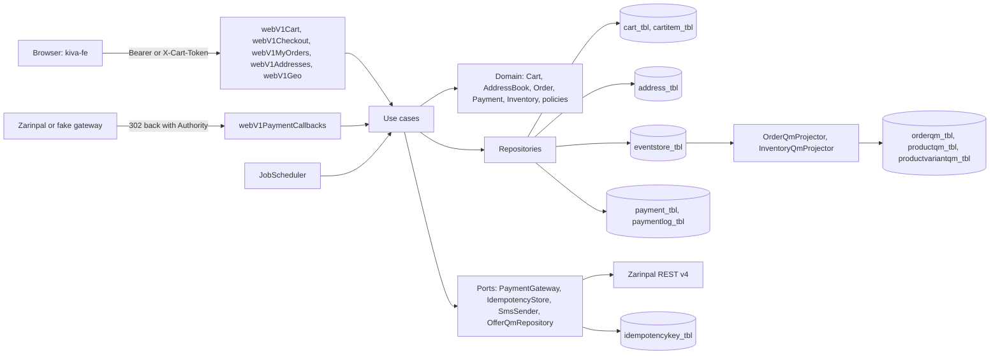
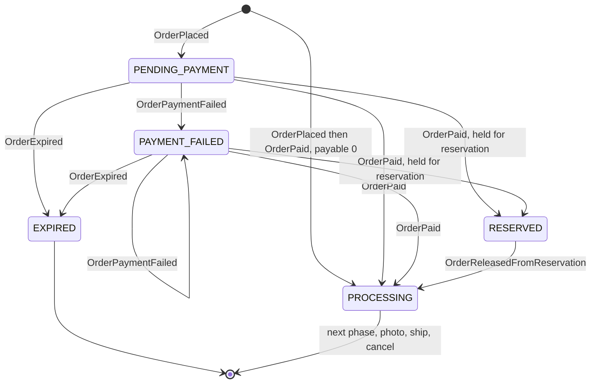
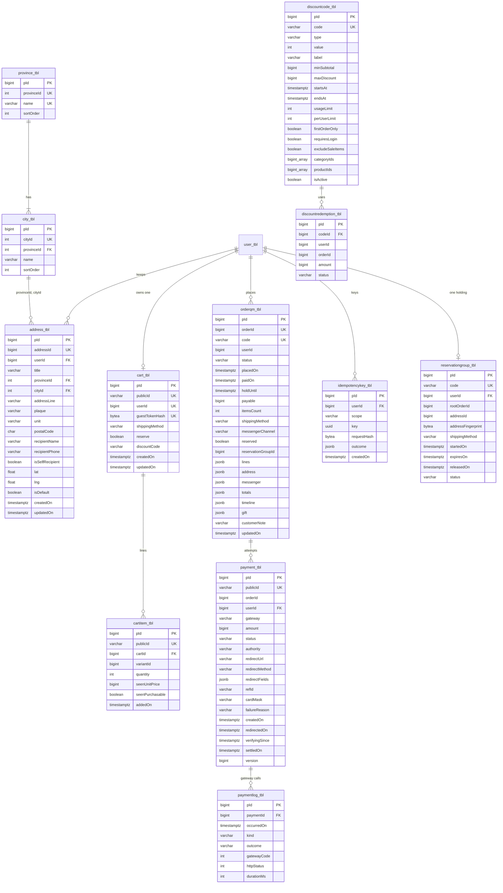
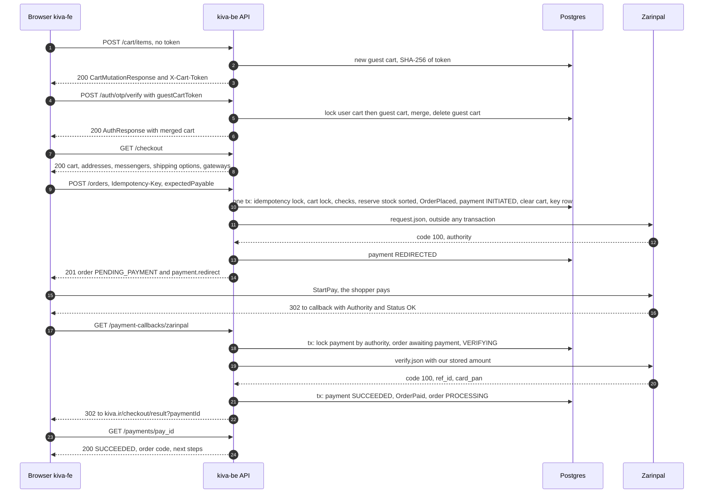
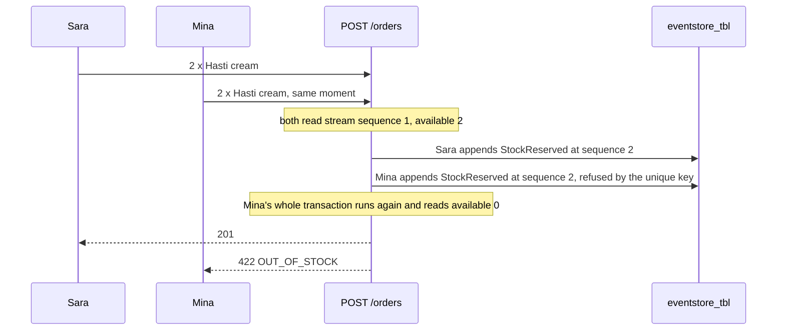

# نقشه‌ی راه فلوی خرید کیوا

> **kiva-be · purchase · v1** · ۱۹ مهر ۱۴۰۵
>
> پایه: کانترکت API نسخه‌ی **1.5.0** (گام ۰ می‌بردش به **1.6.0**)، اسکیل‌های بک‌اند شرکت (نسخه‌ی خودت در `Music\skills`)، سند معماری کاتالوگ، سند معماری ورود و کامن kiva.
>
> این سند نقشه‌ی ساختن خریده: از اولین «افزودن به سبد» تا لحظه‌ای که پول رسیده و سفارش توی حساب مشتری دیده می‌شه. توضیح می‌ده چی کجا می‌ره، هر قانون چرا اونجاست و به چه ترتیبی ساخته می‌شه. هر گام یه کامیت روی برنچ `purchase` ـه و فهرست «تموم شده یعنی» خودش رو داره. وقتی گامی تموم شد، تیکش زده می‌شه و یه خط به «گزارش کار» آخر فایل اضافه می‌شه.
>
> روش کار مثل قبل: تو می‌گی کدوم گام، اول سؤال‌های طراحی همون گام جواب داده می‌شه و بعد کد نوشته می‌شه. هیچ گامی خودبه‌خود شروع نمی‌شه.

---

## فهرست

0. [در یک نگاه](#0)
1. [تصمیم‌های اصلی](#1)
2. [مرز این فاز: کدوم endpointها](#2)
3. [از چی محافظت می‌کنیم](#3)
4. [نقشه‌ی فاز](#4)
5. [داده‌های پایه: استان و شهر، تنظیمات فروشگاه](#5)
6. [Aggregate سبد](#6)
7. [محاسبه‌ی مبلغ‌ها و ارسال](#7)
8. [Aggregate دفترچه‌ی آدرس](#8)
9. [Aggregate سفارش](#9)
10. [پرداخت و درگاه](#10)
11. [موجودی در فلوی خرید و ترتیب قفل‌ها](#11)
12. [Idempotency](#12)
13. [رزرو ۴ روزه و ادغام سفارش‌ها (دور دوم)](#13)
14. [کد تخفیف (دور دوم)](#14)
15. [کارهای زمان‌بندی‌شده](#15)
16. [جدول‌ها](#16)
17. [UseCaseها و endpointها](#17)
18. [سفر یک خرید](#18)
19. [پیکربندی، رازها و لاگ](#19)
20. [ساختار پوشه‌ها](#20)
21. [تغییرات کانترکت 1.6.0](#21)
22. [گام‌ها](#22)
23. [قبل از انتشار](#23)
24. [عمداً نه در این فاز](#24)
25. [فرق با اسکیل شرکت](#25)
26. [سؤال‌های باز](#26)
27. [گزارش کار](#27)

---

<a id="0"></a>
## ۰. در یک نگاه

**فلوی خرید از دید مشتری:**

```
سبد (مهمان یا کاربر) ← ورود و ادغام سبد ← تسویه ← ثبت سفارش و رزرو موقت موجودی ← درگاه
← برگشت از درگاه و verify ← صفحه‌ی نتیجه ← «سفارش‌های من»
```

**چی ساخته می‌شه:**

- استان‌ها و شهرها، و دفترچه‌ی آدرس کاربر
- تنظیمات فروشگاه: روش‌های ارسال و هزینه‌شون، آستانه‌ی ارسال رایگان، درگاه‌ها، مهلت پرداخت و رزرو. همه تو دیتابیس، تا پنل ادمین بعداً فقط ویرایششون کنه
- سبد مهمان و کاربر، همگام‌سازی سبد با قیمت و موجودی، و ادغام سبد مهمان بعد از ورود
- صفحه‌ی تسویه، ثبت سفارش، رزرو موقت ۱۵ دقیقه‌ای موجودی و Idempotency
- پرداخت: درگاه آزمایشی برای توسعه، زرین‌پال واقعی، callback، verify، تلاش دوباره و صفحه‌ی نتیجه
- کارهای زمان‌بندی‌شده: انقضای سفارش پرداخت‌نشده، تطبیق پرداخت‌های نیمه‌کاره و پاک‌سازی
- «سفارش‌های من»، جزئیات سفارش و «خرید دوباره»
- **دور دوم:** رزرو ۴ روزه با ادغام سفارش‌ها، و کد تخفیف

**چی ساخته نمی‌شه** (بخش ۲۴): لغو و استرداد وجه، عکس قبل از ارسال، درخواست تغییر، ارسال و کد رهگیری، مرجوعی، پیگیری مهمان، فاکتور PDF، داشبورد حساب، `GET /config`، علاقه‌مندی‌ها و پنل ادمین سفارش‌ها. همه‌ی این‌ها «بعد از خرید» ان و فاز بعدی‌ان.

**۲۲ گام در سه دور:**

| دور | گام‌ها | نتیجه |
|---|---|---|
| ۱. هسته | ۰ تا ۱۸ | خرید کامل با پست و تیپاکس و پرداخت زرین‌پال |
| ۲. رزرو و تخفیف | ۱۹ و ۲۰ | رزرو ۴ روزه، ادغام سفارش‌ها و کد تخفیف |
| ۳. جمع‌بندی | ۲۱ | حمله‌ی آزمایشی، سند ریویو، پیام فرانت و یه دور کامل با مرورگر |

### وضعیت گام‌ها

| گام | عنوان | اندازه | وضعیت |
|---|---|---|---|
| ۰ | کانترکت 1.6.0 و آماده‌سازی | S | ✅ |
| ۱ | استان‌ها و شهرها | S | ✅ |
| ۲ | تنظیمات فروشگاه | M | ✅ |
| ۳ | دفترچه‌ی آدرس | M | ✅ |
| ۴ | قانون‌های قیمت و ارسال (دامنه) | S | ✅ |
| ۵ | Aggregate سبد (دامنه) | M | ⬜ |
| ۶ | سبد: دیتابیس و endpointها | L | ⬜ |
| ۷ | ادغام سبد مهمان | S | ⬜ |
| ۸ | Aggregate سفارش (دامنه) | L | ⬜ |
| ۹ | سفارش: event store و read model | M | ⬜ |
| ۱۰ | پرداخت: مدل، جدول و درگاه آزمایشی | M | ⬜ |
| ۱۱ | Idempotency | S | ⬜ |
| ۱۲ | صفحه‌ی تسویه: `GET /checkout` | M | ⬜ |
| ۱۳ | ثبت سفارش: `POST /orders` | L | ⬜ |
| ۱۴ | برگشت از درگاه و نتیجه‌ی پرداخت | L | ⬜ |
| ۱۵ | پرداخت دوباره | M | ⬜ |
| ۱۶ | کارهای زمان‌بندی‌شده | M | ⬜ |
| ۱۷ | سفارش‌های من و خرید دوباره | M | ⬜ |
| ۱۸ | درگاه واقعی زرین‌پال | M | ⬜ |
| ۱۹ | رزرو ۴ روزه و ادغام سفارش‌ها | L | ⬜ |
| ۲۰ | کد تخفیف | L | ⬜ |
| ۲۱ | حمله‌ی آزمایشی و جمع‌بندی | M | ⬜ |

---

<a id="1"></a>
## ۱. تصمیم‌های اصلی

قانون‌های عمومی سند کاتالوگ و ورود اینجا هم برقرارن: یک تراکنش برای هر UseCase، `Cmd` و `Qry` با مقدار خام، منطق فقط تو دامنه، Flyway، لاگ ورودی هر UseCase، تست اجباری برای هر Aggregate و Domain Service، و وضعیت HTTP از `FailureKind`. این جدول فقط تصمیم‌های خاص این فازه. ردیف‌های ۱ تا ۵ همون تصمیم‌هایی‌ان که قبلاً پذیرفتی.

| # | موضوع | تصمیم | چرا |
|---|---|---|---|
| 1 | مرز فاز | از «افزودن به سبد» تا «پول رسید و سفارش تو حسابه». هر چیزی که بعدش میاد فاز بعده | بیشترش کار اپراتوره و به پنل سفارش‌ها وابسته‌ست. این فاز باید جدا قابل انتشار باشه |
| 2 | دور اول و دوم | هسته اول. رزرو ۴ روزه و کد تخفیف دور دوم، ولی مدل از روز اول جاشون رو داره (ورودی‌های اختیاری policyها، ستون‌های سبد و `OrderPlaced`) | هسته زودتر قابل تست و انتشار می‌شه، بدون اینکه بعداً بازنویسی لازم باشه |
| 3 | رزرو موجودی | موقع `POST /orders`، تا `holdUntil` (۱۵ دقیقه، `paymentPendingMinutes`). با انقضا آزاد می‌شه و با ارسال (فاز بعد) کسر می‌شه | وگرنه دو نفر پول آخرین کیف رو می‌دن. کانترکت هم همین رو می‌خواد |
| 4 | درگاه | زرین‌پال اول. برای توسعه و تست یه درگاه آزمایشی داریم که دقیقاً همون مسیر callback رو طی می‌کنه. سامان و ملت `available = false` | زرین‌پال sandbox داره و ساده‌ترینه (GET). درگاه آزمایشی کل مسیر رو بدون اینترنت قابل تست می‌کنه |
| 5 | ذخیره‌سازی | **سفارش با Event Sourcing.** سبد، آدرس، پرداخت، تنظیمات، استان و شهر، گروه رزرو و کد تخفیف با جدول معمولی. موجودی همون ES کاتالوگه | سفارش چرخه‌ی طولانی داره و `OrderDetail.timeline` مستقیم از رویدادهاش ساخته می‌شه. سبد مدام عوض می‌شه و دورریختنیه. پرداخت یه رکورد تراکنشه با لاگ جدای خودش |
| 6 | منبع قیمت | سرور. قیمت‌ها لحظه‌ی ثبت سفارش از read model خونده و snapshot می‌شن. کلاینت فقط `expectedPayable` رو برای مقایسه می‌فرسته | هیچ عددی که کلاینت می‌فرسته پول جابه‌جا نمی‌کنه |
| 7 | یک محاسبه برای همه | `OrderPricing` و `ShippingPolicy` تو دامنه. سبد، تسویه و ثبت سفارش هر سه همین رو صدا می‌زنن | اگه دو جا حساب کنن، یا `PRICE_CHANGED` بی‌دلیل می‌پره، یا بدتر، مشتری یه عدد می‌بینه و عدد دیگه‌ای پرداخت می‌کنه |
| 8 | تماس با درگاه | **هیچ‌وقت داخل تراکنش دیتابیس انجام نمی‌شه.** state machine پرداخت جای تراکنش رو می‌گیره | درگاه کند یعنی connection pool پر، و pool پر یعنی کل سایت از کار می‌افته، نه فقط پرداخت |
| 9 | verify | فقط وقتی انجام می‌شه که سفارش هنوز قابل پرداخت باشه و موجودی‌اش رو نگه داشته باشه. وگرنه verify نمی‌شه و درگاه پول رو خودش برمی‌گردونه | تنها راه مطمئن برای اینکه «پول گرفتیم ولی کیف نداریم» یا «دو بار پول گرفتیم» هیچ‌وقت پیش نیاد |
| 10 | Idempotency | کلید و نتیجه تو **همون تراکنش** ثبت سفارش ذخیره می‌شن، با قفل advisory روی (کاربر، کلید) | اگه بعد از commit جدا ذخیره بشه، قطعی بین این دو تا سفارش دوم رو می‌سازه |
| 11 | چند Aggregate در یک تراکنش | ثبت سفارش، سفارش و موجودی چند رنگ و سبد و پرداخت رو با هم و در یک تراکنش عوض می‌کنه | یک دیتابیس داریم و یک برنامه. ثبات قوی ارزون‌تره از هماهنگی رویدادی (saga) |
| 12 | شناسه‌های عمومی | کد سفارش (`KV-218340`) با یه جایگشت از روی شناسه‌ی عددی سفارش ساخته می‌شه. `pay_…`، `cart_…` و `ci_…` تصادفی‌ان. شناسه‌ی آدرس عدده (کانترکت) | هیچ عدد پشت‌سرهمی تعداد فروش رو لو نمی‌ده، و کد سفارش بدون تلاش دوباره یکتاست |
| 13 | سبد مهمان | توکن تصادفی ۲۵۶ بیتی با شکل `gct_…`. تو دیتابیس فقط SHA-256 ـش ذخیره می‌شه | همون منطق refresh token |
| 14 | مالکیت | چیزی که مال کاربر دیگه‌ست، 404 می‌گیره: `ADDRESS_NOT_FOUND`، `ORDER_NOT_FOUND`، `PAYMENT_NOT_FOUND` | همون قانون سند ورود: معلوم نشه اصلاً وجود داره |
| 15 | پول | `Long` و تومان. ریال فقط داخل آداپتر درگاه (`Money.toRials()`). گرد کردن کد تخفیف به ۱٬۰۰۰ با ریاضی صحیح | کانترکت. Double تو پول ممنوعه |
| 16 | زمان | `Clock` از Koin. منطق «روز کاری» و «جمعه» با `Asia/Tehran` | کانترکت. تست‌ها با `MutableClock` |
| 17 | متن فارسی | فقط لایه‌ی HTTP می‌سازدش: پیام‌ها، برچسب‌ها، `nextSteps`، تایم‌لاین رزرو. تاریخ شمسی با یه تابع کوچیک خودمون | دامنه فقط کد و عدد تولید می‌کنه، مثل `ProductTexts` |
| 18 | کارهای زمان‌بندی‌شده | یه scheduler کوچیک داخل خود برنامه (coroutine). درستی هر کار از idempotent بودنش میاد، نه از قفل | اجرای دوباره یا همزمان یه کار نباید چیزی رو خراب کنه |
| 19 | کانترکت اول | هر جا پیاده‌سازی چیزی غیر از کانترکت لازم داشت، اول کانترکت عوض می‌شه (گام ۰، یا همون کامیت با یه خط تو بخش ۲۱) | سؤال «طبق کانترکته؟» همیشه یه جواب داره |

---

<a id="2"></a>
## ۲. مرز این فاز: کدوم endpointها

### ساخته می‌شن

| endpoint | گام | نکته |
|---|---|---|
| `GET /geo/provinces`، `GET /geo/provinces/{provinceId}/cities` | ۱ | با `ETag` و `max-age=300` |
| `GET`، `POST /me/addresses` · `GET`، `PUT`، `DELETE /me/addresses/{addressId}` · `POST /me/addresses/{addressId}/default` | ۳ | |
| `GET`، `DELETE /cart` · `POST /cart/items` · `PATCH`، `DELETE /cart/items/{itemId}` · `PUT /cart/shipping-method` | ۶ | ورود اختیاری |
| `PUT /cart/reservation` | ۶ (واقعی در ۱۹) | تا گام ۱۹ همیشه `RESERVATION_DISABLED` |
| `POST /cart/merge` و فیلد `cart` در پاسخ `POST /auth/otp/verify` | ۷ | |
| `GET /checkout` | ۱۲ | |
| `POST /orders` | ۱۳ | با `Idempotency-Key` |
| `GET`، `POST /payment-callbacks/{gateway}` · `GET /payments/{paymentId}` | ۱۴ | callback عمومیه و همیشه 302 برمی‌گردونه |
| `POST /payments/{paymentId}/retry` · `POST /me/orders/{orderCode}/payments` | ۱۵ | با `Idempotency-Key` |
| `GET /me/orders` · `GET /me/orders/{orderCode}` · `POST /me/orders/{orderCode}/reorder` | ۱۷ | |
| `GET /me/reservation` | ۱۹ | |
| `POST`، `DELETE /cart/discount-code` | ۲۰ | |
| `/dev/fake-gateway/{authority}` (بیرون از `/api/v1`) | ۱۰ | فقط وقتی `kiva.payment.provider = fake` ـه. تو کانترکت نیست، چون مال فروشگاه نیست |

یه تغییر کوچیک تو endpointهای ساخته‌شده هم داریم: `GET /admin/customers` از گام ۱۷ `ordersCount`، `totalSpent` و `lastOrderAt` واقعی رو برمی‌گردونه (تا الان صفر و null بودن).

### ساخته نمی‌شن (فاز بعد)

`POST /cart/items/{itemId}/move-to-wishlist` (به علاقه‌مندی‌ها وابسته‌ست)، `/me/orders/{orderCode}/cancel`، `/media`، `/media-feedback`، `/returns`، `/invoice`، `GET /me/returns`، `GET /me/tracking`، `/tracking/*`، `GET /me/dashboard`، `GET /config`، `DELETE /me` و `/me/deletion/request`، همه‌ی `/admin/orders*` و `/admin/refunds*` و `/admin/returns*`، `/admin/discount-codes*` و `/admin/settings`.

تا اون موقع، سرور تو `OrderSummary.actions` گزینه‌های `canCancel`، `canRequestChange`، `canApproveMedia`، `canReturn` و `canReview` رو همیشه `false` برمی‌گردونه. این‌طوری فرانت دکمه‌ای نشون نمی‌ده که پشتش endpointی نیست.

---

<a id="3"></a>
## ۳. از چی محافظت می‌کنیم

هر ردیف یه خطر واقعی برای پول یا داده‌ی مشتریه. ستون آخر می‌گه دفاعش تو کدوم گام ساخته و تست می‌شه. گام ۲۱ جلوی هر ردیف اسم تستی رو می‌نویسه که ازش محافظت می‌کنه.

| # | خطر | چطور پیش میاد | دفاع | گام |
|---|---|---|---|---|
| 1 | فروش بیشتر از موجودی | دو نفر همزمان آخرین کیف رو می‌خرن | رزرو موقع ثبت سفارش. قید یکتای `(aggregateName, aggregateId, sequence)` ِ event store دومی رو رد می‌کنه، و دومی دوباره می‌خونه و `OUT_OF_STOCK` می‌گیره. `CHECK ("onHand" >= reserved)` دیوار دومه | ۱۳ |
| 2 | بن‌بست | سفارش (A، B) و سفارش (B، A) همزمان قفل‌ها رو برعکس هم می‌گیرن | موجودی همیشه به ترتیب صعودی `(productId, variantId)` قفل می‌شه (بخش ۱۱) | ۱۳ |
| 3 | دو بار پول گرفتن | دو تلاش پرداخت برای یه سفارش، هر دو موفق برمی‌گردن | verify فقط وقتی سفارش هنوز پرداخت‌نشده‌ست و ردیف پرداخت قفله. تلاش دوم verify نمی‌شه و درگاه پولش رو برمی‌گردونه. ایندکس یکتای «یک پرداخت موفق برای هر سفارش» دیوار دومه | ۱۴ |
| 4 | پول گرفتیم، کیف آزاد شد | مشتری دقیقه‌ی ۱۴ می‌ره درگاه و دقیقه‌ی ۱۸ برمی‌گرده، ولی job دقیقه‌ی ۱۵ موجودی رو آزاد کرده | job سفارشی رو که تلاش پرداخت در جریان داره (REDIRECTED کمتر از ۲۰ دقیقه پیش، یا VERIFYING) منقضی نمی‌کنه. callback برای سفارش منقضی‌شده verify نمی‌کنه | ۱۴، ۱۶ |
| 5 | جعل callback | کسی callback رو با `Status=OK` یا با Authority یه پرداخت دیگه صدا می‌زنه | پرداخت از روی Authority ذخیره‌شده پیدا می‌شه (یکتا). verify سرور به سرور با مبلغی که خودمون ذخیره کردیم انجام می‌شه. `refId` هم یکتاست | ۱۴ |
| 6 | دستکاری مبلغ | کلاینت قیمت یا مبلغ رو عوض می‌کنه | سرور همه‌چیز رو حساب می‌کنه. `expectedPayable` فقط برای مقایسه‌ست | ۱۳ |
| 7 | سفارش دوباره | دابل‌کلیک، قطع شبکه یا تکرار خودکار مرورگر | `Idempotency-Key` با قفل advisory و در همون تراکنش. سبد هم بعد از ثبت خالی می‌شه | ۱۱، ۱۳ |
| 8 | قفل کردن موجودی | یه ربات سفارش پرداخت‌نشده می‌سازه تا کیف‌ها از فروشگاه بیرون برن | حداکثر ۳ سفارش پرداخت‌نشده‌ی در حال نگه‌داری موجودی برای هر کاربر، بعدش `429 RATE_LIMITED`. هر سفارش هم فقط ۱۵ دقیقه نگه می‌داره | ۱۳ |
| 9 | دسترسی به داده‌ی دیگران (IDOR) | `GET /me/orders/KV-…`، `/payments/pay_…` یا آدرس کاربر دیگه | `userId` فقط از توکن. منبع کاربر دیگه 404 می‌گیره. تست نگهبان همه‌ی routeهای `bearerAuth` کانترکت رو بدون توکن صدا می‌زنه | ۳، ۱۴، ۱۷ |
| 10 | دزدی توکن سبد | توکن مهمان لو می‌ره | ۲۵۶ بیت تصادفی، فقط hash تو دیتابیس. فقط به یه سبد بی‌نام دسترسی می‌ده و هیچ اطلاعات شخصی‌ای پشتش نیست | ۶ |
| 11 | سوءاستفاده از کد تخفیف | دو سفارش همزمان آخرین ظرفیت یه کد رو می‌گیرن، یا خرید اول دو بار | ردیف کد موقع ثبت سفارش `FOR UPDATE` قفل می‌شه. ظرفیت = تأییدشده + نگه‌داشته‌شده | ۲۰ |
| 12 | خطای گرد کردن پول | Double، یا گرد کردن جای اشتباه | فقط `Long`. policyها با ریاضی صحیح، و تست‌های طلایی با عددهای خود طرح | ۴، ۲۰ |
| 13 | کند شدن یا قطعی درگاه | زرین‌پال ۳۰ ثانیه جواب نمی‌ده | هیچ تراکنشی موقع تماس باز نیست. timeout اتصال ۵ و کل ۱۵ ثانیه. شکست ← `PAYMENT_GATEWAY_UNAVAILABLE` با `meta.orderCode`، و پرداخت دوباره با درگاه دیگه | ۱۳، ۱۸ |
| 14 | پر شدن connection pool | تماس شبکه داخل تراکنش | تست معماری: درگاه آزمایشی تو تست، اگه داخل تراکنش صدا زده بشه، خطا می‌ده | ۱۰، ۱۳ |
| 15 | لو رفتن اطلاعات شخصی تو لاگ | آدرس، موبایل گیرنده یا شماره‌ی پیام‌رسان تو لاگ نوشته بشه | فقط شناسه‌ها و کدها لاگ می‌شن. موبایل ماسک می‌شه. `toString` ِ VOهای شخصی ستاره برمی‌گردونه. تست اسکن لاگ | ۳، ۲۱ |
| 16 | قیمت یا وضعیت قدیمی | محصول بین سبد و ثبت سفارش از فروشگاه خارج شده یا گرون شده | ثبت سفارش read model رو داخل تراکنش دوباره می‌خونه. خارج‌شده ← `PRODUCT_UNAVAILABLE`، گرون‌شده ← `PRICE_CHANGED` | ۱۳ |
| 17 | callback تکراری | refresh صفحه، یا GET و POST با هم | callback idempotent ـه: پرداختی که تموم شده دیگه عوض نمی‌شه، و `101` (قبلاً verify شده) هم موفقیت حساب می‌شه | ۱۴ |
| 18 | redirect به سایت دیگه | پارامتر دستکاری‌شده تو callback | مقصد redirect ثابته و از config میاد. فقط `paymentId` با فرمت چک‌شده بهش اضافه می‌شه | ۱۴ |
| 19 | خطای منطقه‌ی زمانی | «جمعه» یا «امروز» به وقت UTC حساب بشه | `ZoneId.of("Asia/Tehran")` در یک جا (`ShopCalendar`)، و تست مرز پنجشنبه ۲۳:۵۹ | ۴ |
| 20 | پرداخت شد ولی callback نرسید | مشتری بعد از پرداخت، قبل از برگشتن تب رو می‌بنده | job تطبیق با inquiry ِ درگاه پرداخت‌های REDIRECTED رو بررسی می‌کنه و اگه PAID بود verify می‌کنه | ۱۶ |
| 21 | فهمیدن حجم فروش | کدهای سفارش پشت‌سرهم | جایگشت روی فضای ۶ رقمی | ۸ |

CSRF اینجا خطر نیست، چون سبد، تسویه و پرداخت هیچ‌کدوم با کوکی کار نمی‌کنن: هویت با هدر `Authorization` یا `X-Cart-Token` میاد که مرورگر خودش نمی‌فرسته.

---

<a id="4"></a>
## ۴. نقشه‌ی فاز

| تیکه | نوع ذخیره | جدول‌ها | چرا این نوع |
|---|---|---|---|
| استان و شهر | داده‌ی مرجع | `province_tbl`، `city_tbl` | ثابته و با migration پر می‌شه |
| تنظیمات فروشگاه | جدول معمولی | `shopsettings_tbl`، `shippingmethod_tbl`، `paymentgateway_tbl` | همون چیزی که `AdminSettings` ِ کانترکت بعداً ویرایش می‌کنه |
| دفترچه‌ی آدرس | جدول معمولی | `address_tbl` | اطلاعات شخصیه و باید قابل حذف باشه |
| سبد | جدول معمولی | `cart_tbl`، `cartitem_tbl` | مدام عوض می‌شه و تاریخچه‌ش ارزشی نداره |
| سفارش | **Event Sourcing** | `eventstore_tbl` ← `orderqm_tbl` | چرخه‌ی عمر و تایم‌لاین داره، و سند مالیه |
| موجودی | Event Sourcing (کاتالوگ) | `eventstore_tbl` ← ستون‌های موجودی QM | از قبل هست. رزرو و آزادسازی اینجا صدا زده می‌شن |
| پرداخت | جدول معمولی + لاگ فقط‌اضافه | `payment_tbl`، `paymentlog_tbl` | رکورد یه تراکنش بیرونیه. state machine ـش کوتاهه و تاریخچه‌ی ارتباط با درگاه تو لاگ می‌مونه |
| Idempotency | جدول معمولی | `idempotencykey_tbl` | عمر کوتاه (۲۴ ساعت) |
| گروه رزرو (دور ۲) | جدول معمولی | `reservationgroup_tbl` | چند سفارش رو به هم وصل می‌کنه |
| کد تخفیف (دور ۲) | جدول معمولی | `discountcode_tbl`، `discountredemption_tbl` | شمارش ظرفیت با ردیف‌های مصرف |



دامنه هیچ تماس شبکه‌ای نمی‌گیره و هیچ متن فارسی‌ای نمی‌سازه. درگاه پشت پورت `PaymentGateway` ـه و پیاده‌سازیش (زرین‌پال، آزمایشی) تو infrastructure ـه.

---

<a id="5"></a>
## ۵. داده‌های پایه

### ۵.۱ استان و شهر

**منبع:** `D:\Personal\taban\taban-be\assets\provinces.json` و `cities.json`. ۳۱ استان و ۱۳۲۴ شهر. شناسه‌ها همون شناسه‌های فایل می‌مونن (شهرها بین ۱ تا ۱۵۱۸، با فاصله)، چون پایدارن و آدرس‌ها بهشون اشاره می‌کنن. ترتیب نمایش همون ترتیب الفبایی فایله (`sortOrder`).

یه اسکریپت کوچیک (`tools/geo/geo_to_sql.py`) فایل‌ها رو به `V11__geo.sql` تبدیل می‌کنه. اسکریپت و کپی دو فایل JSON تو `tools/geo/` کامیت می‌شن، تا معلوم باشه SQL از کجا اومده. خروجی SQL یه بار ساخته و کامیت می‌شه، و برنامه موقع اجرا هیچ JSONی نمی‌خونه.

**ایرادهای داده و کاری که migration باهاشون می‌کنه:**

| مورد | الان | بعد از migration | چرا |
|---|---|---|---|
| استان ۹، ۱۶ و ۲۳ | «چهارمحال وبختیاری»، «سیستان وبلوچستان»، «کهگیلویه وبویراحمد» | «چهارمحال و بختیاری»، «سیستان و بلوچستان»، «کهگیلویه و بویراحمد» | فاصله‌ی جاافتاده |
| شهرهای ۲۳، ۳۰۰ و ۱۰۹۰ | «آران وبیدگل»، «بویین ومیاندشت»، «کتالم وسادات شهر» | با فاصله قبل و بعد از «و» | همون. «چاه ورز» درسته و دست نمی‌خوره |
| شهرهای ۳۶۴ تا ۳۶۷ | «تبریز1-» تا «تبریز4-» | حذف | منطقه‌های پستی تبریزن، نه شهر. مشتری «تبریز» (۳۶۱) رو انتخاب می‌کنه |
| شهر ۱۲۱۷ | «گلوگاه» دوم در مازندران | حذف (۱۲۱۶ می‌مونه) | تکراری |
| «… اباد» جدا | «اسلام اباد»، «علی اباد»، «حسن اباد»، … | «… آباد» | یکدستی با «حسن آباد» ِ تهران. اسم‌های چسبیده مثل «مهاباد» و «گناباد» درستن و دست نمی‌خورن |
| پرانتزدارها | «خداجو(خراجو)»، «کارزین (فتح آباد)»، «هشتپر (تالش)» | دست نمی‌خورن | اسم رسمی‌ان |

بعد از migration: **۳۱ استان و ۱۳۱۹ شهر.**

نکته برای کانترکت: مثال‌های کانترکت `provinceId: 8` (تهران، درست) و `cityId: 301` دارن، ولی شهر ۳۰۱ تو این داده «بهاباد» یزده و تهران ۳۹۴ ـه. مثال‌ها تو گام ۰ درست می‌شن.

### ۵.۲ تنظیمات فروشگاه

`AdminSettings` ِ کانترکت می‌گه این مقدارها رو بعداً پنل عوض می‌کنه. پس از همین الان تو دیتابیس‌ان و migration مقدار اولیه‌شون رو می‌نویسه. برنامه هر بار از دیتابیس می‌خونه (یه ردیف با ایندکس)، پس تغییر بدون ری‌استارت اثر می‌کنه.

| تنظیم | مقدار اولیه | منبع |
|---|---|---|
| `TIPAX` | ۱۴۵٬۰۰۰ تومان، ۱ تا ۲ روز کاری، فعال، آیکن `truck` | طرح (`kiva.js`) |
| `POST` | ۷۵٬۰۰۰ تومان، ۳ تا ۵ روز کاری، فعال، آیکن `box` | طرح |
| `COURIER` | **ردیف نداره**. روشی که ردیف نداره هیچ‌وقت ارائه نمی‌شه | کانترکت: [پیشنهادی]. طرح هیچ اسم، هزینه یا مدتی براش نداره، پس عدد ساختگی تو دیتابیس نمی‌ره |
| روش ارسال پیش‌فرض سبد | `POST` | طرح |
| `freeShippingThreshold` | ۳٬۰۰۰٬۰۰۰ | کانترکت بخش ۳ |
| `freeShippingMethods` | `[POST]` | کانترکت بخش ۳ |
| `nonShippingWeekdays` | `[FRIDAY]` | کانترکت |
| `paymentPendingMinutes` | ۱۵ | کانترکت |
| `reservationEnabled` | **false** تا گام ۱۹، بعدش true | دور دوم |
| `reservationHoldDays` | ۴ | کانترکت |
| `returnWindowDays` | ۷ | کانترکت (برای فاز بعد) |
| درگاه `ZARINPAL` | فعال، پیش‌فرض، «زرین‌پال»، `#F2C230`، «ز» | طرح |
| درگاه `SAMAN`، `MELLAT` | غیرفعال | هنوز آداپتر ندارن |

متن «تحویل ۳ تا ۵ روز کاری» ِ هر روش ذخیره نمی‌شه: لایه‌ی HTTP از `minDays` و `maxDays` می‌سازدش، تا هیچ‌وقت با روزهای واقعی ناجور نشه (`description` ِ `AdminSettings` فقط خوندنیه).

`lowStockThreshold` فعلاً همون ثابت `StockPolicy` (۵) می‌مونه و تو این فاز به دیتابیس نمی‌ره. پیام‌رسان‌ها (روبیکا، تلگرام، بله) هم تو `AdminSettings` نیستن، پس اسم و راهنماشون ثابت‌های لایه‌ی HTTP ان.

**یک منبع برای آستانه:** امروز نشان «ارسال رایگان» کاتالوگ آستانه رو از `kiva.shop.freeShippingThreshold` ِ config می‌خونه. گام ۲ اون رو به همین تنظیمات دیتابیس وصل می‌کنه و کلید config رو حذف می‌کنه، تا دو عدد هیچ‌وقت از هم جدا نشن.

**درگاه «در دسترس»** یعنی ردیفش فعال باشه **و** برنامه براش آداپتر پیکربندی‌شده داشته باشه. پس سامان با فعال کردن ردیفش در دسترس نمی‌شه.

---

<a id="6"></a>
## ۶. Aggregate سبد

**ریشه:** `Cart` · **موجودیت داخلی:** `CartLine` · **ذخیره:** جدول معمولی · **قفل:** `SELECT … FOR UPDATE` روی ردیف سبد در هر Command

### وضعیت

| فیلد | نوع | قانون |
|---|---|---|
| `id` | `CartId` | عدد داخلی، هیچ‌وقت بیرون نمی‌ره |
| `publicId` | `CartPublicId` | `cart_` + ۱۰ کاراکتر تصادفی. همون `Cart.id` ِ کانترکت |
| `owner` | `CartOwner` | `User(userId)` یا `Guest(tokenHash)`. دقیقاً یکی (`CHECK` تو دیتابیس). هر کاربر یه سبد داره |
| `lines` | `List<CartLine>` | هر رنگ (ورینت) حداکثر یه ردیف |
| `shippingMethod` | `ShippingMethodCode` | پیش‌فرض از تنظیمات (`POST`) |
| `reserve` | `Boolean` | سوییچ رزرو ۴ روزه. فقط وقتی رزرو در دسترسه true می‌مونه |
| `discountCode` | `DiscountCodeText?` | دور ۲ |
| `createdOn`، `updatedOn` | `Instant` | `updatedOn` برای پاک‌سازی سبد مهمان |

**`CartLine`:** `itemId` (`ci_` + ۱۰ کاراکتر، همون `CartItem.id`)، `variantId`، `quantity` (۱ تا ۲۰)، `seenUnitPrice` (قیمتی که مشتری آخرین بار دیده)، `seenPurchasable` (آخرین بار قابل خرید بود یا نه)، `addedOn`.

### «پیشنهاد» یه رنگ: آنچه سبد از کاتالوگ لازم داره

سبد هیچ‌وقت قیمت یا موجودی ذخیره نمی‌کنه. هر بار از read model خونده می‌شه، از طریق پورت `OfferQmRepository` (در application). برای هر `variantId` یه `OfferQm` برمی‌گردونه که هم داده‌ی دامنه داره، هم داده‌ی نمایش:

- **برای دامنه (`PurchaseOffer`):** `variantId`، `productId`، `categoryId`، `priceTag` (قیمت مؤثر رنگ: `ownPriceTag` یا قیمت محصول)، `available` (موجودی منهای رزرو)، `maxPerOrder`، `purchasable` (محصول `ACTIVE` و رنگ فعال)، `reservable`
- **برای نمایش:** اسم، slug، کد محصول، دسته (`id`، `slug`، `name`)، رنگ (`key`، `name`، `hex`، `isLight`، `sortOrder`) و اولین مدیای رنگ

همه‌ی این‌ها با **یک** کوئری روی `productvariantqm_tbl` و `productqm_tbl` و `category_tbl` و `color_tbl` خونده می‌شن.

### قانون‌هایی که سبد نگه می‌داره

1. **هر رنگ یه ردیف.** افزودن دوباره‌ی یه رنگ، تعداد رو جمع می‌کنه.
2. **تعداد هر درخواست ۱ تا ۲۰** (کانترکت). بیشتر یا کمتر ← `400 VALIDATION_ERROR` روی `quantity`.
3. **سقف ردیف:** `maxQuantity = min(available, maxPerOrder − جمع بقیه‌ی رنگ‌های همون محصول)`.
   `maxPerOrder` مال **محصوله**، نه رنگ (کانترکت: «سقف خرید هر محصول»). پس با سقف ۵، ۳ کاراملی و ۳ مشکی آیدا با هم ممکن نیست. وقتی ظرفیت محصول تقسیم می‌شه، ردیف‌ها به ترتیب `addedOn` سهم می‌گیرن. (این برداشت تو سؤال‌های باز هست.)
4. **عدد دقیق موجودی لو نمی‌ره.** `maxQuantity` و `meta.availableQuantity` همون عدد بالا رو نشون می‌دن، که با سقف پیش‌فرض ۵ هیچ‌وقت بیشتر از چیزی که `LOW_STOCK` نشون می‌ده لو نمی‌ده.
5. **ردیف غیرقابل خرید می‌مونه.** اگه رنگ ناموجود بشه یا از فروشگاه خارج بشه، ردیف پاک نمی‌شه (شاید برگرده، یا مشتری بخواد ببینه). ولی تو جمع پول حساب نمی‌شه و ثبت سفارش تا وقتی حذفش نکنی ردش می‌کنه. فیلد تازه‌ی `CartItem.purchasable` (کانترکت 1.6.0) این رو به فرانت می‌گه.
6. **سوییچ رزرو** فقط وقتی true می‌مونه که رزرو در دسترس باشه. اگه نباشه، بی‌صدا خاموش می‌شه و `reservation.unavailableReason` دلیلش رو می‌گه.

### همگام‌سازی (sync): `issues` ِ «از آخرین بازدید»

کانترکت می‌خواد سبد بگه از آخرین باری که مشتری دیده چی عوض شده. این یعنی هر خوندن سبد یه **تغییر** هم هست: «دیده شد» ثبت می‌شه. برای همین `GET /cart` یه Command به اسم `OpenCartUc` ـه که `Cart.sync(offers, settings)` رو صدا می‌زنه.

| وضعیت ردیف یا سبد | کار | `CartIssue.code` |
|---|---|---|
| قیمت فعلی ≠ `seenUnitPrice` | `seenUnitPrice` به‌روز می‌شه | `PRICE_INCREASED` یا `PRICE_DECREASED` (با `previousValue` و `currentValue`) |
| قابل خرید بود، الان `available = 0` | `seenPurchasable = false` | `OUT_OF_STOCK` |
| قابل خرید بود، الان محصول یا رنگ بیرون از فروشگاهه | `seenPurchasable = false` | `VARIANT_UNAVAILABLE` |
| `quantity > maxQuantity ≥ 1` | تعداد ذخیره‌شده کم می‌شه | `QUANTITY_REDUCED` (با مقدار قبلی و فعلی) |
| روش ارسال انتخاب‌شده غیرفعال شده | می‌ره روی روش پیش‌فرض | `SHIPPING_METHOD_CHANGED` |
| کد تخفیف دیگه معتبر نیست (دور ۲) | کد برداشته می‌شه | `DISCOUNT_REMOVED` |

هر issue فقط **یک بار** دیده می‌شه، چون همون لحظه «دیده شد» ثبت می‌شه. متن فارسی هر issue (مثلاً «قیمت «کیف دستی آیدا» از آخرین بازدیدت تغییر کرده.») رو لایه‌ی HTTP می‌سازه.

### عملیات‌ها

| عملیات | قانون‌ها و خطاها |
|---|---|
| `add(variantId, quantity)` | رنگ ناشناخته ← `404 VARIANT_NOT_FOUND`. محصول یا رنگ بیرون از فروشگاه ← `422 PRODUCT_UNAVAILABLE`. `available = 0` ← `422 OUT_OF_STOCK`. ظرفیت محصول با رنگ‌های دیگه پر شده (`maxQuantity = 0` با وجود موجودی) ← `422 QUANTITY_EXCEEDS_LIMIT` با `meta.maxPerOrder`. بیشتر از سقف ← **تا سقف کم می‌شه** با `QUANTITY_REDUCED` (کانترکت) |
| `changeQuantity(itemId, q)` | ردیف ناشناخته ← `404 CART_ITEM_NOT_FOUND`. بیشتر از موجودی ← `422 QUANTITY_EXCEEDS_STOCK` با `meta.availableQuantity`. بیشتر از سقف محصول ← `422 QUANTITY_EXCEEDS_LIMIT` با `meta.maxQuantity` |
| `changeColor(itemId, variantId)` [پیشنهادی] | رنگ باید مال همون محصول باشه، وگرنه `400` روی `variantId`. رنگ تازه ناموجود ← `OUT_OF_STOCK` یا `PRODUCT_UNAVAILABLE`. اگه اون رنگ از قبل ردیف داره، دو ردیف یکی می‌شن (جمع تعداد، تا سقف) |
| `remove(itemId)` | `404 CART_ITEM_NOT_FOUND`. خروجی: `variantId`، `quantity` و اسم، برای «برگردون» |
| `clear()` | ردیف‌ها، کد تخفیف و سوییچ رزرو پاک می‌شن. روش ارسال می‌مونه |
| `chooseShippingMethod(m)` | روش ناشناخته ← `400`. غیرفعال ← `422 SHIPPING_METHOD_UNAVAILABLE`. در حالت ادغام با رزرو (دور ۲) فقط روش گروه مجازه |
| `setReservation(enabled)` | روشن کردن وقتی رزرو در دسترس نیست ← `422 RESERVATION_UNAVAILABLE` با `meta.reason`. خاموش کردن همیشه مجازه |
| `absorb(guestCart)` | ادغام، پایین‌تر |

### سبد مهمان و توکن

| درخواست | سبد | هدر `X-Cart-Token` در پاسخ |
|---|---|---|
| با Bearer معتبر | سبد کاربر (اگه نباشه ساخته می‌شه، با `INSERT … ON CONFLICT DO NOTHING`) | ندارد. `X-Cart-Token` ِ درخواست نادیده گرفته می‌شه |
| با Bearer منقضی یا خراب | — | `401 TOKEN_EXPIRED` یا `UNAUTHORIZED`. هرگز بی‌صدا مهمان حساب نمی‌شه |
| بدون Bearer، با توکنی که سبدش پیدا می‌شه | همون سبد مهمان | ندارد |
| بدون Bearer، با توکن ناشناخته یا بدشکل | سبد مهمان تازه | توکن تازه |
| بدون Bearer و بدون توکن | سبد مهمان تازه (حتی برای `GET /cart`، طبق کانترکت) | توکن تازه |

- توکن: `gct_` + base64url ِ ۳۲ بایت تصادفی از `SecureRandom` (۴۳ کاراکتر). تو دیتابیس فقط `SHA-256(token)` ذخیره می‌شه. `CartToken.toString()` ستاره برمی‌گردونه.
- هدر `X-Cart-Token` تو CORS از قبل `allowHeader` و `exposeHeader` شده.
- **برای فرانت:** `GET /cart` فقط از مرورگر صدا زده بشه، نه از رندر سمت سرور Next.js. وگرنه هر بازدید یه سبد خالی می‌سازه. job پاک‌سازی (بخش ۱۵) سبدهای خالی مهمان رو بعد از یک روز پاک می‌کنه.

### ادغام سبد مهمان

موقع `POST /auth/otp/verify` با `guestCartToken`، یا با `POST /cart/merge`:

1. سبد کاربر قفل می‌شه، بعد سبد مهمان (ترتیب ثابت).
2. هر ردیف مهمان به سبد کاربر اضافه می‌شه: رنگ مشترک تعدادش جمع می‌شه، و هر چیزی بیشتر از سقف باشه کم می‌شه با `QUANTITY_REDUCED`.
3. روش ارسال و سوییچ رزرو سبد مهمان برنده‌ان، چون مشتری همین الان روی صفحه‌ی سبد انتخابشون کرده. کد تخفیف (دور ۲): اگه کاربر کد داشته، کد خودش می‌مونه، وگرنه کد مهمان (بعد از اعتبارسنجی دوباره).
4. سبد مهمان حذف می‌شه.

توکنی که سبدش نیست (قبلاً ادغام شده، پاک شده یا ساختگیه) هیچ کاری نمی‌کنه و خطا هم نمی‌ده. توکن‌ها فقط به سبد مهمان اشاره می‌کنن، پس با هیچ توکنی نمی‌شه به سبد یه کاربر دیگه رسید. ادغام فقط بعد از verify ِ موفق انجام می‌شه.

بعد از این فاز، فیلد `cart` ِ پاسخ verify دیگه `null` نیست و همیشه سبد کاربر بعد از ادغامه (کانترکت 1.6.0).

### شکل UseCaseهای سبد

هر Command سبد (`AddCartItemUc`، `ChangeCartItemUc`، …) در یک تراکنش این کارها رو می‌کنه: سبد رو قفل می‌کنه، اول `sync` و بعد خود تغییر رو انجام می‌ده، و ذخیره می‌کنه. خروجیش یه `CartChange` ـه: `cartId`، توکن تازه (اگه ساخته شده)، `issues`، `affectedItemId` و `removedItem`. بعد Route با `GetCartUc` (Query) کل سبد رو می‌سازه: جمع‌ها، گزینه‌های ارسال، نوار ارسال رایگان و وضعیت رزرو.

`CartChange` یه استثنای مستند از قانون «Command فقط شناسه برمی‌گردونه» ـه، دقیقاً به همون دلیل `IssuedSession` ِ سند ورود: `issues` و توکن تازه فقط همون لحظه وجود دارن و هیچ Query ای بعداً نمی‌تونه بخوندشون.

---

<a id="7"></a>
## ۷. محاسبه‌ی مبلغ‌ها و ارسال

تابع‌های خالص دامنه، بدون دیتابیس و بدون ساعت (ساعت ورودیه). جاشون: `domain/…/order/model/policy/`. سبد هم همین‌ها رو صدا می‌زنه، تا عددهای سبد، تسویه و سفارش دقیقاً یکی باشن.

**یک نقطه‌ی ورود:** سبد، تسویه و ثبت سفارش فقط `OrderPricing.quote(lines, settings, chosenMethod, now, reserve, codeDiscount?, consolidation?)` رو صدا می‌زنن. خروجیش `PurchaseQuote` ـه: مبلغ‌های هر ردیف، `OrderTotals`، گزینه‌های ارسال، گزینه‌ی انتخاب‌شده و نوار ارسال رایگان. ترتیب محاسبه خودش قانونه (ردیف‌ها ← `subtotal` ← ارسال ← کد تخفیف ← `payable`) و هیچ UseCase ای اون رو جدا نمی‌سازه. UseCase ساعت رو یه بار می‌خونه و `now: Instant` می‌ده.

### ۷.۱ `OrderPricing`: جمع‌ها (کانترکت بخش ۳)

فقط ردیف‌های **قابل خرید** تو جمع پول حساب می‌شن. `itemsCount` و `linesCount` همه‌ی ردیف‌ها رو می‌شمرن، چون بج سبد باید همون چیزی رو نشون بده که تو سبد می‌بینی.

| خروجی | تعریف |
|---|---|
| `lineTotal` | `unitPrice × quantity` |
| `lineCompareAtTotal` | `unitCompareAtPrice × quantity`، یا `null` وقتی تخفیف نداره |
| `lineDiscount` | `(unitCompareAtPrice − unitPrice) × quantity`، یا ۰ |
| `itemsCompareAtTotal` | `Σ (unitCompareAtPrice ?: unitPrice) × quantity` |
| `productDiscount` | `Σ lineDiscount` |
| `subtotal` | `Σ lineTotal` = `itemsCompareAtTotal − productDiscount`. **مبنای کد تخفیف و ارسال رایگان** |
| `codeDiscount` | `DiscountPolicy` (دور ۲). همیشه ≤ مبنای خودش ≤ `subtotal` |
| `shippingCost` | `cost` ِ گزینه‌ی انتخاب‌شده. بدون ردیف قابل خرید، ۰ |
| `payable` | `subtotal − codeDiscount + shippingCost`. چون `codeDiscount ≤ subtotal`، هیچ‌وقت منفی نمی‌شه |
| `totalSavings` | `productDiscount + codeDiscount` |
| `shippingIsFree` | ردیف قابل خرید داره **و** `shippingCost = 0` |

### ۷.۲ `ShippingPolicy`: گزینه‌های ارسال

برای هر روش فعال، به ترتیب `sortOrder`:

| حالت | `cost` | `isFree` | `freeReason` | `available` |
|---|---|---|---|---|
| ادغام با رزرو (دور ۲)، روش گروه | ۰ | true | `RESERVATION_CONSOLIDATION` | true |
| ادغام با رزرو، روش دیگه | `baseCost` | false | null | **false** (`unavailableReason`: «سفارش رزروی با پست ارسال می‌شه») |
| روش در `freeShippingMethods` و `subtotal ≥ threshold` | ۰ | true | `THRESHOLD` | true |
| بقیه | `baseCost` | false | null | true |
| سبد بدون ردیف قابل خرید | ۰ | false | null | true |

`baseCost` همیشه فرستاده می‌شه، تا قیمت خط‌خورده نشون داده بشه. `PROMO` تو این فاز استفاده نمی‌شه.

**روش مؤثر (`ShippingPolicy.selectedOption`):** روش انتخاب‌شده، اگه هنوز قابل انتخابه؛ وگرنه روش پیش‌فرض فروشگاه؛ وگرنه اولین روش قابل انتخاب. جمع‌ها همیشه با همین حساب می‌شن، و `sync` ِ سبد با مقایسه‌ی همین با روش ذخیره‌شده `SHIPPING_METHOD_CHANGED` می‌ده. اگه فروشگاه همه‌ی روش‌ها رو خاموش کرده باشه، چیزی انتخاب نمی‌شه، هزینه‌ی ارسال ۰ می‌مونه و ثبت سفارش `SHIPPING_METHOD_UNAVAILABLE` می‌گیره.

### ۷.۳ `DeliveryWindowPolicy` و `ShopCalendar`: تاریخ تحویل

- «امروز» یعنی تاریخ تهران در لحظه‌ی `now`: `ShopCalendar.dateOf(now)`. `now` رو UseCase یه بار از `Clock` می‌خونه و به policy می‌ده. فقط `ShopCalendar` منطقه‌ی زمانی رو می‌شناسه.
- روز ارسال = امروز، و اگه امروز روز ارسال نیست (جمعه)، اولین روز ارسال بعدش. با رزرو روشن: `shipAfterDate = امروز + holdDays` (روز تقویمی)، و روز ارسال اولین روز ارسال از `shipAfterDate` به بعد.
- `fromDate` = روز ارسال + `minDays` روز کاری. `toDate` = روز ارسال + `maxDays` روز کاری. روزهای `nonShippingWeekdays` (جمعه) شمرده نمی‌شن.
- تعطیلات رسمی فعلاً حساب نمی‌شن (سؤال‌های باز).

**مثال:** پنجشنبه ۲۳ مهر ۱۴۰۵ (2026-10-15)، پست (۳ تا ۵ روز). جمعه شمرده نمی‌شه، پس: شنبه (۱)، یکشنبه (۲)، دوشنبه (۳) ← `fromDate = 2026-10-19`؛ سه‌شنبه (۴)، چهارشنبه (۵) ← `toDate = 2026-10-21`. تیپاکس از همون روز: ۲۵ و ۲۶ مهر (2026-10-17 و 2026-10-18).

**سفارش جمعه** (۲۴ مهر) شنبه ارسال می‌شه و از شنبه شمرده می‌شه: پست ۲۸ تا ۳۰ مهر (2026-10-20 تا 2026-10-22)، تیپاکس ۲۶ و ۲۷ مهر. یعنی یه روز دیرتر از سفارش پنجشنبه، که با ارسال واقعی جوره. اگه روز ارسال همیشه «امروز» بود، سفارش جمعه همون تاریخ پنجشنبه رو می‌گرفت و یه روز زودتر از واقعیت قول می‌داد (کانترکت، بخش ۳).

### ۷.۴ `FreeShippingProgress`

`threshold` از تنظیمات، `method` اولین روش **فعال** (به ترتیب `sortOrder`) که تو `freeShippingMethods` ـه (`POST`)، `eligible = subtotal ≥ threshold`، `remaining = max(0, threshold − subtotal)`، و `progressPercent = min(100, subtotal × 100 / threshold)` با یک رقم اعشار و گرد کردن نیمه به بالا. این تنها عدد غیرصحیح پاسخه و پول نیست. در حالت ادغام با رزرو: `eligible = true`، `remaining = 0`، `100` و `method` = روش گروه.

- **بدون Double:** دامنه درصد رو به دهم درصد و با عدد صحیح نگه می‌داره (`progressPerMille`، ۰ تا ۱۰۰۰): `(subtotal × 2000 + threshold) / (2 × threshold)`، مثل `PricePolicy.discountPercent`. ۱٬۴۵۰٬۰۰۰ از ۳٬۰۰۰٬۰۰۰ ← `483`. لایه‌ی HTTP اون رو با یه رقم اعشار می‌نویسه (`48.3`).
- **۱۰۰ فقط وقتی `eligible`:** ۲٬۹۹۹٬۹۹۹ گرد می‌شه به ۱۰۰، ولی هنوز ۱ تومان مونده. پس تا وقتی `eligible` نیست، حداکثر `99.9`. نواری که پر به نظر بیاد و پیامش بگه «۱ تومان مونده» با خودش تناقض داره.
- **بدون نوار:** اگه فروشگاه هیچ روش فعالی با ارسال رایگان نداره، `freeShipping = null` (چیزی برای قول دادن نیست). آستانه‌ی ۰ یعنی همه‌چی رایگانه: `eligible` و `100`.

### ۷.۵ مثال‌های طلایی (تست‌های گام ۴ از همین‌ها ساخته می‌شن)

| سبد | itemsCompareAtTotal | productDiscount | subtotal | ارسال | payable |
|---|---|---|---|---|---|
| آیدا کاراملی (۲٬۷۹۰٬۰۰۰ از ۳٬۲۹۰٬۰۰۰) + KV-1015 قهوه‌ای (۶۹۰٬۰۰۰ از ۷۹۰٬۰۰۰)، پست | ۴٬۰۸۰٬۰۰۰ | ۶۰۰٬۰۰۰ | ۳٬۴۸۰٬۰۰۰ | ۰ (`THRESHOLD`) | **۳٬۴۸۰٬۰۰۰** |
| همون، تیپاکس | ۴٬۰۸۰٬۰۰۰ | ۶۰۰٬۰۰۰ | ۳٬۴۸۰٬۰۰۰ | ۱۴۵٬۰۰۰ | **۳٬۶۲۵٬۰۰۰** |
| کراس‌بادی نیلا (۱٬۴۵۰٬۰۰۰ از ۱٬۷۵۰٬۰۰۰)، پست | ۱٬۷۵۰٬۰۰۰ | ۳۰۰٬۰۰۰ | ۱٬۴۵۰٬۰۰۰ | ۷۵٬۰۰۰ | **۱٬۵۲۵٬۰۰۰** (تا ارسال رایگان: ۱٬۵۵۰٬۰۰۰، یعنی ۴۸٫۳٪) |
| ردیف اول + کد `KIVA10` (دور ۲)، پست | ۴٬۰۸۰٬۰۰۰ | ۶۰۰٬۰۰۰ | ۳٬۴۸۰٬۰۰۰ | ۰ (آستانه قبل از کد حساب می‌شه) | **۳٬۱۳۲٬۰۰۰** (کد: ۳۴۸٬۰۰۰) |

این عددها با مثال‌های خود کانترکت (`CartTotals`، `AppliedDiscount`، `FreeShippingProgress`) و سفارش‌های نمونه‌ی mock ِ فرانت یکی‌ان.

---

<a id="8"></a>
## ۸. Aggregate دفترچه‌ی آدرس

**ریشه:** `AddressBook` (همه‌ی آدرس‌های یه کاربر، حداکثر ۲۰) · **موجودیت داخلی:** `Address` · **ذخیره:** جدول معمولی `address_tbl` · **قفل:** `pg_advisory_xact_lock(hashtext('addressbook:' || userId))`

چرا کل دفترچه یه Aggregate ـه و هر آدرس جدا نیست؟ چون قانون‌های مهم بین آدرس‌هاست: سقف ۲۰، «دقیقاً یکی پیش‌فرض»، و «با حذف پیش‌فرض، قدیمی‌ترین بعدی پیش‌فرض می‌شه». با ۲۰ ردیف، خوندن کل دفترچه ارزونه.

### Value Objectها

| VO | قانون | کد خطا (فیلد) |
|---|---|---|
| `ProvinceId`، `CityId` | عدد مثبت | `PROVINCE_ID_INVALID`، `CITY_ID_INVALID` |
| `AddressLine` | بعد از trim و `normalizePersianLetters` (مثل `normalizePersian`، ولی ارقام همون‌طور که تایپ شده می‌مونن، چون متن نمایشیه): ۱۰ تا ۳۰۰ کاراکتر، بدون کاراکتر کنترلی و `<` و `>` | `ADDRESS_LINE_TOO_SHORT`، `ADDRESS_LINE_TOO_LONG`، `ADDRESS_LINE_INVALID` |
| `PostalCode` | ارقام فارسی نرمال می‌شن، فاصله و `-` حذف می‌شن، بعد دقیقاً ۱۰ رقم (الگوی کانترکت `^\d{10}$`) | `POSTAL_CODE_INVALID` |
| `RecipientName` | قانون `PersonName`، ولی ۳ تا ۸۰ کاراکتر | `RECIPIENT_NAME_REQUIRED`، `RECIPIENT_NAME_TOO_SHORT`، `RECIPIENT_NAME_TOO_LONG`، `RECIPIENT_NAME_INVALID` |
| `recipientPhone` | `IranianMobileNumber` ِ کامن، با `forField("recipientPhone")` | `PHONE_INVALID` |
| `AddressTitle` [پیشنهادی] | حداکثر ۳۰. خالی یعنی null | `ADDRESS_TITLE_TOO_LONG` |
| `Plaque`، `UnitNumber` [پیشنهادی] | حداکثر ۱۰. خالی یعنی null | `PLAQUE_TOO_LONG`، `UNIT_TOO_LONG` |
| `GeoPoint` [پیشنهادی] | `lat` بین ‎−۹۰ و ۹۰، `lng` بین ‎−۱۸۰ و ۱۸۰، هر دو با هم | `LOCATION_INVALID` |

همه‌ی این کدها کد فیلدن (`FieldError.code`)، نه کد اصلی پاسخ. پس لازم نیست تو `ErrorCode` ِ کانترکت بیان، ولی هر کدوم متن فارسی تو `ErrorMessages.kt` می‌گیره. `toString` ِ `AddressLine`، `PostalCode` و `RecipientName` ستاره برمی‌گردونه.

### رفتارها

- `add(input, setAsDefault)`: آدرس بیست‌ویکم ← `422 ADDRESS_LIMIT_REACHED`. اولین آدرس خودکار پیش‌فرض می‌شه. `setAsDefault = true` بقیه رو از پیش‌فرض بودن درمیاره.
- `update(addressId, input)`: آدرس ناشناخته ← `404 ADDRESS_NOT_FOUND`. `setAsDefault = true` پیش‌فرضش می‌کنه، ولی `false` پیش‌فرض بودن رو برنمی‌داره، چون همیشه باید یکی باشه. سفارش‌های قبلی snapshot خودشون رو دارن و عوض نمی‌شن (کانترکت).
- `remove(addressId)`: اگه پیش‌فرض بود، قدیمی‌ترین باقی‌مونده (`createdOn`، بعد `addressId`) پیش‌فرض می‌شه. حذف واقعیه، چون اطلاعات شخصیه.
- `makeDefault(addressId)`.

**کار `AddressBookDomainService`:** چیزی که Aggregate خودش نمی‌دونه رو چک می‌کنه. استان باید وجود داشته باشه (`400` روی `provinceId` با `PROVINCE_NOT_FOUND`)، و شهر باید مال همون استان باشه (`422 CITY_NOT_IN_PROVINCE`، کانترکت). شناسه‌ی آدرس رو هم از پورت `AddressIdGenerator` (sequence) می‌گیره، مثل `ProductIdGenerator`. دیتابیس هم با یه FK ترکیبی `("provinceId", "cityId")` همین قانون رو دوباره نگه می‌داره.

**پاسخ:** `Address` ِ کانترکت، به‌همراه `provinceName` و `cityName` (join)، `fullText` («استان، شهر، آدرس، پلاک ۱۲، واحد ۴»، ساخته‌شده در لایه‌ی HTTP)، `isDefault` و `createdAt`. لیست با آدرس پیش‌فرض شروع می‌شه.

### Snapshot برای سفارش

سفارش `AddressSnapshot` نگه می‌داره: `provinceName`، `cityName`، `addressLine`، `plaque`، `unit`، `postalCode`، `recipientName`، `recipientPhone` و `fullText`، به‌علاوه‌ی `addressId` اگه آدرس ذخیره‌شده بوده. `plaque` و `unit` تو کانترکت فعلی snapshot نیستن، ولی پیک و اپراتور لازمشون دارن، پس به `AddressSnapshot` اضافه می‌شن (کانترکت 1.6.0).

---

<a id="9"></a>
## ۹. Aggregate سفارش

**ریشه:** `Order` · **ذخیره:** Event Sourcing (`aggregateName = ORDER`، `aggregateId = orderId`) · **خوندن:** `orderqm_tbl`

### وضعیت

| فیلد | نوع | توضیح |
|---|---|---|
| `id` | `OrderId` | از `orderid_seq`. بیرون نمی‌ره |
| `code` | `OrderCode` | `KV-` + ۶ رقم، ساخته‌شده با `OrderCodePolicy` از روی `id` (پایین‌تر) |
| `userId` | `UserId` | |
| `status` | `OrderStatus` | ۱۳ مقدار کانترکت. تو این فاز فقط `PENDING_PAYMENT`، `PAYMENT_FAILED`، `EXPIRED`، `RESERVED` و `PROCESSING` |
| `lines` | `List<OrderLine>` | snapshot: `lineId` (۱ تا n در همین سفارش، همون `OrderItem.id`)، `productId`، `variantId`، `sku` ِ رنگ، اسم و slug محصول، رنگ (`key`، `name`، `hex`)، آدرس عکس، `quantity`، `unitPrice`، `unitCompareAtPrice`، و `reservable` و `returnable` (برای فاز بعد) |
| `address` | `AddressSnapshot` | بخش ۸ |
| `messenger` | `PreShipmentMessenger` | `channel`، `phone`، `username?` ‏(≤ ۵۰)، `note?` ‏(≤ ۲۰۰) |
| `shippingMethod` | `ShippingMethodCode` | اسمش موقع نمایش از تنظیمات میاد |
| `totals` | `OrderTotals` | همه‌ی جمع‌های بخش ۷، `discountCode`، `shippingFreeReason`، `giftWrapCost = 0` |
| `reserveRequested`، `reservationGroupId` | `Boolean`، `ReservationGroupId?` | دور ۲ |
| `holdUntil` | `Instant` | `placedOn + paymentPendingMinutes`. همون `PaymentInit.expiresAt` |
| `placedOn`، `paidOn` | `Instant`، `Instant?` | |
| `paidByPaymentId` | `PaymentId?` | پرداخت برنده |
| `customerNote` [پیشنهادی] | `CustomerNote?` | حداکثر ۳۰۰ |
| `gift` [پیشنهادی] | `GiftNote?` | `message` ‏(≤ ۲۰۰) و `hidePrices`. تا وقتی `giftWrap.available = false` ـه، `wrap` همیشه false ذخیره می‌شه و هزینه‌ای اضافه نمی‌شه |

### رویدادهای این فاز

| رویداد | کِی | وضعیت بعدش |
|---|---|---|
| `OrderPlaced` | ثبت سفارش. همه‌ی snapshot بالا رو داره | `PENDING_PAYMENT` |
| `OrderPaymentFailed(paymentId, reason)` | درگاه NOK برگردوند یا verify رد شد، و سفارش هنوز پرداخت‌نشده‌ست | `PAYMENT_FAILED` |
| `OrderPaid(paymentId?, amount, paidOn, heldForReservation, reservationGroupId?)` | verify موفق، یا ثبت سفارشی که `payable = 0` داره (`paymentId = null`) | `RESERVED` یا `PROCESSING` |
| `OrderExpired` | job، بعد از `holdUntil` و وقتی هیچ پرداختی در جریان نیست | `EXPIRED` |
| `OrderReleasedFromReservation` (دور ۲) | پایان مهلت گروه رزرو | `RESERVED → PROCESSING` |

رویدادهای فاز بعد (لغو، عکس، ارسال، تحویل، مرجوعی) بعداً به همین sealed class اضافه می‌شن. `OrderDetail.timeline` مستقیم از رویدادها ساخته می‌شه: Projector با هر رویداد یه `OrderEvent` (وضعیت، زمان، یادداشت) به ستون `timeline` اضافه می‌کنه.



### قوانینی که Aggregate نگه می‌داره

- سفارش حداقل یه ردیف داره. جمع تعداد هر محصول ≤ `maxPerOrder` ِ همون محصول.
- `markPaid` فقط از `PENDING_PAYMENT` یا `PAYMENT_FAILED`. پرداخت‌شده ← `AlreadyPaid`؛ منقضی ← `NotPayable`. `amount` باید دقیقاً `totals.payable` باشه، وگرنه `AmountMismatch` (این یه باگه و بلند لاگ می‌شه).
- `recordPaymentFailure` فقط از وضعیت پرداخت‌نشده. روی سفارش پرداخت‌شده هیچ رویدادی نمی‌سازه.
- `expire(now)` فقط برای پرداخت‌نشده و وقتی `now ≥ holdUntil`. قبلش ← `TooEarly`. انجام دوباره بی‌اثره.
- `isAwaitingPayment` = `PENDING_PAYMENT` یا `PAYMENT_FAILED`. `canStartPayment(now)` = `isAwaitingPayment && now < holdUntil`. یعنی تلاش پرداخت تازه فقط قبل از پایان مهلت مجازه، ولی callback ِ تلاشی که قبل از مهلت شروع شده، بعد از مهلت هم پذیرفته می‌شه (تا وقتی job منقضیش نکرده).

### `OrderDomainService`

- `placeOrder(spec)`: ردیف‌ها رو از روی `PurchaseOffer`ها می‌سازه و قابل خرید بودن و سقف‌ها رو چک می‌کنه. جمع‌ها رو با `OrderPricing` حساب می‌کنه و با `expectedPayable` مقایسه می‌کنه (`PriceChanged(payable)`). شناسه رو از `OrderIdGenerator` می‌گیره و کد رو با `OrderCodePolicy` می‌سازه. هیچ‌وقت ذخیره نمی‌کنه و تراکنش باز نمی‌کنه.
- بقیه‌ی عملیات (`markPaid`، `expire`، …) رو UseCaseها مستقیم روی Aggregate صدا می‌زنن (Rule 1).

### `OrderCodePolicy`: کد سفارش بدون تکرار و بدون الگو

```
n    = orderId − 1                                  (0, 1, 2, …)
code = "KV-" + (100000 + (n × A + B) mod 900000)    A نسبت به 900000 = 2⁵·3²·5⁵ اول است
```

این یه جایگشت روی فضای ۶ رقمیه: هر `orderId` یه کد یکتا می‌ده، بدون هیچ چک یا تلاش دوباره‌ای، و دو سفارش پشت‌سرهم کدهای نزدیک به هم نمی‌گیرن. `A` باید بر ۲، ۳ و ۵ بخش‌پذیر نباشه (یه عدد اول بزرگ). `A` و `B` ثابت‌های کدن و هیچ‌وقت عوض نمی‌شن. بعد از ۹۰۰٬۰۰۰ سفارش، همین فرمول روی فضای ۷ رقمی ادامه پیدا می‌کنه (کانترکت ۴ تا ۸ رقم رو مجاز می‌دونه). `OrderCode` ِ موجود در دامنه همینه.

### نمایش وضعیت (برای `OrderSummary`)

| `status` | `statusLabel` | `statusTone` | `progress` | `actions` در این فاز |
|---|---|---|---|---|
| `PENDING_PAYMENT` | در انتظار پرداخت | `WARN` | هر چهار مرحله `UPCOMING` و `currentStepIndex = 0` | `canPay` تا `holdUntil` |
| `PAYMENT_FAILED` | پرداخت ناموفق | `DANGER` | همون | `canPay` تا `holdUntil` |
| `EXPIRED` | منقضی شد | `DANGER` | همون | — («خرید دوباره» با `reorder`) |
| `RESERVED` | رزرو شده | `CREAM` | «ثبت شد» `CURRENT` با زمان پرداخت | `canAddToReservation` (دور ۲) |
| `PROCESSING` | در حال آماده‌سازی | `WARN` | «ثبت شد» `CURRENT` با زمان پرداخت | — |

برچسب‌ها مال کانترکت بخش ۴ ان و لایه‌ی HTTP می‌سازدشون. `OrderActionsPolicy` (دامنه) فقط بولی‌ها رو حساب می‌کنه. تو این فاز `shipment` همیشه `waitingMessage` («بعد از تحویل به پست این‌جا نمایش داده می‌شه») و بقیه‌ی فیلدها null داره، و `preShipmentMedia.status` همیشه `WAITING` ـه، با پیام انتظار و اسم پیام‌رسان انتخاب‌شده.

### Read model: `orderqm_tbl`

ستون برای هر چیزی که فیلتر یا مرتب می‌شه (`userId`، `status`، `placedOn`، `holdUntil`) و JSONB برای سندهای نمایش (`lines`، `address`، `messenger`، `totals`، `timeline`، `gift`). اطلاعات پرداخت تو این جدول نیست: `OrderDetail.payment` موقع خوندن از `payment_tbl` (آخرین تلاش) میاد. ستون‌هایی که پنل ادمین بعداً لازم داره (شهر گیرنده، گروه ارسال) اون موقع با یه migration و بازسازی read model از روی رویدادها اضافه می‌شن.

**`soldCount`:** `OrderQmProjector` با `OrderPaid` ستون `soldCount` ِ محصول‌های سفارش رو به اندازه‌ی تعدادشون بالا می‌بره (به ترتیب صعودی `productId`)، تا مرتب‌سازی «پرفروش‌ترین» واقعی بشه. کم کردنش با لغو، مال فاز بعده.

---

<a id="10"></a>
## ۱۰. پرداخت و درگاه

### ۱۰.۱ Aggregate پرداخت

**ریشه:** `Payment` (یه **تلاش** پرداخت برای یه سفارش) · **ذخیره:** `payment_tbl` با `version` و `FOR UPDATE` · **لاگ:** `paymentlog_tbl` فقط‌اضافه، مثل `securityevent_tbl`

| فیلد | توضیح |
|---|---|
| `publicId` | `pay_` + ۱۲ کاراکتر تصادفی از `[0-9A-Z]`. همون `paymentId` ِ کانترکت |
| `orderId`، `userId`، `gateway`، `amount` | `amount` همون `payable` ِ سفارش در لحظه‌ی ساخت تلاشه |
| `status` | وضعیت داخلی، جدول پایین |
| `authority` | شناسه‌ای که درگاه داده. با `(gateway, authority)` یکتاست |
| `redirect` | `url`، `method` (GET یا POST)، `fields`. همون `PaymentInit.redirect` |
| `refId`، `cardMask` | شماره‌ی پیگیری بانکی و کارت ماسک‌شده. `(gateway, refId)` یکتاست |
| `failureReason` | `USER_CANCELLED`، `GATEWAY_DECLINED`، `ORDER_NOT_PAYABLE`، `GATEWAY_UNREACHABLE`، `GATEWAY_REJECTED` یا `EXPIRED` |
| `createdOn`، `redirectedOn`، `verifyingSince`، `settledOn` | |

| از | به | با | وضعیت کانترکت |
|---|---|---|---|
| — | `INITIATED` | ساخت تلاش (ثبت سفارش یا پرداخت دوباره) | `PENDING` |
| `INITIATED` | `REDIRECTED` | درگاه authority داد | `PENDING` |
| `INITIATED` | `START_FAILED` | درگاه رد کرد یا در دسترس نبود | `FAILED` |
| `REDIRECTED` | `CANCELLED` | callback با NOK | `CANCELLED` |
| `REDIRECTED` | `VERIFYING` | callback با OK، و سفارش هنوز در انتظار پرداخت | `PENDING` |
| `REDIRECTED` | `FAILED` | callback با OK، ولی سفارش دیگه قابل پرداخت نیست (`ORDER_NOT_PAYABLE`). verify صدا زده **نمی‌شه** | `FAILED` |
| `VERIFYING` | `SUCCEEDED` | verify با کد ۱۰۰ یا ۱۰۱ | `SUCCEEDED` |
| `VERIFYING` | `FAILED` | verify رد شد | `FAILED` |
| `VERIFYING` | `VERIFYING` | verify جواب نداد. job تطبیق دوباره امتحان می‌کنه | `PENDING` |
| `INITIATED`، `REDIRECTED` | `EXPIRED` | job، وقتی سفارش منقضی شد | `EXPIRED` |
| `SUCCEEDED` | `REFUNDED` | فاز بعد | `REFUNDED` |

اثر روی سفارش: `CANCELLED` و `FAILED` (به‌جز `ORDER_NOT_PAYABLE`) ← `OrderPaymentFailed`، اگه سفارش هنوز پرداخت‌نشده باشه. `START_FAILED` سفارش رو `PENDING_PAYMENT` نگه می‌داره، چون مشتری کاری نکرده.

### ۱۰.۲ پورت درگاه

```kotlin
// application/port/PaymentGateway.kt — every method returns a Result (Rule 6), and none is ever called inside a transaction
interface PaymentGateway {
    val code: PaymentGatewayCode

    /** Opens a payment session. amount is in toman; the adapter converts it to rials. */
    suspend fun requestPayment(request: GatewayPaymentRequest): Result<GatewayRedirect, GatewayFailure>

    /** The callback's own parameters (Authority, Status for Zarinpal); null when they are not this gateway's. */
    fun readCallback(params: Map<String, String>): GatewayCallback?

    /** Confirms a paid session with the amount WE stored. "Already verified" is a success too. */
    suspend fun verify(authority: GatewayAuthority, amount: Money): Result<GatewayReceipt, GatewayFailure>

    /** The session's state without confirming it: IN_BANK, PAID, VERIFIED, FAILED, REVERSED. */
    suspend fun inquire(authority: GatewayAuthority): Result<GatewayInquiry, GatewayFailure>
}

sealed class GatewayFailure {
    /** Network error or timeout: the outcome is unknown, so the payment stays as it is and is checked again later. */
    data object Unreachable
    /** The gateway refused our request (merchant id, domain, amount limit): our configuration is wrong. Logged as ERROR. */
    data class Rejected(val gatewayCode: Int)
    /** The payment itself was not successful. */
    data class Declined(val gatewayCode: Int)
    /** The paid amount is not what we asked for: a bug, logged as ERROR. */
    data object AmountMismatch
}
```

یه `PaymentGateways` (رجیستری) در application می‌گه کدوم درگاه آداپتر داره. درگاه بدون آداپتر «در دسترس» نیست.

### ۱۰.۳ زرین‌پال (REST v4)

| کار | آدرس | نکته |
|---|---|---|
| درخواست | `POST https://payment.zarinpal.com/pg/v4/payment/request.json` | `merchant_id`، `amount` (ریال)، `currency: "IRR"`، `description` («سفارش KV-218340 کیوا»)، `callback_url`. موفقیت: `data.code = 100` و `data.authority` |
| redirect | `https://payment.zarinpal.com/pg/StartPay/{authority}` | `method = GET` |
| callback | `GET {callbackBaseUrl}/api/v1/payment-callbacks/zarinpal?Authority=…&Status=OK|NOK` | NOK یعنی شکست یا انصراف. verify فقط برای OK |
| verify | `POST …/pg/v4/payment/verify.json` | `merchant_id`، `amount` (ریال)، `authority`. ۱۰۰ = موفق، ۱۰۱ = قبلاً verify شده (هر دو موفقیتن). `ref_id` و `card_pan` ذخیره می‌شن، `card_hash` نه |
| inquiry | `POST …/pg/v4/payment/inquiry.json` | `status`: `IN_BANK`، `PAID`، `VERIFIED`، `FAILED`، `REVERSED`. خودش verify نمی‌کنه |
| reverse | `POST …/pg/v4/payment/reverse.json` | فقط تا ۳۰ دقیقه بعد از پرداخت و با IP ثبت‌شده‌ی سرور. تو جریان عادی لازم نیست (بخش ۱۰.۵) |
| sandbox | همون مسیرها با `sandbox.zarinpal.com` | merchant id هر UUID نسخه‌ی ۴، و authority با `S` شروع می‌شه |

کدهای خطای مهم: ‎`-9` (اعتبارسنجی)، ‎`-10` (merchant یا IP غلط)، ‎`-11` (درگاه غیرفعال)، ‎`-14` (دامنه‌ی callback با دامنه‌ی ثبت‌شده نمی‌خونه)، ‎`-41` (سقف ۱۰۰ میلیون تومان)، ‎`-50` (مبلغ پرداخت‌شده فرق داره)، ‎`-51` (پرداخت ناموفق)، ‎`-54` و ‎`-55` (authority نامعتبر یا پیدا نشد). جزئیات رو موقع پیاده‌سازی گام ۱۸ دوباره با مستندات رسمی (`zarinpal.com/docs/paymentGateway`) چک کن.

### ۱۰.۴ درگاه آزمایشی (فقط توسعه و تست)

`FakePaymentGateway` خودش رو جای `ZARINPAL` جا می‌زنه، تا مسیرها و callback دقیقاً مثل سرور واقعی باشن:

- `requestPayment` یه authority مثل `FAKE-…` می‌سازه و redirect رو به `{callbackBaseUrl}/dev/fake-gateway/{authority}` می‌فرسته.
- اون صفحه یه HTML ساده‌ست با مبلغ، کد سفارش و دو دکمه: «پرداخت موفق» و «انصراف» (مثل mock ِ فرانت). هر دکمه به `/api/v1/payment-callbacks/zarinpal?Authority=…&Status=OK|NOK` برمی‌گرده.
- `verify` فقط برای authorityای موفقه که دکمه‌ی موفقش زده شده. بار دوم «قبلاً verify شده» برمی‌گردونه.
- تو تست‌ها: می‌شه بهش گفت جواب نده (`Unreachable`)، رد کنه، یا کند باشه. تعداد تماس‌هاش رو هم می‌شمره.
- **تست معماری:** هر بار صدا زده می‌شه، چک می‌کنه داخل تراکنش Exposed نباشه (`TransactionManager.currentOrNull() == null`) و اگه بود، خطا می‌ده. پس کسی که تماس درگاه رو داخل تراکنش بذاره، build ـش قرمز می‌شه.
- با `kiva.payment.provider = fake`، برنامه موقع بالا اومدن یه WARN می‌نویسه، مثل `LogSmsSender`.

### ۱۰.۵ چرا تماس با درگاه بیرون تراکنشه، و چطور امن می‌مونه

ثبت سفارش و برگشت از درگاه هر کدوم سه قدم دارن، و قدم وسط بیرون از تراکنشه:

```
StartPaymentUc:           [tx: payment INITIATED را بخوان] → requestPayment → [tx: REDIRECTED یا START_FAILED]
HandleGatewayCallbackUc:  [tx: VERIFYING یا CANCELLED یا FAILED] → verify → [tx: SUCCEEDED + OrderPaid، یا FAILED]
```

اگه وسط کار چیزی بشکنه، state machine نشون می‌ده کجا مونده و کار قابل ادامه‌ست:

- **دو StartPayment همزمان برای یه پرداخت** (مثلاً تکرار درخواست با همون کلید): هر دو authority می‌گیرن. تراکنش دوم با `FOR UPDATE` می‌بینه پرداخت دیگه `INITIATED` نیست، authority خودش رو دور می‌ریزه و redirect ِ برنده رو برمی‌گردونه. session ِ اضافه‌ی درگاه پرداخت‌نشده منقضی می‌شه و ضرری نداره.
- **کرش بعد از VERIFYING و قبل از verify:** job تطبیق بعد از ۲ دقیقه دوباره verify می‌کنه. اگه قبلاً verify شده بود، ۱۰۱ برمی‌گرده که موفقیت حساب می‌شه.
- **verify موفق، ولی سفارش دیگه قابل پرداخت نیست:** نباید پیش بیاد، چون job سفارشی رو که پرداخت VERIFYING داره منقضی نمی‌کنه. اگه به‌خاطر یه باگ پیش اومد: پرداخت `SUCCEEDED` می‌شه، یه لاگ ERROR با `PAID_BUT_ORDER_NOT_PAYABLE` نوشته می‌شه، و اگه هنوز زیر ۳۰ دقیقه‌ست، `reverse` امتحان می‌شه. وگرنه پشتیبانی دستی استرداد می‌کنه.

این دو UseCase تنها جاهایی‌ان که یه UseCase دو تراکنش داره. فرق با اسکیل شرکت تو بخش ۲۵ نوشته شده.

### ۱۰.۶ برگشت از درگاه: `HandleGatewayCallbackUc`

1. `readCallback(params)`. اگه پارامترها مال این درگاه نیستن ← redirect به `{resultUrl}` بدون `paymentId`.
2. **تراکنش الف:** پرداخت با `(gateway, authority)` و `FOR UPDATE` پیدا می‌شه. پیدا نشد ← redirect بدون `paymentId`. وضعیتش پایانیه (`SUCCEEDED`، `FAILED`، `CANCELLED`، `EXPIRED`) ← هیچ کاری نمی‌کنه و redirect با `paymentId`. NOK ← `CANCELLED` و `OrderPaymentFailed`. OK ولی سفارش در انتظار پرداخت نیست ← `FAILED(ORDER_NOT_PAYABLE)`. OK و سفارش در انتظار پرداخت ← `VERIFYING`.
3. **بیرون تراکنش:** فقط اگه `VERIFYING` شد: `verify(authority, payment.amount)`. مبلغ از دیتابیس خودمون میاد، نه از callback.
4. **تراکنش ب:** پرداخت دوباره قفل می‌شه و باید هنوز `VERIFYING` باشه. موفق ← پرداخت `SUCCEEDED` و `OrderPaid`، و در دور ۲ گروه رزرو و تأیید کد تخفیف هم همین‌جا انجام می‌شن. رد ← `FAILED` و `OrderPaymentFailed`. `Unreachable` ← همون `VERIFYING` می‌مونه.
5. بعد از commit: پیامک «پرداخت موفق» (کد سفارش و لینک `track?order=KV-…`، کانترکت بخش ۵). اگه پیامک شکست بخوره، فقط لاگ می‌شه و پرداخت رو خراب نمی‌کنه.
6. Route: `302` به `{resultUrl}?paymentId=pay_…`.

callback هیچ‌وقت JSON یا خطا نشون نمی‌ده و همیشه redirect می‌کنه. `POST /payment-callbacks/{gateway}` (فرم، برای سامان و ملت) هم ساخته می‌شه و همین UseCase رو صدا می‌زنه. فعلاً برای `saman` و `mellat` آداپتری نیست، پس `404` برمی‌گردونن.

### ۱۰.۷ صفحه‌ی نتیجه: `GET /payments/{paymentId}`

ورود لازمه، و پرداخت کاربر دیگه `404 PAYMENT_NOT_FOUND` می‌گیره. پاسخ:

- `status` با نگاشت جدول ۱۰.۱. وقتی `PENDING` ـه (verify در جریانه)، فرانت هر ۳ ثانیه و حداکثر ۳۰ ثانیه دوباره می‌پرسه (کانترکت 1.6.0).
- `referenceId`، `cardMask`، `paidAt`.
- `failureReason`: متن فارسی از روی دلیل، مثلاً «تراکنش توسط کاربر لغو شد»، یا «مهلت پرداخت این سفارش تموم شده بود. اگه مبلغی کم شده، خودکار برمی‌گرده».
- `canRetry` = پرداخت موفق نیست **و** `order.canStartPayment(now)`.
- `order`: `code`، `status`، `reserved`، `consolidatedInto`.
- `nextSteps`: سه متن، بسته به رزرو، ادغام، پیام‌رسان و روش ارسال: «سفارشت در حال آماده‌سازیه.»، «عکس و ویدیوی کیفت رو قبل از ارسال توی تلگرام برات می‌فرستیم.»، «بعد از تحویل به پست، کد رهگیری توی حسابت قرار می‌گیره.»

### ۱۰.۸ پرداخت دوباره

`POST /payments/{paymentId}/retry` و `POST /me/orders/{orderCode}/payments` هر دو `StartPaymentAttemptUc` رو صدا می‌زنن (یکی با شناسه‌ی پرداخت، یکی با کد سفارش):

- سفارش مال همین کاربر باشه، وگرنه `404`.
- پرداخت‌شده ← `422 ORDER_ALREADY_PAID`. `canStartPayment(now)` نیست ← `422 PAYMENT_EXPIRED` (موجودی آزاد شده یا می‌شه).
- درگاه انتخابی (پیش‌فرض: همون درگاه قبلی) در دسترس نیست ← `422 PAYMENT_GATEWAY_UNAVAILABLE`.
- بیشتر از ۱۰ تلاش برای یه سفارش ← `429 RATE_LIMITED`.
- با `Idempotency-Key`.
- یه پرداخت تازه با `amount = payable` ساخته می‌شه، و بعد `StartPaymentUc`. `PaymentInit.expiresAt` همون `holdUntil` ِ سفارشه و **تمدید نمی‌شه**.
- تلاش‌های قبلی لغو نمی‌شن. اگه یه تلاش قدیمی هنوز تو تب دیگه باز باشه و اول پرداخت بشه، همون برنده‌ست. تلاش‌های بعدی، چون سفارش دیگه در انتظار پرداخت نیست، verify نمی‌شن (بخش ۳، ردیف ۳).

---

<a id="11"></a>
## ۱۱. موجودی در فلوی خرید و ترتیب قفل‌ها

### کِی چی صدا زده می‌شه

| اتفاق | عملیات `Inventory` | نتیجه در read model |
|---|---|---|
| ثبت سفارش | `reserve(orderCode, quantity)` برای هر ردیف | `reserved` بالا می‌ره، `available` ِ فروشگاه همون لحظه کم می‌شه |
| انقضای سفارش پرداخت‌نشده | `releaseReservation(orderCode)` | برمی‌گرده |
| پرداخت موفق | **هیچی.** رزرو تا ارسال می‌مونه | — |
| ارسال (فاز بعد) | `ship(orderCode)` | `onHand` و `reserved` با هم کم می‌شن |
| لغو (فاز بعد) | `releaseReservation(orderCode)` | برمی‌گرده |

`InventoryDomainService` دو متد تازه می‌گیره: `reserveForOrder(orderCode, lines)` و `releaseForOrder(orderCode, lines)`. اولی **همه یا هیچ** ـه: اگه یه ردیف کم بیاد، Failure برمی‌گرده (با همه‌ی ردیف‌هایی که کم میان) و تراکنش rollback می‌شه. توضیح `Inventory.reserve` («برای سفارش پرداخت‌شده») هم درست می‌شه به «برای سفارشی که موجودی رو نگه داشته: پرداخت‌نشده در مهلت، یا پرداخت‌شده‌ی ارسال‌نشده». منطق خود Aggregate عوض نمی‌شه.

همزمانی: مثل `AdjustInventoryUc`. اگه `ConcurrentChangeException` پیش بیاد، **کل** تراکنش ثبت سفارش از اول اجرا می‌شه (حداکثر ۳ بار) و قانون‌ها روی موجودی تازه دوباره چک می‌شن.

### ترتیب قفل‌ها

هر UseCase قفل‌ها رو **فقط** به این ترتیب می‌گیره. وقتی همه یه ترتیب دارن، چرخه‌ای پیش نمیاد و بن‌بست ممکن نیست:

| # | قفل | کی |
|---|---|---|
| 1 | advisory ِ idempotency `(userId, scope, key)` | ثبت سفارش، پرداخت دوباره |
| 2 | ردیف سبد (`FOR UPDATE`): اول سبد کاربر، بعد سبد مهمان | همه‌ی Commandهای سبد، ثبت سفارش، ادغام |
| 3 | advisory ِ دفترچه‌ی آدرس `(userId)` | Commandهای آدرس، و ثبت سفارش با آدرس جدید |
| 4 | advisory ِ گروه رزرو `(userId)` (دور ۲) | پرداخت موفق با رزرو، پایان مهلت |
| 5 | ردیف کد تخفیف (`FOR UPDATE`، دور ۲) | ثبت سفارش، پرداخت موفق، انقضا |
| 6 | ردیف پرداخت (`FOR UPDATE`) | callback، تطبیق، انقضا |
| 7 | ردیف محصول‌ها و رنگ‌ها در read model (Projectorها)، **به ترتیب صعودی `(productId, variantId)`** | رزرو، آزادسازی، `soldCount` |
| 8 | stream ِ سفارش (قید یکتای event store) | همه‌ی رویدادهای سفارش |

قفل ۷ همون قفلیه که `InventoryQmProjector` و `ProductQmSummary.lock` از قبل می‌گیرن (اول محصول، بعد رنگ). تنها کار تازه اینه که ردیف‌های یه سفارش قبل از رزرو مرتب بشن. تست گام ۱۳ دو سفارش (A، B) و (B، A) رو ۵۰ بار همزمان اجرا می‌کنه.

نسخه‌ی کاربر (`user_tbl.version`، برای ذخیره‌ی پیام‌رسان پیش‌فرض) قفل خوش‌بینانه‌ست. اگه تداخل پیش بیاد، همون تلاش دوباره‌ی کل تراکنش انجام می‌شه.

---

<a id="12"></a>
## ۱۲. Idempotency

کانترکت: `POST /orders`، `POST /payments/{id}/retry` و `POST /me/orders/{code}/payments` هدر `Idempotency-Key` (UUID) می‌گیرن، و تکرار با همون کلید همون پاسخ رو برمی‌گردونه.

**جدول:** `idempotencykey_tbl (userId, scope, key, requestHash, outcome, createdOn)` با یکتایی `(userId, scope, key)`. `scope` یکی از `PLACE_ORDER`، `RETRY_PAYMENT` یا `PAY_ORDER` ـه. `requestHash` = SHA-256 ِ شکل استاندارد بدنه. `outcome` = شناسه‌ی چیزی که ساخته شد (`orderCode`، `paymentId`).

**جریان، داخل همون تراکنش UseCase:**

1. `pg_advisory_xact_lock(hashtext(userId || scope || key))`. درخواست همزمان دوم همین‌جا منتظر می‌مونه تا اولی commit بشه.
2. ردیف هست و hash یکیه ← **تکرار**: UseCase کار رو انجام نمی‌ده و همون `outcome` رو برمی‌گردونه. hash فرق داره ← `409 IDEMPOTENCY_KEY_REUSED`.
3. ردیف نیست ← کار انجام می‌شه و ردیف آخر همون تراکنش اضافه می‌شه.

**نتیجه:**

- شکست‌هایی که rollback می‌شن (`CART_EMPTY`، `PRICE_CHANGED`، `OUT_OF_STOCK`، …) هیچ ردیفی نمی‌ذارن. تکرارشون دوباره اجرا می‌شه، که درسته: شاید مشتری مشکل رو حل کرده باشه. فرانت هم برای هر تلاش کلید تازه می‌سازه.
- تکرار یه درخواست موفق، **همون سفارش و همون پرداخت** رو برمی‌گردونه. Route از روی `outcome` پاسخ رو دوباره می‌سازه و `StartPaymentUc` به وضعیت پرداخت نگاه می‌کنه: `REDIRECTED` ← همون redirect، `START_FAILED` ← همون `422 PAYMENT_GATEWAY_UNAVAILABLE`، `INITIATED` (کرش وسط کار) ← دوباره تلاش. وضعیت سفارش تو پاسخ وضعیت **فعلی** ـه (شاید دیگه پرداخت شده). یعنی پاسخ از نظر معنی یکیه، نه بایت‌به‌بایت (کانترکت 1.6.0).
- کلید نیومده یا UUID نیست ← `400 VALIDATION_ERROR` روی فیلد `Idempotency-Key`.
- کلیدها بعد از ۲۴ ساعت پاک می‌شن (بخش ۱۵).

پورتش `IdempotencyStore` در application ـه و پیاده‌سازیش با Exposed. UseCase صداش می‌زنه، نه یه middleware ِ HTTP، چون باید داخل همون تراکنش باشه.

---

<a id="13"></a>
## ۱۳. رزرو ۴ روزه و ادغام سفارش‌ها (دور دوم)

**ریشه:** `ReservationGroup` · **ذخیره:** `reservationgroup_tbl` · **قفل:** advisory روی `userId`

| فیلد | توضیح |
|---|---|
| `code` | `SG-` + عدد، همون `shipmentGroupCode` ِ پنل |
| `userId`، `rootOrderId` | سفارشی که گروه رو شروع کرد |
| `addressId`، `addressFingerprint` | ادغام فقط به همین آدرس، و فقط اگه از شروع گروه ویرایش نشده باشه (hash ِ snapshot) |
| `shippingMethod` | روش ارسال سفارش اصلی، برای کل گروه |
| `startedOn`، `expiresOn` | `startedOn` = زمان پرداخت موفق سفارش اصلی. `expiresOn = startedOn + holdDays`. **ثابته و تمدید نمی‌شه** |
| `status` | `HOLDING` یا `RELEASED`. هر کاربر حداکثر یه `HOLDING` (ایندکس یکتای جزئی) |

### در دسترس بودن سوییچ (`CartReservation`)

به ترتیب اولویت:

1. `reservationEnabled = false` ← `RESERVATION_DISABLED`
2. کاربر گروه `HOLDING` داره ← `HAS_ACTIVE_RESERVATION` (برای مهمان معلوم نیست، و موقع ثبت سفارش دوباره چک می‌شه)
3. حتی یه ردیف قابل خرید `reservable = false` داره ← `ITEM_NOT_RESERVABLE`
4. وگرنه در دسترسه

`shipAfterDate = امروز + holdDays`. سه کارت `timeline`، با متن و تاریخ شمسی، تو لایه‌ی HTTP ساخته می‌شن: «امروز، ۱۹ مهر · پرداخت کامل و ثبت سفارش»، «تا پنجشنبه ۲۳ مهر · هر محصول دیگه‌ای خواستی به همین سفارش اضافه کن»، «بعد از ۴ روز · همه با هم و با یک هزینه ارسال فرستاده می‌شن».

### ادغام (`consolidation`)

وقتی کاربر گروه `HOLDING` داره و آدرس سفارش همون آدرس گروهه (در سبد: آدرس پیش‌فرض، در تسویه: `addressId` ِ انتخاب‌شده):

- `consolidation = { reservedOrderCode, expiresAt, addressId, shippingWaived: true, shippingMethod, message }`
- گزینه‌های ارسال: فقط روش گروه، با `cost = 0` و `RESERVATION_CONSOLIDATION`
- `reserve` ِ درخواست نادیده گرفته می‌شه
- تصمیم ادغام **موقع ثبت سفارش** گرفته می‌شه (`reservationGroupId` در `OrderPlaced`)، و اگه مهلت بین ثبت و پرداخت تموم بشه، ارسال رایگان می‌مونه (کانترکت)

### پرداخت موفق

| سفارش | حالت | نتیجه |
|---|---|---|
| ادغام‌شده | گروه هنوز `HOLDING` و `now < expiresOn` | `RESERVED` در همون گروه |
| ادغام‌شده | مهلت گروه تموم شده | `PROCESSING`. با همون گروه ارسال می‌شه |
| `reserveRequested` | کاربر گروه `HOLDING` نداره | گروه تازه (`startedOn = paidOn`) و `RESERVED` |
| `reserveRequested` | همزمان یه سفارش دیگه گروه ساخته، و آدرس یکیه | به همون گروه می‌پیونده و `RESERVED` می‌شه |
| `reserveRequested` | همزمان یه سفارش دیگه گروه ساخته، و آدرس فرق داره | `PROCESSING` (زودتر ارسال می‌شه، و مشتری ضرری نمی‌کنه). لاگ INFO |

**پایان مهلت (job):** همه‌ی سفارش‌های `RESERVED` گروه ← `OrderReleasedFromReservation` ← `PROCESSING`، و گروه ← `RELEASED`. اجرای دوباره بی‌اثره.

**`GET /me/reservation`:** گروه `HOLDING` ← `ReservationInfo` (`orderCode` اصلی، `startedAt`، `expiresAt`، `remainingSeconds`، `groupOrderCodes` ِ سفارش‌های پرداخت‌شده‌ی گروه، `message`). بدون گروه ← `204`.

**پیامک «۱۲ ساعت مونده»** [پیشنهادی در کانترکت]: اختیاری در گام ۱۹، اگه وقت بود.

---

<a id="14"></a>
## ۱۴. کد تخفیف (دور دوم)

**جدول‌ها:** `discountcode_tbl` (همون فیلدهای `DiscountCodeUpsertRequest`: `code`، `type`، `value`، `label`، `minSubtotal`، `maxDiscount`، `startsAt`، `endsAt`، `usageLimit`، `perUserLimit`، `firstOrderOnly`، `requiresLogin`، `excludeSaleItems`، `categoryIds`، `productIds`، `isActive`) و `discountredemption_tbl` (`codeId`، `userId`، `orderId`، `amount`، `status`: `HELD`، `CONFIRMED` یا `RELEASED`).

`usedCount` و `totalDiscountGiven` ِ پنل از ردیف‌های `CONFIRMED` حساب می‌شن و جدا ذخیره نمی‌شن.

### اعتبارسنجی (`DiscountDomainService`)، به ترتیب

| شرط | کد |
|---|---|
| نیست یا `isActive = false` | `DISCOUNT_CODE_INVALID` |
| `startsAt > now` | `DISCOUNT_CODE_NOT_STARTED` |
| `endsAt ≤ now` | `DISCOUNT_CODE_EXPIRED` |
| مهمان، و کد `requiresLogin` یا `firstOrderOnly` یا `perUserLimit` داره | `DISCOUNT_LOGIN_REQUIRED` |
| `firstOrderOnly`، و کاربر سفارش پرداخت‌شده داره | `DISCOUNT_FIRST_ORDER_ONLY` |
| `CONFIRMED + HELD ≥ usageLimit` یا `≥ perUserLimit` ِ همین کاربر | `DISCOUNT_USAGE_LIMIT_REACHED` |
| `subtotal < minSubtotal` | `DISCOUNT_MIN_SUBTOTAL_NOT_MET` (`meta.minSubtotal`) |
| هیچ ردیف مجازی نیست (`excludeSaleItems`، دسته‌ها، محصول‌ها) | `DISCOUNT_NOT_APPLICABLE` |

متن کد: trim، حروف بزرگ و ارقام لاتین. پس `kiva10 ` و `KIVA۱۰` هر دو `KIVA10` ـن.

### مبلغ (`DiscountPolicy`)

- مبنا = `subtotal` ِ ردیف‌های مجاز (بدون محدودیت، کل `subtotal`).
- **درصدی:** `floor((مبنا × value + 50_000) / 100_000) × 1_000`، یعنی گرد به نزدیک‌ترین ۱٬۰۰۰ و نیمه به بالا، با ریاضی صحیح. بعد سقف `maxDiscount` و سقف مبنا.
  مثال: ۱۰٪ از ۳٬۴۸۰٬۰۰۰ = ۳۴۸٬۰۰۰. ۱۰٪ از ۱٬۴۵۵٬۰۰۰ = ۱۴۵٬۵۰۰ ← ۱۴۶٬۰۰۰. ۱۰٪ از ۱٬۴۵۴٬۹۹۰ = ۱۴۵٬۴۹۹ ← ۱۴۵٬۰۰۰.
- **مبلغی:** `min(value, مبنا)`.

### چرخه

- **در سبد:** `POST /cart/discount-code` اعتبارسنجی و ذخیره می‌کنه. هر `sync` دوباره چک می‌کنه، و اگه نامعتبر شده باشه ← برداشته می‌شه با `DISCOUNT_REMOVED`.
- **ثبت سفارش:** ردیف کد `FOR UPDATE` قفل می‌شه و دوباره اعتبارسنجی می‌شه. اگه نامعتبر باشه، سفارش بدون کد حساب می‌شه و چون مبلغ عوض شده، `409 PRICE_CHANGED` با مبلغ تازه برمی‌گرده. این‌طوری کانترکت کد تازه‌ای لازم نداره و مشتری قبل از پرداخت عدد درست رو می‌بینه. معتبر ← ردیف `HELD`.
- **پرداخت موفق** ← `CONFIRMED`. **انقضا** ← `RELEASED`. **`payable = 0`** ← همون موقع `CONFIRMED`.
- **seeder توسعه:** سه کد طرح: `KIVA10` (۱۰٪)، `WELCOME` (۱۵۰٬۰۰۰ تومان، خرید اول، با ورود) و `PAEEZ15` (۱۵٪، حداقل ۲٬۰۰۰٬۰۰۰). روی سرور، تا پنل کد تخفیف ساخته بشه، کد فقط با SQL ساخته می‌شه (سؤال‌های باز).

---

<a id="15"></a>
## ۱۵. کارهای زمان‌بندی‌شده

`infrastructure/job/JobScheduler`: موقع `ApplicationStarted`، برای هر کار یه coroutine در یه `SupervisorJob` اجرا می‌کنه، و خطای یه کار بقیه رو متوقف نمی‌کنه. هر کار: یه Query که کاندیداها رو از read model پیدا می‌کنه (حداکثر ۱۰۰ تا)، و بعد برای هر کاندیدا یه Command با **تراکنش خودش**. Aggregate تصمیم می‌گیره، نه کوئری: اگه وضعیت بین پیدا کردن و انجام دادن عوض شده باشه، Command هیچ کاری نمی‌کنه. برای همین اجرای دوباره یا همزمان (مثلاً دو نمونه از برنامه) بی‌خطره و قفل جدا لازم نیست. کارها با `UserId.SYSTEM` انجام می‌شن. `kiva.jobs.enabled = false` تو تست‌ها، و تست‌ها خود UseCaseها رو با `MutableClock` صدا می‌زنن.

| کار | هر | UseCaseها | چی |
|---|---|---|---|
| انقضای سفارش | ۱ دقیقه | `FindExpirableOrdersUc` ← `ExpireUnpaidOrderUc` | سفارش در انتظار پرداخت با `holdUntil ≤ now` که هیچ پرداخت `VERIFYING` یا `REDIRECTED` ِ جوان‌تر از ۲۰ دقیقه نداره ← `OrderExpired`، آزادسازی موجودی (مرتب)، پرداخت‌های `INITIATED` و `REDIRECTED` ← `EXPIRED`، و ردیف کد تخفیف ← `RELEASED` |
| تطبیق پرداخت | ۲ دقیقه | `FindStalePaymentsUc` ← `ReconcilePaymentUc` | `VERIFYING` قدیمی‌تر از ۲ دقیقه ← دوباره verify. `REDIRECTED` قدیمی‌تر از ۳ دقیقه ← inquiry: اگه `PAID` و سفارش در انتظار پرداخت ← verify و تموم کردن، اگه `FAILED` ← `FAILED`، اگه `IN_BANK` ← صبر |
| پایان رزرو (دور ۲) | ۱ دقیقه | `FindDueReservationGroupsUc` ← `ReleaseReservationGroupUc` | بخش ۱۳ |
| یادآوری رزرو (دور ۲، اختیاری) | ۱۵ دقیقه | `RemindReservationEndUc` | ۱۲ ساعت مونده، یک بار |
| پاک‌سازی سبد مهمان | روزی یک بار، ۴ صبح تهران | `DeleteStaleGuestCartsUc` | سبد مهمان خالی که یک روز دست نخورده، و هر سبد مهمانی که ۳۰ روز دست نخورده. سبد کاربر هیچ‌وقت پاک نمی‌شه |
| پاک‌سازی Idempotency | ساعتی | `DeleteOldIdempotencyKeysUc` | قدیمی‌تر از ۲۴ ساعت |

**پنجره‌ی درگاه (۲۰ دقیقه):** مدتیه که فرض می‌کنیم مشتری ممکنه هنوز روی صفحه‌ی بانک باشه. چون تلاش تازه فقط تا `holdUntil` مجازه، طولانی‌ترین زمانی که یه سفارش موجودی رو نگه می‌داره حدود ۳۵ دقیقه‌ست (`holdUntil` + ۲۰). این عدد ثابت `PaymentPolicy.GATEWAY_WINDOW` ـه و تو سؤال‌های باز اومده.

---

<a id="16"></a>
## ۱۶. جدول‌ها

**۹ migration، هر کدوم تو گام خودش.** قانون پروژه سر جاشه: هر قانون VO یه `CHECK` هم تو دیتابیس داره، اسم ستون‌ها camelCase و داخل `"…"` ـه، و همه `LongIdTable` با `pId` ان.

| migration | گام | جدول‌ها |
|---|---|---|
| `V11__geo.sql` | ۱ | `province_tbl`، `city_tbl` و داده‌شون |
| `V12__shop_settings.sql` | ۲ | `shopsettings_tbl`، `shippingmethod_tbl`، `paymentgateway_tbl` و مقدار اولیه |
| `V13__addresses.sql` | ۳ | `addressid_seq`، `address_tbl` |
| `V14__carts.sql` | ۶ | `cart_tbl`، `cartitem_tbl` |
| `V15__orders.sql` | ۹ | `orderid_seq`، `orderqm_tbl` |
| `V16__payments.sql` | ۱۰ | `payment_tbl`، `paymentlog_tbl` |
| `V17__idempotency.sql` | ۱۱ | `idempotencykey_tbl` |
| `V18__reservation_groups.sql` | ۱۹ | `reservationgroup_tbl`، و `reservationEnabled = true` |
| `V19__discount_codes.sql` | ۲۰ | `discountcode_tbl`، `discountredemption_tbl` |



### تیکه‌های مهم SQL

```sql
-- V11: a city is chosen inside its province; addresses point at the pair, so the database keeps that rule too.
ALTER TABLE city_tbl ADD CONSTRAINT city_tbl_province_city_key UNIQUE ("provinceId", "cityId");

-- V12: exactly one settings row, and exactly one default gateway.
CREATE TABLE shopsettings_tbl (
    "pId"                   BIGINT GENERATED BY DEFAULT AS IDENTITY PRIMARY KEY,
    singleton               BOOLEAN NOT NULL DEFAULT TRUE UNIQUE CHECK (singleton),
    "freeShippingThreshold" BIGINT  NOT NULL CHECK ("freeShippingThreshold" >= 0),
    "freeShippingMethods"   TEXT[]  NOT NULL CHECK ("freeShippingMethods" <@ ARRAY ['TIPAX', 'POST', 'COURIER']),
    "defaultShippingMethod" VARCHAR(10) NOT NULL,
    "nonShippingWeekdays"   TEXT[]  NOT NULL,
    "paymentPendingMinutes" INTEGER NOT NULL CHECK ("paymentPendingMinutes" BETWEEN 5 AND 60),
    "reservationEnabled"    BOOLEAN NOT NULL,
    "reservationHoldDays"   INTEGER NOT NULL CHECK ("reservationHoldDays" BETWEEN 1 AND 14),
    "returnWindowDays"      INTEGER NOT NULL CHECK ("returnWindowDays" BETWEEN 0 AND 60),
    "updatedOn"             TIMESTAMPTZ NOT NULL,
    version                 BIGINT  NOT NULL DEFAULT 0
);
CREATE UNIQUE INDEX paymentgateway_one_default_idx ON paymentgateway_tbl ((TRUE)) WHERE "isDefault";

-- V13: one default address per user; the city must belong to the province.
CREATE UNIQUE INDEX address_one_default_idx ON address_tbl ("userId") WHERE "isDefault";
ALTER TABLE address_tbl ADD CONSTRAINT address_tbl_city_fkey
    FOREIGN KEY ("provinceId", "cityId") REFERENCES city_tbl ("provinceId", "cityId");

-- V14: a cart belongs to a user or to a guest token, never both; one line per color.
CHECK (("userId" IS NULL) <> ("guestTokenHash" IS NULL)),
CHECK ("guestTokenHash" IS NULL OR length("guestTokenHash") = 32),
CONSTRAINT cartitem_tbl_cart_variant_key UNIQUE ("cartId", "variantId"),
CHECK (quantity BETWEEN 1 AND 20)
-- No foreign key from cartitem_tbl.variantId to the read model: a write table never depends on a rebuildable one.

-- V15: the expiry job's search, and the account's list.
CREATE INDEX orderqm_unpaid_hold_idx ON orderqm_tbl ("holdUntil") WHERE status IN ('PENDING_PAYMENT', 'PAYMENT_FAILED');
CREATE INDEX orderqm_user_placed_idx ON orderqm_tbl ("userId", "placedOn" DESC);

-- V16: the last walls against paying twice and reusing a gateway session.
CONSTRAINT payment_tbl_authority_key UNIQUE (gateway, authority),
CONSTRAINT payment_tbl_ref_key UNIQUE (gateway, "refId"),
CHECK (status NOT IN ('REDIRECTED', 'VERIFYING', 'SUCCEEDED') OR authority IS NOT NULL),
CHECK ((status = 'SUCCEEDED') = ("refId" IS NOT NULL)),
CHECK (amount > 0)
CREATE UNIQUE INDEX payment_one_success_per_order_idx ON payment_tbl ("orderId") WHERE status = 'SUCCEEDED';
-- paymentlog_tbl is append-only, with the same trigger as securityevent_tbl.

-- V17
CONSTRAINT idempotencykey_tbl_key UNIQUE ("userId", scope, key)

-- V18: at most one holding reservation per user.
CREATE UNIQUE INDEX reservationgroup_one_holding_idx ON reservationgroup_tbl ("userId") WHERE status = 'HOLDING';

-- V19: an order uses a code once.
CONSTRAINT discountredemption_tbl_code_order_key UNIQUE ("codeId", "orderId")
```

`payment_tbl.orderId` به `orderqm_tbl` FK نداره، چون اون جدول read model ـه و قابل بازسازیه. یکتایی کد سفارش رو `OrderCodePolicy` تضمین می‌کنه، و `UNIQUE` روی `orderqm_tbl.code` دیوار دومه.

---

<a id="17"></a>
## ۱۷. UseCaseها و endpointها

اسم‌ها طبق قرارداد شرکت: `VerbNounUc`، با `Cmd`، `Qry` و `Failure` داخل خود کلاس. مسیرها زیر `/api/v1` ان.

| UseCase | نوع | endpoint | خطاها | گام |
|---|---|---|---|---|
| `ListProvincesUc` | Query | `GET /geo/provinces` | 400 | ۱ |
| `ListCitiesOfProvinceUc` | Query | `GET /geo/provinces/{provinceId}/cities` | 404 `NOT_FOUND` | ۱ |
| `ListMyAddressesUc`، `GetMyAddressUc` | Query | `GET /me/addresses`، `GET /me/addresses/{addressId}` | 401 · 404 `ADDRESS_NOT_FOUND` | ۳ |
| `AddAddressUc` | Command | `POST /me/addresses` | 400 · 422 `CITY_NOT_IN_PROVINCE` · `ADDRESS_LIMIT_REACHED` | ۳ |
| `UpdateAddressUc` | Command | `PUT /me/addresses/{addressId}` | 400 · 404 · 422 `CITY_NOT_IN_PROVINCE` | ۳ |
| `DeleteAddressUc`، `SetDefaultAddressUc` | Command | `DELETE /me/addresses/{addressId}`، `POST …/default` | 404 | ۳ |
| `OpenCartUc` | Command | `GET /cart`، و قبل از `GET /checkout` | — | ۶ |
| `GetCartUc` | Query | بدنه‌ی همه‌ی پاسخ‌های سبد | — | ۶ |
| `AddCartItemUc` | Command | `POST /cart/items` | 400 · 404 `VARIANT_NOT_FOUND` · 422 `OUT_OF_STOCK` · `PRODUCT_UNAVAILABLE` · `QUANTITY_EXCEEDS_LIMIT` | ۶ |
| `ChangeCartItemUc` | Command | `PATCH /cart/items/{itemId}` | 400 · 404 `CART_ITEM_NOT_FOUND` · 422 `QUANTITY_EXCEEDS_STOCK` · `QUANTITY_EXCEEDS_LIMIT` · `OUT_OF_STOCK` · `PRODUCT_UNAVAILABLE` | ۶ |
| `RemoveCartItemUc` | Command | `DELETE /cart/items/{itemId}` | 404 `CART_ITEM_NOT_FOUND` | ۶ |
| `ClearCartUc` | Command | `DELETE /cart` | — | ۶ |
| `ChooseShippingMethodUc` | Command | `PUT /cart/shipping-method` | 400 · 422 `SHIPPING_METHOD_UNAVAILABLE` | ۶ |
| `SetCartReservationUc` | Command | `PUT /cart/reservation` | 400 · 422 `RESERVATION_UNAVAILABLE` | ۶ و ۱۹ |
| `MergeGuestCartUc` | Command | `POST /cart/merge`، و داخل verify | 400 · 401 | ۷ |
| `GetCheckoutContextUc` | Query | `GET /checkout` | 400 · 401 · 422 `CART_EMPTY` | ۱۲ |
| `PlaceOrderUc` | Command | `POST /orders` | 400 · 401 · 409 `PRICE_CHANGED` · `IDEMPOTENCY_KEY_REUSED` · 422 (بخش ۲۲، گام ۱۳) · 429 | ۱۳ |
| `StartPaymentUc` | Command | بعد از `POST /orders` و پرداخت‌های دوباره | 422 `PAYMENT_GATEWAY_UNAVAILABLE` | ۱۳ |
| `GetOrderSummaryUc`، `GetPaymentInitUc` | Query | بدنه‌ی پاسخ ثبت سفارش و پرداخت دوباره | — | ۱۳ |
| `HandleGatewayCallbackUc` | Command | `GET`، `POST /payment-callbacks/{gateway}` | همیشه 302 | ۱۴ |
| `GetPaymentResultUc` | Query | `GET /payments/{paymentId}` | 401 · 404 `PAYMENT_NOT_FOUND` | ۱۴ |
| `StartPaymentAttemptUc` | Command | `POST /payments/{paymentId}/retry`، `POST /me/orders/{orderCode}/payments` | 400 · 401 · 404 · 409 `IDEMPOTENCY_KEY_REUSED` · 422 `ORDER_ALREADY_PAID` · `PAYMENT_EXPIRED` · `PAYMENT_GATEWAY_UNAVAILABLE` · 429 | ۱۵ |
| `FindExpirableOrdersUc` + `ExpireUnpaidOrderUc` | Query + Command | job | — | ۱۶ |
| `FindStalePaymentsUc` + `ReconcilePaymentUc` | Query + Command | job | — | ۱۶ |
| `DeleteStaleGuestCartsUc`، `DeleteOldIdempotencyKeysUc` | Command | job | — | ۱۶ |
| `ListMyOrdersUc` | Query | `GET /me/orders` | 400 · 401 | ۱۷ |
| `GetMyOrderUc` | Query | `GET /me/orders/{orderCode}` | 401 · 404 `ORDER_NOT_FOUND` | ۱۷ |
| `ReorderUc` | Command | `POST /me/orders/{orderCode}/reorder` | 401 · 404 | ۱۷ |
| `GetMyReservationUc` | Query | `GET /me/reservation` | 401 · 204 | ۱۹ |
| `FindDueReservationGroupsUc` + `ReleaseReservationGroupUc` | Query + Command | job | — | ۱۹ |
| `ApplyDiscountCodeUc`، `RemoveDiscountCodeUc` | Command | `POST`، `DELETE /cart/discount-code` | 400 · 422 `DISCOUNT_*` | ۲۰ |

**خروجی Commandها:** شناسه‌ها (`AddressId`، `PlacedOrder(orderCode, paymentId?)`، `PaymentPublicId`). تنها استثنای مستند `CartChange` ـه (بخش ۶). Route بعد از هر Command، پاسخ رو با Query می‌سازه.

**کد سفارش بدشکل** (`/me/orders/abc`) مثل slug بدشکل محصول با `404 ORDER_NOT_FOUND` جواب می‌گیره، نه ۴۰۰، تا معلوم نشه فرمت درست چیه.

---

<a id="18"></a>
## ۱۸. سفر یک خرید

سارا بدون ورود دو کیف به سبد اضافه می‌کنه، وارد می‌شه، با پست سفارش می‌ده و پرداخت می‌کنه:



و اگه دو نفر همزمان آخرین «کیف دوشی هستی» کرم رو بخرن (۲ عدد مونده، هر کدوم ۲ تا):



---

<a id="19"></a>
## ۱۹. پیکربندی، رازها و لاگ

```hocon
kiva {
  payment {
    # "fake" (development: a page on this server plays the bank) or "zarinpal". Fake writes a WARN on startup.
    provider = "fake"
    provider = ${?KIVA_PAYMENT_PROVIDER}
    # This API's public address; the gateway sends the shopper back to {callbackBaseUrl}/api/v1/payment-callbacks/...
    callbackBaseUrl = "http://localhost:8080"
    callbackBaseUrl = ${?KIVA_API_PUBLIC_URL}
    # The frontend page that shows the outcome; ?paymentId=... is added.
    resultUrl = "http://localhost:3100/checkout/result"
    resultUrl = ${?KIVA_PAYMENT_RESULT_URL}
    zarinpal {
      # 36 characters, from the Zarinpal panel. A secret: never in git, never in a log.
      merchantId = ${?KIVA_ZARINPAL_MERCHANT_ID}
      sandbox = true
      sandbox = ${?KIVA_ZARINPAL_SANDBOX}
    }
  }
  jobs {
    enabled = true
    enabled = ${?KIVA_JOBS_ENABLED}
  }
}
```

| متغیر | چی |
|---|---|
| `KIVA_PAYMENT_PROVIDER` | `fake` (پیش‌فرض، فقط توسعه) یا `zarinpal` |
| `KIVA_ZARINPAL_MERCHANT_ID` | با `zarinpal` اجباریه. اگه نباشه یا UUID نباشه، برنامه با یه پیام روشن بالا نمیاد |
| `KIVA_ZARINPAL_SANDBOX` | `true` تو توسعه، `false` روی سرور |
| `KIVA_API_PUBLIC_URL` | روی سرور `https://api.kiva.ir`. دامنه‌ش باید همون دامنه‌ی ثبت‌شده در زرین‌پال باشه (خطای ‎`-14`) |
| `KIVA_PAYMENT_RESULT_URL` | روی سرور `https://kiva.ir/checkout/result` |
| `KIVA_JOBS_ENABLED` | پیش‌فرض true. تست‌ها false |

`kiva.shop.freeShippingThreshold` تو گام ۲ از config حذف می‌شه (منبعش دیتابیسه). `AppConfig` آدرس‌ها رو چک می‌کنه (`http` یا `https`، بدون `/` آخر)، و `toString` ِ پیکربندی پرداخت merchant id رو ستاره می‌کنه.

### لاگ

| | چی |
|---|---|
| **هرگز** | متن آدرس، کد پستی، اسم گیرنده، موبایل کامل (خریدار، گیرنده، پیام‌رسان)، آیدی و یادداشت پیام‌رسان، یادداشت سفارش و پیام هدیه، توکن سبد، merchant id، `card_hash`، بدنه‌ی خام پاسخ درگاه |
| **ماسک‌شده** | موبایل با `masked()` |
| **آزاد** | `userId`، کد سفارش، `paymentId`، `variantId`ها، مبلغ‌ها، وضعیت‌ها، کد درگاه و کد عددی جوابش، `refId`، مدت تماس با درگاه، `traceId` |

لاگ‌های مهم برای هشدار: `PAID_BUT_ORDER_NOT_PAYABLE` (ERROR)، `GatewayFailure.Rejected` (ERROR، یعنی پیکربندی خرابه)، `AmountMismatch` (ERROR)، و پرداختی که بیشتر از ۱۰ دقیقه `VERIFYING` مونده (WARN).

---

<a id="20"></a>
## ۲۰. ساختار پوشه‌ها

```
tools/geo/                                   geo_to_sql.py, provinces.json, cities.json   (one-off generator)

domain/src/main/kotlin/com/kiva/domain/aggregate/
  geo/
    entity/Province.kt, City.kt
    model/valueobject/ProvinceId.kt, CityId.kt
    repository/GeoRepository.kt
  settings/
    entity/ShopSettings.kt, ShippingMethod.kt, PaymentGatewayOption.kt
    model/valueobject/ShippingMethodCode.kt, PaymentGatewayCode.kt, ShippingCost.kt, DeliveryDays.kt
    repository/ShopSettingsRepository.kt
  address/
    entity/AddressBook.kt, Address.kt
    AddressBookDomainService.kt
    model/AddressInput.kt
    model/valueobject/AddressId.kt, AddressLine.kt, PostalCode.kt, RecipientName.kt, AddressTitle.kt, Plaque.kt, UnitNumber.kt, GeoPoint.kt
    repository/AddressBookRepository.kt, AddressIdGenerator.kt
  cart/
    entity/Cart.kt, CartLine.kt
    model/PurchaseOffer.kt, CartIssue.kt
    model/policy/CartLimitsPolicy.kt
    model/valueobject/CartId.kt, CartPublicId.kt, CartItemId.kt, CartToken.kt, CartOwner.kt, CartQuantity.kt
    repository/CartRepository.kt
  order/
    entity/Order.kt, OrderLine.kt
    entity/event/OrderDomainEvent.kt, OrderPlaced.kt, OrderPaymentFailed.kt, OrderPaid.kt, OrderExpired.kt, OrderReleasedFromReservation.kt
    OrderDomainService.kt
    model/PricedLine.kt, PurchaseQuote.kt                                                    (step 4)
    model/policy/OrderPricing.kt, ShippingPolicy.kt, DeliveryWindowPolicy.kt, ShopCalendar.kt (step 4), OrderCodePolicy.kt, OrderActionsPolicy.kt, PaymentPolicy.kt
    model/valueobject/OrderTotals.kt, LineTotals.kt, ShippingQuote.kt, ShippingFreeReason.kt, ShippingUnavailableReason.kt,
                      ShippingConsolidation.kt, DeliveryWindow.kt, FreeShippingProgress.kt  (step 4)
    model/valueobject/OrderCode.kt (exists), OrderId.kt, OrderStatus.kt, AddressSnapshot.kt, PreShipmentMessenger.kt, CustomerNote.kt, GiftNote.kt
    repository/OrderRepository.kt, OrderIdGenerator.kt
  payment/
    entity/Payment.kt
    model/valueobject/PaymentId.kt, PaymentPublicId.kt, PaymentStatus.kt, GatewayAuthority.kt, GatewayRefId.kt, CardMask.kt, PaymentFailureReason.kt
    repository/PaymentRepository.kt
  inventory/InventoryDomainService.kt         + reserveForOrder, releaseForOrder
  reservation/   (round 2) entity/ReservationGroup.kt, ReservationDomainService.kt, model/valueobject/…, repository/…
  discount/      (round 2) entity/DiscountCode.kt, DiscountRedemption.kt, DiscountDomainService.kt, model/policy/DiscountPolicy.kt, …

application/src/main/kotlin/com/kiva/application/
  port/PaymentGateway.kt, PaymentGateways.kt, IdempotencyStore.kt, SmsSender.kt (+ sendOrderPaid)
  repository/OfferQmRepository.kt, OfferQm.kt, OrderQmRepository.kt
  usecase/geo/usecase/query/…
  usecase/address/usecase/{command,query}/…
  usecase/cart/usecase/{command,query}/…
  usecase/checkout/usecase/{command,query}/…   PlaceOrderUc, StartPaymentUc, StartPaymentAttemptUc, HandleGatewayCallbackUc, GetCheckoutContextUc, GetPaymentResultUc, …
  usecase/order/usecase/{command,query}/…      ListMyOrdersUc, GetMyOrderUc, ReorderUc, ExpireUnpaidOrderUc, …
  usecase/payment/usecase/{command,query}/…    ReconcilePaymentUc, FindStalePaymentsUc
  dto/CartDto.kt, CartChange.kt, CheckoutContextDto.kt, OrderSummaryDto.kt, OrderDetailDto.kt, PaymentInitDto.kt, PaymentResultDto.kt, AddressDto.kt, ProvinceDto.kt, …

src/main/kotlin/com/kiva/infrastructure/
  payment/ZarinpalGateway.kt, FakePaymentGateway.kt, PaymentConfig.kt
  job/JobScheduler.kt, Jobs.kt
  common/text/JalaliDates.kt                   Persian calendar dates for the HTTP texts
  common/http/Caching.kt                       ETag + Cache-Control
  httpserver/controller/httprest/web/webV1Geo.kt, webV1Addresses.kt, webV1Cart.kt, webV1Checkout.kt, webV1PaymentCallbacks.kt, webV1MyOrders.kt
  httpserver/controller/httprest/web/devFakeGateway.kt
  httpserver/cart/CartAccess.kt                Bearer or X-Cart-Token → CartOwner, and the response header
  httpserver/controller/httprest/model/request/…, model/response/… (CartTexts.kt, OrderTexts.kt, PaymentTexts.kt)
  persistence/exposed/tbl/ProvinceTbl.kt, CityTbl.kt, ShopSettingsTbl.kt, ShippingMethodTbl.kt, PaymentGatewayTbl.kt, AddressTbl.kt, CartTbl.kt, CartItemTbl.kt, OrderQmTbl.kt, PaymentTbl.kt, PaymentLogTbl.kt, IdempotencyKeyTbl.kt
  persistence/exposed/…RepositoryImpl.kt, OfferQmRepositoryImpl.kt, OrderQmRepositoryImpl.kt, IdempotencyStoreImpl.kt
  persistence/exposed/projector/OrderQmProjector.kt
  persistence/event/serializer/payload/order/…
src/main/resources/db/migration/V11__geo.sql … V19__discount_codes.sql
docs/FRONTEND_PURCHASE.md                      (step 21)
PURCHASE_REVIEW.md                             (step 21)
```

وابستگی‌های تازه (از BOM ِ Ktor 3.6.0): `ktor-client-core`، `ktor-client-cio`، `ktor-client-content-negotiation` برای زرین‌پال، و `ktor-client-mock` برای تست‌ها. برای تاریخ شمسی کتابخونه نمی‌گیریم: الگوریتم تبدیل کوتاهه و با تاریخ‌های شناخته‌شده تست می‌شه.

---

<a id="21"></a>
## ۲۱. تغییرات کانترکت 1.6.0

همه تو گام ۰، با `info.version: 1.6.0`. هر چیزی که پیاده‌سازی بعداً لازم داشت، با یه ردیف تازه به همین جدول اضافه می‌شه.

| # | کجا | تغییر | چرا |
|---|---|---|---|
| 1 | `POST /cart/items` | 422: `QUANTITY_EXCEEDS_LIMIT` (`meta.maxPerOrder`). هدر `X-Cart-Token` روی همه‌ی پاسخ‌های سبد، نه فقط GET و POST | سقف محصول بین رنگ‌ها؛ هر endpoint سبد ممکنه سبد تازه بسازه |
| 2 | `PATCH /cart/items/{itemId}` | 422: `QUANTITY_EXCEEDS_LIMIT`، `OUT_OF_STOCK`، `PRODUCT_UNAVAILABLE`. توضیح ادغام وقتی رنگ تازه ردیف داره. رنگ محصول دیگه ← 400 | رفتار تغییر رنگ |
| 3 | `CartItem.maxQuantity` | تعریف: `min(موجودی، maxPerOrder − بقیه‌ی رنگ‌های همون محصول)`، نه «موجودی ورینت» | عدد دقیق موجودی لو نره |
| 4 | `CartItem` | فیلد تازه‌ی `purchasable: boolean` (required). ردیف غیرقابل خرید تو جمع پول نیست. `itemsCount` و `linesCount` همه‌ی ردیف‌ها رو می‌شمرن | فرانت باید بدونه کدوم ردیف تو جمع نیست |
| 5 | `GET /cart` | سبد تازه فقط برای درخواست بدون توکن یا با توکن ناشناخته. فقط از مرورگر صدا زده بشه | جلوگیری از سبدهای خالی |
| 6 | `AuthResponse.cart` | دیگه null نیست (`nullable` برداشته شد): سبد کاربر بعد از ادغام. بک‌اند تا گام ۷ هنوز null برمی‌گردونه | فاز سبد اومد |
| 7 | `POST /orders` | 422: `PRODUCT_UNAVAILABLE`، و `OUT_OF_STOCK` با `meta.itemIds`. 429 `RATE_LIMITED` (بیشتر از ۳ سفارش پرداخت‌نشده، با `Retry-After` = تا پایان مهلت پرداخت زودترین‌شون). ترتیب کامل قانون‌ها (گام ۱۳) تو توضیح endpoint. `PAYMENT_GATEWAY_UNAVAILABLE` در دو حالت: قبل از ثبت (بدون سفارش)، و بعد از ثبت (سفارش ساخته شده، با `meta.orderCode` و `meta.paymentId`، و ادامه با `POST /payments/{paymentId}/retry`). `Idempotency-Key` نیومده ← 400. نگه‌داری کلید ۲۴ ساعت. تکرار همون سفارش و پرداخت رو برمی‌گردونه، با وضعیت فعلی | بخش‌های ۱۰ تا ۱۲ |
| 8 | `PlaceOrderRequest` | توضیح: `preShipmentMessenger` نیومده یا بدون `channel` ← 422 `MESSENGER_REQUIRED` (نه 400). برای همین `preShipmentMessenger` از `required` ِ شِما و `channel` و `phone` از `required` ِ خودش بیرون اومدن، وگرنه شِما و قانون 400/422 با هم نمی‌خوندن. خطاهای `newAddress` با پیشوند `newAddress.` در `errors[].field`. اگه دفترچه پر باشه، سفارش ثبت می‌شه و آدرس ذخیره نمی‌شه. `expectedPayable` به‌شدت توصیه می‌شه و اگه نیاد، مقایسه انجام نمی‌شه. `gift.wrap` تا `giftWrap.available = false` ـه نادیده گرفته می‌شه | ترتیب و رفتار دقیق |
| 9 | `AddressSnapshot` | فیلدهای `plaque` و `unit` (nullable) | پیک لازمشون داره |
| 10 | `GET /payments/{paymentId}` | `PENDING` یعنی «verify در جریانه». کلاینت هر ۳ ثانیه و حداکثر ۳۰ ثانیه دوباره می‌پرسه | verify ِ بی‌جواب |
| 11 | `/payment-callbacks/{gateway}` | پرداخت پیدا نشد ← redirect به صفحه‌ی نتیجه بدون `paymentId` | callback هیچ‌وقت خطا نشون نمی‌ده |
| 12 | `POST /payments/{paymentId}/retry` | 422: `PAYMENT_GATEWAY_UNAVAILABLE`. 409: `IDEMPOTENCY_KEY_REUSED`. 429: بیشتر از ۱۰ تلاش (`Retry-After` = تا پایان مهلت پرداخت سفارش، چون این سقف با زمان باز نمی‌شه و بعدش فقط «خرید دوباره» می‌مونه). `PaymentInit.expiresAt` همون `holdUntil` ِ سفارشه و تمدید نمی‌شه | |
| 13 | `POST /me/orders/{orderCode}/payments` | 409: `IDEMPOTENCY_KEY_REUSED`. 429 مثل بالا | |
| 14 | `GET /checkout` | `addressId` که مال کاربر نیست ← 400 روی `addressId`. `cart.issues` همگام‌سازی شده | |
| 15 | `OrderItem.id` | توضیح: شماره‌ی ردیف در همون سفارش (۱ تا n) | |
| 16 | `Cart.shippingMethod` | پیش‌فرض `POST` (از تنظیمات) | |
| 17 | `ReservationConsolidation` | ادغام فقط به همون آدرس، و فقط اگه از شروع گروه ویرایش نشده باشه | |
| 18 | مثال‌ها | `cityId: 301` ← `394` (تهران)، هر جا که با `provinceId: 8` اومده | داده‌ی واقعی |
| 19 | بخش ۳ «قوانین کسب‌وکار» | سقف `maxPerOrder` برای هر محصول و بین همه‌ی رنگ‌هاش؛ سقف ۳ سفارش پرداخت‌نشده؛ نگه‌داری موجودی تا پایان پرداخت در جریان (حداکثر ۲۰ دقیقه بعد از `holdUntil`) | قانون‌های تازه‌ی بیزنس باید تو سند باشن |
| 20 | `CreateReviewRequest` | فیلد تازه‌ی `orderCode` (nullable) کنار `orderItemId` | نتیجه‌ی ردیف ۱۵: شماره‌ی ردیف فقط داخل سفارش یکتاست، پس `orderItemId` به‌تنهایی معلوم نمی‌کنه کدوم خرید. همون جفتی که `ReviewablePurchase` داره |
| 21 | `/geo/provinces` و `/geo/provinces/{provinceId}/cities` (گام ۱) | `Province.cities` ← `nullable` (`includeCities=false` ← `null`). هدر `ETag` روی شهرهای استان هم. پاسخ `304` برای هر دو. `includeCities` غیر از true/false ← 400 | قانون «فیلدها همیشه فرستاده می‌شن»، و قانون کلی کانترکت که `/geo/*` کش می‌شه |
| 22 | `ShippingMethod.description` و `ShippingOptionQuote.description` (گام ۲) | ساخته‌شده از `minDays` و `maxDays`؛ در `AdminSettings` فقط خوندنی و در PUT نادیده گرفته می‌شه | یه منبع برای مدت تحویل؛ متن هیچ‌وقت با عدد ناجور نمی‌شه |
| 23 | `/me/addresses*` (گام ۳) | 404ها `ADDRESS_NOT_FOUND`. `PUT` ِ آدرس `422 CITY_NOT_IN_PROVINCE` هم داره. ترتیب لیست: پیش‌فرض، بعد قدیمی‌ترین. اولین آدرس همیشه پیش‌فرض، و `setAsDefault: false` پیش‌فرض بودن رو برنمی‌داره. استان یا شهر ناموجود ← 400 روی فیلد (`PROVINCE_NOT_FOUND`، `CITY_NOT_FOUND`). کد پستی با ارقام فارسی و «-» پذیرفته می‌شه. ارقام `addressLine` همون‌طور که تایپ شده می‌مونن. `fullText` پلاک و واحد رو هم داره | رفتار دقیق دفترچه |
| 24 | بخش ۳ «قوانین کسب‌وکار»، `FreeShippingProgress.progressPercent`، `Cart.freeShipping` (گام ۴) | سفارش جمعه شنبه ارسال می‌شه و `estimatedDelivery` از روز ارسال شمرده می‌شه. `progressPercent` با یک رقم اعشار (نیمه به بالا) و `100` فقط وقتی `eligible` (وگرنه حداکثر `99.9`). `freeShipping` ← `nullable` (فروشگاه روش فعالی با ارسال رایگان نداره) | «جمعه‌ها ارسال نداریم» یعنی تاریخ تحویل سفارش جمعه یه روز دیرتره؛ نوار پر با «۱ تومان مونده» نمی‌خونه؛ بدون روش رایگان چیزی برای نوار نیست |

**پیام برای فرانت (گام ۰ و ۲۱):** ردیف‌های ۲، ۴، ۵، ۶، ۷، ۸، ۱۰، ۱۱، ۲۰ و ۲۴ رفتار فرانت رو عوض می‌کنن. `docs/FRONTEND_PURCHASE.md` (گام ۲۱) کل جریان رو برای فرانت توضیح می‌ده، مثل `FRONTEND_AUTH.md`.

---

<a id="22"></a>
## ۲۲. گام‌ها

### برای همه‌ی گام‌ها

- **برنچ فاز:** `purchase`. هر گام یه کامیت (یا چند کامیت کوچیک با یه موضوع) با اسم «Purchase step N: …»، مثل فاز ورود.
- `./gradlew test --rerun-tasks` سبز (نه از cache)، و بدون هشدار کامپایلر.
- **تست:** برای هر قانون یه تست موفق و یه تست شکست. Aggregateها و policyها بدون دیتابیس تست می‌شن، Repositoryها و endpointها روی `kiva_test`. برای VOهایی که `require` دارن، هیچ‌وقت `any()` ِ MockK استفاده نمی‌شه.
- **لاگ:** هر UseCase و Domain Service ورودش رو با شناسه‌ها لاگ می‌کنه. هیچ داده‌ی شخصی‌ای تو لاگ نمیاد (بخش ۱۹).
- **کانترکت:** هر کد خطای تازه متن فارسی تو `ErrorMessages.kt` می‌گیره (`ErrorMessagesTest`). پاسخ‌ها همه‌ی فیلدهای کانترکت رو دارن و فیلد بی‌مقدار `null` ـه، نه حذف‌شده.
- **نگهبان‌ها:** گام ۳ `RouteGuardsTest` رو گسترش می‌ده: علاوه بر `/me` و `/admin`، هر route ِ ثبت‌شده‌ای که تو کانترکت `security: [{ bearerAuth: [] }]` داره، بدون توکن باید 401 بده. پس `/checkout`، `/orders`، `/payments/*` و `/cart/merge` هم خودکار پوشش داده می‌شن.
- **خرابکاری عمدی:** برای هر نگهبان (قفل، ترتیب، شرط verify، Idempotency، مالکیت)، یه بار حذفش کن و ببین کدوم تست قرمز می‌شه. اسم اون تست تو پیام کامیت میاد.
- قبل از کد، **سؤال‌های طراحی** همون گام جواب داده می‌شن.

---

### گام ۰: کانترکت 1.6.0 و آماده‌سازی · S ✅

**می‌سازی:**
- برنچ `purchase` از `main`.
- همه‌ی ردیف‌های بخش ۲۱ تو `api/kiva-openapi.yml`، و `info.version: 1.6.0`.
- به کپی کانترکت در `kiva-fe/kiva-openapi.yml` دست نمی‌زنیم. فقط پیام تغییرات برای فرانت آماده می‌شه.

**سؤال‌های طراحی:**
1. ردیف ۴ (`purchasable`) فیلد تازه‌ی required ـه. شکستن سازگاری با فرانت فعلی (که این فیلد رو نمی‌خونه) مشکلی داره؟ چرا اضافه کردن فیلد به پاسخ شکننده نیست، ولی حذفش هست؟
2. چرا `PAYMENT_GATEWAY_UNAVAILABLE` ِ بعد از ثبت سفارش، 422 با `meta.orderCode` ـه و نه 201؟

**تموم شده یعنی:**
- [x] YAML معتبره (snakeyaml از کش Gradle، مثل قبل)، و `ErrorMessagesTest` و `RouteGuardsTest` سبزن.
- [x] هر ردیف بخش ۲۱ تو کانترکت هست.
- [x] پیام تغییرات برای فرانت آماده‌ست.

---

### گام ۱: استان‌ها و شهرها · S ✅

**می‌سازی:** `tools/geo/geo_to_sql.py` و کپی دو JSON. `V11__geo.sql` با اصلاح‌های بخش ۵.۱. دامنه‌ی `geo` (`Province`، `City`، `ProvinceId`، `CityId`، `GeoRepository`)، `ListProvincesUc` (با `includeCities`)، `ListCitiesOfProvinceUc`، `webV1Geo.kt`، و یه helper ِ `ETag` (`common/http/Caching.kt`) که بعداً کاتالوگ هم ازش استفاده می‌کنه.

وابسته به: گام ۰

**سؤال‌های طراحی:**
1. `ETag` رو از چی بسازیم: hash ِ بدنه‌ی پاسخ، یا یه نسخه‌ی ثابت داده؟ داده‌ی استان‌ها فقط با migration عوض می‌شه.
2. وقتی `includeCities=false` ـه، `cities` نیومده باشه یا `null`؟ (قانون «فیلدها همیشه فرستاده می‌شن» رو ببین.)

**تموم شده یعنی:**
- [x] `GET /api/v1/geo/provinces`: ۳۱ استان به ترتیب الفبا، هر کدوم با شهرهاش. جمع شهرها ۱۳۱۹.
- [x] `includeCities=false` ← `cities: null`.
- [x] `/geo/provinces/8/cities` «تهران» رو با id ۳۹۴ داره. `/geo/provinces/99/cities` و `/geo/provinces/abc/cities` ← `404 NOT_FOUND`.
- [x] «چهارمحال و بختیاری»، «سیستان و بلوچستان» و «کهگیلویه و بویراحمد» با فاصله‌ان. «تبریز1-» و «گلوگاه» ِ دوم نیستن. «علی آباد» با «آ» ـه.
- [x] درخواست دوم با `If-None-Match` ← `304` بدون بدنه. `Cache-Control: public, max-age=300`.
- [x] INSERT ِ شهر با استان ناموجود، یا دو شهر هم‌اسم در یه استان، توسط دیتابیس رد می‌شه.

---

### گام ۲: تنظیمات فروشگاه · M ✅

**می‌سازی:** `V12__shop_settings.sql` با مقدارهای بخش ۵.۲. دامنه‌ی `settings` (`ShopSettings`، `ShippingMethod`، `PaymentGatewayOption`، `ShippingMethodCode`، `PaymentGatewayCode`) و `ShopSettingsRepository`. نشان `FREE_SHIPPING` ِ کاتالوگ آستانه رو از تنظیمات می‌خونه، و `kiva.shop.freeShippingThreshold` از `application.conf`، `AppConfig` و `ShopConfig` حذف می‌شه.

وابسته به: گام ۰

**سؤال‌های طراحی:**
1. تنظیمات یه ردیف با ستون‌های تایپ‌دار، یا جدول کلید و مقدار؟ (چرا این سند اولی رو انتخاب کرده؟)
2. کاتالوگ هر بار تنظیمات رو از دیتابیس بخونه یا یه کش کوتاه داشته باشه؟ اگه کش، کی باطل بشه؟

**تموم شده یعنی:**
- [x] خوندن تنظیمات: TIPAX ۱۴۵٬۰۰۰ (۱ تا ۲ روز)، POST ۷۵٬۰۰۰ (۳ تا ۵ روز)، آستانه‌ی ۳٬۰۰۰٬۰۰۰ فقط برای POST، جمعه، ۱۵ دقیقه، رزرو خاموش، زرین‌پال تنها درگاه فعال.
- [x] «کیف دستی گلاره» (۳٬۱۵۰٬۰۰۰) نشان «ارسال رایگان» داره. با `UPDATE` ِ آستانه به ۳٬۲۰۰٬۰۰۰ تو دیتابیس، بدون ری‌استارت دیگه نداره.
- [x] کلید config حذف شده و `AppConfigTest` به‌روزه.
- [x] دیتابیس رد می‌کنه: ردیف دوم تنظیمات، `minDays > maxDays`، دو درگاه پیش‌فرض، روش ارسال ناشناخته در `freeShippingMethods`.

---

### گام ۳: دفترچه‌ی آدرس · M ✅

**می‌سازی:** `V13__addresses.sql`. VOهای بخش ۸، `AddressBook` و `Address`، `AddressBookDomainService`، `AddressBookRepository` (قفل advisory و ذخیره‌ی تفاوت‌ها: insert، update، delete)، `AddressIdGenerator`. شش UseCase ِ بخش ۱۷ و `webV1Addresses.kt`. گسترش `RouteGuardsTest` به همه‌ی routeهای `bearerAuth` ِ کانترکت. متن فارسی کدهای فیلد تازه.

وابسته به: گام ۱

**سؤال‌های طراحی:**
1. چرا Aggregate «دفترچه» ـه و نه «آدرس»؟ اگه هر آدرس Aggregate بود، قانون «دقیقاً یه پیش‌فرض» کجا نگه داشته می‌شد؟
2. `update` با `setAsDefault = false` روی آدرس پیش‌فرض: پیش‌فرض بودن برداشته بشه یا نه؟

**تموم شده یعنی:**
- [x] اولین آدرس خودکار پیش‌فرض می‌شه. آدرس دوم با `setAsDefault=true` پیش‌فرض می‌شه و اولی نه. همیشه دقیقاً یکی پیش‌فرضه (ایندکس جزئی هم چکش می‌کنه).
- [x] حذف پیش‌فرض ← قدیمی‌ترین باقی‌مونده پیش‌فرض می‌شه. حذف آخرین ← دفترچه‌ی خالی.
- [x] آدرس بیست‌ویکم ← `422 ADDRESS_LIMIT_REACHED`. ۲۰ افزودن همزمان روی دفترچه‌ی ۱۹تایی ← فقط یکی موفق.
- [x] شهر ۳۹۴ با استان ۴ ← `422 CITY_NOT_IN_PROVINCE`. استان ۹۹ ← 400 روی `provinceId`.
- [x] کد پستی «۱۹۶۵۸-۴۳۱۱۷» پذیرفته و `1965843117` ذخیره می‌شه. ۹ رقم ← 400 روی `postalCode`. موبایل گیرنده‌ی غلط ← 400 روی `recipientPhone`. چند فیلد غلط با هم ← یه 400 با همه‌شون.
- [x] آدرس کاربر دیگه با هر چهار عملیات ← `404 ADDRESS_NOT_FOUND`، و هیچی عوض نشده.
- [x] پاسخ `provinceName`، `cityName`، `fullText` و `createdAt` داره، و لیست با پیش‌فرض شروع می‌شه.
- [x] `RouteGuardsTest` ِ گسترش‌یافته سبزه و با حذف `authenticate` از یکی از این routeها قرمز می‌شه.
- [x] متن آدرس و شماره‌ی گیرنده تو هیچ لاگی نیست.

---

### گام ۴: قانون‌های قیمت و ارسال (دامنه) · S ✅

**می‌سازی:** `OrderPricing`، `ShippingPolicy`، `DeliveryWindowPolicy`، `ShopCalendar`، `FreeShippingProgress`، `OrderTotals`، `ShippingQuote` و ورودی‌شون (`PricedLine`). تخفیف و ادغام ورودی‌های اختیاری‌ان و فعلاً null. فقط ماژول `domain`، با `./gradlew :domain:test`.

وابسته به: گام ۲

**سؤال‌های طراحی:**
1. `progressPercent` تنها عدد اعشاری پاسخه. چطور بدون Double حسابش کنیم که ۴۸٫۳ دربیاد؟
2. «امروز» رو کی تعیین کنه: policy (با `Clock`) یا کسی که صداش می‌زنه؟

**تموم شده یعنی:**
- [x] هر چهار ردیف جدول ۷.۵ دقیقاً همون عددها رو می‌دن.
- [x] `subtotal` دقیقاً ۳٬۰۰۰٬۰۰۰ ← پست رایگان. ۲٬۹۹۹٬۰۰۰ ← نه. تیپاکس هیچ‌وقت رایگان نیست.
- [x] سبد بدون ردیف قابل خرید: همه‌ی مبلغ‌ها ۰ و `shippingIsFree = false`.
- [x] تاریخ‌ها: پنجشنبه 2026-10-15، ساعت ۲۳:۵۹ تهران، پست ← `2026-10-19` تا `2026-10-21`. ساعت 2026-10-15T21:00Z (۰۰:۳۰ جمعه در تهران) بر اساس جمعه‌ی تهران حساب می‌شه: ارسال شنبه، پست ← `2026-10-20` تا `2026-10-22`.
- [x] با رزرو (امروز 2026-10-11، ۴ روز) ← `shipAfterDate = 2026-10-15` و تاریخ‌های تحویل از همون روز.
- [x] هیچ Double ای در محاسبه‌ی پول نیست (`NoFloatingPointMoneyTest` کد پکیج‌های `order` و `settings` رو می‌گرده).

---

### گام ۵: Aggregate سبد (دامنه) · M ⬜

**می‌سازی:** `Cart`، `CartLine`، `PurchaseOffer`، `CartIssue`، `CartLimitsPolicy` و VOهای بخش ۶ (`CartToken` با hash و `toString` ستاره‌دار). عملیات‌ها، `sync` و `absorb`. فقط دامنه.

وابسته به: گام ۴

**سؤال‌های طراحی:**
1. وقتی ظرفیت یه محصول بین دو رنگ تقسیم می‌شه، کدوم ردیف سهم می‌گیره؟ این سند می‌گه به ترتیب `addedOn`. جایگزینش چیه؟
2. ردیف ناموجود تو سبد بمونه یا خودکار پاک بشه؟ هزینه‌ی هر کدوم برای مشتری چیه؟

**تموم شده یعنی:**
- [ ] افزودن همون رنگ دو بار ← یه ردیف با تعداد جمع‌شده.
- [ ] آیدا (۳ از هر رنگ، سقف ۵): ۳ کاراملی، بعد ۳ مشکی ← مشکی به ۲ کم می‌شه با `QUANTITY_REDUCED`. بعدش ۱ قرمز ← `QUANTITY_EXCEEDS_LIMIT`.
- [ ] تعداد ۲۱ ← 400 روی `quantity`.
- [ ] `sync`: قیمت از ۱٬۴۵۰٬۰۰۰ به ۱٬۶۰۰٬۰۰۰ ← یه بار `PRICE_INCREASED` (۱٬۴۵۰٬۰۰۰ ← ۱٬۶۰۰٬۰۰۰)، بار دوم هیچی. موجودی صفر ← یه بار `OUT_OF_STOCK`، ردیف می‌مونه و `purchasable = false`. محصول از فروشگاه خارج ← `VARIANT_UNAVAILABLE`. موجودی کمتر از تعداد ← `QUANTITY_REDUCED` و تعداد ذخیره‌شده کم می‌شه.
- [ ] تغییر رنگ به رنگی که ردیف داره ← دو ردیف یکی می‌شن. رنگ محصول دیگه ← Failure.
- [ ] `absorb`: مهمان ۲ نیلا مشکی، کاربر ۱ نیلا مشکی ← ۳. اگه از سقف بیشتر بشه ← کم می‌شه با `QUANTITY_REDUCED`. روش ارسال مهمان می‌مونه.
- [ ] توکن: ۴۳ کاراکتر base64url بعد از `gct_`، hash ۳۲ بایتی، و `"$token"` شامل خود توکن نیست.

---

### گام ۶: سبد: دیتابیس و endpointها · L ⬜

**می‌سازی:** `V14__carts.sql`، `CartRepositoryImpl` (`FOR UPDATE`، ساخت سبد کاربر با `ON CONFLICT`، جست‌وجوی سبد مهمان با hash)، `OfferQmRepository` و پیاده‌سازیش (یه کوئری)، UseCaseهای سبد بخش ۱۷ (به‌جز ادغام و تخفیف)، `CartAccess` (Bearer یا توکن، و هدر پاسخ)، `webV1Cart.kt` با `authenticate(ACCESS, optional = true)`، و `CartTexts` (پیام‌های فارسی: issueها، `message` ِ افزودن و حذف، `freeShipping.message`، `unavailableReason`).

وابسته به: گام ۵

**سؤال‌های طراحی:**
1. `GET /cart` یه Command ـه (همگام‌سازی). چطور این با CQRS جور درمیاد؟ و چرا `CartChange` استثنای قانون خروجی Commandهاست؟
2. اگه دو تب همزمان سبد رو عوض کنن، `FOR UPDATE` چی رو تضمین می‌کنه که `version` (قفل خوش‌بینانه) نمی‌کرد؟

**تموم شده یعنی:**
- [ ] `GET /cart` بدون توکن ← 200، سبد خالی و `X-Cart-Token` تو هدر. با همون توکن ← همون سبد و بدون هدر تازه. توکن ناشناخته یا بدشکل ← سبد تازه و هدر.
- [ ] با Bearer ← سبد کاربر، و `X-Cart-Token` نادیده گرفته می‌شه. Bearer منقضی ← `401 TOKEN_EXPIRED`، هرگز مهمان.
- [ ] `POST /cart/items`: شب‌تاب (موجودی ۰) ← `422 OUT_OF_STOCK`. variant ناموجود ← `404 VARIANT_NOT_FOUND`. محصول `DRAFT` ← `422 PRODUCT_UNAVAILABLE`. `quantity` ۰ یا ۲۱ ← 400.
- [ ] پاسخ افزودن `affectedItemId` و `message` («کراس‌بادی نیلا — زیتونی (۱ عدد) به سبد اضافه شد») داره.
- [ ] `PATCH` بیشتر از موجودی ← `422 QUANTITY_EXCEEDS_STOCK` با `meta.availableQuantity` برابر `maxQuantity`. بیشتر از سقف محصول ← `QUANTITY_EXCEEDS_LIMIT`.
- [ ] `DELETE /cart/items/{id}` ← `removedItem` (`variantId`، `quantity`، `name`). item ِ سبد دیگه ← `404 CART_ITEM_NOT_FOUND`.
- [ ] `PUT /cart/shipping-method`: TIPAX ← گزینه‌ها و `selected` درست. COURIER (غیرفعال) ← `422 SHIPPING_METHOD_UNAVAILABLE`. `"BIKE"` ← 400.
- [ ] `PUT /cart/reservation {enabled: true}` ← `422 RESERVATION_UNAVAILABLE` با `meta.reason = RESERVATION_DISABLED`. `false` ← 200.
- [ ] `DELETE /cart` ← سبد خالی، و روش ارسال حفظ شده.
- [ ] همه‌ی پاسخ‌ها شکل کامل `Cart` رو دارن و فیلدهای بی‌مقدار `null` ان (`isWishlisted`، `discount`، `consolidation`).
- [ ] ۲۰ افزودن همزمان روی یه سبد ← تعداد نهایی دقیقاً جمعشونه (تا سقف) و هیچ ردیف تکراری‌ای نیست.
- [ ] عدد دقیق موجودی بالای ۴ هیچ‌جای پاسخ سبد نیست.
- [ ] توکن خام تو دیتابیس پیدا نمی‌شه، فقط hash ـش.

---

### گام ۷: ادغام سبد مهمان · S ⬜

**می‌سازی:** `MergeGuestCartUc`. verify بعد از موفقیت ادغام رو انجام می‌ده و `cart` رو برمی‌گردونه (`AuthHttpResponse.cart` دیگه null نیست). `POST /cart/merge`.

وابسته به: گام ۶

**سؤال‌های طراحی:**
1. ادغام داخل تراکنش verify باشه یا بعدش، در تراکنش خودش؟ اگه ادغام شکست بخوره، ورود هم باید شکست بخوره؟
2. چرا ادغام با توکنی که سبدش نیست خطا نمی‌ده؟

**تموم شده یعنی:**
- [ ] verify با `guestCartToken` ← `cart` ِ پاسخ سبد ادغام‌شده‌ست و سبد مهمان حذف شده. verify بدون توکن ← سبد خود کاربر (شاید خالی).
- [ ] verify با کد اشتباه ← هیچ ادغامی انجام نمی‌شه.
- [ ] `POST /cart/merge` بدون ورود ← 401. با توکن نامعتبر یا قبلاً ادغام‌شده ← 200 با سبد کاربر بدون تغییر.
- [ ] هیچ توکنی به سبد یه کاربر نمی‌رسه (تست با سبد کاربر الف و توکن‌سازی دستی).

---

### گام ۸: Aggregate سفارش (دامنه) · L ⬜

**می‌سازی:** `Order` و `OrderLine`، رویدادهای بخش ۹، VOها (`OrderId`، `OrderStatus`، `AddressSnapshot`، `PreShipmentMessenger`، `CustomerNote`، `GiftNote`، …)، `OrderDomainService`، `OrderCodePolicy`، `OrderActionsPolicy` و `PaymentPolicy` (پنجره‌ی ۲۰ دقیقه، سقف ۳ سفارش، سقف ۱۰ تلاش).

وابسته به: گام‌های ۳ و ۴

**سؤال‌های طراحی:**
1. `OrderPaid` وضعیت بعدی (`RESERVED` یا `PROCESSING`) رو با خودش داشته باشه، یا `apply` از روی بقیه‌ی وضعیت حسابش کنه؟ (یادت باشه `apply` نباید قانون چک کنه.)
2. `PAYMENT_FAILED` ِ دوم روی سفارشی که از قبل `PAYMENT_FAILED` ـه رویداد بسازه یا نه؟ تایم‌لاین چی لازم داره؟

**تموم شده یعنی:**
- [ ] `place` ← `OrderPlaced` با همه‌ی snapshot، `PENDING_PAYMENT` و `holdUntil = placedOn + ۱۵ دقیقه`.
- [ ] `payable = 0` ← `OrderPlaced` و `OrderPaid` با شماره‌ی ۱ و ۲، و وضعیت `PROCESSING`.
- [ ] `markPaid` از `PENDING_PAYMENT` و `PAYMENT_FAILED` کار می‌کنه. از `EXPIRED` ← `NotPayable`. دو بار ← `AlreadyPaid`. مبلغ متفاوت ← `AmountMismatch`.
- [ ] `expire` قبل از `holdUntil` ← `TooEarly`. بعد از پرداخت ← `NotPayable`. دو بار ← بی‌اثر.
- [ ] replay: ثبت، شکست و پرداخت ← دقیقاً همون وضعیت.
- [ ] ۶ عدد از یه محصول با `maxPerOrder = 5` ← Failure.
- [ ] `OrderCodePolicy`: ۹۰۰٬۰۰۰ شناسه‌ی پشت‌سرهم ← ۹۰۰٬۰۰۰ کد یکتای ۶ رقمی، و دو شناسه‌ی پشت‌سرهم کد پشت‌سرهم نمی‌دن.
- [ ] `OrderActionsPolicy`: `canPay` فقط برای پرداخت‌نشده و قبل از `holdUntil`. بقیه‌ی گزینه‌ها تو این فاز false.

---

### گام ۹: سفارش: event store و read model · M ⬜

**می‌سازی:** payloadها و `DomainEventSerializer` برای سفارش (با تست طلایی JSON)، `OrderRepositoryImpl` (با `EventStore` ِ مشترک)، `OrderIdGenerator` (`orderid_seq`)، `V15__orders.sql`، `OrderQmProjector` (ردیف، تایم‌لاین و `soldCount`) و `OrderQmRepository`.

وابسته به: گام ۸

**سؤال‌های طراحی:**
1. `timeline` رو Projector بسازه یا موقع خوندن از event store دربیاد؟ (قانون «لیست‌ها هیچ‌وقت event store رو نمی‌خونن» رو ببین.)
2. `soldCount` رو Projector ِ سفارش عوض کنه یا Projector ِ محصول؟ ترتیب قفل چی می‌شه؟

**تموم شده یعنی:**
- [ ] برای هر رویداد یه JSON طلایی هست و هر `eventType` یکتاست.
- [ ] ذخیره و خوندن دوباره همون وضعیت رو می‌سازه.
- [ ] `orderqm_tbl` یه ردیف با `lines`، `address`، `totals` و `timeline` ِ درست داره، و رویداد بعدی فقط **همون** ردیف رو عوض می‌کنه.
- [ ] `OrderPaid` ← `soldCount` ِ هر محصول به اندازه‌ی تعدادش بالا می‌ره.
- [ ] دو save همزمان روی یه سفارش ← `ConcurrentChangeException`.

---

### گام ۱۰: پرداخت: مدل، جدول و درگاه آزمایشی · M ⬜

**می‌سازی:** `Payment` و VOهاش، `PaymentRepository` و پیاده‌سازیش، `V16__payments.sql` (با trigger ِ فقط‌اضافه برای لاگ)، پورت `PaymentGateway` و رجیستری `PaymentGateways`، `FakePaymentGateway`، صفحه‌ی `/dev/fake-gateway/{authority}`، پیکربندی `kiva.payment` و تست معماری «تماس درگاه بیرون از تراکنش».

وابسته به: گام ۹

**سؤال‌های طراحی:**
1. چرا پرداخت جدا از سفارشه و ES نیست؟ چه چیزی تو `paymentlog_tbl` می‌ره که تو رویدادهای سفارش نمی‌ره؟
2. درگاه آزمایشی چطور بفهمه داخل تراکنشه، بدون اینکه application به Exposed وابسته بشه؟

**تموم شده یعنی:**
- [ ] هر انتقال جدول ۱۰.۱ موفقه و هر انتقال دیگه Failure می‌ده.
- [ ] دیتابیس رد می‌کنه: authority تکراری، `refId` تکراری، دومین `SUCCEEDED` برای یه سفارش، و `REDIRECTED` بدون authority.
- [ ] `UPDATE` یا `DELETE` روی `paymentlog_tbl` رد می‌شه.
- [ ] درگاه آزمایشی: `requestPayment` ← redirect به صفحه‌ی آزمایشی. صفحه دو دکمه داره و به callback برمی‌گرده. `verify` فقط برای OK موفقه و بار دوم «قبلاً verify شده» برمی‌گردونه. `inquire` کار می‌کنه.
- [ ] صدا زدن درگاه آزمایشی داخل `inTransaction` تو تست‌ها خطا می‌ده.
- [ ] با `provider = fake` موقع بالا اومدن یه WARN نوشته می‌شه، و `provider = zarinpal` بدون merchant id برنامه رو بالا نمیاره.

---

### گام ۱۱: Idempotency · S ⬜

**می‌سازی:** `V17__idempotency.sql`، پورت `IdempotencyStore`، پیاده‌سازیش (قفل advisory، hash و ثبت)، خوندن هدر `Idempotency-Key` در Route و ساختن `requestHash` از بدنه‌ی استاندارد.

وابسته به: گام ۰ (موازی با ۱ تا ۱۰ هم می‌شه)

**سؤال‌های طراحی:**
1. «شکل استاندارد» بدنه برای hash چیه؟ ترتیب کلیدهای JSON و فاصله‌ها نباید hash رو عوض کنن.
2. چرا شکست‌های rollback‌شده ردیف نمی‌ذارن؟ اگه می‌ذاشتن، مشتری بعد از درست کردن سبدش چی می‌دید؟

**تموم شده یعنی:**
- [ ] کلید تازه ← کار انجام و نتیجه ثبت می‌شه.
- [ ] همون کلید و همون بدنه ← همون نتیجه، بدون انجام دوباره.
- [ ] همون کلید با بدنه‌ی دیگه ← `409 IDEMPOTENCY_KEY_REUSED`.
- [ ] کلید یه کاربر روی کاربر دیگه هیچ اثری نداره.
- [ ] ۱۰ درخواست همزمان با یه کلید ← کار یک بار انجام می‌شه و هر ۱۰ تا همون نتیجه رو می‌گیرن.
- [ ] شکستی که rollback می‌شه هیچ ردیفی نمی‌ذاره.
- [ ] کلید غیر UUID یا نیومده ← 400 روی `Idempotency-Key`.

---

### گام ۱۲: صفحه‌ی تسویه: `GET /checkout` · M ⬜

**می‌سازی:** `GetCheckoutContextUc` و route. Route اول `OpenCartUc` (همگام‌سازی) و بعد Query رو صدا می‌زنه. ثابت‌های پیام‌رسان‌ها (اسم و راهنما) در لایه‌ی HTTP.

وابسته به: گام‌های ۳ و ۶

**سؤال‌های طراحی:**
1. `selectedAddressId` وقتی کاربر آدرس نداره چیه؟ و فرانت باید چی نشون بده؟
2. «درگاه در دسترس» کجا حساب بشه: تنظیمات، رجیستری آداپترها یا هر دو؟

**تموم شده یعنی:**
- [ ] بدون ورود ← 401. سبد بدون ردیف ← `422 CART_EMPTY`.
- [ ] `addresses` با پیش‌فرض شروع می‌شه. `selectedAddressId` = پیش‌فرض، یا `?addressId=` اگه مال خودشه. آدرس کس دیگه ← 400 روی `addressId`.
- [ ] `selectedMessenger` = `defaultMessenger` ِ کاربر، و `messengerPhone` = `defaultMessengerPhone` یا موبایل حساب.
- [ ] `messengers` سه تاست (روبیکا، تلگرام، بله). در `paymentGateways`، زرین‌پال `available` ـه و سامان و ملت نه.
- [ ] `giftWrap = {available: false, price: 0}` و `termsUrl = "/pages/terms"`.
- [ ] `cart` همون سبدیه که `GET /cart` می‌ده، با `issues` ِ همگام‌سازی.

---

### گام ۱۳: ثبت سفارش: `POST /orders` · L ⬜

**می‌سازی:** `PlaceOrderUc`، `StartPaymentUc`، `GetOrderSummaryUc`، `GetPaymentInitUc`، `InventoryDomainService.reserveForOrder` و route. جریان دقیق:

```
بیرون از تراکنش (400ها، همه با هم): کلید، آدرس (دقیقاً یکی؛ فیلدهای newAddress با پیشوند)، enumها، طول یادداشت‌ها، expectedPayable ≥ 0
تراکنش (تا ۳ بار با ConcurrentChangeException):
  1  قفل idempotency ← تکرار؟ همون outcome
  2  قفل سبد ← خالی؟ CART_EMPTY
  3  تنظیمات، پیشنهادها، دفترچه ← addressId ِ ناشناخته؟ ADDRESS_NOT_FOUND
  4  پیام‌رسان ← MESSENGER_REQUIRED، بعد MESSENGER_PHONE_INVALID
  5  روش ارسال ← SHIPPING_METHOD_UNAVAILABLE (در ادغام: روش گروه)
  6  جمع‌ها (OrderPricing) ← اگه payable > 0 و درگاه در دسترس نیست: PAYMENT_GATEWAY_UNAVAILABLE
  7  acceptTerms ← TERMS_NOT_ACCEPTED
  8  رزرو (دور ۲) ← RESERVATION_UNAVAILABLE
  9  سقف ۳ سفارش پرداخت‌نشده ← 429 RATE_LIMITED با retryAfterSeconds
  10 ردیف‌ها ← PRODUCT_UNAVAILABLE یا OUT_OF_STOCK (meta.itemIds)
  11 کد تخفیف (دور ۲) ← نامعتبر؟ بدون کد
  12 expectedPayable ≠ payable ← 409 PRICE_CHANGED (meta.payable)
  13 شناسه و کد سفارش
  14 رزرو موجودی، مرتب (productId, variantId) ← کم اومد؟ OUT_OF_STOCK
  15 OrderPlaced (و OrderPaid اگه payable = 0)
  16 پرداخت INITIATED (اگه payable > 0)
  17 آدرس تازه در دفترچه (اگه جا داره)، پیام‌رسان پیش‌فرض کاربر (اگه saveAsDefault)
  18 خالی کردن سبد
  19 ردیف idempotency
بعد از commit: اگه payable = 0، پیامک
Route: StartPaymentUc ← 201 با order و payment، یا 422 PAYMENT_GATEWAY_UNAVAILABLE با meta.orderCode و meta.paymentId
```

وابسته به: گام‌های ۹، ۱۰، ۱۱ و ۱۲

**سؤال‌های طراحی:**
1. چرا سبد موقع ثبت سفارش خالی می‌شه و نه موقع پرداخت موفق؟ اگه پرداخت شکست بخوره، مشتری کجا ادامه می‌ده؟
2. ترتیب کانترکت «آدرس ← پیام‌رسان ← روش ارسال ← درگاه» ـه. چرا `CART_EMPTY` قبل از همه‌شونه و موجودی و قیمت بعد از همه؟
3. چرا رزرو موجودی بعد از چک قیمته؟ اگه برعکس بود، `PRICE_CHANGED` چه هزینه‌ای داشت؟

**تموم شده یعنی:**
- [ ] مسیر موفق: 201، `order.status = PENDING_PAYMENT`، `payment.redirect` به درگاه آزمایشی، `expiresAt = placedAt + ۱۵ دقیقه`، سبد خالی، موجودی رزرو شده (`available` ِ read model کم شده)، پرداخت `REDIRECTED`.
- [ ] ترتیب خطاها، وقتی چند چیز با هم غلطه، دقیقاً جریان بالاست: سبد خالی، آدرس کس دیگه (`ADDRESS_NOT_FOUND`)، بدون پیام‌رسان، موبایل پیام‌رسان غلط، COURIER، SAMAN، `acceptTerms: false`.
- [ ] `newAddress` با کد پستی غلط ← 400 با `errors[].field = "newAddress.postalCode"`. هم `addressId` و هم `newAddress` ← 400.
- [ ] `expectedPayable` متفاوت ← `409 PRICE_CHANGED` با `meta.payable`، و **هیچی** ذخیره نمی‌شه: سبد سر جاشه و موجودی رزرو نشده.
- [ ] رقابت آخرین کیف: «کیف دوشی هستی» کرم (۲ عدد)، ۲۰ خریدار همزمان هر کدوم ۱ ← دقیقاً ۲ سفارش، بقیه `422 OUT_OF_STOCK`، و `available` صفر می‌شه و هرگز منفی نمی‌شه.
- [ ] بن‌بست: سفارش (A، B) و (B، A) ۵۰ بار همزمان ← همه تموم می‌شن (یا `OUT_OF_STOCK`)، بدون هیچ deadlock.
- [ ] دابل‌کلیک: دو POST همزمان با یه `Idempotency-Key` ← یه سفارش، و دو پاسخ با همون `code` و `paymentId`.
- [ ] درگاه بعد از ثبت جواب نمی‌ده ← `422 PAYMENT_GATEWAY_UNAVAILABLE` با `meta.orderCode` و `meta.paymentId`. سفارش `PENDING_PAYMENT` با موجودی رزروشده‌ست، و تکرار همون کلید همون 422 رو می‌ده.
- [ ] `payable = 0` (با یه پیشنهاد آزمایشی صفر تومانی، چون تخفیف دور دومه) ← `payment: null` و سفارش `PROCESSING`.
- [ ] سفارش پرداخت‌نشده‌ی چهارم ← `429 RATE_LIMITED` با `Retry-After`.
- [ ] آدرس تازه با `saveNewAddress` ← تو دفترچه ذخیره می‌شه. دفترچه‌ی پر ← سفارش ثبت می‌شه و آدرس نه.
- [ ] `saveAsDefault` ← `defaultMessenger` و `defaultMessengerPhone` ِ کاربر عوض می‌شن.
- [ ] snapshot: بعد از ثبت، عوض کردن قیمت محصول یا ویرایش آدرس، جزئیات سفارش رو عوض نمی‌کنه.
- [ ] رنگی که بعد از افزودن از فروشگاه خارج شده ← `422 PRODUCT_UNAVAILABLE` با `meta.itemIds`.
- [ ] تست معماری: هیچ تماس درگاهی داخل تراکنش نیست.

---

### گام ۱۴: برگشت از درگاه و نتیجه‌ی پرداخت · L ⬜

**می‌سازی:** `HandleGatewayCallbackUc` (بخش ۱۰.۶)، routeهای GET و POST callback، `GetPaymentResultUc` و `GET /payments/{paymentId}`، `SmsSender.sendOrderPaid` (و پیاده‌سازی `LogSmsSender`)، و `PaymentTexts` (`failureReason` و `nextSteps`).

وابسته به: گام ۱۳

**سؤال‌های طراحی:**
1. چرا پرداخت از روی authority پیدا می‌شه و نه از روی یه `paymentId` تو آدرس callback؟ حمله‌ی «authority ِ یه پرداخت دیگه» رو قدم‌به‌قدم توضیح بده.
2. callback برای سفارش منقضی: چرا verify نمی‌کنیم و پول رو به درگاه می‌سپریم؟ جایگزینش (verify و بعد reverse) چه خطری داره؟

**تموم شده یعنی:**
- [ ] OK ← پرداخت `SUCCEEDED` (`refId`، `cardMask`، `paidAt`)، سفارش `PROCESSING`، `302` به `{resultUrl}?paymentId=pay_…`، و پیامک «پرداخت موفق» بعد از commit.
- [ ] NOK ← پرداخت `CANCELLED`، سفارش `PAYMENT_FAILED`، موجودی هنوز رزروه، و `GET /payments/{id}` ← `canRetry: true`.
- [ ] callback دوباره (refresh، یا GET بعد از POST) ← هیچ تغییری نمی‌کنه و همون redirect رو می‌ده.
- [ ] authority ِ ناشناخته ← هیچ پرداختی عوض نمی‌شه، و redirect بدون `paymentId`.
- [ ] callback با `Status=OK` بدون پرداخت واقعی ← verify ِ درگاه رد می‌کنه و هیچ سفارشی پرداخت‌شده نمی‌شه.
- [ ] سفارش منقضی‌شده و callback ِ OK ← verify صدا زده نمی‌شه (شمارنده‌ی درگاه آزمایشی: صفر)، پرداخت `FAILED(ORDER_NOT_PAYABLE)`، و `failureReason` می‌گه پول خودکار برمی‌گرده.
- [ ] دو تلاش که هر دو OK برمی‌گردن ← فقط اولی verify می‌شه. دومی `FAILED(ORDER_NOT_PAYABLE)` و verify ـش صدا زده نمی‌شه.
- [ ] verify با خطای شبکه ← پرداخت `VERIFYING` می‌مونه، redirect انجام می‌شه، و نتیجه `PENDING` ـه.
- [ ] verify رد ← `FAILED`، و سفارش `PAYMENT_FAILED`.
- [ ] `GET /payments/{id}` ِ کاربر دیگه ← `404 PAYMENT_NOT_FOUND`. بدون ورود ← 401.
- [ ] `nextSteps` سه متن داره، با پیام‌رسان و روش ارسال درست.
- [ ] شکست پیامک پرداخت رو خراب نمی‌کنه (sender ِ آزمایشی که خطا می‌ده).

---

### گام ۱۵: پرداخت دوباره · M ⬜

**می‌سازی:** `StartPaymentAttemptUc` (بخش ۱۰.۸) و دو route ـش.

وابسته به: گام ۱۴

**سؤال‌های طراحی:**
1. چرا `expiresAt` با پرداخت دوباره تمدید نمی‌شه؟ اگه تمدید می‌شد، یه ربات چی کار می‌تونست بکنه؟
2. تلاش‌های قدیمی موقع ساختن تلاش تازه لغو بشن یا نه؟

**تموم شده یعنی:**
- [ ] retry بعد از NOK ← 201 و `PaymentInit` با `paymentId` ِ تازه و همون `expiresAt` ِ سفارش.
- [ ] retry ِ سفارش پرداخت‌شده ← `422 ORDER_ALREADY_PAID`. بعد از `holdUntil` ← `422 PAYMENT_EXPIRED`.
- [ ] تغییر درگاه به SAMAN ← `422 PAYMENT_GATEWAY_UNAVAILABLE`.
- [ ] `POST /me/orders/{code}/payments` همین رفتار رو با کد سفارش داره. سفارش کس دیگه ← 404.
- [ ] `Idempotency-Key` مثل `POST /orders` کار می‌کنه.
- [ ] تلاش یازدهم ← `429 RATE_LIMITED`.
- [ ] تلاش قدیمی که بعد از تلاش تازه OK برمی‌گرده، اگه سفارش هنوز پرداخت نشده، پرداخت رو کامل می‌کنه.

---

### گام ۱۶: کارهای زمان‌بندی‌شده · M ⬜

**می‌سازی:** `JobScheduler`، و کارها و UseCaseهای بخش ۱۵: انقضای سفارش، تطبیق پرداخت، پاک‌سازی سبد مهمان و Idempotency. `InventoryDomainService.releaseForOrder`.

وابسته به: گام ۱۴

**سؤال‌های طراحی:**
1. چرا کاندیداها از read model پیدا می‌شن، ولی تصمیم با Aggregate ـه؟ اگه کوئری خودش `UPDATE … WHERE holdUntil < now` می‌زد، چی از دست می‌رفت؟
2. چرا قفل جدا برای اجرای همزمان دو نمونه لازم نیست؟

**تموم شده یعنی:**
- [ ] با `MutableClock`: ۱۵ دقیقه و یک ثانیه بعد، سفارشی که پرداخت در جریان نداره ← `EXPIRED`، موجودی آزاد، و پرداخت‌هاش `EXPIRED`.
- [ ] پرداخت `REDIRECTED` ِ کمتر از ۲۰ دقیقه، یا `VERIFYING` ← سفارش منقضی نمی‌شه تا وقتی تموم بشه.
- [ ] اجرای دوباره یا همزمان دو job ← هیچ اثر دوباره‌ای ندارن (رویداد تکراری یا آزادسازی دوباره پیش نمیاد).
- [ ] تطبیق: پرداخت `VERIFYING` با verify ِ شکست‌خورده ← دوباره verify و `SUCCEEDED`. پرداخت `REDIRECTED` که مشتری پرداخت کرده ولی تب رو بسته (inquiry: `PAID`) ← verify، و سفارش `PROCESSING`.
- [ ] سبد مهمان خالی ِ ۲۵ ساعته پاک می‌شه. سبد کاربر هیچ‌وقت.
- [ ] کلید idempotency ِ ۲۵ ساعته پاک می‌شه.
- [ ] تو تست‌ها `kiva.jobs.enabled = false` ـه، و خطای یه کار بقیه رو متوقف نمی‌کنه.

---

### گام ۱۷: سفارش‌های من و خرید دوباره · M ⬜

**می‌سازی:** `ListMyOrdersUc`، `GetMyOrderUc`، `ReorderUc`، `webV1MyOrders.kt` و `OrderTexts` (برچسب‌ها، `progress`، پیام‌های انتظار). پر کردن `ordersCount`، `totalSpent` و `lastOrderAt` ِ `/admin/customers` از سفارش‌های پرداخت‌شده.

وابسته به: گام ۱۳ (موازی با ۱۴ تا ۱۶)

**سؤال‌های طراحی:**
1. سفارش `EXPIRED` تو کدوم تب بیاد: «جاری» یا «لغوشده»؟ (mock ِ فرانت: لغوشده.)
2. `totalSpent` یعنی جمع `payable` ِ سفارش‌های پرداخت‌شده. بعداً با استرداد چی عوض می‌شه؟

**تموم شده یعنی:**
- [ ] لیست با تازه‌ترین شروع می‌شه و صفحه‌بندی داره (پیش‌فرض ۲۰). فیلترهای `current`، `delivered` و `cancelled` درستن، و `counts` هر چهار تب رو داره.
- [ ] جزئیات: `items`، `address`، `totals`، `payment` (آخرین تلاش)، `timeline` از رویدادها، `progress`، `actions`، `preShipmentMediaDetail` با `WAITING` و پیام انتظار، `shipment` با `waitingMessage`، `returns: []` و `invoiceUrl: null`.
- [ ] سفارش کس دیگه، یا کد بدشکل ← `404 ORDER_NOT_FOUND`.
- [ ] `statusLabel` و `statusTone` طبق جدول بخش ۹ ان.
- [ ] `reorder` ِ سفارش منقضی ← کالاهای موجود به سبد اضافه می‌شن و ناموجودها تو `skipped` با `OUT_OF_STOCK` یا `UNAVAILABLE` میان.
- [ ] `/admin/customers` برای کاربری با دو سفارش پرداخت‌شده و یه منقضی ← `ordersCount = 2`، `totalSpent` درست و `lastOrderAt` ِ آخرین پرداخت‌شده.

---

### گام ۱۸: درگاه واقعی زرین‌پال · M ⬜

**می‌سازی:** `ZarinpalGateway` با `ktor-client` (بخش ۱۰.۳)، نگاشت کدهای جواب به `GatewayFailure`، نوشتن هر تماس در `paymentlog_tbl`، `inquire`، و `reverse` (فقط برای حالت استثنایی بخش ۱۰.۵).

وابسته به: گام ۱۴

**سؤال‌های طراحی:**
1. کدوم کدهای زرین‌پال `Rejected` ان (پیکربندی ما خرابه) و کدوم `Declined` (پرداخت مشتری ناموفقه)؟ چرا این تفاوت تو لاگ مهمه؟
2. timeout ِ verify چقدر باشه؟ اگه verify بعد از timeout ِ ما در زرین‌پال موفق بشه، چی پیش میاد؟

**تموم شده یعنی:**
- [ ] تست‌ها با `MockEngine`: کد ۱۰۰ ← authority. ‎`-9`، ‎`-10`، ‎`-11` یا ‎`-14` ← `Rejected` و لاگ ERROR. timeout ← `Unreachable`.
- [ ] مبلغ به ریاله: سفارش ۱٬۵۲۵٬۰۰۰ تومانی ← `amount: 15250000` (هم در request و هم در verify).
- [ ] verify با ۱۰۰ و ۱۰۱ هر دو موفقه. ‎`-50` ← `AmountMismatch` و لاگ ERROR. ‎`-51` ← `Declined`.
- [ ] `card_pan` ِ ماسک‌شده ذخیره می‌شه و `card_hash` نه.
- [ ] merchant id نه تو لاگه، نه تو `toString`.
- [ ] timeout اتصال ۵ ثانیه و کل درخواست ۱۵ ثانیه‌ست.
- [ ] یه دور واقعی با sandbox (merchant id ِ دلخواه UUID نسخه‌ی ۴)، از kiva-fe تا صفحه‌ی نتیجه.

---

### گام ۱۹: رزرو ۴ روزه و ادغام سفارش‌ها (دور دوم) · L ⬜

**می‌سازی:** بخش ۱۳ کامل: `V18__reservation_groups.sql` (با `reservationEnabled = true`)، `ReservationGroup`، `ReservationDomainService`، در دسترس بودن واقعی سوییچ، `consolidation` در سبد و تسویه و ثبت سفارش، رفتار پرداخت موفق، `OrderReleasedFromReservation`، job ِ پایان مهلت، `GET /me/reservation`، `reservable = false` برای «کلاچ مهتاب» در seeder ِ توسعه (مثل mock ِ فرانت)، و پیامک یادآوری (اختیاری).

وابسته به: گام‌های ۱۶ و ۱۷

**سؤال‌های طراحی:**
1. مهلت از پرداخت شروع می‌شه، نه از ثبت. چرا؟ اگه از ثبت بود، سفارش پرداخت‌نشده چه اثری روی گروه داشت؟
2. «همون آدرس» یعنی چی: همون `addressId`، یا همون محتوا؟ اگه مشتری آدرس گروه رو ویرایش کنه چی؟

**تموم شده یعنی:**
- [ ] سبد با «کلاچ مهتاب» ← `ITEM_NOT_RESERVABLE`. کاربر با گروه فعال ← `HAS_ACTIVE_RESERVATION`.
- [ ] `reserve: true` و پرداخت ← `RESERVED`، و گروه `HOLDING` با `expiresOn = paidOn + ۴ روز` و کد `SG-…`.
- [ ] سفارش دوم به همون آدرس، قبل از پایان مهلت ← `consolidation` در سبد و تسویه، ارسال صفر با `RESERVATION_CONSOLIDATION` و روش ارسال قفل. بعد از پرداخت ← `RESERVED` در همون گروه، و `expiresOn` تمدید نمی‌شه.
- [ ] سفارش دوم به آدرس دیگه ← هزینه‌ی ارسال عادی و `PROCESSING`.
- [ ] پایان مهلت (`MutableClock`) ← همه‌ی سفارش‌های `RESERVED` ِ گروه `PROCESSING` می‌شن و گروه `RELEASED`. اجرای دوباره بی‌اثره.
- [ ] مهلت بین ثبت و پرداخت تموم بشه ← ارسال رایگان می‌مونه و سفارش بعد از پرداخت `PROCESSING` می‌شه.
- [ ] دو سفارش رزروی همزمان از یه کاربر ← یه گروه. دومی به همون آدرس می‌پیونده، به آدرس دیگه `PROCESSING` می‌شه.
- [ ] `GET /me/reservation` ← `ReservationInfo` با `remainingSeconds` درست. بدون رزرو ← `204`.
- [ ] ویرایش آدرس گروه بعد از شروع ← سفارش بعدی ادغام نمی‌شه.
- [ ] `OrderSummary.reservation` برای سفارش `RESERVED` پره و `actions.canAddToReservation = true`.

---

### گام ۲۰: کد تخفیف (دور دوم) · L ⬜

**می‌سازی:** بخش ۱۴ کامل: `V19__discount_codes.sql`، `DiscountCode`، `DiscountRedemption`، `DiscountDomainService`، `DiscountPolicy`، `ApplyDiscountCodeUc` و `RemoveDiscountCodeUc`، اعتبارسنجی دوباره در `sync` و ثبت سفارش، `HELD`، `CONFIRMED` و `RELEASED`، و سه کد seeder ِ توسعه.

وابسته به: گام ۱۳ (بهتره بعد از ۱۹)

**سؤال‌های طراحی:**
1. وقتی کد بین سبد و ثبت سفارش نامعتبر می‌شه، چرا `PRICE_CHANGED` و نه یه کد خطای تخفیف؟
2. ظرفیت = تأییدشده + نگه‌داشته‌شده. اگه فقط تأییدشده‌ها رو می‌شمردیم، دو سفارش همزمان چی کار می‌کردن؟

**تموم شده یعنی:**
- [ ] `KIVA10` روی ۳٬۴۸۰٬۰۰۰ ← ۳٬۴۸۰٬۰۰۰ − ۳۴۸٬۰۰۰ = ۳٬۱۳۲٬۰۰۰ (پست هنوز رایگانه).
- [ ] گرد کردن: ۱۴۵٬۵۰۰ ← ۱۴۶٬۰۰۰. ۱۴۵٬۴۹۹ ← ۱۴۵٬۰۰۰.
- [ ] `PAEEZ15` زیر ۲٬۰۰۰٬۰۰۰ ← `422 DISCOUNT_MIN_SUBTOTAL_NOT_MET` با `meta.minSubtotal` و پیام «این کد برای خرید بالای ۲٬۰۰۰٬۰۰۰ تومان فعاله».
- [ ] `WELCOME` برای مهمان ← `DISCOUNT_LOGIN_REQUIRED`. برای کاربری با سفارش پرداخت‌شده ← `DISCOUNT_FIRST_ORDER_ONLY`. روی سبد ۱۰۰٬۰۰۰ تومانی ← ۱۰۰٬۰۰۰ تخفیف، و `payable` فقط هزینه‌ی ارسال.
- [ ] کدی که کل مبلغ رو پوشش بده (`payable = 0`) ← `payment: null` و سفارش `PROCESSING`.
- [ ] `usageLimit = 1` و دو سفارش همزمان ← یکی کد رو می‌گیره و دومی `409 PRICE_CHANGED` (بدون کد).
- [ ] سفارش منقضی ← ردیف مصرف آزاد می‌شه و کد دوباره قابل استفاده‌ست.
- [ ] کد منقضی‌شده تو سبد ← برداشته می‌شه با `DISCOUNT_REMOVED`، یک بار.
- [ ] `excludeSaleItems` ← فقط کالاهای بدون تخفیف مبنان. هیچ کالای مجازی نباشه ← `DISCOUNT_NOT_APPLICABLE`.
- [ ] `kiva10 ` و `KIVA۱۰` هر دو `KIVA10` حساب می‌شن.

---

### گام ۲۱: حمله‌ی آزمایشی و جمع‌بندی · M ⬜

**می‌سازی:**
- `PURCHASE_REVIEW.md`: جدول بخش ۳، و جلوی هر ردیف اسم تست یا تست‌هایی که ازش محافظت می‌کنن.
- **خرابکاری عمدی**، با اسم تستی که قرمز شد: حذف مرتب‌سازی قبل از رزرو، حذف `FOR UPDATE` ِ سبد، verify بدون چک «در انتظار پرداخت»، پیدا کردن پرداخت بدون authority، حذف قفل idempotency، تماس درگاه داخل تراکنش، حذف ایندکس «یک پرداخت موفق»، حذف چک «پرداخت در جریان» از job، حذف چک مالکیت از `GET /payments`، و اعتماد به قیمت فرستاده‌شده.
- **تست اسکن لاگ:** یه appender ِ ضبط‌کننده که یه خرید کامل (سبد، ادغام، آدرس تازه، ثبت سفارش، پرداخت و نتیجه) رو ضبط می‌کنه. هیچ متن آدرس، کد پستی، اسم گیرنده، موبایل کامل یا توکن سبدی نباید توش باشه.
- `docs/FRONTEND_PURCHASE.md`: کل جریان برای فرانت (توکن سبد، ادغام، `purchasable`، ترتیب خطاها، Idempotency، `PENDING` و polling، redirect درگاه، پرداخت دوباره).
- README: متغیرهای تازه، درگاه آزمایشی و jobها.

وابسته به: گام‌های ۱ تا ۲۰

**تموم شده یعنی:**
- [ ] هر ردیف بخش ۳ حداقل یه تست داره.
- [ ] هر خرابکاری حداقل یه تست رو قرمز می‌کنه.
- [ ] تست اسکن لاگ سبزه.
- [ ] یه دور واقعی با مرورگر و kiva-fe روی localhost:3100: مهمان دو کیف اضافه می‌کنه، وارد می‌شه (ادغام)، آدرس تازه می‌ده، با پست سفارش می‌ده، در درگاه آزمایشی پرداخت موفق ← صفحه‌ی نتیجه ← سفارش‌های من. یه بار هم انصراف ← تلاش دوباره ← موفق. یه بار هم صبر ۱۵ دقیقه‌ای (با `paymentPendingMinutes` ِ موقت ۱ دقیقه روی دیتابیس محلی) ← `EXPIRED` ← خرید دوباره.

---

<a id="23"></a>
## ۲۳. قبل از انتشار

مال فاز آماده‌سازی انتشارن، ولی همین‌جا ثبت می‌شن تا یادمون نره:

- **زرین‌پال:** حساب پذیرنده با سطح احراز هویت لازم (خطای ‎`-16` یعنی سطح پایین‌تر از نقره‌ای)، دامنه‌ی `api.kiva.ir` به‌عنوان دامنه‌ی callback (خطای ‎`-14`)، و IP ِ سرور (برای `reverse`).
- `KIVA_PAYMENT_PROVIDER=zarinpal`، `KIVA_ZARINPAL_SANDBOX=false`، و `KIVA_ZARINPAL_MERCHANT_ID` در secret store ِ سرور، هرگز در git.
- `KIVA_API_PUBLIC_URL=https://api.kiva.ir` و `KIVA_PAYMENT_RESULT_URL=https://kiva.ir/checkout/result`.
- **پنل پیامک:** قالب «پرداخت موفق» (کد سفارش و لینک پیگیری) از قبل تأیید بشه، مثل قالب OTP.
- **تنظیمات:** هزینه‌های ارسال، آستانه و درگاه‌ها با SQL تأیید بشن، تا وقتی پنل تنظیمات ساخته بشه.
- **صفحه‌ی قوانین** (`/pages/terms`): برای اینماد لازمه و تسویه بهش لینک می‌ده. تا صفحه‌های ثابت ساخته بشن، فرانت نسخه‌ی ثابت داشته باشه.
- **کدهای تخفیف تولید:** با SQL، یا صبر تا پنل کد تخفیف.
- **nginx:** محدودیت درخواست برای `/api/v1/cart` و `/api/v1/orders` به ازای هر IP.
- **بکاپ:** سفارش‌ها و پرداخت‌ها سند مالی‌ان. بکاپ روزانه و تست بازگردانی.
- **هشدارها:** `PAID_BUT_ORDER_NOT_PAYABLE`، `GatewayFailure.Rejected`، `AmountMismatch`، و پرداختی که بیشتر از ۱۰ دقیقه `VERIFYING` مونده.
- **jobها روشن** باشن و seed خاموش.

---

<a id="24"></a>
## ۲۴. عمداً نه در این فاز

| چی | کِی | چرا |
|---|---|---|
| لغو سفارش و استرداد وجه | فاز بعد از خرید | استرداد واقعی (درگاه یا انتقال بانکی) و پنل ادمین لازم داره |
| عکس قبل از ارسال، درخواست تغییر و `balanceDue` | فاز بعد | کار اپراتور و آپلود مدیاست |
| ارسال، کد رهگیری، تحویل و `Inventory.ship` | فاز بعد | پنل سفارش‌ها |
| مرجوعی | فاز بعد | بعد از تحویل معنی پیدا می‌کنه |
| پیگیری مهمان و کدهای رهگیری روزانه | فاز بعد | به ارسال وابسته‌ان |
| فاکتور PDF | فاز بعد | کتابخونه‌ی PDF و قالب فاکتور |
| داشبورد حساب (`GET /me/dashboard`) | بعد از علاقه‌مندی‌ها | آمارش به عکس‌ها و علاقه‌مندی‌ها هم وابسته‌ست |
| `GET /config` | فاز محتوا | بیشترش (برند، اطلاعیه، پشتیبانی، فوتر) مال محتواست. بخش ارسالش از همین تنظیمات خونده می‌شه |
| پنل ادمین سفارش، کد تخفیف و تنظیمات | فاز پنل | — |
| `move-to-wishlist` | فاز علاقه‌مندی‌ها | — |
| حذف حساب (`DELETE /me`) | فاز بعد | تعریف «سفارش جاری» و بی‌نام کردن سفارش‌های قبلی لازم داره |
| درگاه سامان و ملت | وقتی لازم شد | پورت آماده‌ست، فقط یه آداپتر |
| بسته‌بندی هدیه با هزینه، و پیک (`COURIER`) | وقتی تصمیمش گرفته شد | [پیشنهادی] ِ کانترکت |
| تعطیلات رسمی در تاریخ تحویل | سؤال‌های باز | تقویم تعطیلات لازم داره |
| بازسازی read model سفارش از رویدادها | با اولین migration ِ ستون تازه | ابزارش با همون نیاز ساخته می‌شه |
| کم کردن `soldCount` | با لغو | — |

---

<a id="25"></a>
## ۲۵. فرق با اسکیل شرکت

جاهایی که عمداً با اسکیل فرق داریم، به‌علاوه‌ی فرق‌هایی که سندهای کاتالوگ و ورود از قبل ثبت کردن.

| اسکیل شرکت | kiva | چرا |
|---|---|---|
| یک UseCase، یک تراکنش (Rule 2) | `StartPaymentUc` و `HandleGatewayCallbackUc` دو تراکنش کوتاه دارن، با تماس درگاه **بینشون** | تماس شبکه داخل تراکنش، connection و قفل‌ها رو تا ۱۵ ثانیه نگه می‌داره. state machine ِ پرداخت هر حالت نیمه‌کاره رو قابل ادامه می‌کنه (بخش ۱۰.۵). همون الگوی «پیامک بعد از commit» ِ فاز ورود، یه قدم جلوتر |
| Command فقط شناسه برمی‌گردونه | Commandهای سبد `CartChange` برمی‌گردونن (شناسه، به‌علاوه‌ی issueها و توکن تازه) | issueها و توکن فقط همون لحظه وجود دارن. همون دلیل `IssuedSession` |
| یک Aggregate در هر تراکنش (راهنمای DDD) | ثبت سفارش، سفارش و موجودی چند رنگ و سبد و پرداخت رو در یک تراکنش عوض می‌کنه | یک دیتابیس داریم. ثبات قوی ساده‌تر و امن‌تر از saga ـه |
| Idempotency معمولاً در لایه‌ی HTTP | داخل تراکنش UseCase، با پورت `IdempotencyStore` | فقط این‌طوری ثبت سفارش و ثبت کلید اتمی‌ان |
| کل سرویس ES | برای هر Aggregate جدا تصمیم گرفته شده: سفارش ES، بقیه جدول | مثل کاتالوگ و ورود |
| شناسه‌ی عمومی تصادفی | کد سفارش با جایگشت از شناسه‌ی عددی ساخته می‌شه | یکتایی بدون چک، و بدون نشون دادن حجم فروش |

---

<a id="26"></a>
## ۲۶. سؤال‌های باز

1. **سقف `maxPerOrder` بین رنگ‌ها:** این سند می‌گه سقف مال محصوله و بین همه‌ی رنگ‌هاش تقسیم می‌شه (کانترکت: «سقف خرید هر محصول»). اگه منظور بیزنس «هر رنگ جدا» ـه، فقط `CartLimitsPolicy` عوض می‌شه.
2. **سقف ۳ سفارش پرداخت‌نشده** برای هر کاربر: عدد مناسبیه؟
3. **پنجره‌ی ۲۰ دقیقه‌ای درگاه:** طول session ِ پرداخت زرین‌پال و شاپرک موقع گام ۱۸ دقیق چک بشه.
4. **تعطیلات رسمی** در تاریخ تحویل: فعلاً فقط جمعه. تقویم تعطیلات از کجا بیاد (دستی در تنظیمات، یا یه منبع بیرونی)؟
5. **هزینه‌ی ارسال ثابت:** کانترکت `baseCost` ِ ثابت داره. تیپاکس در واقعیت با شهر مقصد فرق می‌کنه. فعلاً ثابت می‌مونه؟
6. **نگه‌داری سبد مهمان:** ۳۰ روز کافیه؟
7. **دفترچه‌ی پر با `saveNewAddress`:** سفارش ثبت می‌شه و آدرس ذخیره نمی‌شه. بهتره به مشتری گفته بشه؟ (کانترکت جایی برای هشدار در پاسخ موفق نداره.)
8. **موبایل در درخواست زرین‌پال** (`metadata.mobile`): فرستادنش پر کردن کارت رو راحت‌تر می‌کنه، ولی داده‌ی شخصیه. فعلاً فرستاده نمی‌شه.
9. **کدهای تخفیف تولید:** تا پنل، با SQL ساخته بشن یا فروشگاه بدون کد شروع کنه؟
10. **صفحه‌ی قوانین:** تا صفحه‌های ثابت ساخته بشن، فرانت نسخه‌ی ثابت داره؟
11. **دامنه‌ی callback:** زرین‌پال فقط یه دامنه می‌پذیره. `api.kiva.ir` درسته، یا callback از `kiva.ir` باشه و nginx به API بفرستدش؟

---

<a id="27"></a>
## ۲۷. گزارش کار

| تاریخ | گام | کامیت | یادداشت |
|---|---|---|---|
| ۱۹ مهر ۱۴۰۵ | — | — | سند نوشته شد. تصمیم‌های بخش ۱ (ردیف‌های ۱ تا ۵) پذیرفته شدن |
| ۱۹ مهر ۱۴۰۵ | ۰ | Purchase step 0 | برنچ `purchase`. کانترکت 1.6.0 با ۱۹ ردیف بخش ۲۱، به‌علاوه‌ی ردیف ۲۰ (`orderCode` در ثبت نظر). کد خطای تازه‌ای لازم نشد. `AuthResponse.cart` غیر nullable شد (حالت آخر فاز). کد فرانت ملاک طراحی نیست؛ فرانت خودش رو با کانترکت هماهنگ می‌کنه |
| ۱۹ مهر ۱۴۰۵ | ۱ | Purchase step 1 | `V11__geo.sql` از `tools/geo/geo_to_sql.py`: ۳۱ استان و ۱۳۱۹ شهر با اصلاح‌های بخش ۵.۱. دامنه‌ی `geo`، `ListProvincesUc` و `ListCitiesOfProvinceUc`، `webV1Geo.kt`، و `Caching.kt` (ETag ضعیف از hash ِ بدنه، `304`). کانترکت: ردیف ۲۱ (`Province.cities` nullable، ETag و 304). `UNIQUE ("provinceId", name)` روی `city_tbl` |
| ۱۹ مهر ۱۴۰۵ | ۲ | Purchase step 2 | `V12__shop_settings.sql`: یه ردیف تایپ‌دار با قید یکتایی، `shippingmethod_tbl` (تیپاکس و پست؛ پیک ردیف نداره) و `paymentgateway_tbl` (زرین‌پال فعال و پیش‌فرض، سامان و ملت خاموش). دامنه‌ی `settings` و `ShopSettingsRepository`. سه UseCase ِ کاتالوگ آستانه رو هر بار از دیتابیس می‌خونن (بدون کش) و `kiva.shop.freeShippingThreshold` حذف شد. متن مدت تحویل از روزها ساخته می‌شه (ردیف ۲۲) |
| ۱۹ مهر ۱۴۰۵ | ۳ | Purchase step 3 | `V13__addresses.sql` (با `ON DELETE CASCADE` روی کاربر و FK ترکیبی به شهر). Aggregate ِ `AddressBook` با قفل advisory، `AddressBookDomainService` و شش UseCase. ارقام `addressLine` همون‌طور که تایپ شده می‌مونن (`normalizePersianLetters` تو کامن). استان یا شهر ناموجود ← 400 روی فیلد (`PROVINCE_NOT_FOUND`، `CITY_NOT_FOUND`)، و نبودنشون `PROVINCE_REQUIRED` و `CITY_REQUIRED`. `RouteGuardsTest` حالا همه‌ی routeهای `bearerAuth` ِ کانترکت رو چک می‌کنه. کانترکت: ردیف ۲۳ |
| ۱۹ مهر ۱۴۰۵ | ۴ | Purchase step 4 | فقط دامنه. یک نقطه‌ی ورود: `OrderPricing.quote` ← `PurchaseQuote` (مبلغ ردیف‌ها، `OrderTotals`، گزینه‌های ارسال، روش مؤثر، نوار ارسال رایگان). `now: Instant` از UseCase و فقط `ShopCalendar` تهران رو می‌شناسه. سفارش جمعه شنبه ارسال می‌شه. `progressPerMille` عدد صحیح، و ۱۰۰٪ فقط وقتی `eligible`. `OrderTotals` با سازنده‌ی `internal` و قانون‌های جمع در `init`. تخفیف (`codeDiscount`) و ادغام (`ShippingConsolidation`) ورودی‌های اختیاری‌ان. ۷۷ تست تازه، ۱۴۶۷ کل. کانترکت: ردیف ۲۴ |

---

kiva-be · نقشه‌ی راه فلوی خرید · بر پایه‌ی کانترکت API نسخه‌ی ۱٫۵٫۰ (← ۱٫۶٫۰)، کامن kiva، اسکیل‌های بک‌اند شرکت، و قراردادهای سندهای معماری کاتالوگ و ورود
